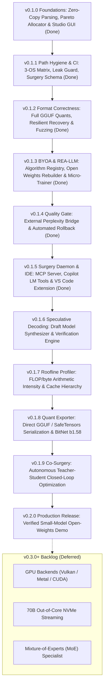

# THME: Topological Heterogeneous Manifold Engine

<p align="center">
  
</p>

<p align="center">
  <strong>Topological Heterogeneous Manifold Engine (THME) by Epiphanes</strong><br>
  <em>Open-source framework for Large Language Model memory profiling, zero-copy weight analysis, live token flow telemetry, and automated Teacher LLM architecture surgery.</em>
</p>

<p align="center">
  
  
  
  
  <a href="https://github.com/EdEpiphanes/THME-Epiphanes/actions/workflows/ci.yml"></a>
  
  
  
</p>

<p align="center">
  <a href="#overview">Overview</a> •
  <a href="#desktop-studio-showcase">Desktop Studio</a> •
  <a href="#vs-code--github-copilot-extension">IDE Extension & Copilot</a> •
  <a href="#cli-tools">CLI Tools</a> •
  <a href="#teacher-llm-surgery">Teacher LLM Surgery</a> •
  <a href="ROADMAP.md">Roadmap</a> •
  <a href="BACKLOG.md">Backlog</a> •
  <a href="CHANGELOG.md">Changelog</a> •
  <a href="#quickstart">Quickstart</a>
</p>

---

## Overview

**THME (Topological Heterogeneous Manifold Engine)** by **Epiphanes** profiles and optimizes Large Language Models using heterogeneous precision allocation and sequential execution. Rather than applying a single uniform bit-width across an entire model, THME measures the topological sensitivity of each attention projection and feed-forward block, building a Pareto-optimal precision plan constrained by quality gates ($Q_{\text{candidate}} \ge Q_{\text{baseline}} - \epsilon$).

Built in pure Rust without external runtime dependencies:
- **Universal model importer**: Zero-copy memory-mapped parsing of GGUF v2/v3 and SafeTensors files or sharded directories, with fallback architecture deduction when `config.json` is absent.
- **Distillation and matrix transformation engine**: Implementations of Truncated SVD, Walsh-Hadamard orthogonal rotation, SmoothQuant per-channel scaling, BitNet b1.58 absmean ternary quantization, and 2:4 semi-structured sparsity.
- **Automated parameter decision engine**: Analyzes spectral energy, condition number, and outlier kurtosis for each tensor, assigning the mathematically optimal algorithm per parameter.
- **Layer tweaker and section inspector**: Adjusts layer sequence mixers, precision allocations, scale factors, bias offsets, and pruning thresholds, with interactive 8x8 weight slice matrices and 32-bin histograms.
- **Live token flow and full benchmark suite**: Simulates token generation across 13 Transformer stages with 60 FPS telemetry, batch scaling analysis ($B=1 \dots 64$), and context window KV cache projections.
- **History checkpoints and audit trail**: Records immutable snapshots for instant configuration rollback and a searchable, structured compliance audit stream.
- **Teacher LLM surgery engine**: Declarative JSON recipe format allowing automated agents to adjust layer precisions, replace sequence mixers, and prune components.
- **Standalone native desktop studio**: Compiles to a 5.8 MB zero-dependency executable ([`THME-Studio.exe`](file:///THME-Studio.exe)).

---

## Desktop Studio Showcase

Launch the native desktop application on Windows, macOS, or Linux:
```bash
thme gui
# Or run the dedicated binaries:
thme-gui
./THME-Studio.exe
```

---

## VS Code & GitHub Copilot Extension

THME provides native IDE integration via a packaged Visual Studio Code extension (`editors/vscode/`) and a Model Context Protocol (MCP) server:

<p align="center">
  
  
  
</p>

### 1. Live AI Debugging & Surgery via GitHub Copilot
In VS Code, open GitHub Copilot Chat (`@copilot`) to inspect, analyze, and perform surgery directly in conversational sessions:
- `@copilot /thme_copilot_inspect`: Inspect active model layer topology, memory footprints, and quantization bottlenecks.
- `@copilot /thme_copilot_surgery`: Generate and execute surgical recipes directly against memory-mapped model weights.
- `@copilot /thme_copilot_validate`: Benchmark baseline vs. candidate perplexity against WikiText-2 and C4.

### 2. Activity Bar Sidebar & Telemetry Tree
- **Active Model & Layer Anatomy**: Real-time layer deconstruction, component role detection (Q/K/V/O, MLP Gate/Up/Down), and sparsity metrics.
- **Pareto Precision Plan**: Live parameter precision allocations (FP16, INT8, INT4, Ternary/BitNet b1.58, 2:4 Sparse).
- **REA-LLM & EWHA Telemetry**: Memory traffic calculations, bandwidth reduction factors, and energy consumption accounting (Joules/token).
- **Copilot Live Tools**: One-click actions to launch the 60 FPS Native Studio GUI, run AutoDecider, and test quality gates.

### 3. Universal MCP Server (`thme mcp`)
For Claude Desktop, Cursor, Antigravity, or other AI agents, THME provides a zero-dependency standard MCP server:
```bash
# Start the JSON-RPC stdio server:
thme mcp
# Or via alias:
llm-tweaker daemon
```

Wire into any agent's `mcp.json`:
```json
{
  "mcpServers": {
    "thme": {
      "command": "thme",
      "args": ["mcp"]
    }
  }
}
```

### 4. Installing the VSIX Extension
```bash
cd editors/vscode
npm run package
code --install-extension thme-vscode-0.1.4.vsix
```

```text
+---------------------------------------------------------------------------------------------------------+
| [●][●][●] [THME]  THME STUDIO v0.1.2 // EPIPHANES TOPOLOGICAL MANIFOLD ENGINE      [Obsidian Cyan] [60 FPS] |
| Llama-3-8B [GGUF • LLAMA] (32 Layers • Hidden Dim 4096 • 8030M Params)                                  |
+---------------------------------------------------------------------------------------------------------+
| [Master Dashboard] [Models] [Layer Tweaker] [Matrix Engine] [Benchmarks] [History] [Audit Log] [Surgery] |
+---------------------------------------------------------------------------------------------------------+
|  THROUGHPUT: 44.2 tok/s  |  VRAM STORAGE: 4.2 GB  |  PARETO RETENTION: 98.92%  |  STATUS: 13-STAGE LIVE |
+---------------------------------------------------------------------------------------------------------+
```

### The 8 Interactive Studio Workspaces

| Workspace Tab | Focus | Core Capabilities |
|---|---|---|
| **Master Dashboard** | Unified command cockpit | Consolidates model health cards, live neural token flow animation, layer sensitivity curves, quick optimization actions, and recent history and audit events. |
| **Models Manager** | Repository & inventory | Multi-model slot manager with GGUF and SafeTensors importers, synthetic model generators, and a sortable tensor inventory registry. |
| **Layer Tweaker & Sections** | Fine-grained surgery | Drill down into any layer: tweak sequence mixers (GQA, Gated DeltaNet, Phase Recurrence, Sliding Window, Mamba-2), precision mix ($\alpha, \beta, \gamma$), scale, bias, and pruning. Inspect Attention Q/K/V/O, MLP Gate/Up/Down, and Norm sections with 8x8 weight slices and 32-bin histograms. |
| **Distillation & Matrix Engine** | Linear algebra transformations | Implements Truncated SVD, Walsh-Hadamard rotation, SmoothQuant, BitNet b1.58, 2:4 sparsity, and Knowledge Distillation feature alignment. Includes the **Automated Parameter Decider** that evaluates every parameter tensor and executes global Pareto transformation plans. |
| **Full Benchmarks** | Multi-dimension profiling | Live 13-stage Transformer flow simulator with animated telemetry, batch size scaling ($B = 1, 4, 8, 16, 32, 64$), context length scaling ($512 \dots 8192$), and layer latency waterfalls. |
| **History & Checkpoints** | Audit and rollback | Immutable snapshots of tuning sessions, before/after scorecard diffs, one-click state restoration, and JSON history report export. |
| **Audit Log** | Structured event stream | Filterable chronological event log with severity classification (`OPTIMIZE`, `DISTILL`, `SURGERY`, `BENCHMARK`, `INFO`, `WARN`), query search, and CSV export. |
| **Export & Surgery** | Model artifacts & JSON recipes | Exports tuned models to SafeTensors, GGUF, or THME bundles. Includes a multiline JSON specification editor and executor for Teacher LLM restructuring recipes. |

---

## CLI Tools

THME provides dual-binary CLI support (`thme` or legacy alias `llm-tweaker`):

### Inspect model weights
Scan local GGUF or SafeTensors files zero-copy:
```bash
thme inspect models/llama-3-8b.gguf
thme inspect /path/to/huggingface-dir --json
```

`	ext
=== THME Model Inspection Summary ===
+-----------------------+-----------------------------+
| Property              | Value                       |
+-----------------------+-----------------------------+
| Model Name            | llama-3-8b                  |
| Architecture          | Llama-family                |
| Total Parameters      | 8.03 B (8030261248)         |
| Raw Weight Size       | 14.96 GB                    |
| Hidden Size           | 4096                        |
| Number of Layers      | 32                          |
| Attention Heads (Q)   | 32                          |
| Key-Value Heads (KV)  | 8 (Grouped-Query GQA)       |
| Head Dimension        | 128                         |
| Vocabulary Size       | 128256                      |
| Max Context Length    | 8192                        |
| Total Tensors         | 291                         |
+-----------------------+-----------------------------+
`

### Profile layer sensitivity and KV cache
Project memory scaling across context windows from 1k to 128k+ tokens:
```bash
thme profile models/llama-3-8b.gguf --batch-size 1 --context-lengths 2048,8192,32768,131072
```

### Generate Pareto precision allocation
Compute a precision plan targeting a specific memory budget:
```bash
thme plan models/llama-3-8b.gguf --budget-gb 8.0 --output optimization_plan.json
```

### Apply Teacher LLM surgery recipe
Execute transformation recipes created by automated Teacher LLMs:
```bash
thme tweak --model models/llama-3-8b.gguf --recipe recipes/deltanet_hybrid.json --output models/restructured.json
```

### Evaluate quality gates
Validate candidate scores against baseline benchmarks with directional checking (lower-is-better for Perplexity; higher-is-better for Accuracy):
```bash
thme validate --baseline 85.0 --candidate 84.4 --max-degradation 1.0
thme validate --suite-file configs/quality_gates.yaml
```

---

## Teacher LLM Surgery

External AI agents can programmatically restructure imported models by writing declarative JSON recipes:

```json
{
  "name": "THME-Optimal-Heterogeneous-Recipe",
  "author": "Teacher-LLM-AutoTuner",
  "target_model": "Llama-3-8B",
  "version": "1.0",
  "description": "Restructures dense Transformer layers into hybrid DeltaNet/Phase recurrence and mixed-precision representation.",
  "operations": [
    {
      "type": "SetPrecision",
      "params": {
        "start_layer": 0,
        "end_layer": 1,
        "role": null,
        "format": "FP16"
      }
    },
    {
      "type": "SetPrecision",
      "params": {
        "start_layer": 2,
        "end_layer": 28,
        "role": "MlpGate",
        "format": "Ternary"
      }
    },
    {
      "type": "ReplaceMixer",
      "params": {
        "layer": 1,
        "mixer_type": "gated_deltanet"
      }
    },
    {
      "type": "ConfigureEarlyExit",
      "params": {
        "checkpoint_layer": 8,
        "confidence_threshold": 0.85,
        "target_exit_ratio": 80.0
      }
    },
    {
      "type": "QuantizeKvCache",
      "params": {
        "format": "INT8"
      }
    }
  ],
  "expected_speedup": 2.15,
  "expected_memory_savings_pct": 68.5
}
```

Applying this recipe computes instant diffs:
```text
[Surgery Started] Applying recipe 'THME-Optimal-Heterogeneous-Recipe' by Teacher-LLM-AutoTuner
Applied precision FP16 to layers 0..=1 (role: None)
Applied precision Ternary to layers 2..=28 (role: Some(MlpGate))
Replaced Layer 1 sequence mixer with 'gated_deltanet'
Configured Early-Exit at Layer 8 (Threshold: 0.85, Exit Target: 80%)
Quantized KV Cache global format to INT8
[Surgery Complete] 29 tensors restructured. Storage saved: 4120.4 MB (64.2%), Estimated Speedup: 2.18x
```

---

## Mathematical Foundation

The scientific architecture is documented in [`docs/research/THME_Research_Programme_v2.pdf`](docs/research/THME_Research_Programme_v2.pdf).

### KV cache memory formula
Autoregressive generation stores historical Key and Value representations. THME computes this footprint using:
$$M_{\mathrm{KV}} = 2 \times L \times B \times S \times H_{\mathrm{KV}} \times D_{\mathrm{head}} \times \text{bytes}$$
where $L$ is layer count, $B$ is batch size, $S$ is context sequence length, $H_{\mathrm{KV}}$ is key-value head count (distinguishing Grouped-Query Attention from Multi-Head Attention), and $D_{\mathrm{head}}$ is head dimension.

### Adaptive speculative early-exit routing
Tokens evaluate confidence at checkpoint layer $L_{\mathrm{exit}}$. Layer reach probability is:
$$q_l = \begin{cases} 1.0 & \text{if } l \leq L_{\mathrm{exit}} \\ 1.0 - p_{\mathrm{exit}} & \text{if } l > L_{\mathrm{exit}} \end{cases}$$
Mean computational depth fraction is $\bar{f} = \frac{1}{N} \sum_{l=0}^{N-1} q_l$, reducing memory bandwidth consumption accordingly.

### Layerwise parabolic sensitivity
Perturbation tests indicate that initial projection layers and terminal output heads are more sensitive to quantization noise, while intermediate layers tolerate lower precision:
$$s(l) = s_{\mathrm{base}} + 4 \cdot \Delta_{\mathrm{depth}} \cdot \left(\frac{l}{N - 1} - 0.5\right)^2$$

---

## Production Roadmap (v0.1 to v0.2)

Detailed milestone definitions and exit criteria are specified in [ROADMAP.md](ROADMAP.md). Engineering tickets and completion checklists are actively tracked in [BACKLOG.md](BACKLOG.md).



- **v0.1.0 (Released):** Zero-copy SafeTensors and GGUF v2/v3 memory-mapped parsing, Pareto allocator, 60 FPS Desktop Studio with 5 themes, matrix distillation engine, token flow simulator, audit logging, and declarative surgery recipes.
- **v0.1.1 (Released):** Rebranded to THME under Epiphanes, 3-OS GitHub Actions CI matrix, automated path-leak guard, tag-driven release publishing, zero clippy warnings, and surgery recipe JSON schema.
- **v0.1.2 (Completed):** Full GGUF v2/v3 quantization matrix (28 GGML types including K-quants and I-quants), zero-allocation block decoders (`Q4_0`, `Q4_1`, `Q5_0`, `Q8_0`), truncated stream recovery, and infallible 1,000-iteration parser fuzz testing suite.
- **v0.1.3 (Completed):** Bring Your Own Algorithm (BYOA) registry with JSON import/export, architecture rebuilder from scratch, open weights remapping, REA-LLM EWHA routing & energy telemetry, layer anatomy deconstruction, multi-format dataset ingestion, non-conventional experimentation lab, and on-device micro-trainer.
- **v0.1.4 (Completed):** Empirical Quality Gate & Perplexity Verification Bridge (WikiText-2, C4, PTB) with automated rollback gating ($\Delta PPL \le \epsilon$), and enhanced CLI `validate` reporting.
- **v0.1.5 (Completed):** Headless JSON-RPC Model Context Protocol (MCP) server (`thme mcp`), VS Code extension packaging (`thme-vscode-0.1.4.vsix`), Language Model Tools for GitHub Copilot (`thme_copilot_inspect`, `thme_copilot_surgery`, `thme_copilot_validate`), and real-time AI debugging.
- **v0.1.6 (Planned):** Speculative Decoding Synthesizer: draft model manifold extraction from early-exit checkpoints and multi-token tree verification simulation.
- **v0.1.7 (Planned):** Roofline & Kernel Profiler: hardware-calibrated Arithmetic Intensity vs. Memory Bandwidth roofline model with L1/L2/L3/HBM cache hierarchy simulation.
- **v0.1.8 (Planned):** Direct binary serialization to deployable GGUF and SafeTensors files with BitNet b1.58 ternary packed weights and calibrated per-channel scales.
- **v0.1.9 (Planned):** Closed-Loop Teacher Surgery: autonomous Teacher-Student co-surgery optimization daemon with iterative recipe generation and delta-PPL verification.
- **v0.2.0 (Target):** Verified production deployment on real open weights (SmolLM-135M / LLaMA-3.2-1B) with reproducible before-and-after benchmarks and signed release binaries.

---

## Quickstart

### Prerequisites
- [Rust Toolchain](https://rustup.rs/) (edition 2021, Rust >= 1.80)

### Installation
```bash
git clone https://github.com/EdEpiphanes/THME-Epiphanes.git
cd THME
cargo build --release
```

The compiled binaries will be available in:
- `target/release/thme` (Primary CLI)
- `target/release/llm-tweaker` (Alias binary)
- `target/release/thme-gui` (Standalone Native Desktop Studio)
- [`THME-Studio.exe`](file:///THME-Studio.exe) (Root standalone executable)

### Run Tests
```bash
cargo test
```

---

## Contributing & Community

THME is an open-source project by Epiphanes. We welcome contributions, RFCs, bug reports, and research extensions:
- Review [CONTRIBUTING.md](CONTRIBUTING.md) for architecture guidelines and coding standards.
- Read [CODE_OF_CONDUCT.md](CODE_OF_CONDUCT.md).
- Security policy is documented in [SECURITY.md](SECURITY.md).

---

## License

Licensed under the [Apache License, Version 2.0](LICENSE).

