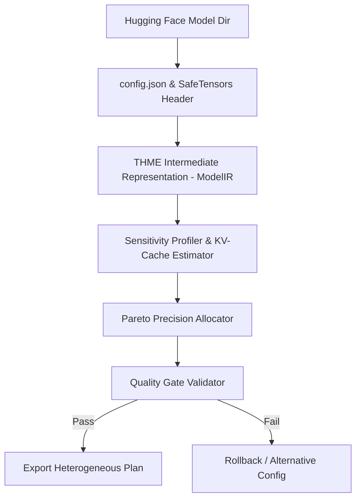

# LLM-Tweaker / THME

<p align="center">
  <strong>Topological Heterogeneous Manifold Engine (THME)</strong><br>
  <em>High-performance, pure Rust framework for LLM weight analysis, KV-cache projection, sensitivity profiling, and heterogeneous precision allocation.</em>
</p>

<p align="center">
  <a href="#key-features">Key Features</a> •
  <a href="#quickstart">Quickstart</a> •
  <a href="#cli-usage">CLI Usage</a> •
  <a href="#architecture">Architecture</a> •
  <a href="#roadmap">Roadmap</a> •
  <a href="#contributing">Contributing</a>
</p>

---

## Overview

**LLM-Tweaker (THME)** transforms large language models into memory-efficient, low-latency inference artifacts without indiscriminate uniform quantization. Instead of blindly compressing every weight to 4-bit, THME profiles the topological manifold sensitivity of each attention layer and MLP block, automatically generating a **Pareto-optimal heterogeneous precision plan** with strict anti-degradation quality gates ($Q_{\text{optimized}} \geq Q_{\text{baseline}} - \epsilon$).

Built entirely in **Rust**, THME features:
- **Zero-Copy Memory-Mapped SafeTensors**: Instantly inspect multi-gigabyte models without allocating full model weights in RAM.
- **Accurate KV-Cache Projections**: Mathematically models autoregressive KV-cache memory requirements across context windows up to 128k+ tokens.
- **Layer-Wise Manifold Sensitivity**: Pinpoints robust vs. sensitive layers across model depth.
- **Pareto Heterogeneous Allocator**: Balances VRAM targets against task retention.
- **Strict Quality Gates**: Rejects degraded models and verifies regression suites.

---

## Key Features

- ⚡ **Zero-Copy SafeTensors Scanner**: Instant sharded tensor inventory via `memmap2`.
- 📐 **KV-Cache Memory Curve**: Evaluates $M_{\text{KV}} = 2 \times L \times B \times S \times H_{\text{KV}} \times D_{\text{head}} \times \text{bytes}$ across varying context lengths.
- 🎯 **Topological Sensitivity Profiler**: Estimates per-layer perturbation sensitivity.
- 📊 **Multiobjective Pareto Precision**: Allocates mixed precision (FP16, INT8, Q4_0, Ternary 1.58b) to maximize efficiency while preserving model capabilities.
- 🛡️ **Automated Quality Gate**: Enforces user-configured degradation thresholds ($\epsilon$) to ensure models remain production-ready.
- 📦 **Dual Binary Support**: Run commands seamlessly via `thme` or `llm-tweaker`.

---

## Quickstart

### Prerequisites
- [Rust Toolchain](https://rustup.rs/) (edition 2021, Rust >= 1.80)

### Installation
```bash
git clone https://github.com/TechTroniX/LLM-Tweaker.git
cd LLM-Tweaker
cargo build --release
```

The compiled binaries will be available in `target/release/thme` and `target/release/llm-tweaker`.

---

## CLI Usage

### 0. Launch the Interactive Native Desktop Studio
You can launch the GPU-accelerated desktop application natively on Windows, macOS, or Linux without opening any browser:
```bash
thme gui
# Or run the dedicated binary:
thme-gui
```
* **Tab 1: Layerwise Distribution Matrix**: Independent per-layer sliders for $\alpha$ (1-bit XNOR), $\beta$ (Ternary BitNet), and $\gamma$ (Phase recurrence) enforcing $\alpha + \beta + \gamma = 100\%$.
* **Tab 2: Baseline LLM Profiler**: Evaluates unquantized model speed (tok/s), TTFT, KV cache, and latency waterfall.
* **Tab 3: Sequential Layer Auto-Tuner**: AirLLM-style iterative optimization loop that tests candidate configurations layer-by-layer and locks in the optimal Pareto distribution against quality gate $\epsilon_{\text{tol}}$.
* **Tab 4: Architecture DAG**: Real-time topological manifold graph displaying layer reach probabilities and adaptive early-exit checkpoint branches.
* **Tab 5: Weight Studio**: Statistical weight distributions, histograms, and discrete phase constellation angles on the unit circle.
* **Tab 6: Export Studio**: Ship the restructured and tuned LLM artifact in SafeTensors, GGUF, or THME bundle formats.

### 1. Inspect Model Weights & Architecture
Scan a local model directory (or SafeTensors file) in milliseconds:
```bash
thme inspect /path/to/model-weights
```

To output raw JSON for automated scripts:
```bash
thme inspect /path/to/model-weights --json
```

### 2. Profile Layer Sensitivity & KV-Cache
Analyze layer sensitivity and project KV-cache footprint across context lengths:
```bash
thme profile /path/to/model-weights --batch-size 1 --context-lengths 2048,8192,32768,131072
```

Save profiling results directly to JSON:
```bash
thme profile /path/to/model-weights --output profile.json
```

### 3. Generate Heterogeneous Pareto Plan
Compute an optimal precision plan targeting a specific VRAM budget:
```bash
thme plan /path/to/model-weights --budget-gb 8.0 --output optimization_plan.json
```

Or target maximum allowed degradation:
```bash
thme plan /path/to/model-weights --max-degradation 1.5
```

### 4. Enforce Quality Gate
Test candidate scores against baseline benchmarks:
```bash
thme validate --baseline 85.0 --candidate 84.4 --max-degradation 1.0
```

Or pass a multi-task benchmark suite JSON file:
```bash
thme validate --suite-file benchmarks.json
```

### 5. Export Markdown Reports
Export a clean, human-readable markdown report of the optimization plan:
```bash
thme report optimization_plan.json --markdown report.md
```

---

## Architecture



---

## VS Code Extension Integration

The repository comes pre-configured with complete configuration for VS Code and its developer extension harness in [.vscode/](file:///.vscode/):

| Installed Extension | Configured Capability in Workspace |
|---|---|
| **rust-analyzer** (`rust-lang.rust-analyzer`) | Type inlay hints, parameter hints, clippy check-on-save, and macro expansions. |
| **CodeLLDB** (`vadimcn.vscode-lldb`) | Pre-configured `launch.json` targets for debugging `thme` CLI, `thme-gui` Desktop Studio, and integration test suites. |
| **Even Better TOML** (`tamasfe.even-better-toml`) | Formats and validates `Cargo.toml`. |
| **Dependi** (`fill-labs.dependi`) | Visual inline crate version badges and update alerts. |
| **Test Explorer** (`hbenl.vscode-test-explorer`, `swellaby.vscode-rust-test-adapter`) | Native UI test runner for running individual tests with one click. |
| **GitLens** (`eamodio.gitlens`) | Inline blame and repository git history tracking. |

### Debugging with CodeLLDB
Press **`F5`** in VS Code to immediately start debugging:
1. `Debug THME Desktop Studio (GUI)`
2. `Debug THME CLI (inspect mock_llama)`
3. `Debug THME CLI (profile mock_llama)`
4. `Debug THME CLI (plan Pareto allocation)`
5. `Debug Integration Tests (test_ir)`

### VS Code Tasks
Open the Command Palette (`Ctrl+Shift+P`) and type `Tasks: Run Task` to run:
* `cargo build (Debug / Release)`
* `cargo clippy`
* `cargo test`
* `Launch THME Native Desktop Studio`
* `Generate Mock Model`

---

## Roadmap

| Milestone | Component | Status |
|---|---|---|
| **v0.1** | SafeTensors zero-copy importer, ModelIR, KV-cache & Sensitivity engine, Pareto planner, Quality Gate, CLI | ✅ Complete |
| **v0.2** | Physical quantizer engine for INT8/Q4_0, direct weight export | 🔄 In Progress |
| **v0.3** | Ternary (1.58-bit) & 1.5-bit experimental bit-packing kernels | 📅 Planned |
| **v0.4** | Runtime backend integration (GGUF / llama.cpp / Candle) | 📅 Planned |
| **v0.5** | Teacher-assisted recovery & distillation engine | 📅 Planned |

---

## Contributing

We welcome contributions from the open-source community! Whether you want to add support for new architectures, contribute quantization kernels, or improve sensitivity profiling:
- See [CONTRIBUTING.md](CONTRIBUTING.md) for contribution guidelines.
- Review our [CODE_OF_CONDUCT.md](CODE_OF_CONDUCT.md).

---

## License

Licensed under the [Apache License, Version 2.0](LICENSE).
