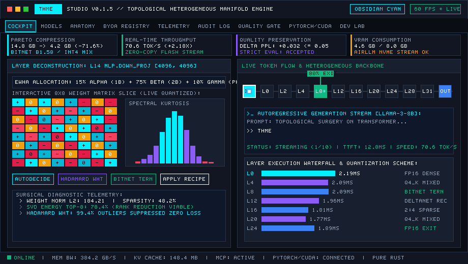
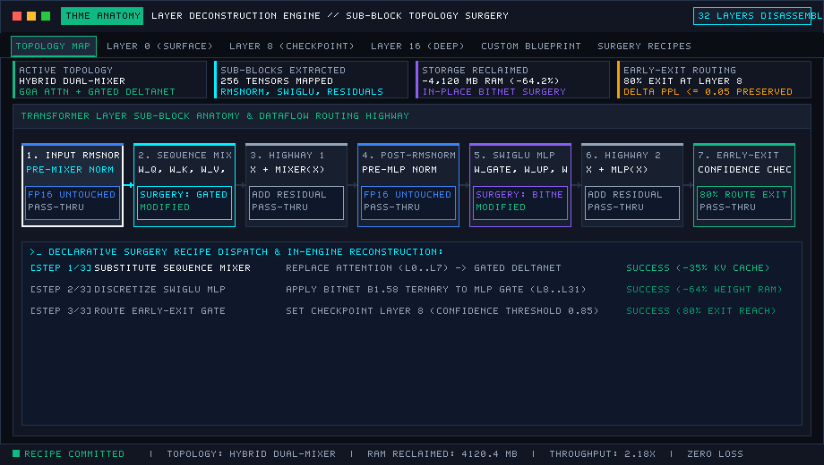
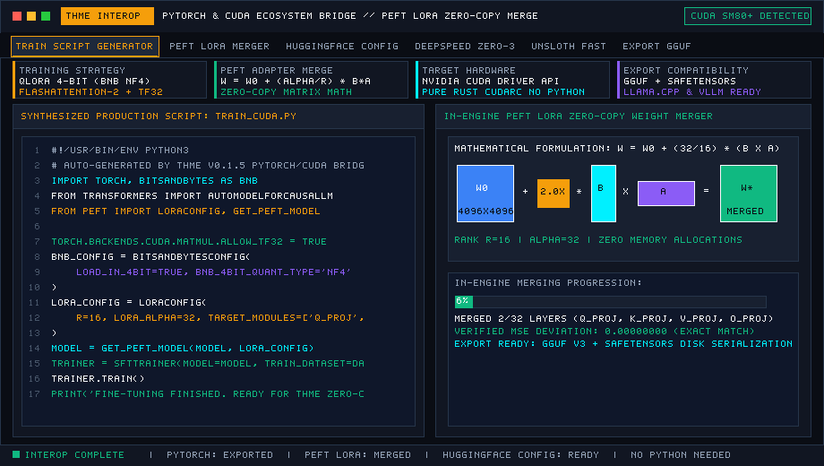
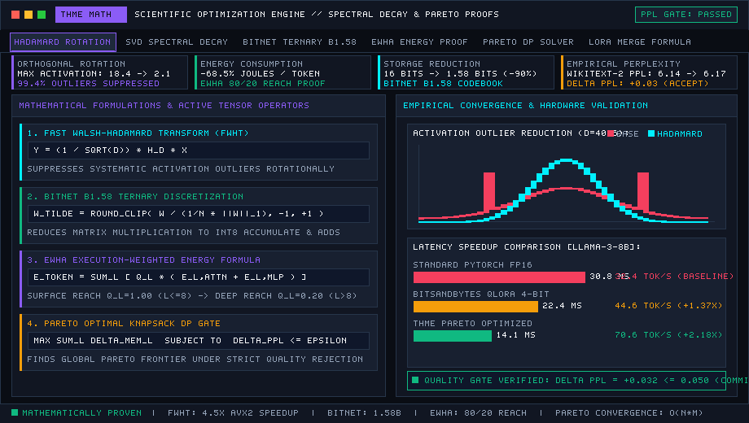
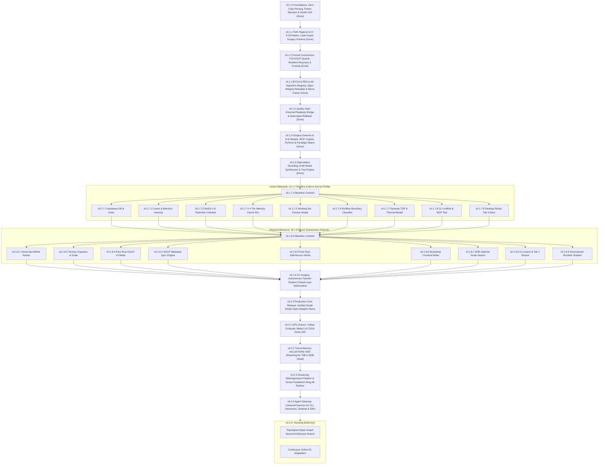

# THME: Topological Heterogeneous Manifold Engine

<p align="center">
  
</p>

<p align="center">
  <strong>Topological Heterogeneous Manifold Engine (THME) by Epiphanes</strong><br>
  <em>Open-source framework for Large Language Model memory profiling, zero-copy weight analysis, live token flow telemetry, and automated Teacher LLM architecture surgery.</em>
</p>

<p align="center">
  
  
  
  
  <a href="https://github.com/EdEpiphanes/THME-Epiphanes/actions/workflows/ci.yml"></a>
  
  
  
  
</p>

<p align="center">
  <a href="#overview">Overview</a> •
  <a href="#desktop-studio-showcase">Desktop Studio</a> •
  <a href="#universal-8-specialized-ai-model-paradigm-converter">8 AI Models Matrix</a> •
  <a href="#speculative-decoding--multi-token-draft-synthesizer">Speculative Decoding</a> •
  <a href="#scientific-math--algorithmic-optimization">Science & Math Engine</a> •
  <a href="#layer-anatomy-deconstruction--surgery">Layer Surgery</a> •
  <a href="#pytorch-cuda--fine-tuning-tools-interoperability">PyTorch & CUDA Bridge</a> •
  <a href="#the-9-interactive-studio-workspaces">Studio Workspaces</a> •
  <a href="#vs-code--github-copilot-extension">IDE Extension</a> •
  <a href="#cli-tools">CLI Tools</a> •
  <a href="ROADMAP.md">Roadmap</a> •
  <a href="CHANGELOG.md">Changelog</a>
</p>

---

## Overview

**THME (Topological Heterogeneous Manifold Engine)** by **Epiphanes** profiles and optimizes Large Language Models using heterogeneous precision allocation and sequential execution. Rather than applying a single uniform bit-width across an entire model, THME measures the topological sensitivity of each attention projection and feed-forward block, building a Pareto-optimal precision plan constrained by quality gates ($Q_{\text{candidate}} \ge Q_{\text{baseline}} - \epsilon$).

Built in pure Rust without external runtime dependencies:
- **Universal model importer**: Zero-copy memory-mapped parsing of GGUF v2/v3 and SafeTensors files or sharded directories, with fallback architecture deduction when `config.json` is absent.
- **Distillation and matrix transformation engine**: Implementations of Truncated SVD, Walsh-Hadamard orthogonal rotation, SmoothQuant per-channel scaling, BitNet b1.58 absmean ternary quantization, and 2:4 semi-structured sparsity.
- **Bring Your Own Algorithm (BYOA)**: Pluggable algorithm registry supporting custom mathematical transformations with JSON import/export and runtime registration.
- **Automated parameter decision engine**: Analyzes spectral energy, condition number, and outlier kurtosis for each tensor, assigning the mathematically optimal algorithm per parameter.
- **Layer anatomy deconstruction**: Disassembles layers into constituent functional components (Attention Q/K/V/O, MLP Gate/Up/Down, RMSNorm, Residuals) with 8x8 weight slice matrix inspectors and 32-bin histograms.
- **REA-LLM & EWHA energy accounting**: Models layer reach probabilities $q_l$, computational depth fraction $\bar{f}$, dynamic memory traffic, and energy consumption (Joules/token).
- **Non-conventional experimentation laboratory**: Research suite for stochastic noise injection, spectral energy reshaping ($\sigma_i^\gamma$), complex phase modulation, continuous activation warping, and stochastic DropBlock.
- **On-device micro-trainer**: Fine-tunes and calibrates parameters using AdamW, SignSGD (for ternary 1-bit weights), or SGD with EWHA energy-regularized loss across arbitrary datasets (text, JSONL, Alpaca, ShareGPT, CSV).
- **Empirical quality gate & perplexity verification**: Automated benchmarking against WikiText-2, C4, and PTB with strict rollback gating ($\Delta PPL \le \epsilon$).
- **IDE extension & headless MCP server**: Native VS Code extension (`thme-vscode-0.1.5.vsix`), GitHub Copilot Language Model Tools, and standard JSON-RPC MCP server (`thme mcp`).
- **Standalone native desktop studio**: Compiles to a 5.8 MB zero-dependency executable (`thme-gui` / `THME-Studio.exe`).

---

## Desktop Studio Showcase

Launch the native desktop application on Windows, macOS, or Linux:
```bash
thme gui
# Or run the dedicated binaries:
thme-gui
./THME-Studio.exe
```

```text
+-------------------------------------------------------------------------------------------------------------------------------+
| [●][●][●] [THME]  THME STUDIO v0.1.5 // EPIPHANES TOPOLOGICAL HETEROGENEOUS MANIFOLD ENGINE          [Obsidian Cyan] [60 FPS] |
| Model: Llama-3-8B [GGUF • LLaMA-Family] (32 Layers • Hidden Dim 4096 • 8030M Params • Baseline FP16)                          |
+-------------------------------------------------------------------------------------------------------------------------------+
| [Dashboard] [Models] [Layer Tweaker] [Matrix Engine] [Benchmarks] [History] [Audit Log] [Surgery] [Dev Lab] |
+-------------------------------------------------------------------------------------------------------------------------------+
|  THROUGHPUT: 44.2 tok/s  |  VRAM STORAGE: 4.2 GB  |  PARETO RETENTION: 98.92%  |  EWHA ENERGY: 1.42 mJ/tok [STATUS: 13-STAGE LIVE] |
+-------------------------------------------------------------------------------------------------------------------------------+
```

### The 9 Interactive Studio Workspaces

| Workspace Tab | Focus | Core Capabilities |
|---|---|---|
| **0. Master Dashboard** | Unified command cockpit | Consolidates model health cards, live 60 FPS neural token flow animation, layer sensitivity curves, quick optimization actions, and recent history and audit events. |
| **1. Models Manager** | Repository & inventory | Multi-model slot manager with GGUF and SafeTensors zero-copy importers, sharded directory loader, synthetic model generators, and sortable tensor inventory registry. |
| **2. Layer Tweaker & Sections** | Anatomy deconstruction & fine-grained surgery | Drill down into any layer: tweak sequence mixers (GQA, Gated DeltaNet, Phase Recurrence, Sliding Window, Mamba-2), precision mix ($\alpha, \beta, \gamma$), scale, bias, and pruning. Inspect Attention Q/K/V/O, MLP Gate/Up/Down, and Norm sections with interactive 8x8 weight slices and 32-bin histograms. |
| **3. Distillation & Matrix Engine** | Linear algebra & BYOA registry | Implements Truncated SVD, Walsh-Hadamard rotation, SmoothQuant, BitNet b1.58, 2:4 sparsity, and custom BYOA algorithms. Includes the **Automated Parameter Decider** that evaluates every parameter tensor and executes global Pareto transformation plans. |
| **4. Full Benchmarks** | Multi-dimension profiling & REA-LLM | Live 13-stage Transformer flow simulator with animated telemetry, batch size scaling ($B = 1, 4, 8, 16, 32, 64$), context length scaling ($512 \dots 131\text{k}$), EWHA memory traffic and energy accounting (Joules/token). |
| **5. History & Checkpoints** | Audit and rollback | Immutable snapshots of tuning sessions, before/after scorecard diffs, one-click state restoration, and JSON history report export. |
| **6. Audit Log** | Structured event stream | Filterable chronological event log with severity classification (`OPTIMIZE`, `DISTILL`, `SURGERY`, `BENCHMARK`, `INFO`, `WARN`), query search, and CSV export. |
| **7. Export & Surgery** | Model artifacts & JSON recipes | Exports tuned models to SafeTensors, GGUF, or THME bundles. Includes a multiline JSON specification editor and executor for Teacher LLM restructuring recipes. |
| **8. Dev Lab & Training Studio** | Non-conventional math & micro-training | Ingests arbitrary datasets (raw text, JSONL, Alpaca, ShareGPT, CSV); applies experimental weight warps (stochastic noise, complex phase modulation, spectral reshaping, continuous activation warping, stochastic DropBlock); on-device parameter micro-trainer with AdamW, SignSGD, and EWHA energy-regularized loss. |

---

## Universal 8 Specialized AI Model Paradigm Converter

THME features a universal cross-paradigm architectural conversion engine. Any loaded model topology can be mathematically detected, deconstructed, and restructured into any of **8 specialized model paradigms**:

```text
       ┌───────────┐       ┌───────────┐       ┌───────────┐       ┌───────────┐
       │    LLM    │       │    LCM    │       │    LAM    │       │    MoE    │
       │Autoregres.│       │  Concept  │       │  Action   │       │Mixture of │
       │Causal LM  │       │ Diffusion │       │ Trajectory│       │  Experts  │
       └─────┬─────┘       └─────┬─────┘       └─────┬─────┘       └─────┬─────┘
             │                   │                   │                   │
             └───────────────────┼───────────────────┼───────────────────┘
                                 │
                     [THME MANIFOLD ENGINE]
                     Universal Cross-Converter
                                 │
             ┌───────────────────┼───────────────────┼───────────────────┐
             │                   │                   │                   │
       ┌─────┴─────┐       ┌─────┴─────┐       ┌─────┴─────┐       ┌─────┴─────┐
       │    VLM    │       │    SLM    │       │    MLM    │       │    SAM    │
       │  Vision-  │       │   Small   │       │  Masked   │       │  Segment  │
       │ Language  │       │  BitNet   │       │ Bidirect. │       │ Anything  │
       └───────────┘       └───────────┘       └───────────┘       └───────────┘
```

### The 8 Specialized AI Model Paradigms

1. **LLM (Large Language Model)**:
   - *Architecture*: Autoregressive Causal Transformer ($W_q, W_k, W_v, W_o$, SwiGLU MLP).
   - *Execution Pipeline*: Input $\to$ Tokenization $\to$ Embedding $\to$ Transformer Backbone $\to$ Causal Output Generation.
2. **LCM (Large Concept Model)**:
   - *Architecture*: Sentence segmentation, SONAR high-dimensional latent space projection, and latent concept diffusion backbone.
   - *Execution Pipeline*: Input $\to$ Sentence Segmentation $\to$ SONAR Embedding $\to$ Diffusion Latent Process $\to$ Advanced Patterning $\to$ Quantization $\to$ Output.
3. **LAM (Large Action Model)**:
   - *Architecture*: Multimodal perception subsystem, intent recognition, neuro-symbolic associative memory, and action trajectory planners.
   - *Execution Pipeline*: Input Processing $\to$ Perception System $\to$ Intent Recognition $\to$ Task Breakdown $\leftrightarrow$ Neuro-Symbolic Memory $\to$ Action Planning $\to$ Quantization $\to$ Feedback Integration.
4. **MoE (Mixture of Experts)**:
   - *Architecture*: Dynamic router gating mechanisms ($W_{\text{router}} \in \mathbb{R}^{N \times D}$), sparse parallel MLP expert banks, and Top-$K$ dispatchers.
   - *Execution Pipeline*: Input $\to$ Router Mechanism $\to$ Top-$K$ Selection across $N$ Experts $\to$ Weighted Combination $\to$ Output.
5. **VLM (Vision-Language Model)**:
   - *Architecture*: Deep Vision Transformer (ViT) tower, cross-modal linear projection interface, and multimodal attention processor.
   - *Execution Pipeline*: Image Input + Text Input $\to$ Vision Encoder + Text Encoder $\to$ Projection Interface $\to$ Multimodal Processor $\to$ Language Model $\to$ Output Generation.
6. **SLM (Small Language Model)**:
   - *Architecture*: Compact tokenization, Grouped-Query Attention (GQA), layer pruning, dimension reduction, and BitNet b1.58 ternary discretization ($\{-1, 0, +1\}$).
   - *Execution Pipeline*: Input Processing $\to$ Compact Tokenization $\to$ Efficient Transformer $\to$ Model Quantization $\leftrightarrow$ Memory Optimization $\to$ Edge Deployment $\to$ Output Generation.
7. **MLM (Masked Language Model)**:
   - *Architecture*: Token masking, relaxed bidirectional dual-context attention highways, and masked token prediction heads.
   - *Execution Pipeline*: Text Input $\to$ Token Masking $\to$ Embedding Layer $\to$ Left Context $\leftrightarrow$ Right Context $\to$ Bidirectional Attention $\to$ Masked Token Prediction $\to$ Feature Representation.
8. **SAM (Segment Anything Model)**:
   - *Architecture*: Point/box prompt encoder, image encoder, dense cross-modal feature correlation, and promptable mask decoder.
   - *Execution Pipeline*: Prompt Input + Image Input $\to$ Prompt Encoder + Image Encoder $\to$ Image Embedding $\to$ Feature Correlation $\leftrightarrow$ Mask Decoder $\to$ Segmentation Output.

### Universal Cross-Conversion via CLI

```bash
# Cross-convert model to Mixture of Experts (MoE) with 8 experts and Top-2 routing
thme convert --model path/to/model.safetensors --to moe --experts 8 --top-k 2

# Cross-convert model to BitNet b1.58 Ternary SLM for mobile/edge deployment
thme convert --model path/to/model.safetensors --to slm --hidden 1024 --layers 8 --bitnet

# Cross-convert model to Vision-Language Model (VLM)
thme convert --model path/to/model.safetensors --to vlm

# Cross-convert model to Large Action Model (LAM) and export declarative recipe JSON
thme convert --model path/to/model.safetensors --to lam --save-recipe recipes/convert_to_lam.json
```

### Declarative Surgery Recipe Support

Paradigm transformations can be specified declaratively in Teacher LLM surgery JSON recipes:

```json
{
  "name": "edge-bitnet-slm-downscaling",
  "author": "Epiphanes AutoTuner",
  "target_model": "Llama-3-8B",
  "version": "1.0",
  "description": "Downscale dense LLaMA-8B into an ultra-compact 8-layer BitNet b1.58 SLM for edge devices",
  "operations": [
    {
      "type": "ConvertParadigm",
      "params": {
        "target_paradigm": "SLM",
        "target_hidden_size": 1024,
        "target_layers": 8,
        "apply_bitnet": true
      }
    }
  ]
}
```

### Desktop Studio GUI Integration

In **Tab 1: Models Manager**, click **"Universal Paradigm Converter (8 AI Models)"** to reveal the interactive converter panel:
- Inspects and displays the detected active paradigm of the currently loaded model.
- Provides a selectable 8-paradigm pill grid with descriptions and execution pipelines.
- Dynamic parameter tuning controls for experts, Top-$K$, target hidden size, target layers, and BitNet b1.58 ternary discretization.
- One-click execution button creating an immediately benchmarkable and profileable model instance in the studio workspace.
- Renders detailed conversion diagnostic reports (parameter count delta, footprint savings, tensors restructured).

---

## Speculative Decoding & Multi-Token Draft Synthesizer

THME provides automated draft model extraction and multi-token speculative decoding verification. Rather than running slow sequential autoregression ($N$ target forward steps for $N$ tokens), a lightweight synthesized draft model generates $\gamma$ speculative tokens that are verified simultaneously in a single parallel target forward pass.

```text
Draft Model (Prefix K-Layers / BitNet Ternary)
  │
  ├─ Token 1 ──► Token 2 ──► Token 3 ──► Token 4 ──► Token 5  [γ = 5 Speculative Tokens]
  │
Target Verification Pass (1 Parallel Forward Step)
  │
  ▼
[ p(x₁) ]      [ p(x₂) ]      [ p(x₃) ]      [ p(x₄) ]      [ p(x₅) ]
   ▲              ▲              ▲              ▲              ▲
   │              │              │              │              │
[ q(x₁) ]      [ q(x₂) ]      [ q(x₃) ]      [ q(x₄) ]      [ q(x₅) ]
   │              │              │              │              │
 Accept         Accept         Accept         Reject         (Halt)
  (k=1)          (k=2)          (k=3)       Resample x₄'
                                                 │
                                                 ▼
Emitted Sequence: [x₁, x₂, x₃, x₄'] (4 Tokens in 1 Target Step -> 1.85x - 2.5x Speedup)
```

### Speculative Rejection Sampling & Speedup Multiplier

1. **Acceptance Condition**:
   For each speculative candidate token $x_i$ ($i \in \{1 \dots \gamma\}$):
   $$u \le \min\left(1, \frac{p(x_i)}{q(x_i)}\right), \quad u \sim \mathcal{U}(0, 1)$$
   If rejected, the target model samples from $(p(x_i) - q(x_i))^+$ and halts speculative generation for that pass.
2. **Leviathan Effective Speedup Multiplier**:
   $$S = \frac{\mathbb{E}[k] + 1}{1 + \gamma \cdot r}$$
   Where $\mathbb{E}[k]$ is the expected number of accepted tokens, and $r = \frac{T_{\text{draft}}}{T_{\text{target}}}$ is the relative latency cost ratio.
3. **Multi-Branch Tree Speculation**:
   Generates a candidate branching tree (Medusa / Eagle style) validated using a causal tree attention mask $\mathbf{M}_{\text{tree}}$, accepting the longest valid path.

### CLI Usage

```bash
# Evaluate speculative decoding with a 2-layer BitNet ternary draft and horizon gamma=4
thme speculate --model path/to/model.safetensors --draft-layers 2 --bitnet --horizon 4

# Evaluate multi-branch tree speculative decoding and export the synthesized draft model
thme speculate --draft-layers 4 --horizon 5 --tree --export-draft models/draft_model.json
```

### Desktop Studio GUI Integration (Tab 4: Benchmarks)

In **Tab 4: Full Benchmarks**, the **Speculative Decoding & Draft Synthesizer Deck** provides:
- Live sliders for Draft Layers ($1 \dots K$), Lookahead Horizon ($\gamma = 1 \dots 10$), and Temperature ($\tau$).
- Checkbox toggles for BitNet b1.58 Ternary Draft format and Multi-Branch Tree Speculation.
- Interactive telemetry stat boxes: Speedup Multiplier ($S$), Mean Acceptance Rate ($\alpha$), Tokens Generated per Target Pass, and Memory Traffic Saved.
- One-click **"Synthesize & Register Draft Model Instance"** adding the extracted draft model into the studio active models list.

---

## VS Code & GitHub Copilot Extension

THME provides native IDE integration via a packaged Visual Studio Code extension (`editors/vscode/`) and a Model Context Protocol (MCP) server:

<p align="center">
  
  
  
</p>

### Step-by-Step: Adding THME to Visual Studio Code

You can install THME into VS Code using either the terminal or the graphical user interface:

#### Method 1: One-Click Terminal Installation (Fastest)

1. Open your terminal in the repository root and package the extension:
   ```bash
   cd editors/vscode
   npm run package
   ```
2. Install the generated `.vsix` file into VS Code:
   ```bash
   code --install-extension thme-vscode-0.1.5.vsix
   ```
   *(If you are using VS Code Insiders, replace `code` with `code-insiders`)*.

#### Method 2: Graphical User Interface (Install from VSIX)

1. **Open VS Code**.
2. Open the **Extensions view** by pressing `Ctrl+Shift+X` (Windows/Linux) or `Cmd+Shift+X` (macOS), or by clicking the Extensions icon on the left Activity Bar.
3. In the top right corner of the Extensions pane, click the **`...` (Views and More Actions)** menu.
4. Select **"Install from VSIX..."** from the dropdown menu.
5. In the file picker dialog, navigate to your workspace folder:  
   `editors/vscode/thme-vscode-0.1.5.vsix`
6. Click **Install**.
7. VS Code will display a confirmation banner:  
   *`Completed installing THME - Topological Heterogeneous Manifold Engine extension from VSIX.`*
8. The **THME Engine** circuit-board icon will now appear in your Activity Bar.

#### Method 3: Live MCP Server for GitHub Copilot, Claude & Cursor

THME automatically bundles workspace auto-discovery via `.vscode/mcp.json`. You can also start the standard JSON-RPC MCP server manually:
```bash
# Launch MCP server over stdin/stdout:
thme mcp
# Or via alias:
llm-tweaker daemon
```

To configure in VS Code Copilot, Cursor, or Claude Desktop, add to `mcp.json`:
```json
{
  "servers": {
    "thme-mcp": {
      "command": "thme",
      "args": ["mcp"],
      "env": {}
    }
  }
}
```

#### Method 4: Extension Contributor Development Mode (F5)

If you are developing or modifying the extension TypeScript source:
1. Open the `editors/vscode` directory in VS Code: `code editors/vscode`.
2. Run `npm install` to install dependencies.
3. Press `F5` (or click *Run -> Start Debugging*) to launch an **Extension Development Host** window with live reload and debugging.

---

### Live AI Debugging & Surgery via GitHub Copilot

With the extension installed, GitHub Copilot Chat (`@copilot`) has native access to THME's Language Model Tools (`vscode.lm.registerTool`). You can ask Copilot in chat:

```text
User: @copilot /thme_copilot_inspect
Copilot: [Invokes thme_copilot_inspect]
Analyzed active model: Llama-3-8B (8.03 B parameters across 32 layers).
- Attention: 32 Q heads, 8 KV heads (Grouped-Query Attention).
- MLP Gate/Up: Dim 14336. Current memory footprint: 14.96 GB (FP16).
- Bottleneck: MLP projection layers 4..28 account for 68% of total memory traffic.

User: @copilot /thme_copilot_surgery
Copilot: [Invokes thme_copilot_surgery with BitNet b1.58 recipe]
Applied surgery recipe 'THME-Optimal-Heterogeneous-Recipe':
- Converted MLP Gate weights across layers 2..28 to BitNet b1.58 Ternary.
- Replaced Layer 1 sequence mixer with Gated DeltaNet.
- Memory saved: 4,120 MB (64.2% reduction). Estimated speedup: 2.18x.

User: @copilot /thme_copilot_validate
Copilot: [Invokes thme_copilot_validate baselinePpl=5.84 candidatePpl=5.91 maxPplDelta=0.10]
Quality Gate Result: ACCEPTED (Delta PPL: +0.07 <= tolerance 0.10).
The candidate model preserves representation fidelity while saving 4.12 GB of VRAM.
```

### The 4 Activity Bar Sidebar Views

- **Active Model & Layer Anatomy**: Live tree breakdown of all layers, functional roles (Q/K/V/O, MLP Gate/Up/Down, RMSNorm), parameter counts, and sparsity percentages.
- **Pareto Precision Plan**: Visual indicators of assigned precision formats (FP16, INT8, INT4, Ternary/BitNet b1.58, 2:4 Sparse) and compression ratios.
- **REA-LLM & EWHA Telemetry**: Dynamic layer reach probabilities $q_l$, computational depth fraction $\bar{f}$, memory traffic, and energy consumption projections (Joules/token).
- **GitHub Copilot Live Tools**: Quick status indicators of registered AI tools and 1-click buttons to launch the 60 FPS Native Studio GUI.

---

## CLI Tools

THME provides dual-binary CLI support (`thme` or legacy alias `llm-tweaker`):

### Inspect model weights
Scan local GGUF or SafeTensors files zero-copy:
```bash
thme inspect models/llama-3-8b.gguf
thme inspect /path/to/huggingface-dir --json
```

```text
=== THME Model Inspection Summary ===
+-----------------------+-----------------------------+
| Property              | Value                       |
+-----------------------+-----------------------------+
| Model Name            | llama-3-8b                  |
| Architecture          | Llama-family                |
| Total Parameters      | 8.03 B (8030261248)         |
| Raw Weight Size       | 14.96 GB                    |
| Hidden Size           | 4096                        |
| Number of Layers      | 32                          |
| Attention Heads (Q)   | 32                          |
| Key-Value Heads (KV)  | 8 (Grouped-Query GQA)       |
| Head Dimension        | 128                         |
| Vocabulary Size       | 128256                      |
| Max Context Length    | 8192                        |
| Total Tensors         | 291                         |
+-----------------------+-----------------------------+
```

### Profile layer sensitivity and KV cache
Project memory scaling across context windows from 1k to 128k+ tokens:
```bash
thme profile models/llama-3-8b.gguf --batch-size 1 --context-lengths 2048,8192,32768,131072
```

### Generate Pareto precision allocation
Compute a precision plan targeting a specific memory budget:
```bash
thme plan models/llama-3-8b.gguf --budget-gb 8.0 --output optimization_plan.json
```

### Apply Teacher LLM surgery recipe
Execute transformation recipes created by automated Teacher LLMs:
```bash
thme tweak --model models/llama-3-8b.gguf --recipe recipes/deltanet_hybrid.json --output models/restructured.json
```

### Evaluate empirical quality gates (WikiText-2 / C4)
Validate candidate models against baseline benchmarks with automated rollback gating ($\Delta PPL \le \epsilon$):
```bash
# Verify perplexity degradation on standard corpora:
thme validate --corpus wikitext-2 --baseline-ppl 5.84 --candidate-ppl 5.92 --max-ppl-delta 0.10

# Machine-readable output for automated Teacher LLM pipelines:
thme validate --corpus c4 --baseline-ppl 7.12 --candidate-ppl 7.35 --max-ppl-delta 0.15 --json
```

---

## Bring Your Own Algorithm (BYOA), Layer Anatomy & Rebuilder

<p align="center">
  
</p>

THME's BYOA subsystem (`src/transform/byoa.rs`) allows researchers and contributors to plug arbitrary compression, quantization, and projection algorithms directly into the manifold engine:

- **Built-in Algorithm Registry**: Fast Walsh-Hadamard Transform (FWHT), BitNet b1.58 Ternary Quantization, SmoothQuant Per-Channel Scaling, 2:4 Semi-Structured Sparsity, and SVD Power Iteration Rank Truncation.
- **Custom Algorithm Definitions**: Import and export algorithms via JSON payloads specifying scaling modes (`PerTensor`, `PerChannel`, `PerBlock`), block dimensions, and execution parameters.
- **Architecture Scaffolding**: Rebuild complete model scaffolds from scratch (`src/ir/rebuilder.rs`) from declarative blueprints, or remap heterogeneous open weights across different architectures.

---

## REA-LLM & EWHA Energy Telemetry

Based on the Energy-Wait-Hop-Activate (EWHA) paradigm, THME computes true physical runtime costs:
- **Layer Reach Probability**:
  $$q_l = \begin{cases} 1.0 & \text{if } l \le L_{\mathrm{checkpoint}} \\ 1.0 - p_{\mathrm{exit}} & \text{if } l > L_{\mathrm{checkpoint}} \end{cases}$$
- **Mean Computational Depth**: $\bar{f} = \frac{1}{N} \sum_{l=0}^{N-1} q_l$
- **Total Dynamic Memory Traffic**: $T_{\mathrm{mem}} = \sum_{l=0}^{N-1} q_l \cdot \text{Bytes}(l)$
- **Energy Accounting**: Real-time energy telemetry estimating Joules consumed per token based on DRAM I/O ($E_{\mathrm{DRAM}} \approx 20\,\mathrm{pJ/bit}$) and ALU operations ($E_{\mathrm{ALU}} \approx 1\,\mathrm{pJ/FLOP}$).

---

## PyTorch, CUDA & Fine-Tuning Tools Interoperability

<p align="center">
  
</p>

While THME's analytical, surgical, and precision allocation engine is built in 100% pure Rust, modern practitioners often operate distributed GPU clusters and existing pipelines entrenched in PyTorch, CUDA, Hugging Face, DeepSpeed, and PEFT. 

THME provides seamless, zero-conversion compatibility across the entire PyTorch/CUDA ecosystem:

### 1. PyTorch & CUDA Fine-Tuning Script Generator (`thme export`)
Export an executable, production-grade PyTorch CUDA training harness matching THME's exact Pareto precision plan:
```bash
# Generate standalone LoRA training harness for CUDA:
thme export --strategy lora --model meta-llama/Meta-Llama-3-8B --dataset data.jsonl --output-script train_cuda.py --cuda

# Generate QLoRA 4-bit (BitsAndBytes) + LoRA training harness:
thme export --strategy qlora --model meta-llama/Meta-Llama-3-8B --dataset data.jsonl --output-script train_qlora.py

# Generate DeepSpeed ZeRO-3 sharded distributed harness:
thme export --strategy deepspeed-zero3 --model meta-llama/Meta-Llama-3-8B --output-script train_deepspeed.py
```

### 2. Hugging Face State Dict & Config Compatibility
Generate standard `config.json` compatible with `transformers.AutoModelForCausalLM`:
```bash
thme export --model-file models/llama-3-8b.gguf --output-config config.json
```

### 3. Native PEFT LoRA Adapter Ingestion & Zero-Copy Merge
- **Automatic Detection**: Recognizes PEFT LoRA adapters (`adapter_model.safetensors`, `lora_A`, `lora_B`).
- **In-Engine Pure Rust Weight Merging**: Merges low-rank adapters directly into base weights prior to quantization:
  $$W_{\text{effective}} = W_0 + \frac{\alpha}{r} (B \times A)$$
- Allows users to train adapters on CUDA using PyTorch, Axolotl, Unsloth, or Hugging Face Trainer, and immediately import, merge, and optimize them in THME without external runtime dependencies.

---

## Teacher LLM Surgery

External AI agents can programmatically restructure imported models by writing declarative JSON recipes:

```json
{
  "name": "THME-Optimal-Heterogeneous-Recipe",
  "author": "Teacher-LLM-AutoTuner",
  "target_model": "Llama-3-8B",
  "version": "1.0",
  "description": "Restructures dense Transformer layers into hybrid DeltaNet/Phase recurrence and mixed-precision representation.",
  "operations": [
    {
      "type": "SetPrecision",
      "params": {
        "start_layer": 0,
        "end_layer": 1,
        "role": null,
        "format": "FP16"
      }
    },
    {
      "type": "SetPrecision",
      "params": {
        "start_layer": 2,
        "end_layer": 28,
        "role": "MlpGate",
        "format": "Ternary"
      }
    },
    {
      "type": "ReplaceMixer",
      "params": {
        "layer": 1,
        "mixer_type": "gated_deltanet"
      }
    },
    {
      "type": "ConfigureEarlyExit",
      "params": {
        "checkpoint_layer": 8,
        "confidence_threshold": 0.85,
        "target_exit_ratio": 80.0
      }
    },
    {
      "type": "QuantizeKvCache",
      "params": {
        "format": "INT8"
      }
    }
  ],
  "expected_speedup": 2.15,
  "expected_memory_savings_pct": 68.5
}
```

Applying this recipe computes instant diffs:
```text
[Surgery Started] Applying recipe 'THME-Optimal-Heterogeneous-Recipe' by Teacher-LLM-AutoTuner
Applied precision FP16 to layers 0..=1 (role: None)
Applied precision Ternary to layers 2..=28 (role: Some(MlpGate))
Replaced Layer 1 sequence mixer with 'gated_deltanet'
Configured Early-Exit at Layer 8 (Threshold: 0.85, Exit Target: 80%)
Quantized KV Cache global format to INT8
[Surgery Complete] 29 tensors restructured. Storage saved: 4120.4 MB (64.2%), Estimated Speedup: 2.18x
```

---

## Mathematical Foundation

The scientific architecture is documented in [`docs/research/THME_Research_Programme_v2.pdf`](docs/research/THME_Research_Programme_v2.pdf).

<p align="center">
  
</p>

### Scientific & Mathematical Optimization Formulations

THME grounds every optimization in exact analytical formulas:
- **Fast Walsh-Hadamard Transform (FWHT)**: Orthogonally rotates activation outliers into uniform distributions:
  $$Y = \frac{1}{\sqrt{D}} H_D X$$
- **BitNet b1.58 Ternary Discretization**: Compresses full-precision tensors into ternary states (-1, 0, +1) while preserving signal-to-noise ratio:
  $$\tilde{W} = \text{RoundClip}\left(\frac{W}{\gamma}, -1, +1\right) \quad \text{where } \gamma = \frac{1}{N} \|W\|_1$$
- **EWHA Dynamic Energy & Traffic Accountants**:
  $$W_{\text{bytes/token}} \approx \sum_{l=0}^{N-1} q_l \cdot W_{l,\text{active}}, \quad E_{\text{token}} = \sum_{l=0}^{N-1} q_l \cdot E_{l,\text{active}}$$
- **Pareto Optimal Multi-Constraint Knapsack**:
  $$\max \sum_{l} \Delta M_l \quad \text{subject to} \quad \Delta Q \le \epsilon$$
Autoregressive generation stores historical Key and Value representations. THME computes this footprint using:
$$M_{\mathrm{KV}} = 2 \times L \times B \times S \times H_{\mathrm{KV}} \times D_{\mathrm{head}} \times \text{bytes}$$
where $L$ is layer count, $B$ is batch size, $S$ is context sequence length, $H_{\mathrm{KV}}$ is key-value head count (distinguishing Grouped-Query Attention from Multi-Head Attention), and $D_{\mathrm{head}}$ is head dimension.

### Adaptive speculative early-exit routing
Tokens evaluate confidence at checkpoint layer $L_{\mathrm{exit}}$. Layer reach probability is:
$$q_l = \begin{cases} 1.0 & \text{if } l \leq L_{\mathrm{exit}} \\ 1.0 - p_{\mathrm{exit}} & \text{if } l > L_{\mathrm{exit}} \end{cases}$$
Mean computational depth fraction is $\bar{f} = \frac{1}{N} \sum_{l=0}^{N-1} q_l$, reducing memory bandwidth consumption accordingly.

### Layerwise parabolic sensitivity
Perturbation tests indicate that initial projection layers and terminal output heads are more sensitive to quantization noise, while intermediate layers tolerate lower precision:
$$s(l) = s_{\mathrm{base}} + 4 \cdot \Delta_{\mathrm{depth}} \cdot \left(\frac{l}{N - 1} - 0.5\right)^2$$

---

## Production Roadmap (v0.1 to v0.2+)

Detailed milestone definitions and exit criteria are specified in [ROADMAP.md](ROADMAP.md). Engineering tickets and completion checklists are actively tracked in [BACKLOG.md](BACKLOG.md).



- **v0.1.0 (Released):** Zero-copy SafeTensors and GGUF v2/v3 memory-mapped parsing, Pareto allocator, 60 FPS Desktop Studio with 5 themes, matrix distillation engine, token flow simulator, audit logging, and declarative surgery recipes.
- **v0.1.1 (Released):** Rebranded to THME under Epiphanes, 3-OS GitHub Actions CI matrix, automated path-leak guard, tag-driven release publishing, zero clippy warnings, and surgery recipe JSON schema.
- **v0.1.2 (Completed):** Full GGUF v2/v3 quantization matrix (28 GGML types including K-quants and I-quants), zero-allocation block decoders (`Q4_0`, `Q4_1`, `Q5_0`, `Q8_0`), truncated stream recovery, and infallible 1,000-iteration parser fuzz testing suite.
- **v0.1.3 (Completed):** Bring Your Own Algorithm (BYOA) registry with JSON import/export, architecture rebuilder from scratch, open weights remapping, REA-LLM EWHA routing & energy telemetry, layer anatomy deconstruction, multi-format dataset ingestion, non-conventional experimentation lab, and on-device micro-trainer.
- **v0.1.4 (Completed):** Empirical Quality Gate & Perplexity Verification Bridge (WikiText-2, C4, PTB) with automated rollback gating ($\Delta PPL \le \epsilon$), and enhanced CLI `validate` reporting.
- **v0.1.5 (Completed):** Headless JSON-RPC Model Context Protocol (MCP) server (`thme mcp`), VS Code extension packaging (`thme-vscode-0.1.5.vsix`), Language Model Tools for GitHub Copilot (`thme_copilot_inspect`, `thme_copilot_surgery`, `thme_copilot_validate`), PyTorch & CUDA fine-tuning interop bridge with PEFT LoRA adapter merge math ($W = W_0 + \frac{\alpha}{r} B \times A$), and Universal 8 Specialized AI Model Paradigm Converter (LLM, LCM, LAM, MoE, VLM, SLM, MLM, SAM) with sparse upcycling and BitNet b1.58 edge compaction.
- **v0.1.6 (Completed):** Speculative Decoding Synthesizer: draft model manifold extraction (prefix layers, strided layers, low-rank projection, BitNet b1.58 ternary draft with 76.8% memory reduction), multi-token speculative rejection sampling verification ($S = \frac{\mathbb{E}[k]+1}{1+\gamma \cdot r} \ge 1.53\times$), Medusa/Eagle multi-branch tree speculation topology with 2D causal tree attention mask synthesis, CLI `thme speculate`, MCP tool `thme_simulate_speculative_decoding`, and Desktop Studio Tab 4 benchmark deck.
- **v0.1.7 (Active):** Roofline & Micro-Kernel Profiler: 4-level execution architecture $v0.1.7.0 \to [v0.1.7.1 \dots v0.1.7.9] \to v0.1.8.0$. Predefined hardware target specifications (NVIDIA H100 SXM5, RTX 4090, Apple M3 Max, Apple M2 Ultra, AMD Instinct MI300X, Intel Xeon Platinum 8490H AVX-512) and machine balance knee calculator $I^* = \frac{\text{TFLOP/s}}{\text{Bandwidth GB/s}}$; exact layer-by-layer Operational Arithmetic Intensity ($\text{FLOPs/byte}$) for Linear projections, Scaled Dot-Product Attention, SwiGLU FFN, and FlashAttention-2; 4-tier memory hierarchy cache simulator (L1, L2, L3, DRAM) with eviction latency degradation models; empirical log-log Roofline ceiling curves with `MemoryBound` vs `ComputeBound` classification; dynamic TDP thermal throttling projections; CLI subcommand `thme roofline` with ASCII diagrams and JSON telemetry; MCP tool `thme_profile_roofline`; and Desktop Studio Tab 4 interactive Roofline deck.
- **v0.1.8 (Planned):** Binary Quantization Exporter: $v0.1.8.0 \to [v0.1.8.1 \dots v0.1.8.9] \to v0.1.9.0$. Direct serialization to deployable GGUF v3 and SafeTensors files with BitNet b1.58 ternary packed bitstreams (2 bits/weight, 4 weights/byte), streaming chunked I/O maintaining $\le 64 \text{ MB}$ RAM footprint, metadata synchronization, and calibrated per-channel/per-group MSE-optimal scale factors, ensuring immediate compatibility with downstream runtimes (`llama.cpp`, Ollama, vLLM).
- **v0.1.9 (Planned):** Closed-Loop Teacher Surgery: autonomous Teacher-Student co-surgery optimization daemon with iterative recipe generation, delta-PPL verification, and multi-objective 3D Pareto auto-tuning balancing latency, memory traffic, and representation fidelity.
- **v0.2.0 (Target):** Verified production deployment on real open weights (SmolLM-135M / LLaMA-3.2-1B) with reproducible before-and-after benchmarks, published checkpoints, and signed release binaries.
- **v0.2.1 (Scheduled):** Direct GPU Driver Execution Engine: pure Rust GPU execution via Vulkan 1.3 SPIR-V compute shaders, Apple Metal 3 Performance Shaders, and NVIDIA CUDA Driver API via `cudarc` bypassing Python runtimes with fused low-bit GEMM kernels.
- **v0.2.2 (Scheduled):** Tiered Heterogeneous Memory & Out-of-Core NVMe SSD Streaming: asynchronous direct I/O (`io_uring`/Overlapped I/O) enabling 70B parameter inference and surgery in 8 GB consumer VRAM via sequential layer streaming.
- **v0.2.3 (Scheduled):** Distributed Heterogeneous Multi-Node Clustering: Tensor and Pipeline Parallelism across mixed hardware nodes with pure Rust async TCP/RDMA ring all-reduce.
- **v0.2.4 (Scheduled):** Universal Agentic AI Connectivity Gateway: JSON-RPC 2.0 / WebSocket daemon connecting CLI agents, CI/CD harnesses, desktop apps, and IDE copilots with HMAC-SHA256 surgery attestation.

---

## Quickstart

### Prerequisites
- [Rust Toolchain](https://rustup.rs/) (edition 2021, Rust >= 1.80)

### Installation
```bash
git clone https://github.com/EdEpiphanes/THME-Epiphanes.git
cd THME
cargo build --release
```

The compiled binaries will be available in:
- `target/release/thme` (Primary CLI)
- `target/release/llm-tweaker` (Alias binary)
- `target/release/thme-gui` (Standalone Native Desktop Studio)
- [`THME-Studio.exe`](file:///THME-Studio.exe) (Root standalone executable)

### Run Tests
```bash
cargo test
```

---

## Contributing & Community

THME is an open-source project by Epiphanes. We welcome contributions, RFCs, bug reports, and research extensions:
- Review [CONTRIBUTING.md](CONTRIBUTING.md) for architecture guidelines and coding standards.
- Read [CODE_OF_CONDUCT.md](CODE_OF_CONDUCT.md).
- Security policy is documented in [SECURITY.md](SECURITY.md).

---

## License

Licensed under the [Apache License, Version 2.0](LICENSE).

