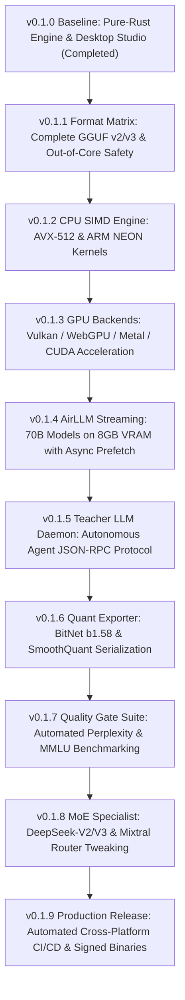

# LLM-Tweaker / THME

<p align="center">
  
</p>

<p align="center">
  <strong>Topological Heterogeneous Manifold Engine (THME) & LLM-Tweaker Studio</strong><br>
  <em>Open-source framework for Large Language Model memory profiling, zero-copy weight analysis, live token flow telemetry, and automated Teacher LLM architecture surgery.</em>
</p>

<p align="center">
  
  
  
  
  
  
</p>

<p align="center">
  <a href="#key-features">Key Features</a> •
  <a href="#desktop-studio-showcase">Desktop Studio</a> •
  <a href="#cli-tools">CLI Tools</a> •
  <a href="#teacher-llm-surgery">Teacher LLM Surgery</a> •
  <a href="#mathematical-foundation">Research Paper</a> •
  <a href="#production-roadmap">Production Roadmap</a> •
  <a href="#quickstart">Quickstart</a>
</p>

---

## Overview

**LLM-Tweaker (THME)** transforms massive Large Language Models into memory-efficient, high-throughput inference artifacts without indiscriminate uniform quantization. Instead of blindly compressing every weight matrix to 4-bit, THME profiles the topological manifold sensitivity of each attention projection and MLP block, automatically generating a **Pareto-optimal heterogeneous precision plan** constrained by anti-degradation quality gates ($Q_{\text{candidate}} \ge Q_{\text{baseline}} - \epsilon$).

Built entirely in **pure Rust** without heavy Python or C++ runtime dependencies:
- **Universal Model Importer**: Zero-copy memory-mapped parsing of **GGUF v2/v3** and **SafeTensors** (single file or sharded Hugging Face directory) with fallback parameter deduction.
- **Deep Weight Statistics & Slice Matrix**: Computes real-time moments ($\mu, \sigma$), sparsity (% zeros), outlier ratio ($>3\sigma$), 32-bin histograms, and renders interactive 8×8 numerical weight matrices.
- **Live Token & Process Flow Benchmarker**: Simulates live token generation through 13 discrete Transformer stages ($\text{Embedding} \to \text{Attention QKV} \to \text{RoPE} \to \text{KV Cache Append} \to \text{Scaled Dot-Product} \to \text{SwiGLU FFN} \to \text{Adaptive Exit Check} \to \text{LM Head}$) with 60 FPS real-time telemetry.
- **Teacher LLM Restructuring & Surgery Engine**: Declarative JSON recipe system enabling automated AI agents (Claude, Gemini, GPT-4) to restructure model precisions, swap layer sequence mixers, and prune components.
- **Standalone GPU-Accelerated Desktop Studio**: Shipped as a 5.7 MB zero-dependency native executable ([`LLM-Tweaker-Studio.exe`](file:///LLM-Tweaker-Studio.exe)).

---

## Desktop Studio Showcase

Launch the native desktop application without opening a browser or localhost server:
```bash
thme gui
# Or run the dedicated binaries:
thme-gui
./LLM-Tweaker-Studio.exe
```

```
┌────────────────────────────────────────────────────────────────────────────────────────┐
│  THME v2.0  LLM RE-STRUCTURER, OPTIMIZER & TUNER                     [📁 Load Model]  │
│  Llama-3-8B [GGUF • LLAMA] (32 Layers • Hidden Dim 4096 • 8030M Params)                │
├────────────────────────────────────────────────────────────────────────────────────────┤
│ [1. Layer Matrix] [2. Live Flow Bench] [3. Auto-Tuner] [DAG] [Weights] [Export/Surgery]│
├────────────────────────────────────────────────────────────────────────────────────────┤
│  THROUGHPUT: 44.2 tok/s  |  BANDWIDTH: 382.4 GB/s  |  KV CACHE: 148.6 MB  |  EXIT: 80% │
└────────────────────────────────────────────────────────────────────────────────────────┘
```

### The 6 Interactive Studio Workspaces:

| Workspace Tab | Focus | Core Capabilities |
|---|---|---|
| **1. Layerwise Distribution Matrix** | Architecture Shaping | Independent per-layer sliders for $\alpha$ (1-bit XNOR), $\beta$ (BitNet b1.58 Ternary), and $\gamma$ (Phase recurrence) enforcing $\alpha + \beta + \gamma = 100\%$. Sequence mixer selector (Gated DeltaNet, Phase Recurrence, Sliding Window, Mamba2, GQA). |
| **2. Live Token Flow Benchmarker** | Real-Time Telemetry | Interactive token generator (`▶ Start`, `⏸ Pause`, `⏭ Step`, `⏹ Reset`, $0.5\times \dots 10\times$ speed). Displays live streaming token terminal, instantaneous throughput (`tok/s`), TTFT, dynamic KV Cache MB allocation, and animated pulse traveling through layers. |
| **3. Sequential Layer Auto-Tuner** | AirLLM Optimization | AirLLM-style layer-by-layer optimization loop. Tests candidate representations against distortion threshold $\epsilon_{\text{tol}}$, locks winning Pareto configurations, and advances sequentially through the network. |
| **4. Architecture DAG Visualizer** | Topological Manifold | Interactive topological manifold displaying layer reach probabilities ($q_l = 1 - p_{\text{exit}}$) and early-exit speculation branches. |
| **5. Weight & Parameter Studio** | Deep Introspection | Live search and role filter (`Attention`, `MLP`, `Embedding`). Computes real 32-bin histograms, sparsity (% zeros), outlier ratio ($>3\sigma$), and renders an **8×8 numerical weight slice matrix** color-coded by magnitude. |
| **6. Export & Teacher LLM Surgery** | Restructuring & Export | Exports tuned models to SafeTensors, GGUF, or THME formats. Includes interactive multiline JSON editor and 1-click execution for Teacher LLM restructuring recipes. |

---

## CLI Tools & Subcommands

LLM-Tweaker provides dual-binary CLI support (`thme` or `llm-tweaker`):

### 1. Zero-Copy Model Inspection
Scan any GGUF or SafeTensors file in milliseconds without high RAM overhead:
```bash
thme inspect models/llama-3-8b.gguf
thme inspect /path/to/huggingface-dir --json
```

```text
=== THME Model Inspection Summary ===
┌───────────────────────┬──────────────────────────┐
│ Property              │ Value                    │
├───────────────────────┼──────────────────────────┤
│ Model Name            │ llama-3-8b               │
│ Architecture          │ Llama-family             │
│ Total Parameters      │ 8.03 B (8030261248)      │
│ Raw Weight Size       │ 14.96 GB                 │
│ Hidden Size           │ 4096                     │
│ Number of Layers      │ 32                       │
│ Attention Heads (Q)   │ 32                       │
│ Key-Value Heads (KV)  │ 8 (Grouped-Query GQA)    │
│ Head Dimension        │ 128                      │
│ Vocabulary Size       │ 128256                   │
│ Max Context Length    │ 8192                     │
│ Total Tensors         │ 291                      │
└───────────────────────┴──────────────────────────┘
```

### 2. Sensitivity Profiling & KV-Cache Projection
Project memory scaling across context windows from 1k to 128k+ tokens:
```bash
thme profile models/llama-3-8b.gguf --batch-size 1 --context-lengths 2048,8192,32768,131072
```

### 3. Pareto Heterogeneous Precision Planning
Solve multi-objective optimization targeting a specific VRAM budget:
```bash
thme plan models/llama-3-8b.gguf --budget-gb 8.0 --output optimization_plan.json
```

### 4. Teacher LLM Model Surgery Headless CLI
Apply declarative transformation recipes created by automated Teacher LLMs:
```bash
thme tweak --model models/llama-3-8b.gguf --recipe recipes/deltanet_hybrid.json --output models/restructured.json
```

### 5. Strict Quality Gate Enforcement
Validate candidate scores against baseline benchmarks with directional metric checking (lower-is-better for Perplexity; higher-is-better for Accuracy):
```bash
thme validate --baseline 85.0 --candidate 84.4 --max-degradation 1.0
thme validate --suite-file configs/quality_gates.yaml
```

---

## Teacher LLM Surgery & Tweak Recipes

External AI agents (such as Claude, Gemini, or custom tuning algorithms) can programmatically restructure imported models by emitting a standard declarative JSON recipe:

```json
{
  "name": "THME-Optimal-Heterogeneous-Recipe",
  "author": "Teacher-LLM-AutoTuner",
  "target_model": "Llama-3-8B",
  "version": "1.0",
  "description": "Restructures dense Transformer layers into hybrid DeltaNet/Phase recurrence and mixed-precision representation.",
  "operations": [
    {
      "type": "SetPrecision",
      "params": {
        "start_layer": 0,
        "end_layer": 1,
        "role": null,
        "format": "FP16"
      }
    },
    {
      "type": "SetPrecision",
      "params": {
        "start_layer": 2,
        "end_layer": 28,
        "role": "MlpGate",
        "format": "Ternary"
      }
    },
    {
      "type": "ReplaceMixer",
      "params": {
        "layer": 1,
        "mixer_type": "gated_deltanet"
      }
    },
    {
      "type": "ConfigureEarlyExit",
      "params": {
        "checkpoint_layer": 8,
        "confidence_threshold": 0.85,
        "target_exit_ratio": 80.0
      }
    },
    {
      "type": "QuantizeKvCache",
      "params": {
        "format": "INT8"
      }
    }
  ],
  "expected_speedup": 2.15,
  "expected_memory_savings_pct": 68.5
}
```

Applying this recipe computes instant diffs:
```text
[Surgery Started] Applying recipe 'THME-Optimal-Heterogeneous-Recipe' by Teacher-LLM-AutoTuner
Applied precision FP16 to layers 0..=1 (role: None)
Applied precision Ternary to layers 2..=28 (role: Some(MlpGate))
Replaced Layer 1 sequence mixer with 'gated_deltanet'
Configured Early-Exit at Layer 8 (Threshold: 0.85, Exit Target: 80%)
Quantized KV Cache global format to INT8
[Surgery Complete] 29 tensors restructured. Storage saved: 4120.4 MB (64.2%), Estimated Speedup: 2.18x
```

---

## Mathematical Foundation & Research Paper

The scientific architecture is detailed in [`docs/research/THME_Research_Programme_v2.pdf`](docs/research/THME_Research_Programme_v2.pdf).

### 1. KV-Cache Memory Formula
Autoregressive attention requires caching historical Key and Value tensors for every active sequence. THME calculates exact footprint via:
$$M_{\mathrm{KV}} = 2 \times L \times B \times S \times H_{\mathrm{KV}} \times D_{\mathrm{head}} \times \text{bytes}$$
where $L$ is number of layers, $B$ is batch size, $S$ is sequence length, $H_{\mathrm{KV}}$ is key-value heads (distinguishing Grouped-Query Attention GQA from Multi-Head Attention MHA), and $D_{\mathrm{head}}$ is head dimension.

### 2. Adaptive Speculative Early Exit Routing
Tokens evaluate entropy at checkpoint layer $L_{\mathrm{exit}}$. Layer reach probability is:
$$q_l = \begin{cases} 1.0 & \text{if } l \leq L_{\mathrm{exit}} \\ 1.0 - p_{\mathrm{exit}} & \text{if } l > L_{\mathrm{exit}} \end{cases}$$
Mean computational depth fraction is $\bar{f} = \frac{1}{N} \sum_{l=0}^{N-1} q_l$, delivering dramatic memory bandwidth savings.

### 3. Layerwise Parabolic Manifold Sensitivity
Empirical perturbation analysis demonstrates that initial layers (embedding projection) and terminal layers (LM head logits) are vulnerable to quantization noise, while intermediate layers tolerate aggressive compression:
$$s(l) = s_{\mathrm{base}} + 4 \cdot \Delta_{\mathrm{depth}} \cdot \left(\frac{l}{N - 1} - 0.5\right)^2$$

---

## Production Roadmap (v0.1.0 → v0.1.9)



- **v0.1.0 (Current):** Zero-copy SafeTensors + GGUF v2/v3 parser, Pareto multi-objective precision allocator, directional Quality Gate, Desktop Studio GUI with 6 tabs, live token flow telemetry, and headless surgery CLI.
- **v0.1.1:** Exhaustive GGML quantization types (`Q2_K`, `Q3_K`, `Q4_K_M`, `Q5_K_M`, `Q6_K`, `IQ2_XXS`), sharded split GGUF, and truncated file recovery.
- **v0.1.2:** AVX-512 / AVX2 / NEON SIMD micro-kernels for real CPU dot-product latency and layer-wise activation SNR measurement.
- **v0.1.3:** `wgpu` (Vulkan/Metal) and CUDA hardware backends for true on-device GPU layer profiling and PCIe transfer measurement.
- **v0.1.4:** Sequential AirLLM asynchronous double-buffered disk-to-VRAM weight streamer allowing 70B models to run on 8GB VRAM.
- **v0.1.5:** Headless daemon (`thme daemon --port 8080`) exposing JSON-RPC / REST endpoints for autonomous Claude/GPT-4 model surgery agents.
- **v0.1.6:** Quantization writer exporting serialized `.gguf` and `.safetensors` files packed with BitNet b1.58 ternary and calibrated scales.
- **v0.1.7:** In-engine Perplexity evaluator on WikiText-2 and zero-shot MMLU benchmarking suite.
- **v0.1.8:** Sparse Mixture-of-Experts (MoE) support for DeepSeek-V2/V3 and Mixtral 8x22B with expert pruning and routing analysis.
- **v0.1.9:** Multi-platform packaging (Windows MSI/exe, Linux AppImage, macOS universal DMG), fuzz testing, and signed releases.

---

## Quickstart

### Prerequisites
- [Rust Toolchain](https://rustup.rs/) (edition 2021, Rust >= 1.80)

### Installation
```bash
git clone https://github.com/TechTroniX/LLM-Tweaker.git
cd LLM-Tweaker
cargo build --release
```

The compiled binaries will be available in:
- `target/release/thme` (Primary CLI)
- `target/release/llm-tweaker` (Alias binary)
- `target/release/thme-gui` (Standalone Native Desktop Studio)
- [`LLM-Tweaker-Studio.exe`](file:///LLM-Tweaker-Studio.exe) (Root standalone executable)

### Run Tests
```bash
cargo test
```

---

## Contributing & Community

LLM-Tweaker is an open-source project created to give back to the global AI and systems community. We welcome contributions, RFCs, bug reports, and research extensions:
- Review [CONTRIBUTING.md](CONTRIBUTING.md) for architecture guidelines and coding standards.
- Read [CODE_OF_CONDUCT.md](CODE_OF_CONDUCT.md).
- Security policy is documented in [SECURITY.md](SECURITY.md).

---

## License

Licensed under the [Apache License, Version 2.0](LICENSE).
