<p align="center">
  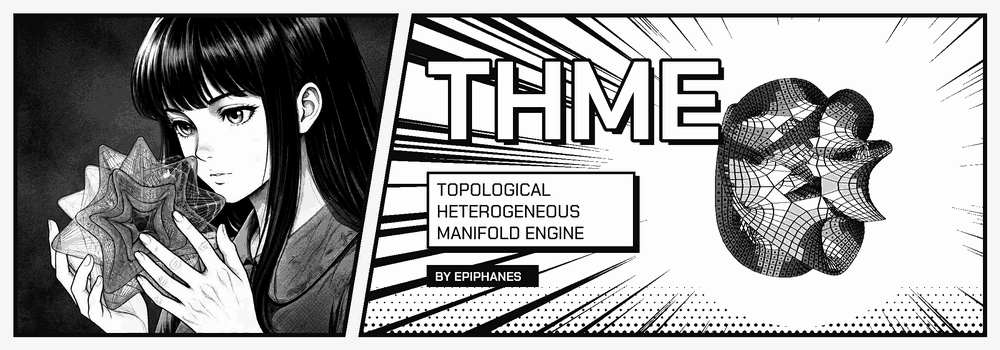
</p>

<h1 align="center">THME</h1>

<p align="center">
  <strong>Topological Heterogeneous Manifold Engine</strong> by Epiphanes<br>
  A pure-Rust workbench for taking language models apart, changing how they are stored and run,<br>
  and measuring what each change costs.
</p>

<p align="center">
  <a href="https://github.com/EdEpiphanes/THME-Epiphanes/actions/workflows/ci.yml"></a>
  
  
  <a href="LICENSING.md"></a>
</p>

<p align="center">
  <a href="#now-building">Now building</a> ·
  <a href="#measurements">Measurements</a> ·
  <a href="#what-is-real-today">What is real today</a> ·
  <a href="#thme-studio">Studio</a> ·
  <a href="#quickstart">Quickstart</a> ·
  <a href="#architecture">Architecture</a> ·
  <a href="#status">Status</a> ·
  <a href="#roadmap">Roadmap</a> ·
  <a href="docs/research/THME_measured_findings_2026-11.md">Research notes</a>
</p>

---

## Why THME

Most compression tools apply one format to every layer and report a size. THME is built on
the opposite premise: every tensor can have its own representation, chosen by measuring what
it costs. You describe a change as a declarative **recipe** (or bring your own algorithm via
the **BYOA** registry), THME applies it, runs the model, and a quality gate accepts or rolls
it back.

Each figure is labelled Measured, Tested, Estimate or Simulated. No measured results are published
right now (see [Measurements](#measurements)). Anything THME cannot yet measure is labelled as an
estimate or a simulation.

## Now building

THME is open source (AGPL-3.0-only) and is finishing its **engine and tools first**; a
commercial release follows later. This week's work, all tested on synthetic data:

| Track | Shipped | In progress |
| :--- | :--- | :--- |
| **Epiphanes model format** | [`.epiph` v1.0](docs/formats/epiph-v1.md): one verifiable file with weights, model description, recipe, provenance, quality results and calibration (`thme epiph pack`, `thme epiph verify`); signed with Minisign (`thme epiph sign`); stores recipe candidates quantized (`--recipe R --quantize`); keeps GGUF metadata and tokenizer files (`thme epiph extract`); converts to GGUF and SafeTensors | Streaming for large models |
| **Model security** | `thme scan PATH`: finds code-executing pickles, chat-template injection, `trust_remote_code` files, hidden executables and malformed headers without loading anything; every model load is scanned first and refused on a high finding (`--allow-unsafe-model` to override); never runs the code it finds; also inspects deflate-compressed pickles, NumPy object arrays (`.npy`, `.npz`), Keras `Lambda` layers and ONNX external-data paths, and still scans the start of pickles past the size limit | Legacy Keras `.h5` |
| **Math engine** | `src/engine`: one shared Walsh-Hadamard transform; FP16, BF16 and FP8 with one tested rounding routine; integer, ternary, sign, codebook and phase quantizers with stated error bounds; an exact DP allocator (`thme search --solver dp`) beside greedy and thresholds; a deterministic SVG visual engine; [isometric figures in Rust](docs/figures.md) (`thme figure MODEL [--gif]` draws a model's anatomy and animates its forward pass, generated by THME itself); ODE steppers (Euler, RK4, adaptive Dormand-Prince 5(4)) and optimal transport (northwest corner, Sinkhorn, log-domain Sinkhorn), each tested against closed-form or brute-force oracles | GPTQ-style rounding |
| **Quality and evidence** | [Versioned quality gates](docs/quality-gate.md) with custom criteria and a hash in every report (`--gate FILE`); every figure labelled Measured, Tested, Estimate or Simulated; glossary in [CONTEXT.md](CONTEXT.md); [benchmark registry](docs/benchmark-registry.md): task files and result records (`thme bench`); metrics and statistics checked against the dossier's oracle values; three-state gate (`thme bench gate`: pass, fail or inconclusive); [claim register](docs/research/claim-register.md) of all 135 dossier claims; versioned JSON Schemas; contamination check (`thme bench contamination`); scoring of outputs from any tool (`thme bench score`); charts with intervals (`thme bench chart`) | Native runner when model runs resume |
| **Engine checks** | GPTQ rounding rewritten to the reference algorithm (Q4_0, Q8_0); a GGUF checker for structure, data section and metadata keys; an exact GPU/CPU placement plan stored in `.epiph` format 1.2 (`thme epiph pack --placement`); Studio numbers that are estimates now say so | The run through llama.cpp; GPTQ on a real model |
| **Plug and play** | `thme discover` lists the models already on your machine from the Hugging Face cache, Ollama, LM Studio, llama.cpp and any folder; `thme doctor` says what works on this machine and what to try next | Model download, bridges to the tools people already use |

Real-model measurements are being redone with the corrected code, starting with Pythia-14M. Until
they are published, work that needs one is marked *measurement pending*. Full plan: **[Now, next, later](ROADMAP.md#now-next-later)**.

## See inside a model

`thme figure MODEL` draws any model it can load as a parts tray: one tray per layer, one block per
tensor. A block's footprint follows the tensor's stored bytes and its height follows its measured
bits per weight. Everything is read from the model file's header; no weights are copied.

<picture>
  <source media="(prefers-color-scheme: dark)" srcset="docs/figures/pythia-14m-dark.svg">
  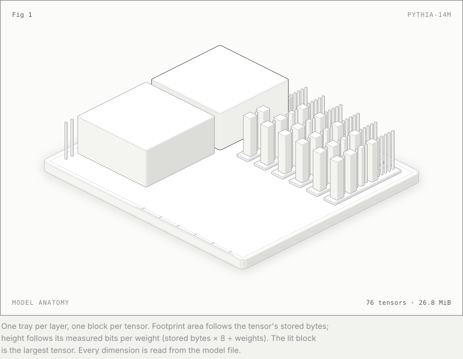
</picture>

*Pythia-14M (EleutherAI, Apache-2.0): 6 layers, 76 tensors, 14,067,712 parameters, drawn by
`thme figure models/pythia-14m --out docs/figures`.*

<table>
  <tr>
    <td width="50%"><picture><source media="(prefers-color-scheme: dark)" srcset="docs/figures/pythia-14m-layers-dark.gif">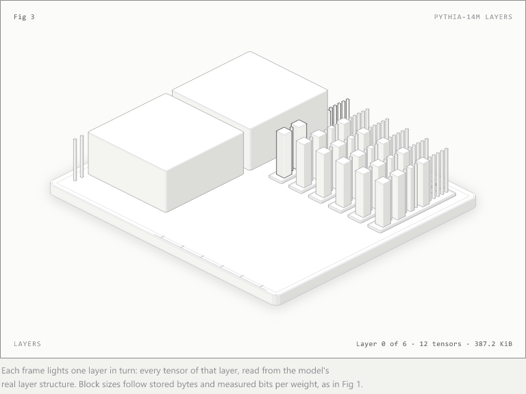</picture><br><sub><b>Layers in turn</b>: real layer structure of Pythia-14M</sub></td>
    <td width="50%"><picture><source media="(prefers-color-scheme: dark)" srcset="docs/figures/mock_llama-forward-dark.gif">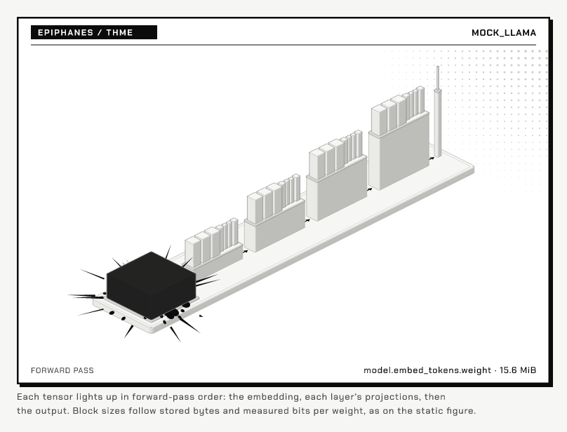</picture><br><sub><b>Forward pass</b> on the synthetic mock model (not a trained model)</sub></td>
  </tr>
</table>

More figures, and how they are made: [docs/figures.md](docs/figures.md).

## Plug and play

THME is meant to work for people who arrive from any background and with whatever tools they use,
so it reads what you already have instead of asking you to move files.

- **Find your models.** `thme discover` lists the models already on your machine from the Hugging
  Face cache, Ollama, LM Studio, llama.cpp and any folder you name (`--path DIR`, `--json`). It is
  read-only and needs no network.
- **Open anything.** SafeTensors, GGUF v2/v3 and `.epiph` load directly; pickle files are scanned
  before they are opened.
- **Talk to it from your editor or agent.** `thme mcp` runs a stdio server that other tools can drive.
- **One window.** The Studio shows the same models, and the numbers it can only estimate say so.

- **Get a model.** `thme download ORG/NAME` fetches config, tokenizer and weights from the Hugging Face hub, prints the
  licence first, verifies checksums, skips pickle files unless you name them, and scans the result. Tested
  with a fake server; no real download has been tried yet.
- **Text in, text out.** `thme tokenize` encodes and decodes text with a model's own `tokenizer.json`, and
  `thme chat-template` renders the model's own chat template from a messages file. Tested on fixtures; a
  chat tab in the Studio is planned (THME-3038).
- **Know your machine.** `thme doctor` says what works here (system, memory, disk, GPU adapter, the models
  found) and what to try next. It marks each fact as checked or assumed.

Planned, not built yet: bridges to notebooks, Ollama and llama.cpp (THME-3042 in the [backlog](BACKLOG.md)).

## Measurements

The earlier measured results are being re-run with the corrected code, after the FP16 rounding
fix (THME-3023). The reports from before that fix were stale, so they have been removed from the
repository. Results will be published here with the full method and the committed report behind
each number. To see how a result is produced, read the [benchmark registry](docs/benchmark-registry.md)
and the [quality gate](docs/quality-gate.md).

## What is real today

| Capability | Status | Evidence |
| :--- | :--- | :--- |
| SafeTensors and GGUF v2/v3 import, 28 GGML types | Implemented | Unit and fuzz tests |
| Reference forward pass (LLaMA family, GPT-NeoX) | Tested | `scheduled_forward_matches_plain_forward_and_validates_inputs` and `uniform_model_has_perplexity_equal_to_vocabulary_size` (`src/inference/`) |
| Precision round trips: FP16, BF16, Q8_0, Q4_0, ternary TQ1_0 | Tested | `every_fp16_code_round_trips`, `decode_matches_the_bit_shift_definition_of_bf16`, `q8_round_trip_stays_within_half_a_step`, `ternary_round_trip_leaves_three_levels_per_block` |
| GGUF v3 export | Tested | Writer round trips and structure checks (`tests/test_gguf_writer.rs`, `tests/test_exporter_compatibility.rs`); per-tensor formats (Q4_K, Q5_K, Q6_K, ternary) also tested |
| Precision sweep, random-placement control, depth probe | Implemented | `examples/precision_sweep.rs`, `examples/depth_probe.rs`; random placements keep format counts (`matched_random_keeps_format_counts`) |
| `thme validate --report`, `thme co-surgery MODEL --tokens` | Tested | Stored verdicts are re-judged by the gate (`src/cli/validate.rs`); co-surgery in `tests/test_co_surgery.rs` |
| Surgery recipes, BYOA registry | Implemented | Recipes are measured through the verification pipeline and co-surgery |
| Layer sensitivity profiler (`thme profile`) | Estimate | Analytic model; not yet calibrated against measured sensitivity |
| `thme evaluate --recipe`, `thme search` | Tested | `search_runs_end_to_end_and_emits_a_recipe` (`src/cli/search.rs`); exact DP solver checked against exhaustive search (`equals_exhaustive_search`, `src/engine/alloc.rs`); real-model results pending |
| Pareto allocator (`thme plan`) | Estimate | Analytic costs; superseded by `thme search` for measured allocation |
| Co-surgery without tokens, Studio Co-Surgery tab | **Simulated** | Analytic proxy, labelled as simulated in the output |
| Speculative decoding, roofline, energy | Model | Formulas over published hardware specs; no timing measured |
| Paradigm converter | Implemented | Rewrites the IR; converted models are not evaluated |
| PyTorch/CUDA scripts, LoRA merge, MCP server, VS Code extension | Implemented | Unit tests |
| BYOA algorithms in recipes | Tested | Contract-checked; Hadamard-rotated ternary and 4-bit built-ins; invalid transforms refused |
| Studio Live 3D view | Tested | Per-tensor activity, residual updates and anomalies from the forward-pass probe (`src/inference/probe.rs`) |
| `.epiph` model files | Tested | Round trip, corruption and truncation, GGUF conversion byte-identical to the source |
| `thme scan` security scanner | Tested | Built fixtures for each rule; nothing is loaded or run |
| Engine primitives (`src/engine`) | Tested | Oracles: explicit Hadamard matrix, exhaustive search, round-and-clamp |
| Other Studio tabs | Implemented | Real screenshots below; telemetry uses a synthetic demo model |

## THME Studio

A native desktop workbench (`thme-gui`, egui) in a black-and-white manga style: paper, ink,
screentone and glass panels, set in Chakra Petch. Every image here is the actual app, captured by
`scripts/capture_studio.ps1` and `scripts/record_gif.ps1`.

### Live 3D model view

Watch a model compute. The default **Manifold** view binds each of the 25 patches of a
Calabi-Yau quintic cross-section to a layer: a patch's tone is the layer's format family and its
light is the layer's **measured** residual update in the current window. The surface turns
through its fourth dimension while token particles ride across it. The geometry is
illustrative; the tones and light are measured. **Layer slabs** shows the detail: every slab is
one applied layer, every row a linear tensor split into output-channel groups, lit by measured
output magnitude, with particles carrying the residual stream between layers. Non-finite
values, exploding residuals and dead MLP units are marked and listed beside the view. Drag to
orbit, scroll to zoom, hover for statistics. Point it at any local LLaMA-family or GPT-NeoX
folder, or run the built-in synthetic demo shown here.

<p align="center">
  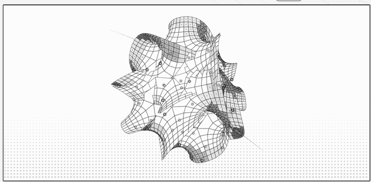
</p>

<table>
  <tr>
    <td width="50%">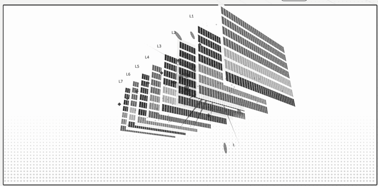<br><sub><b>Layer slabs</b>: tensors, channel groups, residual flow; ink glass marks the layer in turn</sub></td>
    <td width="50%">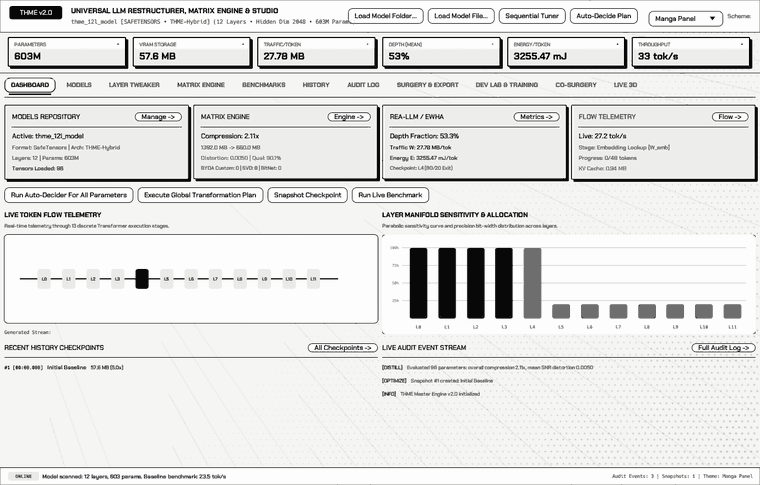<br><sub><b>Manga Panel</b> theme (default); <b>Manga Night</b> and <b>Manga Ink</b> keep the red</sub></td>
  </tr>
</table>

<sub>Recorded from the real app with `scripts/record_gif.ps1` while it runs the synthetic demo
(pseudo-random weights, mixed formats), so perplexity is not meaningful; the activity is real
computation. Binary and phase families and adaptive routing are in the legend as not implemented.</sub>

### Workspaces

The other tabs below show the Studio's built-in synthetic demo model, so every number on screen
is illustrative rather than measured.

<table>
  <tr>
    <td width="50%">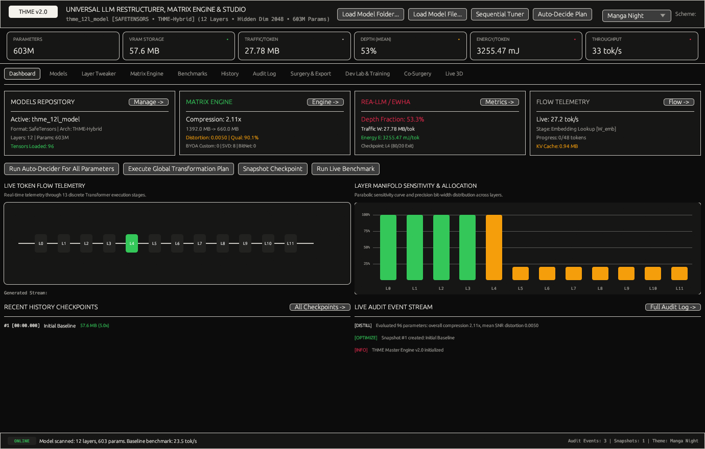<br><sub><b>Dashboard</b>: model summary, sensitivity allocation, audit stream</sub></td>
    <td width="50%">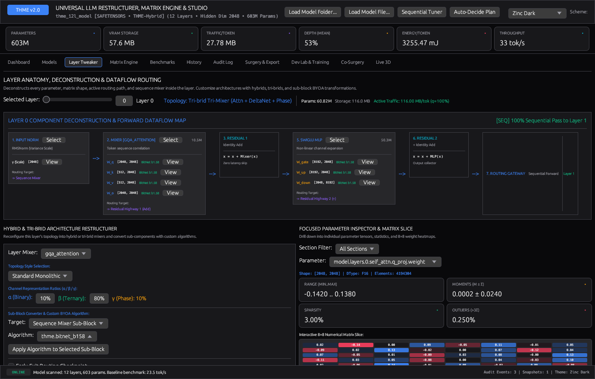<br><sub><b>Layer Tweaker</b>: per-layer anatomy, α/β/γ ratios, BYOA sub-block algorithms</sub></td>
  </tr>
  <tr>
    <td>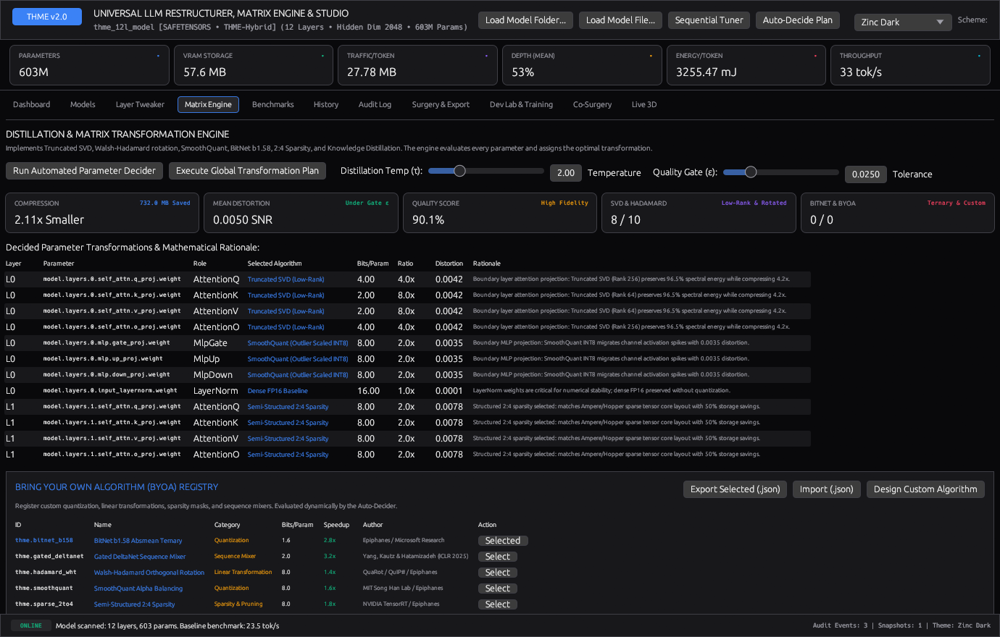<br><sub><b>Matrix Engine</b>: per-parameter transformation decisions</sub></td>
    <td>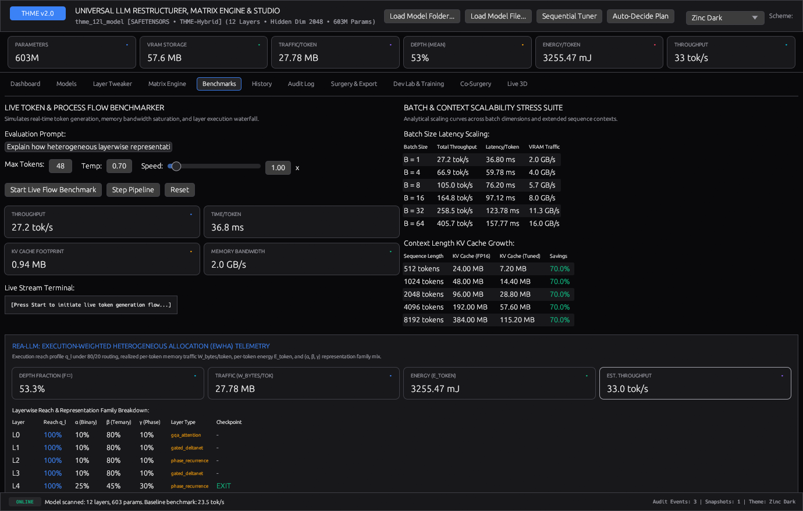<br><sub><b>Benchmarks</b>: flow simulator, KV-cache scaling, roofline deck</sub></td>
  </tr>
</table>

<details>
<summary>All ten tabs</summary>

| | |
| :---: | :---: |
| 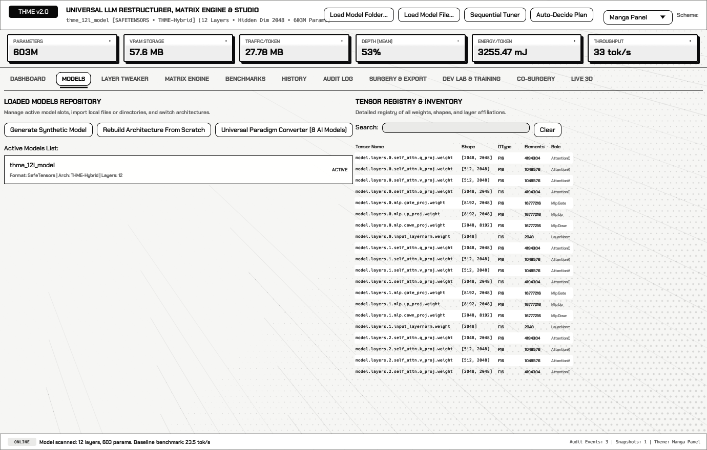<br><sub>Models</sub> | 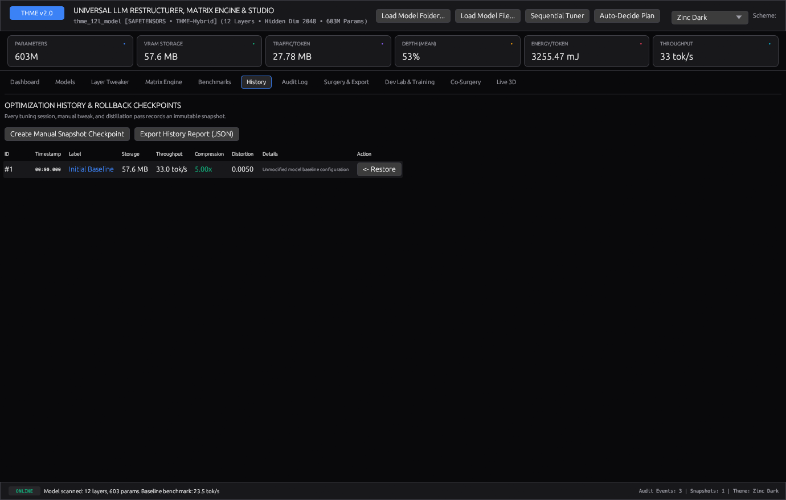<br><sub>History</sub> |
| 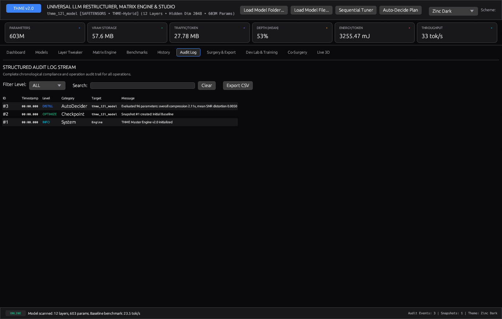<br><sub>Audit Log</sub> | 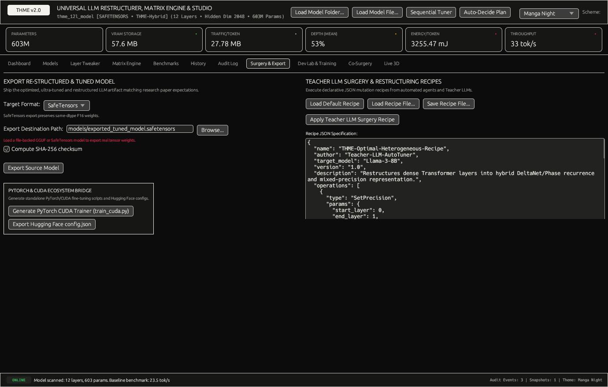<br><sub>Surgery & Export</sub> |
| 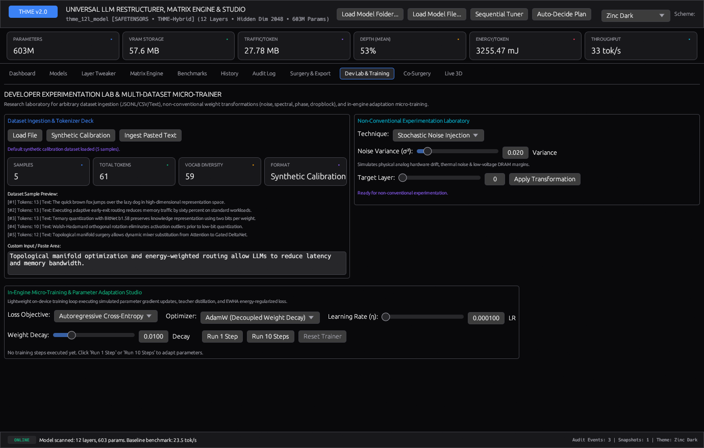<br><sub>Dev Lab & Training</sub> | 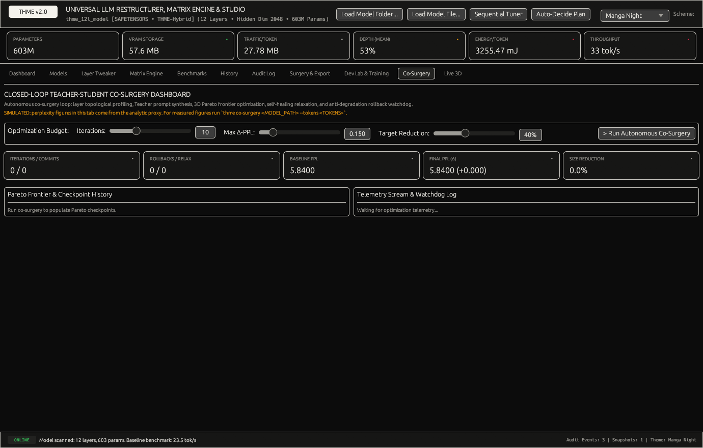<br><sub>Co-Surgery</sub> |

</details>

## Quickstart

Requires Rust 1.95 or newer. Measuring perplexity also needs Python with `tokenizers`.

```bash
git clone https://github.com/EdEpiphanes/THME-Epiphanes.git
cd THME-Epiphanes
cargo build --release
```

**Explore without any download** (synthetic fixture):

```bash
cargo run --example generate_mock_model
./target/release/thme inspect examples/mock_llama
./target/release/thme scan examples/mock_llama                       # security scan, loads nothing
./target/release/thme epiph pack examples/mock_llama --out target/mock.epiph
./target/release/thme epiph verify target/mock.epiph                 # digests, shapes, types
./target/release/thme gui
```

**Measure a real model.** Put a Hugging Face checkpoint (`model.safetensors` + `config.json`)
in `models/<name>/`. Weights are never committed.

```bash
pip install tokenizers
python scripts/prepare_eval_tokens.py --repo EleutherAI/pythia-14m

# Quality gate: source vs exported GGUF vs surgery recipe
cargo run --release --example production_verification -- \
    --model-path models/Pythia-14M --tokens target/eval/wikitext2_test.pythia-14m.u32

# Gate the report it wrote
./target/release/thme validate --report target/verification_report.json

# What does each format, role and layer cost?
cargo run --release --example precision_sweep -- \
    --model-path models/Pythia-14M --tokens target/eval/wikitext2_test.pythia-14m.u32 --layer-scan

# How early do predictions settle; what do repeated or skipped layers do?
cargo run --release --example depth_probe -- \
    --model-path models/Pythia-14M --tokens target/eval/wikitext2_test.pythia-14m.u32

# Write the recipe as a GGUF file, each tensor in its own format
./target/release/thme export models/SmolLM-135M -o smollm-mixed.gguf --recipe recipe.json

# Search a mixed-precision recipe under a size budget, then re-check it
./target/release/thme search models/Pythia-14M --tokens target/eval/wikitext2_test.pythia-14m.u32 \
    --budget 0.5 --formats q8_0,q4_0 --emit-recipe target/searched.json
./target/release/thme evaluate models/Pythia-14M --recipe target/searched.json \
    --tokens target/eval/wikitext2_test.pythia-14m.u32

# Closed-loop co-surgery with measured perplexity
./target/release/thme co-surgery models/Pythia-14M --tokens target/eval/wikitext2_test.pythia-14m.u32
```

Each run writes a JSON report. `scripts/generate_dossier.py` and `scripts/generate_charts.py`
turn committed reports into a dossier and charts; neither script contains numbers of its own.

| Model | Role | Full-split evaluation on a 6-core desktop CPU |
| :--- | :--- | :--- |
| [Pythia-14M](https://huggingface.co/EleutherAI/pythia-14m) | Fast iteration on techniques | About 50 s |
| [SmolLM-135M](https://huggingface.co/HuggingFaceTB/SmolLM-135M) | Release verification | About 9 min |

## Architecture

```mermaid
%%{init: {'theme': 'base', 'themeVariables': {'fontFamily': 'Chakra Petch, Bahnschrift, Arial Narrow, sans-serif', 'primaryColor': '#ffffff', 'primaryTextColor': '#0b0b0b', 'primaryBorderColor': '#0b0b0b', 'lineColor': '#0b0b0b', 'secondaryColor': '#f6f6f4', 'tertiaryColor': '#ffffff', 'clusterBkg': '#f6f6f4', 'clusterBorder': '#0b0b0b', 'edgeLabelBackground': '#ffffff', 'noteBkgColor': '#ffffff', 'noteBorderColor': '#0b0b0b', 'actorBkg': '#ffffff', 'actorBorder': '#0b0b0b', 'signalColor': '#0b0b0b', 'labelBoxBkgColor': '#ffffff'}}}%%
flowchart LR
    classDef measured fill:#0b0b0b,stroke:#0b0b0b,stroke-width:2px,color:#ffffff;
    classDef impl fill:#ffffff,stroke:#0b0b0b,stroke-width:1.5px,color:#0b0b0b;

    subgraph In["Import"]
        ST["SafeTensors"]:::impl
        GG["GGUF v2/v3"]:::impl
    end
    IR["ModelIR<br/>tensors, roles, sources"]:::impl
    subgraph Change["Change"]
        R["Surgery recipe / BYOA"]:::impl
        P["Profiler and planner"]:::impl
    end
    subgraph Measure["Measure"]
        F["Reference forward pass<br/>LLaMA · GPT-NeoX"]:::measured
        G["Perplexity gate<br/>accept or roll back"]:::measured
    end
    E["GGUF export"]:::measured
    D["Reports → dossier, charts"]:::measured

    ST & GG --> IR --> P --> R --> F --> G
    G -- accept --> E --> F
    G --> D
```

Solid ink stages are backed by measurements today; white stages are implemented and tested. The full subsystem reference (profiler,
allocator, speculative decoding, roofline, paradigm converter, PyTorch bridge, MCP, CLI flags)
is in **[docs/subsystems.md](docs/subsystems.md)**.

## Status

<picture>
  <source media="(prefers-color-scheme: dark)" srcset="docs/status/status-dark.svg">
  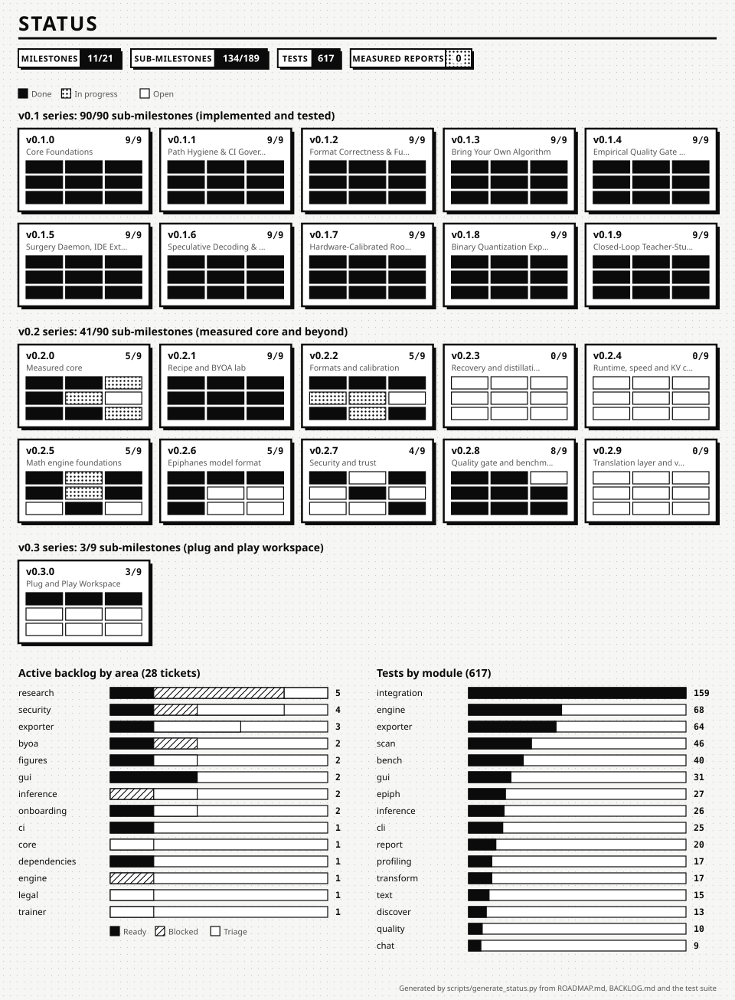
</picture>

<sub>Generated by `scripts/generate_status.py` from [ROADMAP.md](ROADMAP.md),
[BACKLOG.md](BACKLOG.md) and the test suite. CI regenerates it and fails if the committed board is stale.</sub>

## Roadmap

Two views of one plan. The **[now, next, later](ROADMAP.md#now-next-later)** view groups work by
track (math engine, Epiphanes model format, security, quality and evidence). The numbered
milestones below track the measured-model programme, which waits while model runs are paused.

```mermaid
%%{init: {'theme': 'base', 'themeVariables': {'fontFamily': 'Chakra Petch, Bahnschrift, Arial Narrow, sans-serif', 'primaryColor': '#ffffff', 'primaryTextColor': '#0b0b0b', 'primaryBorderColor': '#0b0b0b', 'lineColor': '#0b0b0b', 'secondaryColor': '#f6f6f4', 'tertiaryColor': '#ffffff', 'clusterBkg': '#f6f6f4', 'clusterBorder': '#0b0b0b', 'edgeLabelBackground': '#ffffff', 'noteBkgColor': '#ffffff', 'noteBorderColor': '#0b0b0b', 'actorBkg': '#ffffff', 'actorBorder': '#0b0b0b', 'signalColor': '#0b0b0b', 'labelBoxBkgColor': '#ffffff'}}}%%
flowchart LR
    classDef done fill:#0b0b0b,stroke:#0b0b0b,stroke-width:2px,color:#ffffff;
    classDef active fill:#ffffff,stroke:#0b0b0b,stroke-width:4px,color:#0b0b0b;
    classDef next fill:#ffffff,stroke:#0b0b0b,stroke-width:1.5px,stroke-dasharray:4 3,color:#52514e;

    A["v0.1.x<br/>Foundations<br/>implemented"]:::done
    B["v0.2.0<br/>Measured core"]:::active
    C["v0.2.1<br/>Recipe and BYOA lab<br/>done"]:::done
    D["v0.2.2<br/>Formats and calibration"]:::active
    E["v0.2.3<br/>Recovery and distillation"]:::next
    F["v0.2.4<br/>Runtime, speed, KV cache"]:::next
    H["v0.2.5<br/>Math engine"]:::active
    I["v0.2.6<br/>Epiphanes model format"]:::active
    J["v0.2.7<br/>Security and trust"]:::active
    K["v0.2.8<br/>Quality gate,<br/>benchmarks"]:::next
    L["v0.2.9<br/>Translation layer,<br/>convergence"]:::next
    G["v0.3<br/>Routing, distillation,<br/>GPU, scale-out"]:::next
    A --> B --> C --> D --> E --> F --> H --> I --> J --> K --> L --> G
```

<sub>Solid ink: done · thick frame: in progress · dashed: next. Live counts are on the [status board](#status).</sub>

| Milestone | Goal | Done when |
| :--- | :--- | :--- |
| **v0.2.0 Measured core** (active; the HF cross-check is paused) | Real forward pass, measured gate, honest dossier | Every published figure regenerates from a report; analytic proxy retired or labelled everywhere |
| **v0.2.1 Recipe and BYOA lab** (done) | Any recipe or BYOA algorithm runs through the measured gate | A searched recipe beats uniform and random placement at matched size |
| **v0.2.2 Formats and calibration** (in progress) | 4-bit K-quants, activation-aware scales, Hadamard rotation, per-tensor export | A heterogeneous artifact smaller than uniform Q8_0 passes the gate |
| v0.2.3 Recovery | Distillation and LoRA recovery for aggressive formats | A recovered ternary-heavy candidate passes the gate |
| v0.2.4 Runtime | Incremental decode, measured speed, memory and KV cache | Speed and memory claims are measured on named hardware |
| **v0.2.5 Math engine** (in progress) | Validated primitives with oracle tests, one implementation per method | Every primitive passes its oracle tests; no duplicates |
| **v0.2.6 Epiphanes model format** (in progress) | `.epiph` with signatures, quantized payloads, tokenizer, placement | A quantized candidate packs, signs, verifies and runs from one file |
| **v0.2.7 Security and trust** (in progress) | Scanner, permission record, supply chain; sandbox reserved for the commercial version | Every import scans first; untrusted code is never run |
| v0.2.8 Quality gate and benchmarks | Versioned gate, benchmark harness, statistics, charts | A task file runs to a result with an interval and a three-state verdict |
| v0.2.9 Translation layer and convergence | Operation graph, exact symmetries, compatibility reports | Every v0.2 exit criterion met or deferred with a reason |

Full plan with sub-milestones: **[ROADMAP.md](ROADMAP.md)** · Tickets: **[BACKLOG.md](BACKLOG.md)**

## Research


THME is also a research programme into heterogeneous representations for language models.

- [Research Programme v2](docs/research/THME_Research_Programme_v2.pdf): hypotheses, method, controls
- [Measured findings, November 2026](docs/research/THME_measured_findings_2026-11.md): what the first experiments support and refute
- [Research Dossier v3.1](docs/research/THME_Research_Dossier_v3.1_2026-11-13.pdf) (theoretical proposal and engineering brief; no measurements of its own) and its [review against the repository](docs/research/REVIEW_dossier_v3.1.md)

## Contributing

Read [AGENTS.md](AGENTS.md) (rules for humans and AI agents), [CONTRIBUTING.md](CONTRIBUTING.md)
and the [production workflow](docs/WORKFLOW.md) (backlog, pull requests, CI gates, releases).
Planned work lives in [BACKLOG.md](BACKLOG.md).
Before any change: `cargo fmt --check`, `cargo clippy --all-targets -- -D warnings`, `cargo test`.
New benchmark numbers must come from a committed report under `docs/benchmarks/`.

Security: [SECURITY.md](SECURITY.md) · Conduct: [CODE_OF_CONDUCT.md](CODE_OF_CONDUCT.md) ·
License: [AGPL-3.0](LICENSE). A commercial license is planned for a later release ([LICENSING.md](LICENSING.md)).
