<p align="center">
  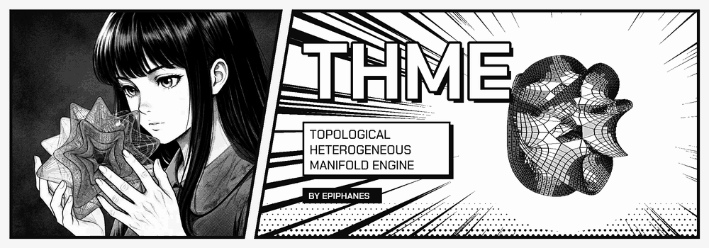
</p>

<h1 align="center">THME</h1>

<p align="center">
  <strong>Topological Heterogeneous Manifold Engine</strong> by Epiphanes<br>
  A pure-Rust workbench for taking language models apart, changing how they are stored and run,<br>
  and measuring what each change costs.
</p>

<p align="center">
  <a href="https://github.com/EdEpiphanes/THME-Epiphanes/actions/workflows/ci.yml"></a>
  
  
  
  <a href="LICENSING.md"></a>
</p>

<p align="center">
  <a href="#measured-results">Measured results</a> ·
  <a href="#what-is-real-today">What is real today</a> ·
  <a href="#thme-studio">Studio</a> ·
  <a href="#quickstart">Quickstart</a> ·
  <a href="#architecture">Architecture</a> ·
  <a href="#status">Status</a> ·
  <a href="#roadmap">Roadmap</a> ·
  <a href="docs/benchmark_dossier.md">Benchmark dossier</a> ·
  <a href="docs/research/THME_measured_findings_2026-11.md">Research notes</a>
</p>

---

## Why THME

Most compression tools apply one format to every layer and report a size. THME is built on
the opposite premise: every tensor can have its own representation, chosen by measuring what
it costs. You describe a change as a declarative **recipe** (or bring your own algorithm via
the **BYOA** registry), THME applies it, runs the model, and a quality gate accepts or rolls
it back.

Every number below comes from a real forward pass and can be regenerated with one command.
Anything THME cannot yet measure is labelled as an estimate or a simulation.

## Measured results

Measured on the full WikiText-2 test split with THME's own CPU forward pass. No retraining or
calibration. Quality gate: perplexity may rise by at most 0.45.

<picture>
  <source media="(prefers-color-scheme: dark)" srcset="docs/benchmarks/smollm-135m/charts/quality-gate-dark.svg">
  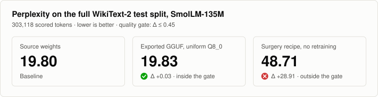
</picture>

| Model | Source | Exported GGUF, uniform Q8_0 | Surgery recipe | Scored tokens |
| :--- | ---: | ---: | ---: | ---: |
| SmolLM-135M | 19.80 | 19.83 (Δ +0.03, **passes**) | 48.71 (Δ +28.91, fails) | 303,118 |
| Pythia-14M | 114.29 | 115.12 (Δ +0.83, fails) | 618.53 (Δ +504.24, fails) | 286,878 |

The exported SmolLM-135M GGUF is 136 MiB, against a 513 MiB source.

### What the experiments show

**1. Where a model is fragile is measurable, and it is not where the heuristics guessed.**
Ternarizing one SmolLM-135M layer at a time costs +0.9 to +6.8 perplexity in the middle of
the network, +13 at the last layer, and +1,429 at layer 0.

<picture>
  <source media="(prefers-color-scheme: dark)" srcset="docs/benchmarks/smollm-135m/charts/layer-sensitivity-dark.svg">
  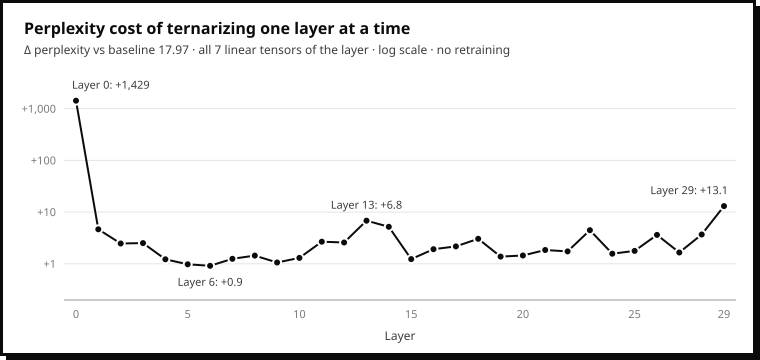
</picture>

**2. Tensor roles differ by an order of magnitude.** The attention value projection holds
2.5% of the weights and is the most fragile role; ternarizing it alone raises perplexity by
+359.

<picture>
  <source media="(prefers-color-scheme: dark)" srcset="docs/benchmarks/smollm-135m/charts/role-sensitivity-dark.svg">
  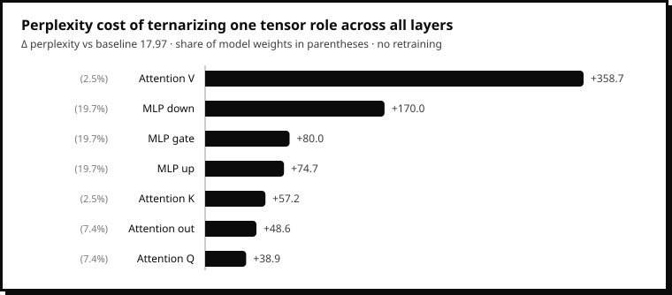
</picture>

**3. Placement matters.** With identical formats and tensor counts, the sensitivity-guided
recipe beat three random placements. This is exploratory: n = 3, and every row still fails
the gate.

<picture>
  <source media="(prefers-color-scheme: dark)" srcset="docs/benchmarks/smollm-135m/charts/placement-dark.svg">
  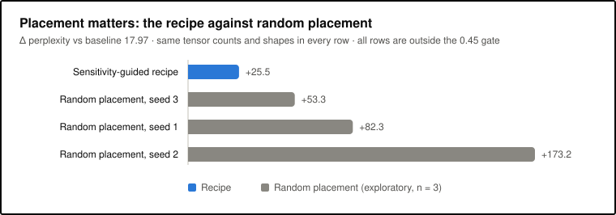
</picture>

**4. Costs do not add up.** The per-layer costs sum to +1,509. Ternarizing all of those
layers together measures +15.9 million. An allocator that adds per-layer costs cannot rank
aggressive candidates; that is why THME evaluates whole candidates.

**5. Early exit is not free.** Read through SmolLM-135M's own output head, 1.6% of tokens
have settled by 30% depth and 28.7% by 80%. Exits need training before they pay off.

<picture>
  <source media="(prefers-color-scheme: dark)" srcset="docs/benchmarks/smollm-135m/charts/depth-settling-dark.svg">
  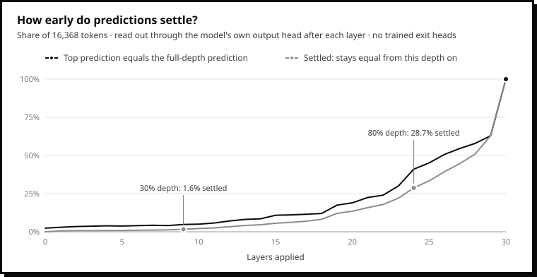
</picture>

<details>
<summary><b>Pythia-14M charts</b> (fast iteration model, about 1 minute per full-split evaluation)</summary>

Pythia-14M is 92% embeddings: quantizing every linear layer changes only 8.4% of its weights.
Use it for fast quality checks, not for memory-reduction studies.

<picture>
  <source media="(prefers-color-scheme: dark)" srcset="docs/benchmarks/pythia-14m/charts/quality-gate-dark.svg">
  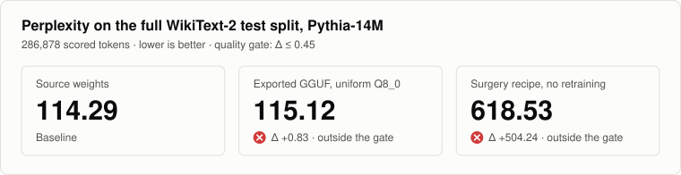
</picture>
<picture>
  <source media="(prefers-color-scheme: dark)" srcset="docs/benchmarks/pythia-14m/charts/role-sensitivity-dark.svg">
  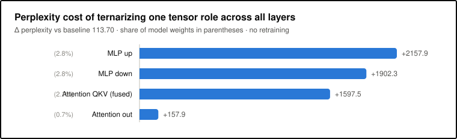
</picture>
<picture>
  <source media="(prefers-color-scheme: dark)" srcset="docs/benchmarks/pythia-14m/charts/layer-sensitivity-dark.svg">
  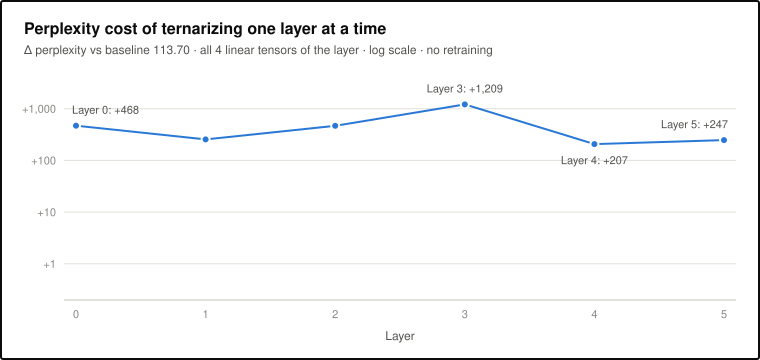
</picture>

</details>

Full tables, method, provenance and hashes: **[benchmark dossier](docs/benchmark_dossier.md)**.
Interpretation against the research programme: **[measured findings](docs/research/THME_measured_findings_2026-11.md)**.

## What is real today

| Capability | Status | Evidence |
| :--- | :--- | :--- |
| SafeTensors and GGUF v2/v3 import, 28 GGML types | Implemented | Unit and fuzz tests |
| Reference forward pass (LLaMA family, GPT-NeoX) | **Measured** | WikiText-2 perplexity on 2 models |
| Precision round trips: FP16, BF16, Q8_0, Q4_0, ternary TQ1_0 | **Measured** | [Precision sweeps](docs/benchmark_dossier.md) |
| GGUF v3 export | **Measured** | Uniform Q8_0 re-imported and evaluated; per-tensor formats not yet written |
| Precision sweep, random-placement control, depth probe | **Measured** | `examples/precision_sweep.rs`, `examples/depth_probe.rs` |
| `thme validate --report`, `thme co-surgery MODEL --tokens` | **Measured** | Gate measured reports; co-surgery scores candidates with the forward pass |
| Surgery recipes, BYOA registry | Implemented | Recipes are measured through the verification pipeline and co-surgery |
| Layer sensitivity profiler (`thme profile`) | Estimate | Analytic model; not yet calibrated against measured sensitivity |
| `thme evaluate --recipe`, `thme search` | **Measured** | Any recipe through the gate; mixed-precision search on measured costs with calibration/validation split and random controls |
| Pareto allocator (`thme plan`) | Estimate | Analytic costs; superseded by `thme search` for measured allocation |
| Co-surgery without tokens, Studio Co-Surgery tab | **Simulated** | Analytic proxy, labelled as simulated in the output |
| Speculative decoding, roofline, energy | Model | Formulas over published hardware specs; no timing measured |
| Paradigm converter | Implemented | Rewrites the IR; converted models are not evaluated |
| PyTorch/CUDA scripts, LoRA merge, MCP server, VS Code extension | Implemented | Unit tests |
| BYOA algorithms in recipes | **Measured** | Contract-checked; Hadamard-rotated ternary and 4-bit built-ins; invalid transforms refused |
| Studio Live 3D view | **Measured** | Per-tensor activity, residual updates and anomalies from the forward-pass probe (`src/inference/probe.rs`) |
| Other Studio tabs | Implemented | Real screenshots below; telemetry uses a synthetic demo model |

## THME Studio

A native desktop workbench (`thme-gui`, egui) in a black-and-white manga style: paper, ink,
screentone and glass panels, set in Chakra Petch. Every image here is the actual app, captured by
`scripts/capture_studio.ps1` and `scripts/record_gif.ps1`.

### Live 3D model view

Watch a model compute. The default **Manifold** view binds each of the 25 patches of a
Calabi-Yau quintic cross-section to a layer: a patch's tone is the layer's format family and its
light is the layer's **measured** residual update in the current window. The surface turns
through its fourth dimension while token particles ride across it. The geometry is
illustrative; the tones and light are measured. **Layer slabs** shows the detail: every slab is
one applied layer, every row a linear tensor split into output-channel groups, lit by measured
output magnitude, with particles carrying the residual stream between layers. Non-finite
values, exploding residuals and dead MLP units are marked and listed beside the view. Drag to
orbit, scroll to zoom, hover for statistics. Point it at any local LLaMA-family or GPT-NeoX
folder, or run the built-in synthetic demo shown here.

<p align="center">
  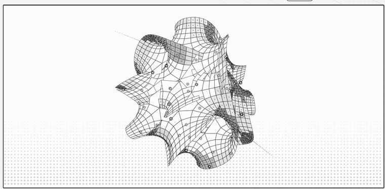
</p>

<table>
  <tr>
    <td width="50%">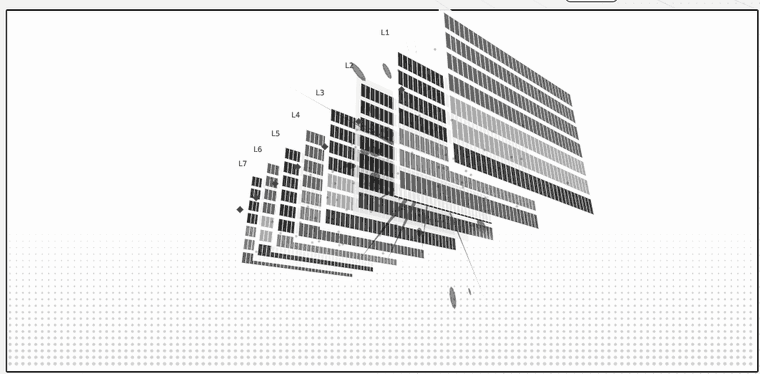<br><sub><b>Layer slabs</b>: tensors, channel groups, residual flow</sub></td>
    <td width="50%">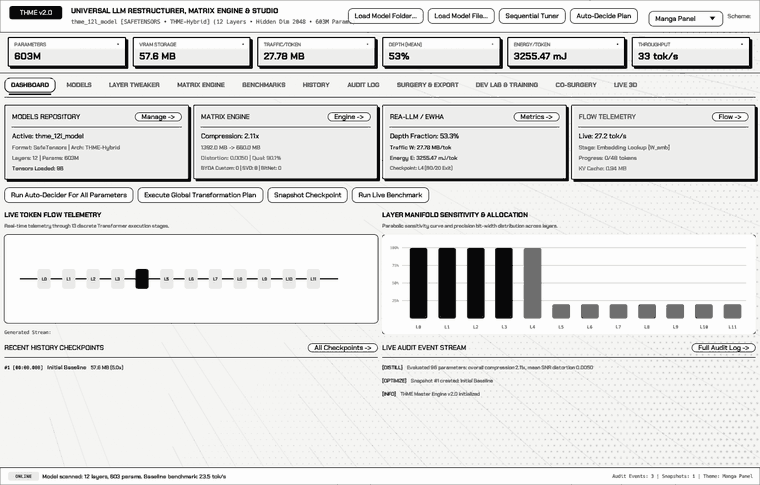<br><sub><b>Manga Panel</b> theme (default); <b>Manga Night</b> and <b>Manga Ink</b> keep the red</sub></td>
  </tr>
</table>

<sub>Recorded from the real app with `scripts/record_gif.ps1` while it runs the synthetic demo
(pseudo-random weights, mixed formats), so perplexity is not meaningful; the activity is real
computation. Binary and phase families and adaptive routing are in the legend as not implemented.</sub>

### Workspaces

The other tabs below show the Studio's built-in synthetic demo model, so every number on screen
is illustrative rather than measured.

<table>
  <tr>
    <td width="50%">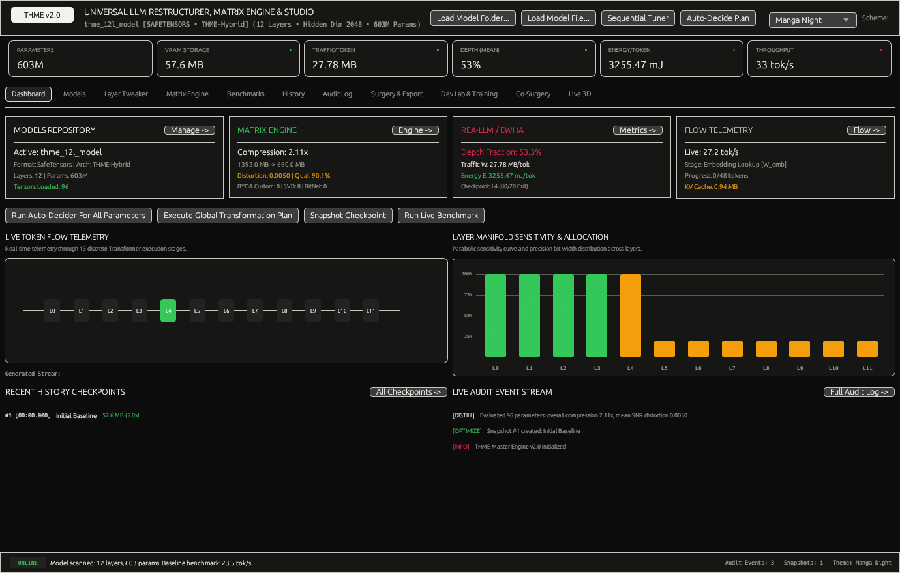<br><sub><b>Dashboard</b>: model summary, sensitivity allocation, audit stream</sub></td>
    <td width="50%">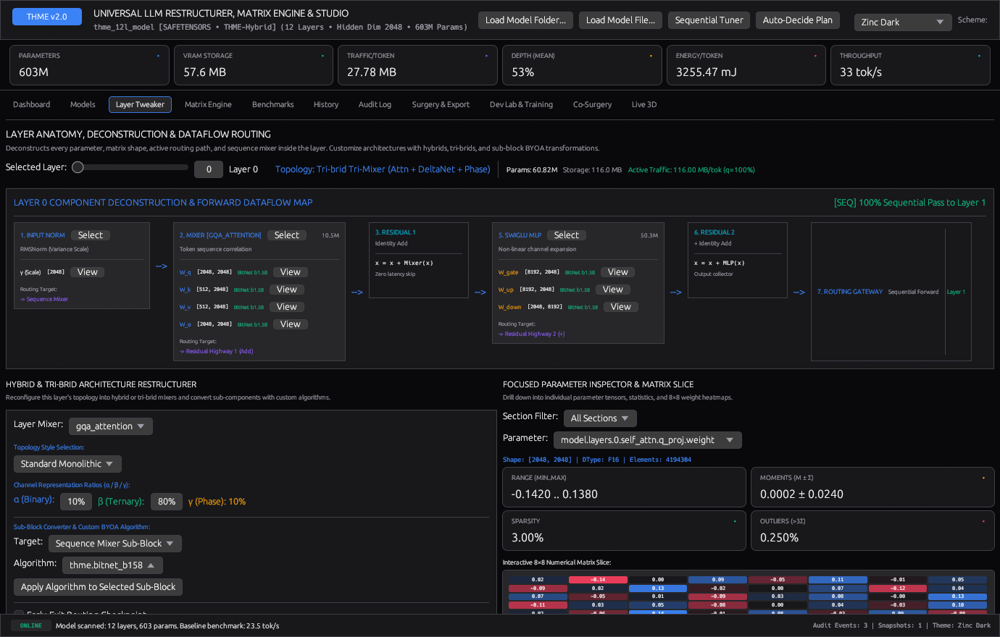<br><sub><b>Layer Tweaker</b>: per-layer anatomy, α/β/γ ratios, BYOA sub-block algorithms</sub></td>
  </tr>
  <tr>
    <td>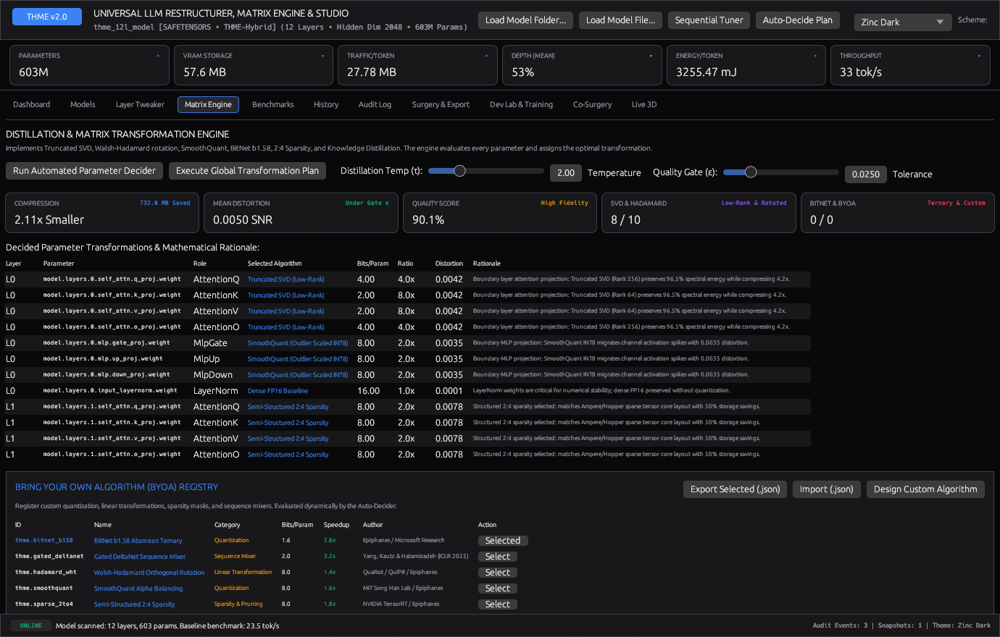<br><sub><b>Matrix Engine</b>: per-parameter transformation decisions</sub></td>
    <td>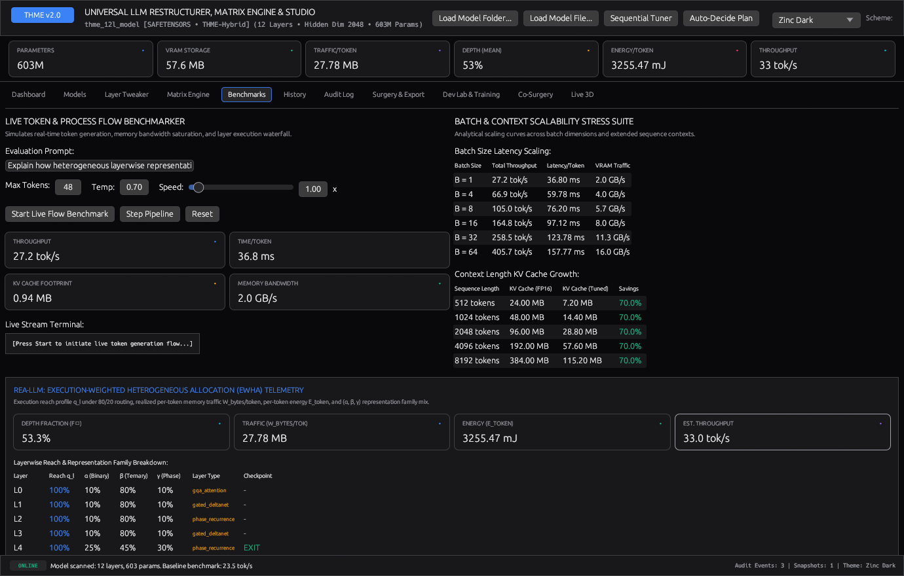<br><sub><b>Benchmarks</b>: flow simulator, KV-cache scaling, roofline deck</sub></td>
  </tr>
</table>

<details>
<summary>All ten tabs</summary>

| | |
| :---: | :---: |
| 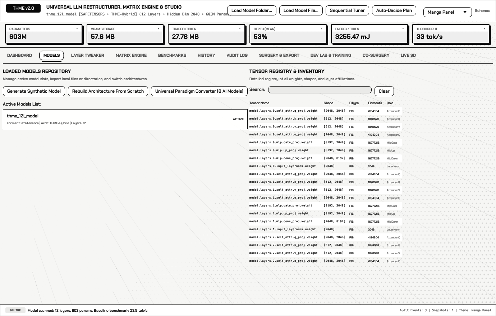<br><sub>Models</sub> | 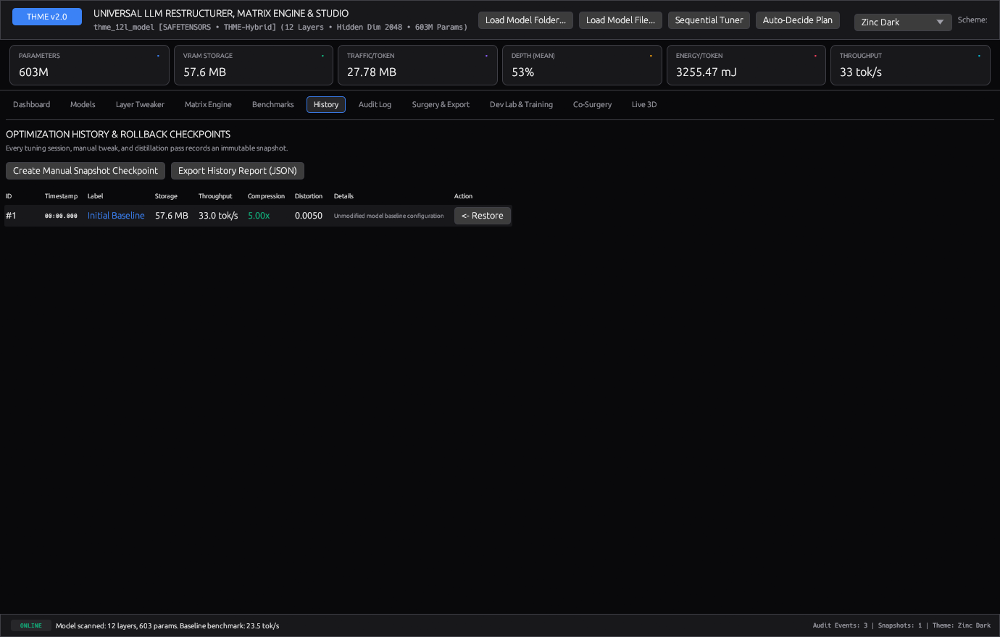<br><sub>History</sub> |
| 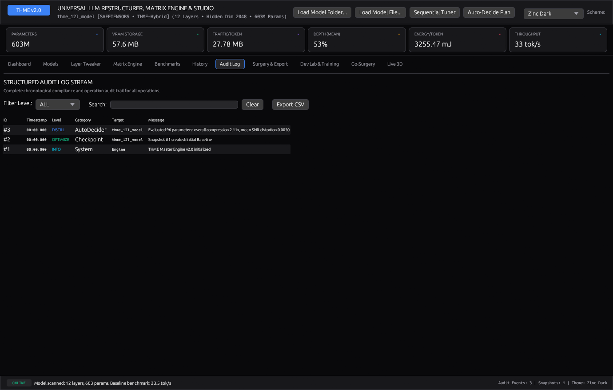<br><sub>Audit Log</sub> | 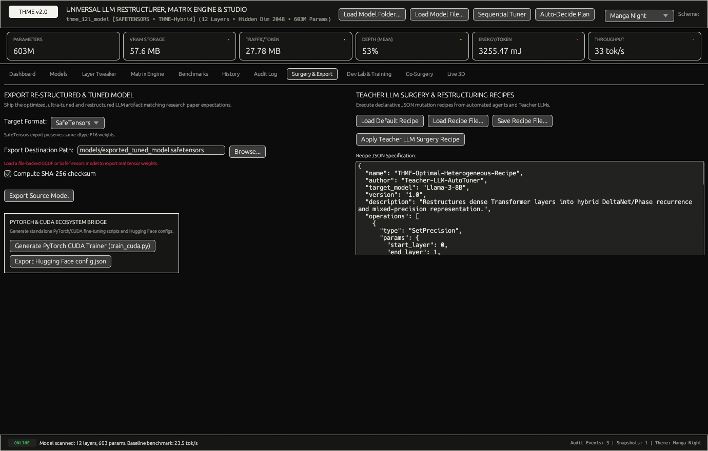<br><sub>Surgery & Export</sub> |
| 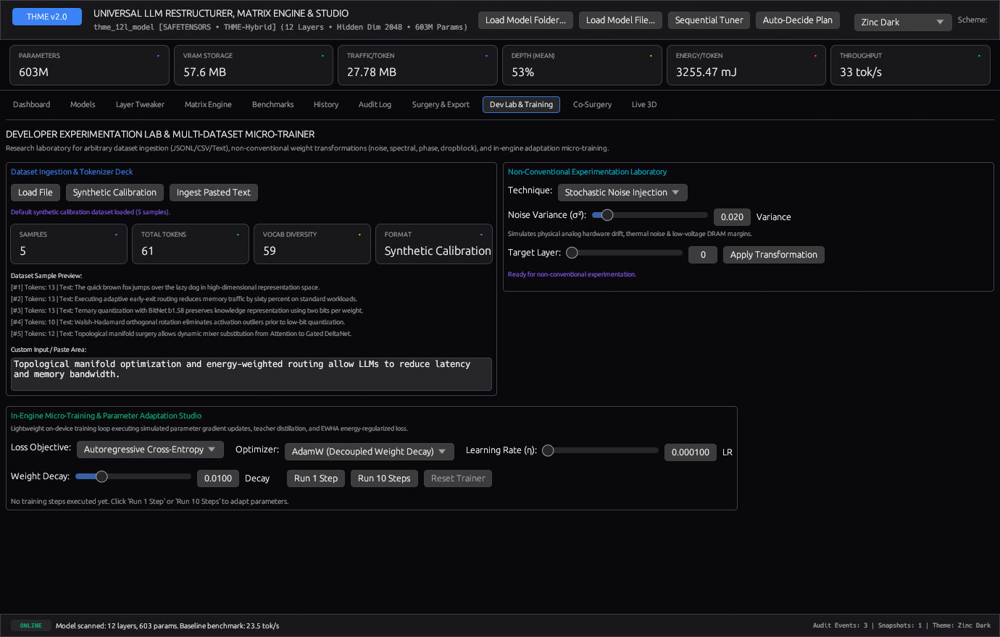<br><sub>Dev Lab & Training</sub> | 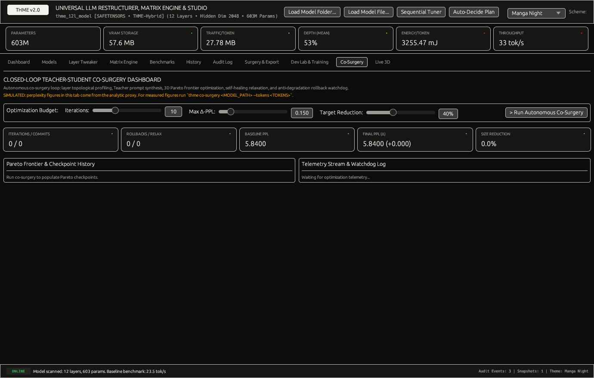<br><sub>Co-Surgery</sub> |

</details>

## Quickstart

Requires Rust 1.89 or newer. Measuring perplexity also needs Python with `tokenizers`.

```bash
git clone https://github.com/EdEpiphanes/THME-Epiphanes.git
cd THME-Epiphanes
cargo build --release
```

**Explore without any download** (synthetic fixture):

```bash
cargo run --example generate_mock_model
./target/release/thme inspect examples/mock_llama
./target/release/thme gui
```

**Measure a real model.** Put a Hugging Face checkpoint (`model.safetensors` + `config.json`)
in `models/<name>/`. Weights are never committed.

```bash
pip install tokenizers
python scripts/prepare_eval_tokens.py --repo EleutherAI/pythia-14m

# Quality gate: source vs exported GGUF vs surgery recipe
cargo run --release --example production_verification -- \
    --model-path models/Pythia-14M --tokens target/eval/wikitext2_test.pythia-14m.u32

# Gate the report it wrote
./target/release/thme validate --report target/verification_report.json

# What does each format, role and layer cost?
cargo run --release --example precision_sweep -- \
    --model-path models/Pythia-14M --tokens target/eval/wikitext2_test.pythia-14m.u32 --layer-scan

# How early do predictions settle; what do repeated or skipped layers do?
cargo run --release --example depth_probe -- \
    --model-path models/Pythia-14M --tokens target/eval/wikitext2_test.pythia-14m.u32

# Search a mixed-precision recipe under a size budget, then re-check it
./target/release/thme search models/Pythia-14M --tokens target/eval/wikitext2_test.pythia-14m.u32 \
    --budget 0.5 --formats q8_0,q4_0 --emit-recipe target/searched.json
./target/release/thme evaluate models/Pythia-14M --recipe target/searched.json \
    --tokens target/eval/wikitext2_test.pythia-14m.u32

# Closed-loop co-surgery with measured perplexity
./target/release/thme co-surgery models/Pythia-14M --tokens target/eval/wikitext2_test.pythia-14m.u32
```

Each run writes a JSON report. `scripts/generate_dossier.py` and `scripts/generate_charts.py`
turn reports into the dossier and the charts above; neither script contains numbers of its own.

| Model | Role | Full-split evaluation on a 6-core desktop CPU |
| :--- | :--- | :--- |
| [Pythia-14M](https://huggingface.co/EleutherAI/pythia-14m) | Fast iteration on techniques | About 50 s |
| [SmolLM-135M](https://huggingface.co/HuggingFaceTB/SmolLM-135M) | Release verification | About 9 min |

## Architecture

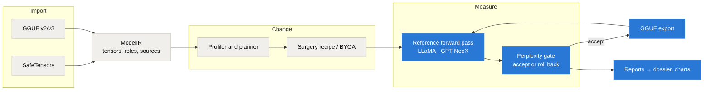

Blue stages are backed by measurements today. The full subsystem reference (profiler,
allocator, speculative decoding, roofline, paradigm converter, PyTorch bridge, MCP, CLI flags)
is in **[docs/subsystems.md](docs/subsystems.md)**.

## Status

<picture>
  <source media="(prefers-color-scheme: dark)" srcset="docs/status/status-dark.svg">
  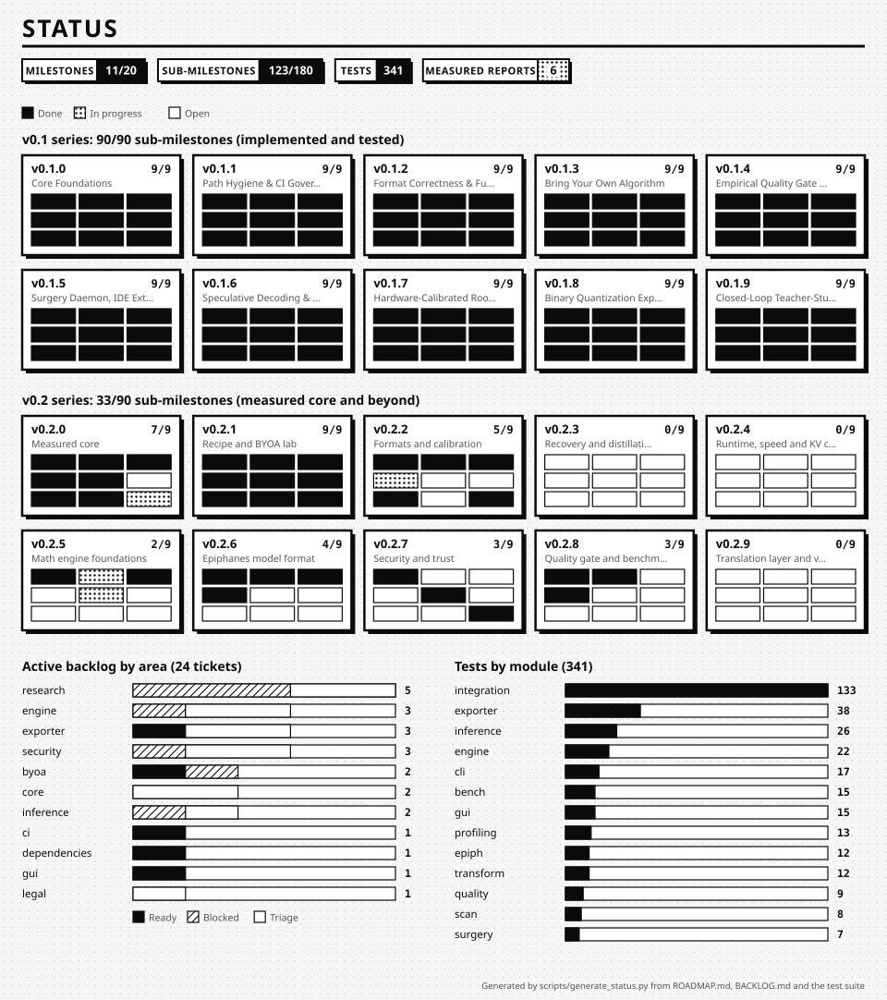
</picture>

<sub>Generated by `scripts/generate_status.py` from [ROADMAP.md](ROADMAP.md),
[BACKLOG.md](BACKLOG.md) and the test suite. CI regenerates it and fails if the committed board is stale.</sub>

## Roadmap

v0.2 is redefined around one rule: **every claim is measured, or labelled as not measured.**
Recipes and BYOA algorithms become experiments, and the gate decides what ships.

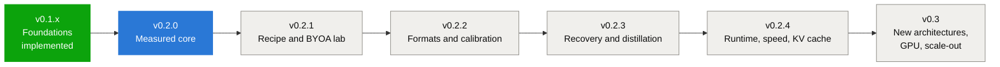

| Milestone | Goal | Done when |
| :--- | :--- | :--- |
| **v0.2.0 Measured core** (active, 7 of 9 done) | Real forward pass, measured gate, honest dossier | Every published figure regenerates from a report; analytic proxy retired or labelled everywhere |
| v0.2.1 Recipe and BYOA lab | Any recipe or BYOA algorithm runs through the measured gate | A searched recipe beats uniform and random placement at matched size |
| v0.2.2 Formats and calibration | 4-bit K-quants, activation-aware scales, Hadamard rotation, per-tensor export | A heterogeneous artifact smaller than uniform Q8_0 passes the gate |
| v0.2.3 Recovery | Distillation and LoRA recovery for aggressive formats | A recovered ternary-heavy candidate passes the gate |
| v0.2.4 Runtime | Incremental decode, measured speed, memory and KV cache | Speed and memory claims are measured on named hardware |

Full plan with sub-milestones: **[ROADMAP.md](ROADMAP.md)** · Tickets: **[BACKLOG.md](BACKLOG.md)**

## Research

THME is also a research programme into heterogeneous representations for language models.

- [Research Programme v2](docs/research/THME_Research_Programme_v2.pdf): hypotheses, method, controls
- [Measured findings, November 2026](docs/research/THME_measured_findings_2026-11.md): what the first experiments support and refute

## Contributing

Read [AGENTS.md](AGENTS.md) (rules for humans and AI agents), [CONTRIBUTING.md](CONTRIBUTING.md)
and the [production workflow](docs/WORKFLOW.md) (backlog, pull requests, CI gates, releases).
Planned work lives in [BACKLOG.md](BACKLOG.md).
Before any change: `cargo fmt --check`, `cargo clippy --all-targets -- -D warnings`, `cargo test`.
New benchmark numbers must come from a committed report under `docs/benchmarks/`.

Security: [SECURITY.md](SECURITY.md) · Conduct: [CODE_OF_CONDUCT.md](CODE_OF_CONDUCT.md) ·
License: [AGPL-3.0](LICENSE) or [commercial](LICENSING.md)
