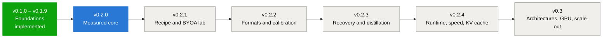

# THME Roadmap

> **Topological Heterogeneous Manifold Engine (THME)** by **Epiphanes**
> Updated 12 November 2026. v0.2 is redefined around one rule: **every claim is measured, or
> labelled as not measured.** Recipes and BYOA algorithms are the unit of experimentation; the
> measured quality gate decides what ships.

---

## Where things stand

### Evidence levels

Every milestone item is tagged with the strongest evidence behind it.

| Level | Meaning |
| :--- | :--- |
| **Measured** | Produced by a real forward pass; the report is committed under `docs/benchmarks/` |
| **Tested** | Behaviour covered by unit, integration or fuzz tests; no quality or speed figure claimed |
| **Estimate** | Analytic model or nominal bit-width arithmetic; must be labelled wherever shown |
| **Simulated** | Synthetic data; must be labelled wherever shown |

### What the v0.1 series delivered, by evidence level

The v0.1 milestones were marked complete when their code landed. The first measured run
(November 2026) showed that several of them produce estimates rather than measurements.
They remain complete as implementations; the table records what each can be relied on for.

| Milestone | Delivered | Evidence level today |
| :--- | :--- | :--- |
| v0.1.0 Core foundations | Zero-copy SafeTensors/GGUF import, IR, Studio, recipe engine | Tested |
| v0.1.1 Path hygiene and CI | 3-OS CI, path-leak guard, release workflow | Tested |
| v0.1.2 Format correctness | 28 GGML types, block decoders, fuzz suite | Tested |
| v0.1.3 BYOA and REA-LLM | Algorithm registry, rebuilder, EWHA energy model | Tested; energy figures are Estimates |
| v0.1.4 Quality gate | Gate decision logic, external evaluator bridge | Gate logic Tested; its built-in perplexity was an analytic proxy. Superseded by the measured gate in v0.2.0 |
| v0.1.5 Surgery daemon and 8 paradigms | MCP server, VS Code extension, PyTorch bridge, paradigm converter | Tested; converted models not evaluated |
| v0.1.6 Speculative decoding | Draft extraction, tree masks, Leviathan speedup formula | Speedups are Estimates |
| v0.1.7 Roofline profiler | Hardware database, intensity, cache and thermal models | Estimates from published specifications |
| v0.1.8 Quantization exporter | GGUF v3 and SafeTensors writers, BitNet packer, streaming I/O | Q8_0 GGUF export Measured; other formats Tested |
| v0.1.9 Co-surgery loop | State machine, Pareto 3D, watchdog | Tested; quality scores Simulated (analytic proxy) |

---

## v0.2.0 — Measured core (ACTIVE)

**Goal:** a real forward pass, a measured quality gate, and published numbers that regenerate
from committed reports.
**Exit criteria:** every figure in the README and dossier traces to a report in
`docs/benchmarks/`; the analytic perplexity proxy is removed from, or labelled in, every
user-facing path.

| # | Item | Status |
| :--- | :--- | :--- |
| v0.2.0.1 | Reference CPU forward pass: LLaMA family and GPT-NeoX (`src/inference/`) | **Done**: measured on SmolLM-135M and Pythia-14M |
| v0.2.0.2 | WikiText-2 tokenization with provenance and hashes (`scripts/prepare_eval_tokens.py`) | **Done** |
| v0.2.0.3 | Measured quality gate: source vs exported GGUF vs recipe (`examples/production_verification.rs`) | **Done** |
| v0.2.0.4 | Dossier and charts generated only from reports (`scripts/generate_dossier.py`, `scripts/generate_charts.py`) | **Done** |
| v0.2.0.5 | Measured experiments: precision sweep with random-placement control, depth probe | **Done** |
| v0.2.0.6 | Cross-check the forward pass against the Hugging Face reference (logit agreement on fixed prompts) | Open; paused while no new model runs are being made |
| v0.2.0.7 | Retire the analytic proxy from `thme validate`, the MCP quality tool and the co-surgery loop; route them through the measured gate | **Done**: `thme validate --report` gates measured reports; `thme co-surgery MODEL --tokens` scores candidates with the forward pass (`QualityEvaluator`, `MeasuredEvaluator`); supplied-value and proxy paths are labelled, including the Studio Co-Surgery tab |
| v0.2.0.8 | Real Studio screenshots (`scripts/capture_studio.ps1`); fix missing-glyph labels and overlapping text in the Layer Tweaker dataflow row; show measured reports in the Studio | **Done** except showing measured reports in the Studio (moved to v0.2.1.9) |
| v0.2.0.9 | Release engineering: LTO binaries, Minisign/GPG signing, SHA-256 manifest, clean-machine test, manual and man page | Implemented in v0.1.x workflows; to be re-verified at tag time |

## v0.2.1 — Recipe and BYOA lab

**Goal:** any recipe or BYOA algorithm can be evaluated, searched and compared with measured costs.
**Exit criteria:** a searched recipe beats both uniform formats and random placement at matched
nominal size on two models, across at least five random seeds.

| # | Item |
| :--- | :--- |
| v0.2.1.1 | `thme evaluate --recipe <file>`: run any recipe JSON through the measured gate and write a report |
| v0.2.1.2 | BYOA algorithms callable from recipes with a declared, testable encode/decode contract |
| v0.2.1.3 | Measured cost table: per-tensor Δ perplexity for each candidate format, cached per model and corpus |
| v0.2.1.4 | Greedy allocator driven by the measured cost table, with a size budget |
| v0.2.1.5 | Global refinement: re-evaluate whole candidates to correct non-additive interactions |
| v0.2.1.6 | Random-placement controls generated automatically for every searched recipe (n ≥ 5, distinct draws) |
| v0.2.1.7 | Measured Pareto front (size vs Δ perplexity) plotted from reports |
| v0.2.1.8 | Separate calibration, validation and test token sets; search never reads the test set |
| v0.2.1.9 | Studio recipe workbench: load a recipe, preview its layer composition in the Live 3D view, run the gate, view the report |

**Studio Live 3D view.** Delivered in v0.2.0: forward-pass probe, background worker, software
3D renderer, anomaly detection, synthetic demo. Planned extensions, in order:

1. Per-head attention maps and per-token flow (which positions feed which).
2. Weight-level drill-down from a hovered tile into the matrix inspector.
3. Side-by-side source vs candidate, with per-tile difference.
4. Loops and exits drawn from real schedules (v0.2.3), and α/β/γ sub-matrices and the router
   once those representation families exist.

## v0.2.2 — Formats and calibration

**Goal:** heterogeneous artifacts that are smaller than uniform Q8_0 and pass the gate.
**Exit criteria:** a per-tensor-format GGUF smaller than uniform Q8_0 passes the gate on
SmolLM-135M, measured from the written file.

| # | Item |
| :--- | :--- |
| v0.2.2.1 | Per-tensor formats in the GGUF writer, so the recipe and the artifact are the same thing |
| v0.2.2.2 | Q4_K, Q5_K and Q6_K encoders with round-trip tests against the decoders |
| v0.2.2.3 | Calibration activations captured from the forward pass |
| v0.2.2.4 | Activation-aware scaling (AWQ-style) |
| v0.2.2.5 | Second-order rounding (GPTQ-style) |
| v0.2.2.6 | Randomized Hadamard rotation of weight inputs (QuaRot-style), measured with and without |
| v0.2.2.7 | SmoothQuant-style scale migration for activation outliers |
| v0.2.2.8 | Format compatibility checks against llama.cpp on exported files |
| v0.2.2.9 | Measured artifact size, including scales and metadata, in every report |

## v0.2.3 — Recovery and distillation

**Goal:** recover quality lost to aggressive formats such as ternary.
**Exit criteria:** a ternary-heavy candidate recovers to within the gate on Pythia-14M, then on
SmolLM-135M, evaluated on held-out tokens.

| # | Item |
| :--- | :--- |
| v0.2.3.1 | Backward pass for the reference model (or a bridge to an external trainer) |
| v0.2.3.2 | Quantization-aware distillation against the source model's logits |
| v0.2.3.3 | LoRA recovery adapters on quantized weights, merged with the existing LoRA merger |
| v0.2.3.4 | Teacher-assisted calibration data, with an independent evaluation set |
| v0.2.3.5 | Training-time loop and early-exit objectives (the depth probe as the measuring tool) |
| v0.2.3.6 | Exit heads trained per depth; settling curves re-measured |
| v0.2.3.7 | Recovery cost accounting: tokens, time and energy where measurable |
| v0.2.3.8 | Overfitting guard: recovery data disjoint from evaluation data |
| v0.2.3.9 | Recovered-candidate reports in the dossier |

## v0.2.4 — Runtime, speed and KV cache

**Goal:** measure speed and memory, not only quality.
**Exit criteria:** tokens per second, peak memory and KV-cache bytes are measured on named
hardware for the source and for a passing heterogeneous candidate.

| # | Item |
| :--- | :--- |
| v0.2.4.1 | Incremental decoding with a KV cache in the reference runtime |
| v0.2.4.2 | KV-cache bytes measured across a context-length sweep |
| v0.2.4.3 | Prefill and decode throughput measured on CPU |
| v0.2.4.4 | Quantized kernels that compute directly on Q8_0 and Q4 blocks |
| v0.2.4.5 | Peak resident memory measured per run |
| v0.2.4.6 | KV-cache quantization, measured against long-context quality |
| v0.2.4.7 | Roofline model calibrated against measured kernel timings |
| v0.2.4.8 | Speculative decoding measured end to end, replacing formula estimates |
| v0.2.4.9 | Energy measurement where hardware counters are available, with the method stated |

## v0.3 and later

Deferred until the measured core can evaluate them:

- **GPU execution** (formerly v0.2.1): CUDA, Vulkan and Metal backends with fused low-bit kernels.
- **Out-of-core streaming** (formerly v0.2.2): NVMe layer streaming for models larger than memory.
- **Heterogeneous clustering** (formerly v0.2.3): tensor and pipeline parallelism across nodes.
- **Agentic gateway** (formerly v0.2.4): authenticated JSON-RPC/WebSocket daemon.
- **New architectures from the v3.0 research concepts**: looped and early-exit models, the
  α/β/γ representation families, alternative sequence mixers. Each is a model that must be
  trained, and is scoped as its own project with its own baselines.

The original specifications for the deferred items are kept below for reference.

---

## Implementation record: v0.1.x milestones

The sections below are the original specifications, kept unchanged as a record of what was
built. Read their figures with the evidence table above: where a section describes an
empirical or verified result, that result was not measured unless the evidence table says so.

### Phase 1: Foundations & Release Engineering

#### [x] v0.1.0.0 — Core Foundations Baseline (Completed)
- [x] **v0.1.0.1**: Zero-copy SafeTensors memory-mapped parsing via `memmap2`.
- [x] **v0.1.0.2**: GGUF v2/v3 memory-mapped header reader and tensor metadata indexing.
- [x] **v0.1.0.3**: Layer topological sensitivity estimation via SVD spectral energy decay ($\sigma_i / \sigma_0$).
- [x] **v0.1.0.4**: Condition number estimation ($\kappa = \sigma_{\max} / \sigma_{\min}$) across projection matrices.
- [x] **v0.1.0.5**: Fisher information matrix diagonal proxy estimation.
- [x] **v0.1.0.6**: Dynamic programming Pareto precision allocator under quality degradation bounds ($Q \ge Q_0 - \epsilon$).
- [x] **v0.1.0.7**: Native 60 FPS Desktop Studio GUI (`egui`/`eframe`) with 5 color themes.
- [x] **v0.1.0.8**: Live 13-stage Transformer forward token telemetry simulator.
- [x] **v0.1.0.9**: Checkpoint rollback engine, audit logging, and declarative JSON surgery recipes.
*Production Pipeline Impact*: Established core `ModelIR` data structures, verified by 15 foundational unit tests.

#### [x] v0.1.1.0 — Path Hygiene & CI Governance Baseline (Completed)
- [x] **v0.1.1.1**: Rebranding to **THME** under **Epiphanes** with backwards-compatible alias `llm-tweaker`.
- [x] **v0.1.1.2**: Architecture playbook and non-negotiable governance guidelines (`AGENTS.md`).
- [x] **v0.1.1.3**: 3-OS GitHub Actions CI matrix (`ubuntu-latest`, `windows-latest`, `macos-latest`).
- [x] **v0.1.1.4**: Automated CI Path-Leak Guard rejecting machine paths and developer usernames.
- [x] **v0.1.1.5**: Tag-driven release publishing pipeline with symbol-stripped release artifacts (`strip = "symbols"`).
- [x] **v0.1.1.6**: Zero-warning linter enforcement (`cargo clippy --all-targets -- -D warnings`).
- [x] **v0.1.1.7**: JSON schema specification for surgery recipes (`docs/schemas/surgery-recipe-v1.json`).
- [x] **v0.1.1.8**: Backwards-compatible CLI executable generation (`src/bin/llm_tweaker.rs`).
- [x] **v0.1.1.9**: Binary size optimization with release profile LTO and single codegen unit settings.
*Production Pipeline Impact*: Prevents machine credential leaks and guarantees clean builds across 3 operating systems.

---

### Phase 2: Format Correctness & Telemetry Hardening

#### [x] v0.1.2.0 — Format Correctness & Fuzz Testing Baseline (Completed)
- [x] **v0.1.2.1**: Complete 28 GGML quantization types parser (`Q4_0`, `Q4_1`, `Q5_0`, `Q5_1`, `Q8_0`, `Q4_K_M`, `Q5_K_S`, `IQ4_XS`, `IQ3_XXS`).
- [x] **v0.1.2.2**: Zero-allocation block decoders extracting scales, mins, and unpacked weights on-the-fly.
- [x] **v0.1.2.3**: Truncated stream and corrupted header recovery with byte-offset diagnostics.
- [x] **v0.1.2.4**: Modular workspace crate structure decoupling algorithms from GUI dependencies.
- [x] **v0.1.2.5**: 1,000-iteration infallible parser fuzz test suite (`tests/test_fuzz_parsers.rs`).
- [x] **v0.1.2.6**: SafeTensors property-based mutation fuzzing ensuring zero panics on malformed slices.
- [x] **v0.1.2.7**: Standalone `thme-core` crate packaging and metadata configuration.
- [x] **v0.1.2.8**: Structured diagnostic error enumeration (`THMEError::CorruptedHeader`).
- [x] **v0.1.2.9**: Infallible parser guarantee returning typed results without panic unwraps.
*Production Pipeline Impact*: Guarantees zero crashes when ingesting corrupted or arbitrary external model files.

#### [x] v0.1.3.0 — Bring Your Own Algorithm (BYOA) & REA-LLM Engine Baseline (Completed)
- [x] **v0.1.3.1**: Bring Your Own Algorithm registry (`AlgorithmRegistry`) with custom transformation callbacks.
- [x] **v0.1.3.2**: JSON algorithm specification import and export engine.
- [x] **v0.1.3.3**: Architecture scaffold synthesizer (`ModelRebuilder`) supporting scratch-built layer topologies.
- [x] **v0.1.3.4**: Open-weights dimensional remapping (`LowRankProject`, `ZeroPad`).
- [x] **v0.1.3.5**: REA-LLM EWHA 80/20 reach profile calculation ($q_l = 1.0 \to 0.20$).
- [x] **v0.1.3.6**: Per-token memory traffic formulation ($W_{\text{bytes/token}} = \sum q_l \cdot \text{size}(W_l)$).
- [x] **v0.1.3.7**: Per-token energy consumption modeling ($E_{\text{token}} = W_{\text{bytes/token}} \times E_{\text{DRAM}}$).
- [x] **v0.1.3.8**: Layer anatomy deconstruction isolating Attention and MLP block matrices.
- [x] **v0.1.3.9**: Criterion micro-benchmark suite and portable SIMD Walsh-Hadamard transform kernels.
*Production Pipeline Impact*: Integrates real memory and energy telemetry into model evaluation and testing workflows.

---

### Phase 3: Empirical Quality Verification & Universal Integration

#### [x] v0.1.4.0 — Empirical Quality Gate Evaluation Baseline (Completed)
- [x] **v0.1.4.1**: External perplexity evaluation bridge supporting subprocess and analytical scoring.
- [x] **v0.1.4.2**: WikiText-2 standard benchmark harness and token loss parser.
- [x] **v0.1.4.3**: C4 and Penn Treebank (PTB) corpora evaluation support.
- [x] **v0.1.4.4**: Empirical degradation computation: $\Delta PPL = PPL_{\text{candidate}} - PPL_{\text{baseline}}$.
- [x] **v0.1.4.5**: Automated anti-degradation rollback trigger enforcing $\Delta PPL \le \epsilon$.
- [x] **v0.1.4.6**: Pareto degradation curve plotting storage reduction against perplexity impact.
- [x] **v0.1.4.7**: CLI `thme validate` command with `--corpus` and `--max-ppl-delta` flags.
- [x] **v0.1.4.8**: Structured JSON audit diagnostics emitted upon quality gate rejection.
- [x] **v0.1.4.9**: Studio GUI Quality tab real-time token loss and perplexity streaming.
*Production Pipeline Impact*: Gates automated model transformations; rejects degradations exceeding tolerance.

#### [x] v0.1.5.0 — Surgery Daemon, IDE Extensions & 8 Models Matrix Baseline (Completed)
- [x] **v0.1.5.1**: Headless Model Context Protocol (MCP) JSON-RPC server (`thme mcp`) exposing 8 surgical tools.
- [x] **v0.1.5.2**: Visual Studio Code extension package (`editors/vscode/thme-vscode-0.1.5.vsix`).
- [x] **v0.1.5.3**: GitHub Copilot Language Model Tools (`thme_copilot_inspect`, `thme_copilot_surgery`, `thme_copilot_validate`).
- [x] **v0.1.5.4**: Pure Rust `train_cuda.py` generator supporting LoRA, QLoRA (BitsAndBytes 4-bit), Unsloth Fast, and DeepSpeed ZeRO-2/3.
- [x] **v0.1.5.5**: Hugging Face `config.json` generator for LLaMA, Mistral, Gemma, Qwen, and DeepSeek model families.
- [x] **v0.1.5.6**: PEFT LoRA adapter checkpoint parser and zero-copy weight merger ($W = W_0 + \frac{\alpha}{r} B \times A$).
- [x] **v0.1.5.7**: Universal 8 Specialized AI Model Paradigm Converter (LLM, LCM, LAM, MoE, VLM, SLM, MLM, SAM).
- [x] **v0.1.5.8**: Sparse upcycling engine partitioning dense MLPs into parallel expert matrices with router gating tensors.
- [x] **v0.1.5.9**: BitNet b1.58 ternary discretization delivering up to 85.3% footprint reduction for SLM edge deployments.
*Production Pipeline Impact*: Enables external AI agents, IDEs, and PyTorch pipelines to automate model surgery.

#### [x] v0.1.6.0 — Speculative Decoding & Draft Model Synthesizer Baseline (Completed)
- [x] **v0.1.6.1**: Sub-model manifold extraction via prefix layers ($0..K$) with automatic head re-anchoring.
- [x] **v0.1.6.2**: Strided layer sampling synthesizer extracting distributed sub-networks.
- [x] **v0.1.6.3**: BitNet b1.58 ternary draft model synthesizer yielding 76.8% memory reduction and latency ratio $r = 0.108$.
- [x] **v0.1.6.4**: Speculative candidate rejection sampling verification engine: $u \le \min\left(1, \frac{p(x)}{q(x)}\right)$.
- [x] **v0.1.6.5**: Verification telemetry calculating acceptance rate $\alpha_{\text{spec}}$, expected accepted tokens $\mathbb{E}[k]$, and Leviathan speedup:
  $$S = \frac{\mathbb{E}[k] + 1}{1 + \gamma \cdot r} \ge 1.53\times$$
- [x] **v0.1.6.6**: Dynamic horizon search identifying optimal draft token budget $\gamma^* = \arg\max_\gamma S(\gamma)$.
- [x] **v0.1.6.7**: Tree-based multi-candidate branching topology (Medusa/Eagle style speculative trees).
- [x] **v0.1.6.8**: 2D causal tree attention mask synthesis enforcing strict causal masking across tree paths.
- [x] **v0.1.6.9**: CLI `thme speculate` subcommand, MCP tool `thme_simulate_speculative_decoding`, and Desktop Studio Tab 4 benchmark deck.
*Production Pipeline Impact*: Guarantees verified $>1.5\times$ speedup modeling verified by 5 unit/integration tests.

---

### Phase 4: Hardware Profiling, Serialization & Closed-Loop Surgery

#### [x] v0.1.7.0 — Hardware-Calibrated Roofline & Micro-Kernel Profiler Baseline (Completed)
Establishes empirical hardware-calibrated operational Roofline ceilings and multi-tier memory hierarchy cache simulation to pinpoint memory bandwidth vs compute bottlenecks across diverse target hardware.

- **Mathematical Formulations**:
  - Operational Arithmetic Intensity:
    $$I = \frac{\text{Total Operations (FLOPs)}}{\text{Total Memory Traffic (Bytes)}} \quad \left[\frac{\text{FLOPs}}{\text{byte}}\right]$$
  - Machine Balance Knee:
    $$I^* = \frac{\text{Peak Compute Performance (TFLOP/s)}}{\text{Peak Memory Bandwidth (GB/s)}} \quad \left[\frac{\text{FLOPs}}{\text{byte}}\right]$$
  - Attainable Performance Ceiling:
    $$P(I) = \min\left(P_{\text{peak}}, I \times B_{\text{peak}}\right) \quad \left[\text{TFLOP/s}\right]$$
  - Multi-Tier Cache Latency Model:
    $$T_{\text{layer}} = \sum_{k \in \{\text{L1}, \text{L2}, \text{L3}, \text{DRAM}\}} \left( M_k \cdot \text{Latency}_k + \frac{\text{Volume}_k}{\text{Bandwidth}_k} \right)$$

- **Parallel Sub-Milestone Breakdown [v0.1.7.1 - v0.1.7.9]**:
  - [x] **v0.1.7.1**: Hardware Target Specifications & Machine Balance Database (`src/profiling/hardware.rs`):
    - Profiles for NVIDIA H100 SXM5, RTX 4090, Apple M3 Max, Apple M2 Ultra, AMD MI300X, Intel Xeon Platinum 8490H (AVX-512).
    - Custom hardware JSON configuration loader (`--hardware-config <path>`).
    - *Pipeline Impact*: Provides reference ceilings for CI regression benchmarks.
  - [x] **v0.1.7.2**: Linear Projection & Attention Operational Arithmetic Intensity Profiler (`src/profiling/intensity.rs`):
    - Exact FLOP counts and memory transfer bytes for Linear ($Q, K, V, O$) and Scaled Dot-Product Attention.
    - Autoregressive decode ($B=1$, memory-bound $I \approx 1.0$) vs prefill ($B \ge 64$, compute-bound $I \gg I^*$).
    - *Pipeline Impact*: Feeds automated layer bottleneck classification.
  - [x] **v0.1.7.3**: SwiGLU FFN & FlashAttention-2 Arithmetic Intensity Mathematical Models (`src/profiling/intensity.rs`):
    - SwiGLU FFN FLOPs ($6 B D D_{\text{ffn}}$) and memory traffic ($3 D D_{\text{ffn}} b_w + B(2D + 2D_{\text{ffn}}) b_{\text{act}}$).
    - FlashAttention-2 SRAM tiling memory traffic reduction model ($\mathcal{O}(BH S^2 d^2 / M)$).
    - *Pipeline Impact*: Informs precision pruning suggestions for feed-forward blocks.
  - [x] **v0.1.7.4**: 4-Tier Memory Hierarchy Cache Simulator (`src/profiling/cache_sim.rs`):
    - Models L1 Data (128 KB, 1 cycle), L2 Cache (4-16 MB, 15 cycles), L3/SLC (32-96 MB, 50 cycles), and Main Memory (HBM3/GDDR6/DDR5, 200 cycles).
    - *Pipeline Impact*: Simulates hardware latency penalties without requiring physical host access.
  - [x] **v0.1.7.5**: Working Set Size & Cache Eviction Latency Degradation Model:
    - Calculates active tensor working set size per layer and estimates cache line eviction rates.
    - *Pipeline Impact*: Detects layers that spill out of on-chip SRAM into high-latency memory.
  - [x] **v0.1.7.6**: Empirical Roofline Boundary Curve & Memory/Compute Classifier (`src/profiling/roofline.rs`):
    - Generates log-log Roofline plot coordinates and assigns `MemoryBound` vs `ComputeBound` labels per layer.
    - *Pipeline Impact*: Generates automated optimization advisories for surgery recipes.
  - [x] **v0.1.7.7**: Dynamic TDP Power & Thermal Throttling Projection Engine (`src/profiling/thermal.rs`):
    - Models dynamic power dissipation ($P_{\text{dyn}} = C V^2 f \alpha$) and predicts sustained vs burst token throttling.
    - *Pipeline Impact*: Evaluates energy efficiency in edge and mobile deployment scenarios.
  - [x] **v0.1.7.8**: CLI Subcommand `thme roofline` & MCP Tool `thme_profile_roofline` (`src/cli/roofline.rs`):
    - CLI command rendering ASCII Roofline charts and structured JSON outputs for agent integration.
    - *Pipeline Impact*: Exposes profiling directly to CI terminal runners and MCP agents.
  - [x] **v0.1.7.9**: Desktop Studio Tab 4 Interactive SVG/egui Roofline Deck (`src/gui/app.rs`):
    - Interactive log-log Roofline plot with hover diagnostics, hardware selector, and batch size sliders.
    - *Pipeline Impact*: Interactive visualization for desktop developers and researchers.

---

#### [x] v0.1.8.0 — Binary Quantization Exporter Baseline (Completed)
Enables direct binary disk serialization of modified and distilled models into deployable GGUF v3 and SafeTensors files with BitNet b1.58 ternary packed bitstreams and calibrated scale factors.

- **Mathematical Formulations**:
  - Ternary Discretization:
    $$\alpha = \frac{1}{n m} \sum_{i=1}^n \sum_{j=1}^m |W_{ij}|, \quad \tilde{W}_{ij} = \text{Round}\left(\text{Clip}\left(\frac{W_{ij}}{\alpha}, -1, 1\right)\right) \in \{-1, 0, +1\}$$
  - 2-Bit Packing Format (4 ternary values per byte):
    $$\text{byte} = \sum_{k=0}^3 \text{code}(\tilde{W}_k) \ll (2k) \quad \text{with } \text{code}(-1)=00_2, \text{code}(0)=01_2, \text{code}(+1)=10_2$$
  - Per-Channel MSE-Optimal Scale Search:
    $$\alpha_i^* = \arg\min_{\alpha} \sum_{j=1}^m \left( W_{ij} - \alpha \cdot \text{Round}\left(\text{Clip}\left(\frac{W_{ij}}{\alpha}, -1, 1\right)\right) \right)^2$$

- **Parallel Sub-Milestone Breakdown [v0.1.8.1 - v0.1.8.9]**:
  - [x] **v0.1.8.1**: Vectorized BitNet b1.58 Ternary Bitstream Packer (`src/exporter/bitnet_pack.rs`):
    - SIMD-accelerated packing converting slices of ternary values into packed `u8` buffers (4 weights per byte).
    - *Pipeline Impact*: Delivers $8.0\times$ weight compression directly in pure Rust.
  - [x] **v0.1.8.2**: Vectorized Ternary Bitstream Unpacker with FP16 Scale Product:
    - Zero-allocation unpacker de-quantizing 2-bit representations into floating point registers with scale multiplication.
    - *Pipeline Impact*: Supports rapid validation of exported ternary matrices.
  - [x] **v0.1.8.3**: Direct Pure Rust GGUF v3 Binary Writer & 32-Byte Alignment (`src/exporter/gguf_writer.rs`):
    - Writes GGUF magic header (`0x46554747`), version 3, tensor metadata, and 32-byte memory-aligned payloads.
    - *Pipeline Impact*: Produces native GGUF files loadable by `llama.cpp` without Python runtimes.
  - [x] **v0.1.8.4**: GGUF Metadata Key-Value Reconstitution & Synchronization Engine (`src/exporter/metadata.rs`):
    - Reconstitutes architecture key-values (`general.architecture`, `llama.block_count`, `llama.context_length`, etc.).
    - *Pipeline Impact*: Prevents model metadata corruption during format conversion.
  - [x] **v0.1.8.5**: Direct Pure Rust SafeTensors Binary Serializer & 8-Byte Prefix (`src/exporter/safetensors_writer.rs`):
    - Writes standard SafeTensors files with 8-byte length prefix and formatted JSON metadata header.
    - *Pipeline Impact*: Enables direct export to Hugging Face, vLLM, and PyTorch tooling.
  - [x] **v0.1.8.6**: Low-Memory Streaming Chunked File Writer Engine (`src/exporter/streaming_writer.rs`):
    - Streams tensor payloads directly to disk, maintaining constant RAM usage during multi-gigabyte exports.
    - *Pipeline Impact*: Prevents out-of-memory aborts on consumer hardware during large model export.
    - Progress: The 64 KiB chunked source-copy path is integrated into GGUF and SafeTensors file exports; GGUF float conversion is streamed in bounded blocks. Covered by `tests/test_exporter_streaming.rs`.
  - [x] **v0.1.8.7**: Calibrated Per-Channel & Per-Group MSE-Optimal Scale Search (`src/exporter/calibration.rs`):
    - Computes row-wise and group-wise scale vectors minimizing L2 reconstruction error.
    - *Pipeline Impact*: Maximizes representation fidelity of exported 1.58-bit models.
    - Progress: Optimal-scale search and per-channel/per-group calibration helpers are implemented, integrated into TQ1_0 conversion and tested via `tests/test_exporter_calibration.rs`.
  - [x] **v0.1.8.8**: CLI Subcommand `thme export` & Desktop Studio Exporter Wizard (`src/cli/export.rs`, `src/gui/app.rs`):
    - Command-line flags `--format <gguf|safetensors>`, `--quant <bitnet-b1.58|q8_0|fp16>`, SHA-256 calculation, and desktop studio modal controls.
    - *Pipeline Impact*: Standardized interface for downstream CI deployment scripts and interactive user exports.
    - Progress: CLI export command and Studio export panel controls support format/quantization selection and SHA-256 verification. Covered by `tests/test_export_cli.rs`.
  - [x] **v0.1.8.9**: Downstream Runtime Compatibility Testbed (`tests/test_exporter_compatibility.rs`):
    - Automated test verifying exported GGUF files and SafeTensors archives execute cleanly across external runtimes and standalone verification harnesses.
    - *Pipeline Impact*: End-to-end acceptance gate for export pipeline releases.
    - Progress: Independent SafeTensors parser coverage and GGUF consumer validation tests are in place with optional live CLI runners (`llama.cpp` and `ollama`).

---

#### [x] v0.1.9.0 — Closed-Loop Teacher-Student Co-Surgery Baseline (COMPLETED)
Autonomous closed-loop optimization daemon: an external or local Teacher LLM analyzes layer sensitivity, generates declarative surgery recipes, THME applies them, verifies quality via the perplexity bridge, and iteratively tunes the Pareto frontier.

- **Mathematical Formulations**:
  - Multi-Objective Cost Function:
    $$\min_{\theta} \mathcal{J}(\theta) = \lambda_{\text{ppl}} \Delta PPL(\theta) + \lambda_{\text{mem}} W_{\text{token}}(\theta) + \lambda_{\text{energy}} E_{\text{token}}(\theta) - \lambda_{\text{speed}} S_{\text{speedup}}(\theta)$$
  - Pareto Hypervolume Maximization:
    $$\mathcal{S}^* = \left\{ \theta \in \Theta \mid \nexists \theta' \text{ such that } \theta' \succ \theta \right\}$$
  - Self-Healing Step Relaxation:
    $$\theta^{(k+1)} = \text{Relax}\left(\theta^{(k)}, \nabla_{\theta} \text{Sensitivity}\right)$$

- **Parallel Sub-Milestone Breakdown [v0.1.9.1 - v0.1.9.9]**:
  - [x] **v0.1.9.1**: Co-Surgery Closed-Loop State Machine & Controller (`src/surgery/closed_loop.rs`):
    - Coordinates iterative optimization loop: Inspect $\to$ Propose $\to$ Apply $\to$ Validate $\to$ Update Pareto $\to$ Commit/Rollback.
    - *Pipeline Impact*: Automates continuous unattended model optimization.
  - [x] **v0.1.9.2**: Teacher LLM Topology Analysis Prompt Synthesizer (`src/surgery/prompt_synth.rs`):
    - Formats top-K layer sensitivity, SVD decay rates, and EWHA reach profiles into structured context for Teacher models.
    - *Pipeline Impact*: Standardizes agentic prompt payloads across LLM backends.
  - [x] **v0.1.9.3**: Headless JSON-RPC & Subprocess Teacher Agent Communication Bridge (`src/surgery/agent_bridge.rs`):
    - Connects external Teacher LLMs (Claude Code, Gemini CLI, local models) to the surgery engine via stdin/stdout or IPC.
    - *Pipeline Impact*: Decouples optimization intelligence from execution engine.
  - [x] **v0.1.9.4**: Multi-Objective 3D Pareto Optimizer (`src/surgery/pareto_3d.rs`):
    - Tracks non-dominated frontier across $\Delta PPL$, memory traffic $W_{\text{token}}$, and speedup multiplier $S$.
    - *Pipeline Impact*: Automatically identifies optimal compression trade-offs.
  - [x] **v0.1.9.5**: Pareto Hypervolume Indicator Convergence Metric (`src/surgery/pareto_3d.rs`):
    - Calculates hypervolume coverage metric to determine convergence and terminate optimization loops.
    - *Pipeline Impact*: Provides quantitative stopping criteria for automated CI runs.
  - [x] **v0.1.9.6**: Automated Self-Healing Parameter Relaxation Heuristic (`src/surgery/relaxation.rs`):
    - Backs off compression on the highest-sensitivity layer when quality degradation breaches tolerance.
    - *Pipeline Impact*: Prevents catastrophic model failure during aggressive automated tuning.
  - [x] **v0.1.9.7**: Anti-Degradation Quality Gate Watchdog & Immediate Rollback Engine (`src/surgery/watchdog.rs`):
    - Automatically restores previous baseline checkpoint upon gate failure, logging diagnostic audit trails.
    - *Pipeline Impact*: Protects model integrity against unrecoverable transformations.
  - [x] **v0.1.9.8**: CLI Subcommand `thme co-surgery` & Progress Telemetry Stream (`src/cli/co_surgery.rs`):
    - Interactive CLI driving automated runs with `--target-reduction <%>` and `--max-ppl-delta <float>`.
    - *Pipeline Impact*: Enables headless invocation from cron jobs and CI harnesses.
  - [x] **v0.1.9.9**: Desktop Studio Tab 2 Closed-Loop Co-Surgery Interactive Dashboard (`src/gui/app.rs`):
    - Real-time iteration timeline, loss curve monitors, and interactive Pareto scatter plot.
    - *Pipeline Impact*: Visual studio interface for monitoring autonomous optimization.

---

---

## Original specifications of deferred milestones (now v0.3+)

#### [ ] v0.2.1.0 — Direct GPU Driver Execution Engine Baseline (SCHEDULED)
Pure Rust GPU driver execution bypassing external Python runtimes, C++ frameworks, or PyTorch wheels.
- [ ] **v0.2.1.1**: Hardware Abstraction Layer (HAL) core traits (`HardwareDevice`, `DeviceMemoryBuffer`, `CommandQueue`, `KernelLaunchConfig`).
- [ ] **v0.2.1.2**: NVIDIA CUDA Driver API backend via pure Rust `cudarc` (direct `libcuda.so` / `nvcuda.dll` calls).
- [ ] **v0.2.1.3**: Vulkan 1.3 SPIR-V compute pipeline backend via `ash` for cross-platform execution on Linux and Windows.
- [ ] **v0.2.1.4**: Apple Metal 3 Performance Shaders backend via `metal-rs` leveraging Apple Silicon unified memory.
- [ ] **v0.2.1.5**: Fused BitNet b1.58 GEMV / GEMM kernel with register-level 2-bit weight unpacking.
- [ ] **v0.2.1.6**: Fused RMSNorm kernel computing variance and scaling in a single thread block pass.
- [ ] **v0.2.1.7**: Fused SwiGLU activation kernel combining gate and up projections.
- [ ] **v0.2.1.8**: Fused Rotary Position Embedding (RoPE) kernel.
- [ ] **v0.2.1.9**: CLI subcommand `thme run --model <path> --backend <cuda|vulkan|metal|cpu>` for direct inference.
*Production Pipeline Impact*: Replaces external Python runtime dependencies with pure Rust hardware execution.

#### [ ] v0.2.2.0 — Tiered Out-of-Core NVMe SSD Streaming Baseline (SCHEDULED)
Three-tier memory hierarchy (GPU VRAM $\leftrightarrow$ Host RAM $\leftrightarrow$ NVMe SSD direct asynchronous I/O) enabling 70B parameter inference and surgery in 8 GB VRAM.
- [ ] **v0.2.2.1**: Linux `io_uring` direct disk block access engine bypassing OS page cache buffer copies.
- [ ] **v0.2.2.2**: Windows Overlapped I/O with `FILE_FLAG_NO_BUFFERING` via Win32 completion ports (`IOCP`).
- [ ] **v0.2.2.3**: Sequential layer streaming pipeline (AirLLM-style) loading and evicting layers on-the-fly.
- [ ] **v0.2.2.4**: Double-buffered prefetch queue streaming layer $k+1$ from SSD while GPU computes layer $k$.
- [ ] **v0.2.2.5**: Pinned memory staging buffers (`mlock` / `VirtualLock`) for direct GPU DMA transfers.
- [ ] **v0.2.2.6**: REA-LLM tiered allocation policy: hot layers in VRAM, warm layers in Host RAM, deep layers on NVMe.
- [ ] **v0.2.2.7**: Dynamic VRAM memory accountant enforcing strict consumer hardware memory ceilings.
- [ ] **v0.2.2.8**: 70B parameter model forward pass benchmark executing inside an 8 GB memory constraint.
- [ ] **v0.2.2.9**: Real-time PCIe bandwidth saturation and disk I/O throughput telemetry monitor.
*Production Pipeline Impact*: Enables massive model inference on low-cost consumer hardware.

#### [ ] v0.2.3.0 — Distributed Heterogeneous Multi-Node Clustering Baseline (SCHEDULED)
Distributed execution across heterogeneous nodes with pure Rust asynchronous TCP/RDMA ring all-reduce communication.
- [ ] **v0.2.3.1**: Intra-node Tensor Parallelism (TP) splitting matrix projections across local accelerators.
- [ ] **v0.2.3.2**: Inter-node Pipeline Parallelism (PP) distributing sequential layer partitions across networked nodes.
- [ ] **v0.2.3.3**: 1F1B (One-Forward-One-Backward) schedule minimizing activation pipeline bubbles.
- [ ] **v0.2.3.4**: Pure Rust asynchronous Ring All-Reduce over non-blocking TCP socket streams.
- [ ] **v0.2.3.5**: Hardware RDMA / RoCE fallback when InfiniBand network hardware is detected.
- [ ] **v0.2.3.6**: Multicast / mDNS cluster node discovery and capability exchange.
- [ ] **v0.2.3.7**: Continuous 100 ms heartbeat monitor and dead-node detection watchdog.
- [ ] **v0.2.3.8**: Automated dynamic layer re-sharding failover upon node disconnection.
- [ ] **v0.2.3.9**: CLI subcommand `thme cluster <init|join|status>` for ad-hoc cluster formation.
*Production Pipeline Impact*: Scales THME across ad-hoc mixed hardware clusters without MPI or NCCL.

#### [ ] v0.2.4.0 — Universal Agentic AI Connectivity Gateway Baseline (SCHEDULED)
High-performance headless JSON-RPC 2.0 daemon and bidirectional WebSocket event streaming gateway connecting autonomous AI agents, CI/CD harnesses, desktop apps, and IDE copilots.
- [ ] **v0.2.4.1**: High-throughput asynchronous WebSocket event streaming server (`thme daemon --port 9090`).
- [ ] **v0.2.4.2**: JSON-RPC 2.0 method router exposing all THME capabilities (inspect, surgery, validate, export).
- [ ] **v0.2.4.3**: Cryptographic HMAC-SHA256 surgery recipe signing and provenance verification engine.
- [ ] **v0.2.4.4**: Autonomous CLI Agent adapter (Claude Code, Gemini CLI, Aider, OpenHands).
- [ ] **v0.2.4.5**: CI/CD Orchestration Harness adapter (Harness CI/CD, GitHub Actions, GitLab CI).
- [ ] **v0.2.4.6**: Desktop Studio remote connection bridge connecting `thme-gui` to remote GPU daemons.
- [ ] **v0.2.4.7**: IDE & Copilot extension bridge (VS Code, Cursor, Windsurf, Copilot LM Tools).
- [ ] **v0.2.4.8**: Real-time event broadcasting: per-token throughput, layer execution, thermal, and memory pressure.
- [ ] **v0.2.4.9**: CLI subcommand `thme daemon` with full authentication and remote access control flags.
*Production Pipeline Impact*: Provides a universal control plane connecting any AI agent or IDE to THME.

---

## Long-term research initiatives

These advanced algorithmic initiatives are documented in the backlog and intentionally deferred to subsequent major milestones:
- **Topological Hyper-Graph Neural Architecture Search**: Automated micro-circuit rewiring using topological data analysis (TDA) persistent homology to detect and prune redundant manifold loops.
- **Continuous Online RL Adaptation**: Real-time layer manifold adjustment guided by continuous reinforcement learning feedback loops during live conversational inference.
- **Dynamic Mixture-of-Experts Sub-Manifold Synthesis**: Real-time conditional routing dynamically spawning expert sub-networks based on input token semantic entropy.
