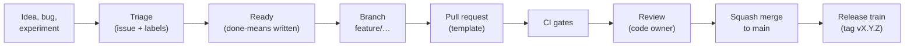

# THME Production Workflow

How work moves from an idea to a released, verified build. It applies to human contributors and
AI coding agents alike; [AGENTS.md](../AGENTS.md) holds the non-negotiable rules this process
enforces.

## 1. Backlog

- **Source of truth:** [BACKLOG.md](../BACKLOG.md). Each ticket has an ID (`THME-2201`), a roadmap
  item, a priority and a "done means" line. [ROADMAP.md](../ROADMAP.md) groups tickets into
  milestones.
- **GitHub Issues mirror the backlog.** `python scripts/sync_github_backlog.py` prints the labels,
  milestones and issues it would create; add `--apply` with a `GITHUB_TOKEN` to create them.
  Re-running is safe: existing items (matched by ticket ID) are skipped.
- **Labels**
  - `type:` bug, feature, experiment, chore, docs
  - `area:` inference, search, byoa, gui, exporter, parser, ci, dependencies, research, docs
  - `priority:` p0 (stop the line), p1 (this milestone), p2 (next milestone)
  - `status:` triage, ready, blocked
- **Triage** happens weekly. A ticket becomes `status:ready` only when its "done means" line is
  observable: a command, a test, or a committed measured report.

## 2. Branches and commits

- `main` is always releasable. Nobody pushes to it directly; changes arrive by pull request.
- Branch names: `feature/…`, `fix/…`, `perf/…`, `docs/…`, `chore/…`.
- Conventional commits: `feat(scope): …`, `fix(…)`, `perf(…)`, `docs(…)`, `chore(…)`,
  `refactor(…)`. Pull requests are squash-merged, so the PR title becomes the commit on `main`.

## 3. Pull requests

Every pull request uses the [template](../.github/PULL_REQUEST_TEMPLATE.md). It records which
backlog ticket and roadmap item the change serves and states its **evidence level**:

| Level | Meaning |
| :--- | :--- |
| Measured | Figures come from a report committed under `docs/benchmarks/` |
| Tested | Behaviour covered by tests; no figure claimed |
| Estimate / Simulated | Labelled as such wherever it is shown |

Review rules:

- One approval from a code owner ([CODEOWNERS](../.github/CODEOWNERS)) is required.
- Anything that produces or publishes figures (`src/inference/`, `src/quality/`,
  `scripts/generate_*.py`, `docs/benchmarks/`) gets a reviewer who checks the evidence, not only
  the code.
- Parser, `unsafe` and exporter changes get a line-by-line read.

## 4. CI gates

All blocking jobs must pass before merge ([ci.yml](../.github/workflows/ci.yml)):

| Job | Blocks merge | What it enforces |
| :--- | :--- | :--- |
| Repository hygiene | Yes | No absolute developer paths; no weights or binaries tracked |
| Format and clippy | Yes | `cargo fmt --check`, `clippy -D warnings` on the pinned toolchain |
| Test (Linux, Windows, macOS) | Yes | `cargo test --locked` |
| Minimum supported Rust | Yes | Builds on `rust-version` from Cargo.toml |
| Published figures regenerate | Yes | Dossier and charts are rebuilt from committed reports and must not change |
| Dependencies | Yes | `cargo-deny`: advisories, licences, sources ([deny.toml](../deny.toml)) |
| Clean machine | Yes | Fresh-environment install and dry-run ([clean_machine_test.yml](../.github/workflows/clean_machine_test.yml)) |
| Latest stable preview | No | Warns early about lints in the next Rust release |

**Toolchain.** [rust-toolchain.toml](../rust-toolchain.toml) pins the compiler and clippy, so an
upstream release never breaks `main` on its own. To upgrade, wait until the latest-stable preview
is green, then bump the pin in a `chore(toolchain)` pull request.

**Dependency exceptions.** An `ignore` entry in `deny.toml` must name a backlog ticket and a
reason, and is reviewed at every release.

## 5. Measured claims

1. Run the experiment with the measured tools (`production_verification`, `precision_sweep`,
   `depth_probe`, `thme evaluate`, `thme search`).
2. Commit the JSON report under `docs/benchmarks/<model>/data/`.
3. Run `python scripts/generate_dossier.py` and
   `python scripts/generate_charts.py --data-dir docs/benchmarks/<model>/data --out-dir docs/benchmarks/<model>/charts`.
4. Reference the figure in prose only after it appears in the dossier. CI fails if the committed
   dossier or charts differ from what the reports produce.

Negative results are committed too.

## 6. Releases

A release train is cut when a milestone's exit criteria are met.

1. Move the `Unreleased` section of [CHANGELOG.md](../CHANGELOG.md) under `## [X.Y.Z] - date`.
2. Set `version = "X.Y.Z"` in Cargo.toml, run `cargo build` to update Cargo.lock, and merge both
   as `chore(release): vX.Y.Z`.
3. Tag the merge commit `vX.Y.Z` and push the tag.
4. [release.yml](../.github/workflows/release.yml) checks that the tag matches Cargo.toml and that
   the changelog has the section, re-runs the gates, builds four targets (Linux x64, Windows x64,
   macOS arm64 and x64) within the binary size limits, bundles `THIRD_PARTY_LICENSES.html`
   (dependency and font licence notices from `cargo about`), signs them when the Minisign key is
   configured, and publishes the archives with per-file and combined SHA-256 checksums.
5. Recapture Studio screenshots if the GUI changed, and confirm the README badges are green.

**Hotfixes** branch from the release tag as `fix/…`, merge to `main`, and ship as a patch release
`vX.Y.Z+1`.

## 7. Repository settings (one-time, by the owner)

These live in GitHub settings rather than in the repository:

- Branch protection on `main`: require a pull request, one code-owner approval, and passing
  checks (hygiene, lint, test on all three OSes, MSRV, measured-claims, dependencies, clean
  machine); dismiss stale approvals; no force pushes.
- Enable Dependabot alerts and security updates ([dependabot.yml](../.github/dependabot.yml)
  handles version updates).
- Add the `MINISIGN_KEY` secret to sign releases.
- Enable private vulnerability reporting (linked from the issue chooser).
