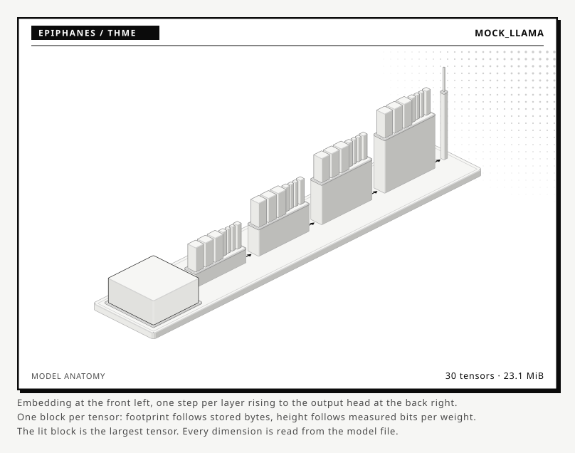

# Isometric figures

THME draws explanatory figures in Rust with `engine::iso`, a port of the core of the
[anatomy](https://github.com/wheresryan22/anatomy) figure kit, set on an Epiphanes manga panel
(see [brand guidelines](brand-guidelines.md)). The software uses them: `thme figure MODEL --out DIR`
draws any model it can load, as one SVG per theme and, with `--gif`, four animations.

The images under `docs/figures/` were drawn before the manga panel and the staircase layout, and
are kept until they are regenerated.

## The look

- **Manga panel.** An ink frame around the figure, a hard print shadow 4 px down and right (no
  blur), and screentone dots on a 10 px grid that grow toward the top-right corner, never behind
  text. The wordmark `EPIPHANES / THME` sits in the header tag, the model name opposite it, the
  hint and the live readout in the footer, and the captions under the panel. Captions and labels
  are set in Chakra Petch (SIL OFL, `assets/fonts/`); the GIFs embed the two faces, the SVG files
  name them and fall back to the system sans when the face is not installed.
- **Two themes.** The light theme is ink on paper: `#0B0B0B` on `#FFFFFF` over `#F6F6F4`, with
  greys carried by the body's tones and the screentone. The dark theme (Manga Night) is paper
  on `#0B0B0B`, with a red print shadow at low opacity. Red `#C8102E` appears only in the dark
  theme.
- **A staircase, in forward-pass order.** The embedding stands at the front left. Each layer is a
  tray one step higher and further back than the last, so layer 0 is lowest and the last layer
  highest at the back right. The tensors outside the layers (final norm, output head) follow at
  the end. Thin ink arrows along the bench show the flow. The whole staircase is scaled to fit the
  frame, so a model with many layers draws smaller, not cut off.
- **Block sizes from the file.** A block's footprint area follows its stored bytes and its height
  follows its measured bits per weight (stored bytes × 8 ÷ weights), so a quantized tensor sits
  visibly lower than an FP16 one. Every number comes from the model file.

## Static figure

<picture>
  <source media="(prefers-color-scheme: dark)" srcset="figures/mock_llama-dark.svg">
  
</picture>

*The synthetic mock model (`examples/mock_llama`, not a trained model), drawn by
`thme figure examples/mock_llama --out docs/figures`.* The lit block is the largest tensor.

## The four animations

`thme figure MODEL --out DIR --gif` writes four GIFs next to the SVG files. They are not
committed to the repository; generate them locally and open them.

| File | What it shows | Frames |
| :--- | :--- | :--- |
| `<stem>-forward.gif` | Light card. Each tensor lights up in forward-pass order as ink glass with a black ink splash. | 4 per tensor; a model with more than 120 tensors lights consecutive tensors together so the GIF has at most 120 frames |
| `<stem>-forward-dark.gif` | Dark card (Manga Night). The same pass, with a blood-red splash: a deep red core (`#C8102E`), a near-black red edge (`#3A0610`) and a few small red droplets. | As above |
| `<stem>-layers.gif` | Light card. One frame per layer: every tensor of that layer is lit as glass, the rest fade, and one black splash sits under the lit layer. | One per layer, 0.4 s each |
| `<stem>-layers-dark.gif` | Dark card, with the red splash. | One per layer |

The readout names the tensor or the layer, its tensor count and its stored bytes, all read from the
model file. Frames are built with `engine::iso`, rasterized with resvg and encoded as GIF, all in
Rust. `--frames DIR` also writes every frame as a PNG so the frames can be checked by eye: the
light forward frames go to `DIR`, the others to `DIR/forward-dark`, `DIR/layers` and
`DIR/layers-dark`.

## Why Rust

The kit was written in TypeScript. We ported its core to Rust so figures are produced by the
same binary that reads the models, with no Node or browser step:

- **Same output.** On 48 committed cases the Rust port's SVG is byte-identical to the original
  kit's (`tests/iso_golden.rs`; `node scripts/iso_golden.mjs <iso-kit.mjs>` regenerates the
  cases from the kit). The manga panel and the staircase are THME's own and sit outside that
  port.
- **Faster.** `cargo run --release --example iso_bench -- 2000` against
  `node scripts/iso_golden.mjs <iso-kit.mjs> --bench 2000` times the same workload. On the
  development machine the Rust port took about a fifth of the time Node took. Timings depend on
  the machine; run both to compare on yours.
- **No stylesheet.** The kit colours its SVG with CSS classes. THME's figures resolve every
  colour in Rust (`engine::iso::inline_styles`, the manga panel in `report::figure`), reading the
  kit palette from the kit's stylesheet so it has one source. Each figure is one self-contained
  SVG that renders the same in browsers, image viewers, PDF tools and converters. The class-based
  form is kept too, because it is what the byte-for-byte check compares.

## What the Rust kit does today

| Area | In `engine::iso` |
| :--- | :--- |
| Camera | Azimuth and elevation, projection, depth toward the viewer, fit to a frame |
| Plans | Rounded rectangles, circles, insets |
| Solids | Extrusion of any floor ring (convex or concave) with four side tones by facing, a lighter top, crease and bevel lines; slabs and cylinders |
| Styles | Tone hierarchy (hi, mid, lo, faint, one lit accent), flat inlays |
| Lines | Lines on top faces, plan outlines, straight segments, dots (screws, rivets), wires with terminal dots |
| Order | `Scene`: painter's order by depth, ties kept in insertion order |
| Output | Class-based SVG with the kit stylesheet, or CSS-free SVG with the kit palette resolved in Rust |

## Not ported yet

Knurls, coils, tick rulers and seams as helpers; round parts on any axis (the kit's lathe); pipes
and cables (tubes); the depth-order and clearance audit; motion and interaction (the kit's live
JavaScript); WebGL layers; the 3D mode; printable sheets. Each will be ported the same way:
checked against the kit's output, then timed against it.

## Licence

Only `src/engine/iso.rs` and `assets/iso.css` derive from the anatomy kit, which is under the MIT
licence (Copyright (c) 2026 Ryan). See [LICENSING.md](../LICENSING.md#third-party-components).
The figure layer in `src/report/figure.rs` and `src/report/animate.rs` is THME's own.
