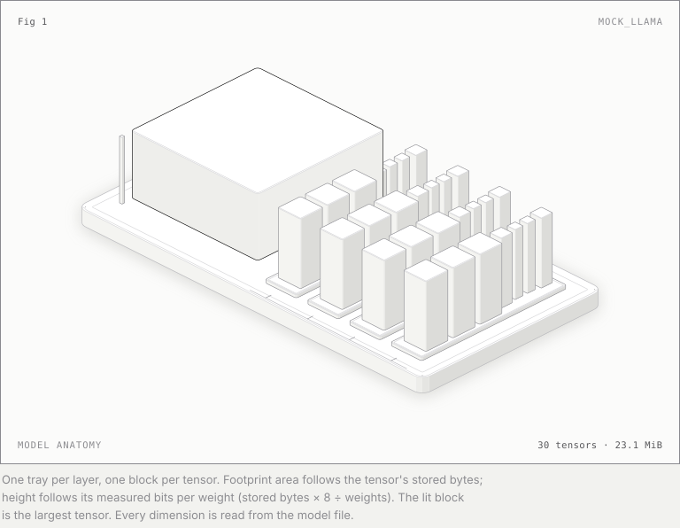
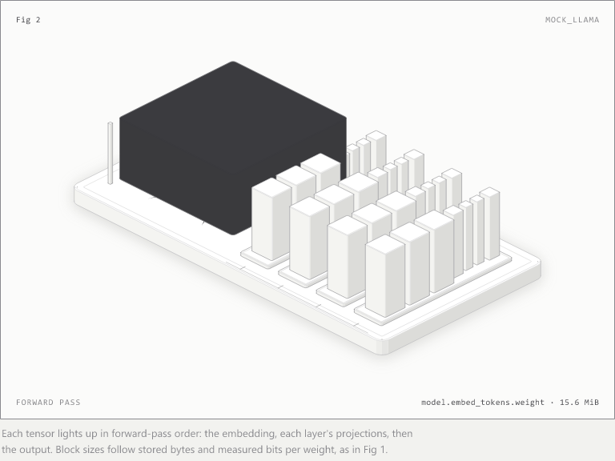

# Isometric figures

THME draws explanatory figures in Rust with `engine::iso`, a port of the core of the
[anatomy](https://github.com/wheresryan22/anatomy) figure kit, and uses them in the software:
`thme figure MODEL --out DIR` draws any model it can load.

<picture>
  <source media="(prefers-color-scheme: dark)" srcset="figures/mock_llama-dark.svg">
  
</picture>

*The synthetic mock model (`examples/mock_llama`, not a trained model), drawn by
`thme figure examples/mock_llama --out docs/figures`.* One tray per layer, one block per tensor.
A block's footprint area follows the tensor's stored bytes and its height follows its measured
bits per weight (stored bytes × 8 ÷ weights), so a quantized tensor sits visibly lower than an
FP16 one. The lit block is the largest tensor. Every dimension is read from the model file.

## Animated: the forward pass

*Generated by THME itself: `thme figure examples/mock_llama --out docs/figures --gif`.* Each
tensor lights up in forward-pass order (embedding, each layer's projections, then the output) as
glossy ink glass with a sweeping sheen, throwing a manga ink splash onto the paper. Frames are
built with `engine::iso`, rasterized with resvg and encoded as GIF, all in Rust; `--frames DIR`
also writes every frame as a PNG.

## Why Rust

The kit was written in TypeScript. We ported its core to Rust so figures are produced by the
same binary that reads the models, with no Node or browser step:

- **Same output.** On 48 committed cases the Rust port's SVG is byte-identical to the original
  kit's (`tests/iso_golden.rs`; `node scripts/iso_golden.mjs <iso-kit.mjs>` regenerates the
  cases from the kit).
- **Faster.** `cargo run --release --example iso_bench -- 2000` against
  `node scripts/iso_golden.mjs <iso-kit.mjs> --bench 2000` times the same workload. On the
  development machine the Rust port took about a fifth of the time Node took. Timings depend on
  the machine; run both to compare on yours.
- **No stylesheet.** The kit colours its SVG with CSS classes. THME's figures resolve every
  colour in Rust (`engine::iso::inline_styles`, `card_svg`), reading the palette from the kit's
  stylesheet so it has one source. Each figure is one self-contained SVG that renders the same in
  browsers, image viewers, PDF tools and converters. The class-based form is kept too, because it
  is what the byte-for-byte check compares.

## What the Rust kit does today

| Area | In `engine::iso` |
| :--- | :--- |
| Camera | Azimuth and elevation, projection, depth toward the viewer, fit to a frame |
| Plans | Rounded rectangles, circles, insets |
| Solids | Extrusion of any floor ring (convex or concave) with four side tones by facing, a lighter top, crease and bevel lines; slabs and cylinders |
| Styles | Tone hierarchy (hi, mid, lo, faint, one lit accent), halo, flat inlays |
| Lines | Lines on top faces, plan outlines, straight segments, dots (screws, rivets), wires with terminal dots |
| Order | `Scene`: painter's order by depth, ties kept in insertion order |
| Output | Class-based SVG with the kit stylesheet, or CSS-free SVG with the card drawn in SVG |

## Not ported yet

Knurls, coils, tick rulers and seams as helpers; round parts on any axis (the kit's lathe); pipes
and cables (tubes); the depth-order and clearance audit; motion and interaction (the kit's live
JavaScript); WebGL layers; the 3D mode; printable sheets. Each will be ported the same way:
checked against the kit's output, then timed against it.

## Licence

Only `src/engine/iso.rs` and `assets/iso.css` derive from the anatomy kit, which is under the MIT
licence (Copyright (c) 2026 Ryan). See [LICENSING.md](../LICENSING.md#third-party-components).
