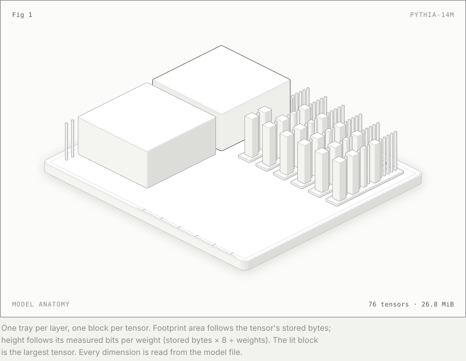
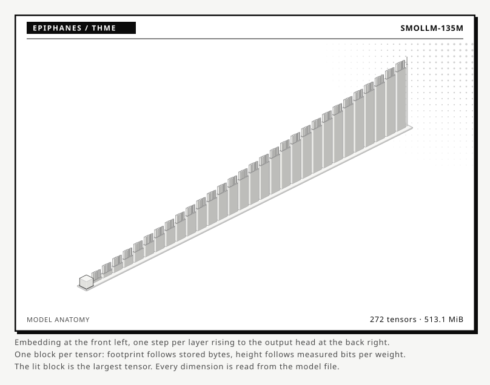
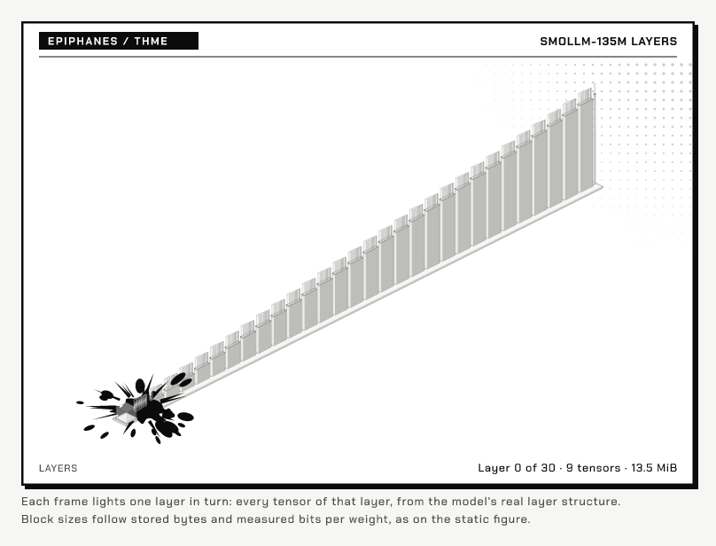
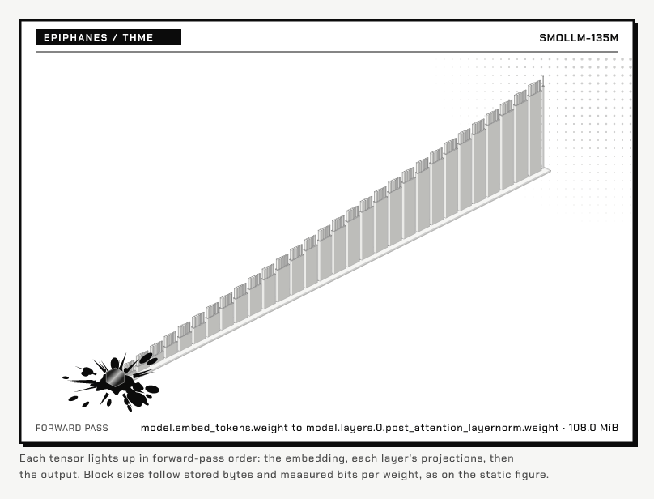

# Hall of fame

Models that THME has loaded, checked and drawn, with the evidence for each claim. A model earns an
entry by passing checks, and the checks are not only the Hugging Face comparison: each row of a
passport is something THME did to the model, with a link to the committed report or the command
that reproduces it. Anything not yet measured says **pending**; nothing here is projected.

Every entry used a model that is not in this repository (weights are never committed).

## Pythia-14M

EleutherAI, Apache-2.0, GPT-NeoX, 6 layers, 76 tensors.

<picture>
  <source media="(prefers-color-scheme: dark)" srcset="figures/pythia-14m-dark.svg">
  
</picture>

| Capability | Result | Evidence |
| :--- | :--- | :--- |
| Safety scan, then load | Loaded and drawn without a blocking finding | `thme figure` scans before it reads |
| Reference forward pass vs Hugging Face fp32 | Max logit difference 1.9e-4 against the reference run on CPU and 1.6e-4 against the reference run on CUDA (tolerance 0.005); THME itself ran on its default device both times | [report](research/hf-cross-check-pythia-14m.json) |
| Figures | Parts tray, layer-by-layer and forward-pass animations | [docs/figures](figures) |
| Measured perplexity, search, export | **pending** | needs a committed measured report |

## SmolLM-135M

HuggingFaceTB, Apache-2.0, LLaMA architecture, 30 layers.

<picture>
  <source media="(prefers-color-scheme: dark)" srcset="figures/smollm-135m-dark.svg">
  
</picture>

<table>
  <tr>
    <td width="50%"><picture><source media="(prefers-color-scheme: dark)" srcset="figures/smollm-135m-layers-dark.gif"></picture></td>
    <td width="50%"><picture><source media="(prefers-color-scheme: dark)" srcset="figures/smollm-135m-forward-dark.gif"></picture></td>
  </tr>
</table>

| Capability | Result | Evidence |
| :--- | :--- | :--- |
| Safety scan, then load | Loaded and drawn without a blocking finding | `thme figure` scans before it reads |
| Reference forward pass vs Hugging Face fp32 | Max logit difference 2.1e-5 against the reference run on CPU and 1.5e-5 against the reference run on CUDA (tolerance 0.005); THME itself ran on its default device both times | [report](research/hf-cross-check-smollm-135m.json) |
| GPU path (wgpu, Vulkan) | Same logits as CPU; **slower** today: 4.3 s against 1.1 s for one 128-token pass, one run each, RTX 4060 Ti, 20 November 2026 | `thme forward MODEL --device gpu` |
| Figures | Parts tray, layer-by-layer and forward-pass animations | [docs/figures](figures) |
| Measured perplexity, search, export | **pending** | needs a committed measured report |

## The `.epiph` format

One file that carries a model's tensors, tokenizer and plan, meant to be read the same way on any
machine. The layout is fixed little-endian with no native-endian casts. A golden-hash test
(`tests/test_epiph_portability.rs`) packs a fixed tiny model and asserts the same SHA-256 on every
host; it passes in CI on Ubuntu (x86-64), Windows (x86-64) and macOS (arm64). Compressed files are
compared by their decoded contents, because the compressed stream depends on the zlib backend.
Big-endian hosts, 32-bit systems and other chips are untested, so they are not claimed.

## How a model gets in

1. Loads through the safety scan with no blocking finding.
2. Reference forward pass agrees with Hugging Face within the stated tolerance.
3. A committed report under `docs/research/` or `docs/benchmarks/` holds the numbers.
4. Its figure is drawn with `thme figure MODEL --out docs/figures --gif`.
