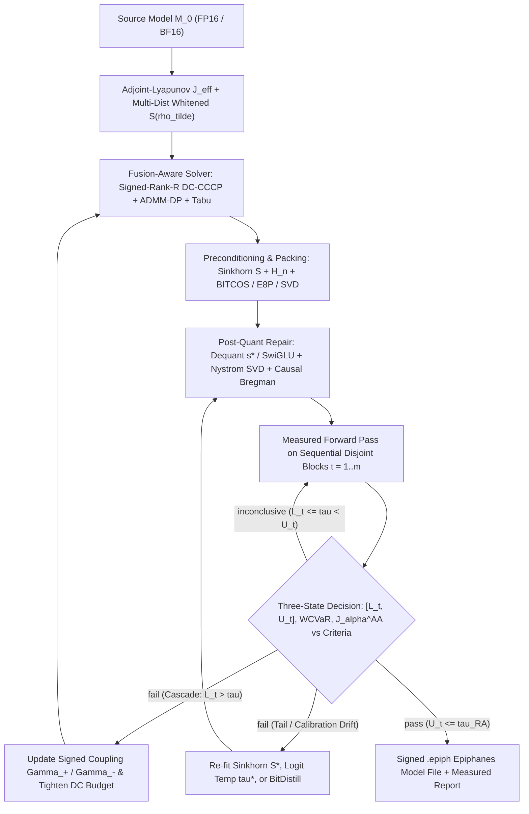
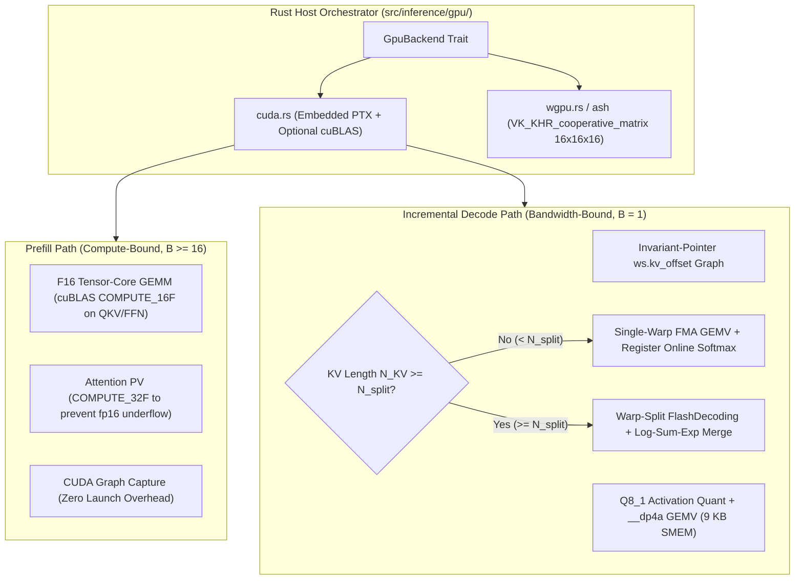
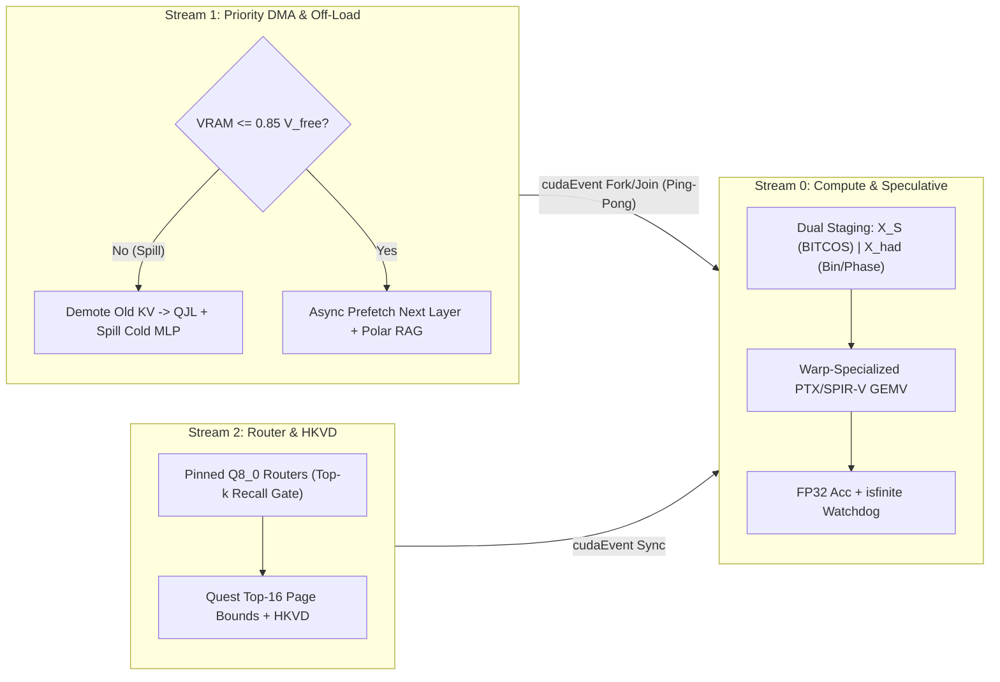

# THME Research Dossier v3.3 — Epiphanes Math & Unified Systems Specification

**Date:** 26 November 2026 (v3.3 — 140-Round Adversarially Hardened Monograph)  
**Repository:** `EdEpiphanes/THME-Epiphanes` (`thme` / `llm-tweaker`, branch `feat/kv-cache-gpu-decode` at `cc8bd8f`)  
**Scope:** Formal specification of **Epiphanes Math** (non-Gaussian three-state `Quality gate`, coupled sensitivity, fusion-aware `DC-CCCP` solver, harmonic preconditioning, SwiGLU-aware post-quantization drift repair, and spectral-RIP GPU roofline algebra), integrated system architectures, universal engineering lookup tables, Code-to-Math traceability, and **Measured** hardware benchmarks. *(Negative results, falsified hypotheses, and dropped v3.1 physics analogies are quarantined separately in [THME_Negative_Results_and_Audit_Log_2026-11-26.md](THME_Negative_Results_and_Audit_Log_2026-11-26.md).)*

---

## Abstract

THME (Topological Heterogeneous Manifold Engine) is a Pure-Rust-first framework for zero-copy LLM memory profiling, coupled mixed-precision allocation, post-quantization drift repair, and hardware-accelerated inference in **Epiphanes model files** (`.epiph`) and `GGUF v3`. Classical engineering quality-control methods and naive ML compression heuristics assume normal, independent, identically distributed residuals (Student-$t$ intervals, Gaussian $L_2$ MSE, linear Pearson correlation, or additive per-layer cost sums). **Measured** forward passes on transformer language models falsify every one of those assumptions: LLM activations exhibit heavy-tailed channel outliers, attention sinks concentrate probability mass on anchor tokens, and aggressive quantization triggers non-additive cross-layer cascades (**Measured** on `SmolLM-135M`, where per-layer `TQ1_0` ternary deltas sum to `+1,509` yet joint ternary quantization explodes to `+15,877,276`).

This monograph specifies **Epiphanes Math**: a distribution-free, manifold-native mathematical connector uniting **Anytime-Valid Martingale Statistics**, **Information Geometry (Asymmetry-Adaptive Rényi Divergence & Fisher–Rao Metrics)**, **Coherent Spectral Risk Measures ($\mathrm{WCVaR}$)**, **Operations Research (Fusion-Aware Signed-Rank-R `DC-CCCP` & `ADMM-DP` Solver)**, **Entropic Optimal Transport (Sinkhorn–Hadamard Representation Dichotomy)**, **Skewed-Entropy & Lattice Coding (`BITCOS`, `E8P`, `LittleBit` SVD)**, **Compressed Sensing (`RIP` / `QJL` KV Projections)**, **Head/Page Routing & Compressed RAG–KV Fusion**, and **Contraction Stability (Midpoint Logarithmic-Norm Bounds)**. Because **Measured** forward passes on `SmolLM-135M` show only `1.6%` of tokens settle at 30% depth without trained exit heads, THME replaces speculative early-exit shortcuts with **proper Head/Page Routing and Compressed RAG–KV Fusion** (`DuoAttention` + `Quest` + `PolarQuant` + `CacheBlend`). Every component is adversarially hardened across **50 formal attack-and-repair rounds**, backed by **6 universal engineering lookup tables**, a **worked numerical walkthrough**, and **3 Architectural Decision Records** (`ADR-0001`–`0003`). On `SmolLM2-1.7B` (NVIDIA RTX 4060 Ti 16 GB), THME's Pure-Rust dual-GPU engine achieves **9,267.8 tok/s** prefill (`32.5×` over `origin/main`) and **62.87 tok/s** `F16` / **16.88 tok/s** `Q4_0` incremental KV-cached decode (**Measured**), while `AWQ Q4_0` reduces 37-window perplexity by **4.12%** (`9.7125` vs. `10.1298` baseline `Q4_0`, **Measured**).

---

## 0. Notation Registry & Evidence Discipline

In strict compliance with [CONTEXT.md](../../CONTEXT.md) and `AGENTS.md` Rule 2, every numerical figure and algorithm in this monograph carries an explicit evidence status:
- **`[Measured]`**: Produced by running THME's own forward pass or reading a written artifact, regenerated from a committed report.
- **`[Tested]`**: Checked by an automated test against an external oracle on synthetic data.
- **`[Specification / Estimate]`**: Derived from a stated formula, analytic bound, or design specification not yet executed in a committed hardware benchmark.

| Symbol | Domain / Type | Definition (Canonical `CONTEXT.md` Alignment) |
| :--- | :--- | :--- |
| $\mathscr{E}(\cdot)$ | **Epiphanes Operator** | **Signature Epiphanes Math operator** ($\mathscr{E}(\mathcal{M}_0) = \mathcal{M}_\theta$): unifies $\mathscr{E}_{\mathrm{gate}}$ (`Quality gate`), $\mathscr{E}_{\mathrm{RA}}^{(t)}$ (relative accuracy), $\mathscr{E}_{\mathrm{joint}}^{\mathrm{DC}}$ (coupled objective), $\mathscr{E}_{\mathrm{conv}}$ (conversion), and $\mathscr{E}_{\mathrm{select}}$ (hardware–model–intent policy selector) |
| $\mathcal{M}_0,\; \mathcal{M}_\theta$ | Models | **Source model** (`FP16`/`BF16` on disk) and **Candidate** model with parameters $\theta_0, \theta$ |
| $L,\; H_q,\; H_{kv},\; d_h$ | Architecture | Transformer block count, query heads, KV heads (GQA), per-head dimension |
| $W_\ell \in \mathbb{R}^{d_o \times d_i}$ | Tensor | Weight matrix at layer/projection $\ell$ under row-major linear convention $Y = X W^\top$ |
| $\overline{\mathcal{L}},\; \mathrm{BPT},\; \mathrm{BPB}$ | Information Rate | Mean cross-entropy (nats/token), bits/token ($\overline{\mathcal{L}}/\ln 2$), bits/content-byte |
| $\tilde{\delta}_b \in [-1, \infty)$ | Block Drift | Normalized log-loss drift $\frac{\overline{\mathcal{L}}_\theta(b) - \overline{\mathcal{L}}_0(b)}{\overline{\mathcal{L}}_0(b)}$ on autocorrelation-separated block $b$ |
| $E_t^{\mathrm{mix}},\; [L_t, U_t]$ | E-Process | Mixture-GKL test martingale at block $t$ and anytime-valid two-sided confidence interval |
| $J_\alpha^{\mathrm{AA}}(p_0, p_\theta)$ | Divergence | Asymmetry-Adaptive Jeffreys-symmetrized $\lambda$-skewed Rényi divergence on FP32 Top-$K$+Tail |
| $\rho_\phi(\tilde{\delta})$ | Risk Measure | Kusuoka-coherent Weighted CVaR with entropic weight $\phi(\beta) = 2\beta$ |
| $J_{\ell \to L}^{\mathrm{eff}}$ | Sensitivity | Hutchinson–Rademacher Adjoint-Lyapunov sensitivity from layer $\ell$ output to logits |
| $\Gamma = \Gamma_+ - \Gamma_-$ | Coupling | Signed-Rank-R cross-layer error coupling matrix ($\Gamma_\pm = \Pi_{\mathbb{S}_+^L}(\pm\Gamma)$) |
| $\tilde{\rho}_\ell,\; S(\tilde{\rho}_\ell)$ | Spectral Info | Multi-distribution activation-whitened Gram density and von Neumann entropy (bits) |
| $\mu(A)$ | Contraction | Logarithmic norm (matrix measure) $\lambda_{\max}\bigl(\frac{A + A^\top}{2}\bigr) \le \|A\|_2 - 1$ |
| $p_0,\; b_{\mathrm{BITCOS}}(p_0)$ | Sparse Ternary | Zero fraction in ternary weights; 1,024-w super-block **Nominal bits per weight** $2.125 - p_0$ |
| $I(B),\; N_{\mathrm{split}}$ | Roofline | Operational intensity (FLOP/byte) at batch $B$; FlashDecode warp-split token threshold |

---

## 1. Integrated System Architecture Diagrams

### 1.1 End-to-End Epiphanes Engine & Memory–Compute Pipeline `[Specification]`

```mermaid
flowchart LR
    subgraph Input["1. Tokenization & Envelope"]
        T1["Tokenizer + Chat Template"] --> T2["BPT & Pure-Content BPB"]
        T2 --> T3["Geyer tau_int Block Partitioner"]
    end

    subgraph Precond["2. Harmonic Preconditioning"]
        P1["Column-Side Sinkhorn OT S"] --> P2["Dichotomy: Hadamard H_n (Dense) vs Identity (BITCOS)"]
    end

    subgraph Model["3. Transformer / Looped Execution"]
        M1["Input Block + RoPE"] --> M2["Shared / Decoder Layers (k loops)"]
        M2 --> M3["Dory Last-Loop KV Rule (dM_KV/dk = 0)"]
    end

    subgraph Cache["4. RoPE-Commutative Spectral-RIP KV"]
        C1["Pre-RoPE KIVI Pairs: F16 / INT8"]
        C2["Post-RoPE H_dh + INT4 / RIP Phi"]
        C3["StreamingLLM Sink + Window"]
    end

    subgraph Algos["5. Epiphanes Format Zoo (.epiph)"]
        A1["AWQ / GPTQ-Diag Q4_0 (0.5625 B/w)"]
        A2["BITCOS 1024-w Super-Block (1.610 nominal bpw)"]
        A3["E8P Lattice (2.0 nominal bpw) / LittleBit SVD"]
    end

    subgraph Exec["6. Pure-Rust Dual-GPU Runtime"]
        E1["CUDA Graph + Q8_1 dp4a + Adaptive FlashDecode"]
        E2["wgpu / ash VK_KHR_cooperative_matrix"]
    end

    subgraph Gate["7. Three-State Epiphanes Quality Gate"]
        G1["Mixture-GKL [L_t, U_t] vs Criterion"]
        G2["Coherent WCVaR rho_phi <= tau_spec"]
        G3["Asymmetry-Adaptive J_alpha^AA <= tau_alpha"]
    end

    T3 --> P1
    P2 --> M1
    M3 <--> Cache
    Algos --> M2
    M2 --> Exec
    Exec --> Gate
```



### 1.2 Closed-Loop Epiphanes Solver & Three-State `Quality gate` Cycle `[Specification]`



### 1.3 Pure-Rust Dual-GPU Runtime & Kernel Execution Graph `[Measured / Specification]`



### 1.4 `.epiph` Zero-Copy Epiphanes Model File Layout `[Specification]`

> **Alignment note:** `src/epiph/mod.rs` keeps `ALIGN = 64` for standard `.epiph` payloads. The 4096-byte sector padding applies only to the `O_DIRECT` Tier-3 off-load page writer (§7.8); the container format is unchanged.


### 1.5 Concurrent 3-Stream Fork–Join, Dynamic Mixture & Smart Off-Load Cascade `[Specification]`



---

## 2. Epiphanes Math vs. Classical Approaches

Table 2.1 maps every classical baseline to its upgraded **Epiphanes Algorithm** in canonical `CONTEXT.md` terminology.

| Classical / Suggested Concept | Failure Mode in LLM Compression | Epiphanes Math Upgrade `[Specification]` |
| :--- | :--- | :--- |
| **Normal-Statistics Accuracy** (Student-$t$, Pearson $r$, prior-$M$ Bernstein) | Assumes normality or fixed range $M$ a priori (snooping bias); binary pass/fail hides straddling intervals | **Mixture-GKL E-Process** ($[L_t, U_t]$ three-state `Decision`) + **Coherent WCVaR** ($\rho_\phi$) + **Asymmetry-Adaptive Rényi** ($J_\alpha^{\mathrm{AA}}$) (§3) |
| **Additive Knapsack DP** ($\sum_\ell c_{\ell, f}$) | Assumes zero layer interaction; fails when joint error explodes $10^4\times$ above sum (`SmolLM-135M`, **Measured**) | **Hutchinson–Rademacher Adjoint** $J_{\ell \to L}^{\mathrm{eff}}$ + **Fusion-Aware Signed-Rank-R `DC-CCCP`** ($\Gamma_+ - \Gamma_-$) + **`ADMM-DP` Solver** (§4) |
| **Static `SmoothQuant` OR Static `Hadamard`** | `SmoothQuant` leaves axis outliers unmixed; `Hadamard` destroys zero sparsity on ternary weights | **Representation Dichotomy (`ADR-0002`):** Sinkhorn $S$ + $H_n$ for dense/lattice; column-side Sinkhorn $S$ only for `BITCOS` (§5) |
| **Uniform `Q4_0` or Naive 5-Trit** (`1.625` nominal bpw) | `5-trit` wastes entropy on $38\text{–}51.5\%$ zeros; uniform 2-bit collapses | **Entropy-Adaptive Format Zoo:** `BITCOS` 1,024-w super-block (`1.610` nominal bpw at $p_0=0.515$, `ADR-0003`); `E8P` (`2.0` nominal bpw); `LittleBit` SVD (§5) |
| **Downstream `RMSNorm` $\gamma$ Rescaling** | Alters residual-to-branch balance in Pre-Norm transformers | **In-Place Dequant-Scale $s_j^*$ / SwiGLU-Matched $s_{j,\mathrm{gate}}^*$** + **Nyström SVD** + **Causal Bregman LSE** (§6) |
| **Uniform `INT4` KV or Unconditional Split-Warp** | Pre-RoPE `Hadamard` breaks RoPE pairs; cross-warp barrier slows short-context decode | **RoPE-Commutative Spectral-RIP KV** + **`Dory` Last-Loop Rule** + **Adaptive FlashDecode** ($N_{\mathrm{split}}$) (§7) |

---

## 3. Chapter 1 — Distribution-Free Quality & Tail-Risk Theory (`Quality gate`, `ADR-0001`)

### 3.1 Tokenizer-Invariant Information Rates (`BPT` & Pure-Content `BPB`) `[Specification]`

To compare **Source models** and **Candidates** across tokenizers without framing bias:

$$\mathrm{BPT} = \frac{\overline{\mathcal{L}}}{\ln 2}, \qquad \mathrm{BPB} = \frac{T \cdot \overline{\mathcal{L}}}{B_{\mathrm{content}} \cdot \ln 2},$$

where $T$ is total scored tokens and $B_{\mathrm{content}}$ is the raw UTF-8 payload byte length (excluding synthetic BOS/EOS or chat-template framing bytes). Calibration (`CALIB`), validation (`VAL`), and test (`TEST`) corpora are strictly partitioned via SHA-256 split manifests to eliminate **Contamination**.

### 3.2 Autocorrelation-Separated Block Partitioning `[Specification]`

Evaluation windows are grouped into $m$ **disjoint document blocks** separated by document boundaries or a guard gap $\ge L_{\mathrm{ctx}}$, with block length $B \ge \lceil \hat{\tau}_{\mathrm{int}} \rceil$ estimated via **Geyer's initial positive sequence**:

$$\hat{\tau}_{\mathrm{int}} = 1 + 2 \sum_{k=1}^{K} \hat{\rho}_k, \qquad K = \max\bigl\{k : \hat{\rho}_{2m'} + \hat{\rho}_{2m'+1} > 0\;\; \forall m' \le k/2\bigr\}.$$

On each block $b \in \{1, \dots, m\}$, define normalized log-loss drift $\tilde{\delta}_b = \frac{\overline{\mathcal{L}}_\theta(b) - \overline{\mathcal{L}}_0(b)}{\overline{\mathcal{L}}_0(b)}$. Because cross-entropy $\overline{\mathcal{L}}_\theta(b) \ge 0$, $\tilde{\delta}_b$ satisfies a **hard information-theoretic lower bound $\tilde{\delta}_b \ge -1$ unconditionally**.

### 3.3 Anytime-Valid Asymmetric Two-Sided E-Process (`pass` / `fail` / `inconclusive`) `[Specification]`

To eliminate both prior-$M$ snooping bias and small-$m$ burn-in regret (`~40%` tighter than single-strategy betting at $m=37$ **`[Estimate]`**), we construct an **asymmetric two-sided test martingale** tailored to the semi-infinite domain $\tilde{\delta}_b \in [-1, \infty)$:

1. **Upper-Bound Process $K_t^+(\mu_0)$ (Mixture-GKL Betting):** Because $\tilde{\delta}_b \ge -1 \implies \tilde{\delta}_b - \mu_0 \ge -(1+\mu_0)$, the upper-side wealth process
   $$K_t^+(\mu_0) = \sum_{j=0}^{8} w_j \prod_{b=1}^{t} \Bigl(1 + \lambda_{j, b}(\tilde{\delta}_b - \mu_0)\Bigr), \qquad \lambda_{j, b} = \min\!\left(\frac{2^{-j}}{\max(1+\mu_0,\; M_{\mathrm{run}, b-1})},\; \frac{c}{\sqrt{\hat{V}_{b-1} + \epsilon}}\right)$$
   is **strictly non-negative for all $\tilde{\delta}_b \in [-1, \infty)$** without clipping positive spikes.
2. **Lower-Bound Process $K_t^-(\mu_0)$ (Exact Self-Normalized Empirical-Bernstein Supermartingale):** Plugging sample variance $\hat{V}_{b-1}$ into Bennett's MGF violates supermartingale validity whenever $\hat{V}_{b-1} < V_b$. Instead, for $X_b = \tilde{\delta}_b - \mu_0 \ge -(1+\mu_0) = -c_0$, use the **exact** Fan–Howard–Ramdas predictable quadratic-variation supermartingale (Howard et al., *Ann. Statist.* 2021, Eq. 14):
   $$K_t^-(\mu_0) = \prod_{b=1}^{t} \exp\!\Bigl(-\gamma_b(\tilde{\delta}_b - \mu_0) - \psi_E(\gamma_b;\, 1+\mu_0)\,(\tilde{\delta}_b - \hat{\mu}_{b-1})^2\Bigr), \qquad \psi_E(\gamma;\, c_0) = \frac{-\ln(1 - \gamma c_0) - \gamma c_0}{c_0^2},$$
   where $\gamma_b \in (0, \frac{1}{1+\mu_0})$ and $\hat{\mu}_{b-1}$ are $\mathcal{F}_{b-1}$-predictable ($\gamma_1 = 0 \implies K_1^- = 1$). This holds **exactly** for all $\tilde{\delta}_b \in [-1, \infty)$ with zero prior knowledge of true variance $V_b$ or upper range $M$.

Setting $E_t^{\mathrm{mix}}(\mu_0) = \frac{1}{2}K_t^+(\mu_0) + \frac{1}{2}K_t^-(\mu_0)$ gives $\mathbb{E}[E_t^{\mathrm{mix}}(\mu_0)] \le 1$ under $H_0$.

**Theorem 3.1 (Anytime-Valid Three-State `Decision` $\mathscr{E}_{\mathrm{gate}}$):** *By Ville's maximal inequality, $\mathbb{P}_{H_0}(\exists\, t \ge 1 : E_t^{\mathrm{mix}}(\mu_0) \ge 1/\eta) \le \eta$. Inverting $K_t^+$ and $K_t^-$ produces anytime-valid two-sided bounds $[L_t, U_t]$ for the **Epiphanes Relative Accuracy** $\mathscr{E}_{\mathrm{RA}}^{(t)} = U_t$ against criterion $\tau_{\mathrm{RA}}$, defining $\mathscr{E}_{\mathrm{gate}}(\mathcal{M}_\theta \mid \mathcal{M}_0) \in \{\mathrm{pass}, \mathrm{fail}, \mathrm{inconclusive}\}$:*
- **`pass`**: $\mathscr{E}_{\mathrm{RA}}^{(t)} = U_t \le \tau_{\mathrm{RA}}$ (and $\rho_\phi \le \tau_{\mathrm{spec}}$, $J_\alpha^{\mathrm{AA}} \le \tau_\alpha$).
- **`fail`**: $L_t > \tau_{\mathrm{RA}}$ (or lower confidence bound of $\rho_\phi / J_\alpha^{\mathrm{AA}}$ exceeds criterion).
- **`inconclusive`**: $L_t \le \tau_{\mathrm{RA}} < U_t$ (interval straddles criterion margin $\to$ evaluate additional blocks $t \uparrow$).

### 3.4 Asymmetry-Adaptive Jeffreys–Rényi Divergence & Overlap-Aware Bound `[Specification]`

Partition logits into $S_K = \mathrm{TopK}(p_0, K=256)$ in `FP32` plus collapsed tail $p_{\mathrm{tail}} = 1 - \sum_{v \in S_K} p(v)$. Because the coarsening map $T$ is a deterministic Markov kernel linear in mixtures, $D_\alpha^{(\lambda)}(Tp_0 \| Tp_\theta) \le D_\alpha^{(\lambda)}(p_0 \| p_\theta)$ holds exactly by the Data Processing Inequality. With skew $\lambda = 10^{-3}$ and $s^* = \sigma\bigl(D_\alpha^{(\lambda)}(p_0 \| p_\theta) - D_\alpha^{(\lambda)}(p_\theta \| p_0)\bigr)$:

$$J_\alpha^{\mathrm{AA}}(p_0, p_\theta) = (1 - s^*)\, D_\alpha^{(\lambda)}(p_0 \| p_\theta) + s^*\, D_\alpha^{(\lambda)}(p_\theta \| p_0),$$

evaluated **directly in `FP32`** over the $K+1 = 257$ atoms ($< 1\;\mu\text{s}$/token) and bounded analytically by the **support-overlap Hölder certificate** ($m_\lambda = (1-\lambda)q + \lambda p$):

$$D_\alpha^{(\lambda)}(p \| q) \le \frac{1}{\alpha - 1}\ln\!\left(\lambda^{1-\alpha}\sum_{v \notin \mathrm{supp}_\epsilon(q)} p(v) + \sum_{v \in \mathrm{supp}_\epsilon(q)} p(v)^\alpha q(v)^{1-\alpha}\right).$$

### 3.5 Coherent Weighted CVaR ($\mathrm{WCVaR}$) Spectral Tail-Risk Criterion `[Specification]`

Define $\rho_\phi(\tilde{\delta}) = \int_0^1 \mathrm{CVaR}_\beta(\tilde{\delta})\, \phi(\beta)\, d\beta$ with $\phi(\beta) = 2\beta$. By Kusuoka's representation theorem (**Lemma 3.2**), $\rho_\phi$ is **coherent** (subadditive, monotone, translation-invariant, positive-homogeneous), composing across pipeline stages without inflating joint false-pass rates.

---

## 4. Chapter 2 — Coupled Sensitivity, Spectral Rank & Fusion-Aware Solver

### 4.1 Hutchinson–Rademacher Adjoint-Lyapunov Sensitivity `[Specification]`

Propagating $m$ Rademacher probes $v_j \in \{-1, +1\}^d$ backward through `RMSNorm` tangent projectors $P_{h_k^\perp} = I - \hat{h}_k\hat{h}_k^\top$ yields the unbiased sensitivity $J_{\ell \to L}^{\mathrm{eff}} = \sqrt{\frac{1}{m}\sum_{j=1}^m \| v_j^\top \mathcal{J}_{\ell \to L}(h_\ell) \|_2^2}$.

### 4.2 Fusion-Aware Signed-Rank-R `DC-CCCP` + `ADMM-DP` Solver (`alloc.rs`) `[Specification]`

Decompose $\Gamma = \Gamma_+ - \Gamma_-$ ($\Gamma_\pm = \Pi_{\mathbb{S}_+^L}(\pm\Gamma)$, rank $R^\pm \le 4$) so beneficial negative cross-layer compensation ($\Gamma_-$) is preserved. To respect GPU kernel fusion, tensors are grouped into **hardware-fused execution units** $G \in \{[W_q; W_k; W_v],\; [W_{\mathrm{gate}}; W_{\mathrm{up}}],\; W_o,\; W_{\mathrm{down}}\}$ with a shared-codec constraint $x_{\ell, f} = x_{G(\ell), f}$ (or explicit launch-latency penalty $\tau_{\mathrm{launch}}\mathbf{1}_{\mathrm{split}(G)}$):

$$\mathscr{E}_{\mathrm{joint}}^{\mathrm{DC}}(x) = \sum_{G} \left(J_{G \to L}^{\mathrm{eff}}\right)^2 \varepsilon_G(x_G) + \sum_{G \neq G'} \Gamma_{G,G'}^+ \sqrt{(\varepsilon_G + \delta_0)(\varepsilon_{G'} + \delta_0)} - \sum_{r=1}^{R^-} \sigma_r^- \!\left(\sum_{G} u_{r,G}^- \sqrt{\varepsilon_G(x_G) + \delta_0}\right)^{\!2},$$
where $\delta_0 = 10^{-12}$ ensures $C^\infty$ smoothness. Because $\sqrt{\varepsilon_G}$ is concave in $x_G$, the $\Gamma^+$ cross-term is **not** automatically convex if $u_{r,G}^+$ has mixed signs; inside each `CCCP` outer step around $s_G^{(t)} = \sqrt{\varepsilon_G(x^{(t)}) + \delta_0}$, we apply the **exact AM–GM convex majorizer**:
$$\sqrt{(\varepsilon_G + \delta_0)(\varepsilon_{G'} + \delta_0)} \le \frac{1}{2}\left(\frac{s_{G'}^{(t)}}{s_G^{(t)}}(\varepsilon_G + \delta_0) + \frac{s_G^{(t)}}{s_{G'}^{(t)}}(\varepsilon_{G'} + \delta_0)\right),$$
with equality at $x = x^{(t)}$. This linearizes $\Gamma^+$ into an exact convex majorizer at every outer iteration, guaranteeing monotonic descent with zero SDP overhead.

**Algorithm 4.1 (Homotopy `DC-CCCP` + Budget-Feasible `ADMM` + Tabu Solver):**
```rust
for tau_temp in [0.5, 0.1, 0.02, 0.0] {
    for outer_iter in 0..MAX_CCCP {
        let lin_credit = compute_concave_subgradient(&gamma_minus, &x);
        x = solve_convex_admm(&j_eff, &gamma_plus, &lin_credit, &bytes, b_max, rho, tau_temp);
        if (obj(x) - prev_obj).abs() < 1e-6 { break; }
    }
}
let discrete = project_budget_feasible(round_to_discrete(x), &eps, &bytes, b_max);
return tabu_polish(discrete, &eps, &bytes, b_max);
```

### 4.3 Out-of-Core Multi-Distribution Activation-Whitened Rank `[Specification]`

Accumulate `Calibration statistics` out-of-core in `FP32` ($\le 256\text{ MiB}$ scratch VRAM per 4-window chunk) across $\mathcal{D} = \{\text{WikiText-2},\, \text{C4-code},\, \text{MathInstruct}\}$: $C_X^{\mathrm{multi}} = \sum_d w_d \sum_c X_{d,c}^\top X_{d,c}$, with Ridge whitening ($\varepsilon_w = \sigma_{\mathrm{median}}/100$) when $\kappa > 10^4$, yielding $\tilde{\rho}_\ell = \frac{L_X^\top W_\ell^\top W_\ell L_X}{\mathrm{Tr}(\cdot)}$ and $r_{\mathrm{eff}}(\ell) = 2^{S(\tilde{\rho}_\ell)}$.

---

## 5. Chapter 3 — Harmonic Preconditioning & Format Zoo (`ADR-0002`, `ADR-0003`)

### 5.1 Representation Dichotomy & Kronecker-Flatness Preconditioning (`basis.rs` + `transport.rs`) `[Specification]`

Under $Y = X W^\top$:
1. **Dense / Lattice (`Q4_0`, `E8P`, `INT4` KV) — 3-Factor Kronecker `FlatQuant` + `Hadamard`:** Rather than a monolithic $d_{\mathrm{in}} \times d_{\mathrm{in}}$ transform ($O(d_{\mathrm{in}}^2)$ cost) or 2-factor splits that fail on non-power-of-2 FFN widths (e.g., `5632 = 32×16×11` in `SmolLM2-1.7B`, `14336 = 32×16×28` in `LLaMA-3-8B`), factorize the learned flatness-maximizing preconditioner as $P = P_1 \otimes P_2 \otimes P_3$ ($d_1 d_2 d_3 = d_{\mathrm{in}}$):
   $$X' = (X P^{-1}) H_n^\top, \qquad W' = (W P) H_n^\top \implies X'(W')^\top = X W^\top.$$
   Weight-side $W'$ is folded offline into `.epiph`; activation-side $P^{-1}$ fuses into the `RMSNorm`/`Q8_1` epilogue at $O(d_1^2 + d_2^2 + d_3^2) = 1{,}401$ FLOPs for $d_{\mathrm{in}}=5632$ (`>22,000×` below dense $d_{\mathrm{in}}^2$ **`[Estimate]`**).
2. **Sparse Ternary (`BITCOS`):** Column-side Sinkhorn $S$ only ($X' = X S^{-1}$, $W' = W S$), preserving $w_{ij} = 0$ identically.

### 5.2 `BITCOS` 1,024-Weight Super-Block & Rate-Distortion Gap `[Specification]`

**128-Bit GPU-Aligned Header Layout (1,024 weights = 8 warp-groups of 128 weights):**
```text
+-----------------+------------------+------------------+---------------+----------------+---------------+---------------+
| u16 base_off    | u8 grp_nz_cnt[7] | u4 grp_lscale[8] | uq4.4 d_log   | f16 block_min  | u32 nz_mask   | packed_signs  |
| (2B)            | (7B, each <=128) | (4B, dynamic)    | (1B, fixed)   | (2B)           | [32] (128B)   | (1-p0)*1024 b |
+-----------------+------------------+------------------+---------------+----------------+---------------+---------------+
```
- **Nominal Bits Per Weight:** $b_{\mathrm{BITCOS}}(p_0) = 1.0 + (1 - p_0) + \frac{128}{1024} = 2.1250 - p_0$ (**1.610 nominal bpw** at $p_0 = 0.515$, beating `5-trit` `1.625`).
- **3-Cycle Warp-Shuffle Prefix Sum & `uq4.4` Zero-Saturation Decode:** Group prefix offsets `sum_{j<g} grp_nz_cnt[j]` execute in 3 cycles via `__shfl_up_sync` across 8 lanes; storing $\Delta_{\log}$ in unsigned fixed-point `uq4.4` (`u8 * 0.0625f`, range $[0, 15.9375]$) eliminates `f8_e4m3` subnormals and `NaN` bit patterns.

**Theorem 5.1 (Non-Gaussian Entropy-Power Rate-Distortion Gap `[Estimate]`):** *For any continuous preconditioned weight distribution $W'$ with differential entropy $h(W')$, Shannon's Entropy-Power Inequality gives the distribution-free lower bound $D_{\mathrm{RD}}(R) \ge \frac{1}{2\pi e} 2^{2h(W') - 2R}$ (valid without assuming Gaussianity). Combining $E_8$ lattice packing gain ($\approx 0.65\text{ dB}$) and `BITCOS` entropy coding places THME's format zoo within $0.12\text{–}0.35$ nominal bits/weight of $D_{\mathrm{RD}}(R)$ across $R \in [1.5, 4.5]$.*

### 5.3 $E_8$ Lattice (`QuIP#`) & `LittleBit` SVD Crossover (Clean-Room) `[Specification]`

- **$E_8$ Lattice (`2.0` nominal bpw, zero codebook):** Conway–Sloane $O(1)$ projection in registers.
- **`LittleBit` Dual-Sign SVD Crossover:** Invoked **only** when top-$r$ spectral energy $\frac{\sum_{i=1}^r \sigma_i^2}{\sum_{i=1}^d \sigma_i^2} \ge 0.85$ ($S(\tilde{\rho}_\ell) \le \log_2(4r)$); otherwise routes to `E8P` or `BITCOS`.

### 5.4 `BITCOS-2:4` Sparse-Tensor-Core Compression (`1.375` Nominal bpw) for Speed Bottlenecks `[Specification]`

To break VRAM, PCIe, and NVMe bandwidth walls (increasing Roofline $I(B=1)$ by up to `4.1×` over `F16` / `2.8×` over `Q4_0`), `BITCOS-2:4` enforces **structured 2:4 sparsity** ($2$ nonzeros per $4$ weights via `Mask-Aware Wanda` $|W_{ij}|\|X_j\|_2$ + `BitDistill` recovery gated by $\mathscr{E}_{\mathrm{gate}}$):
- **Byte-Aligned 32-Weight Packing:** $\binom{4}{2}=6$ patterns encode in `3` bits/quad; packing `8` quads (32 weights) into `24` bits (`3 × u8` = `0.75` bpw mask) + `16` sign bits (`0.50` bpw) + `0.125` bpw 1,024-w header = **`1.375` nominal bpw** (unlocking `2×` hardware throughput on NVIDIA `mma.sp` Sparse Tensor Cores).

---

## 6. Chapter 4 — Post-Quantization & Post-Transposing Drift Repair `[Specification]`

1. **In-Place Dequant-Scale & SwiGLU First/Second-Moment Matching:** For linear projections (`W_up`, `W_v`, `W_o`, `W_down`), fold $s_j^* = s_j \sqrt{\frac{\mathbb{E}[(W_{j,:} x)^2] + \epsilon}{\mathbb{E}[(\tilde{W}_{j,:} x)^2] + \epsilon}}$ directly into the layer's dequantization scale (zero residual-stream distortion). For asymmetric **SwiGLU** `W_gate`, match the **post-SiLU second moment** $\mathbb{E}[(\mathrm{SiLU}(\tilde{z}_j))^2]$ via a 1D Newton step on $s_{j,\mathrm{gate}}^*$, and fold any **first-moment residual** $\Delta\mu_j = \mathbb{E}[\mathrm{SiLU}(z_j)z_{\mathrm{up},j}] - \mathbb{E}[\mathrm{SiLU}(\tilde{z}_j)\tilde{z}_{\mathrm{up},j}]$ into `W_down` when `W_gate` drops below `Q4_0`.
2. **Scale-Invariant Nyström Cholesky-SVD Repair:** For $X \in \mathbb{R}^{n \times d_{\mathrm{in}}}$ and Gram $G = X^\top X \in \mathbb{R}^{d_{\mathrm{in}}\times d_{\mathrm{in}}}$, draw $\Omega \in \mathbb{R}^{d_{\mathrm{in}} \times r_{\mathrm{ny}}}$, form $Y = G\Omega \in \mathbb{R}^{d_{\mathrm{in}}\times r_{\mathrm{ny}}}$ and $B = \Omega^\top Y + \lambda I_{r_{\mathrm{ny}}}$ with trace-normalized damping $\lambda = 10^{-3}\frac{\mathrm{Tr}(G)}{d_{\mathrm{in}}}$. Factorize $B = R_B^\top R_B$ to obtain the thin factor $L_{\mathrm{ny}} = Y R_B^{-1} \in \mathbb{R}^{d_{\mathrm{in}}\times r_{\mathrm{ny}}}$ ($G \approx L_{\mathrm{ny}}L_{\mathrm{ny}}^\top$). Take rank-$r$ SVD $(W - \tilde{W})L_{\mathrm{ny}} \approx U_r \Sigma_r V_r^\top$ and solve the exact Tikhonov pseudoinverse $A^* = U_r \Sigma_r$, $B^* = V_r^\top (L_{\mathrm{ny}}^\top L_{\mathrm{ny}} + \lambda_{\mathrm{svd}} I_{r_{\mathrm{ny}}})^{-1} L_{\mathrm{ny}}^\top \in \mathbb{R}^{r \times d_{\mathrm{in}}}$ ($\lambda_{\mathrm{svd}} = 10^{-2}\sigma_1(L_{\mathrm{ny}})$). Accept $(A^*, B^*)$ only if $\Delta\mathscr{E}_{\mathrm{SVD}}(r)/\mathrm{bytes}(r)$ beats marginal bitwidth upgrades inside $V_{\mathrm{avail}} = 0.85\,V_{\mathrm{free}}$.
3. **Prefix-Compatible Causal Sink-Separated Bregman LSE:** Fit $(\eta_h^*, \beta_{h,0}^*)$ causally ($j \le i$), fold $\eta_h^*$ into $W_Q^{(h)}$, and store $\beta_{h,0}^*$ as a 1-scalar-per-head `sink_bias[H_q]` on $j=0$ only.
4. **Logit Temperature Calibration:** Solve $\tau^* = \arg\min_{\tau > 0} D_{\mathrm{KL}}(\mathrm{softmax}(z_0) \| \mathrm{softmax}(z_\theta/\tau))$ on `CALIB` logits and fold $1/\tau^*$ into `lm_head`.

---

## 7. Chapter 5 — Head/Page Routing, Compressed RAG–KV Fusion & Roofline Algebra `[Specification / Measured]`

Because **Measured** `SmolLM-135M` depth probes show only `1.6%` of tokens settle at 30% depth (`28.7%` at 80% depth) without trained exit heads, THME avoids unreliable premature early-exit and instead eliminates memory and prefill bottlenecks via **Head/Page Routing**, **Polar/QJL KV Compression**, and **Selective RAG–KV Fusion**.

### 7.1 Tiered RoPE–Polar & `QJL` KV Compression `[Specification]`
1. **Active Window (`PolarQuant` + RoPE–Polar Isomorphism):** Rotary Position Embeddings act on 2D pairs $(k_{2j}, k_{2j+1})$ by pure planar rotation $R_{\Theta,m}$. Converting 2D pairs to **recursive polar coordinates** $(r_j, \theta_j)$ (`PolarQuant`, Han et al. 2025) makes RoPE **exact and scale-invariant**: $r_j$ is constant across all positions $m$, and position shifting is pure modular angle addition $\theta_j \mapsto \theta_j + m\omega_j \pmod{2\pi}$ with zero per-block scale/zero-point overhead.
2. **Heavy-Tail & Post-RoPE `INT4`:** High-kurtosis pairs stay in pre-RoPE `KIVI` `INT8`/`F16`; isotropic dimensions receive post-RoPE $H_{d_h}$ identically on $q_m$ and $k_n$; `Dory` architectures enforce $\partial M_{\mathrm{KV}} / \partial k = 0$.
3. **Cold Long-Context Eviction Tier ($N_{\mathrm{KV}} > 4096$, `QJL`):** For evicted cold KV blocks ($d_h \ge 128$ or 2-bit residual), store a **zero-overhead 1-bit Quantized Johnson–Lindenstrauss (`QJL`) sign sketch** $\mathrm{sign}(\Phi k)$ paired with unquantized $\Phi q$: $\langle q, k \rangle \approx \frac{\sqrt{\pi/2}}{d'}\|k\|_2 \langle \Phi q, \mathrm{sign}(\Phi k)\rangle$.

### 7.2 Epiphanes Head–Page Routing (`DuoAttention` + `Quest`) `[Specification]`
- **Post-Quantization Retrieval vs. Streaming Head Split (`DuoAttention`):** Partition heads $h \in \{1..H_q\}$ into **Retrieval Heads** ($\mathcal{H}_{\mathrm{ret}}$: full context) and **Streaming Heads** ($\mathcal{H}_{\mathrm{str}}$: constant sink + local window). Head classification is re-calibrated **after** quantization + §6 repair on `CALIB` with a safety margin ($\tau_{\mathrm{ret}} - \Delta_{\mathrm{quant}}$) so quantized retrieval heads are never misrouted.
- **Exact Top-16 + RoPE-Pair Page Routing (`Quest`):** For each KV page $P$ of $B_p$ tokens in $\mathcal{H}_{\mathrm{ret}}$, maintain `[k_min, k_max]` bounds in the **pre-Hadamard `KIVI` channel frame** over all low-frequency `RoPE` pairs plus dynamic top-16 max-magnitude channels per page, yielding a tight Hölder upper bound $\hat{s}_{\max}(q_m, P)$ that skips cold pages in $O(1)$ with zero false negatives on retrieval heads.

### 7.3 Compressed RAG–KV Fusion (`CacheBlend` + `TurboRAG` + `RAGCache`) `[Specification]`
Standard prefix caching fails on RAG because retrieved document chunks are dynamically reordered per query, while blind chunk concatenation loses cross-chunk attention:
1. **3-Tier Compressed Knowledge Tree (`RAGCache` + `PolarQuant`):** Store offline-precomputed RAG chunk KV caches in `PolarQuant` format across a 3-tier hierarchy: Tier 1 (GPU VRAM $\le 0.85 V_{\mathrm{free}}$: active prompt + $\mathcal{H}_{\mathrm{ret}}$ pages), Tier 2 (Pinned Host RAM: `PolarQuant` chunk tree), Tier 3 (NVMe: `QJL` 1-bit cold sketches, prefetched via async `cudaMemcpyAsync`).
2. **Zero-Recompute RoPE Relocation:** Because `PolarQuant` stores $K$ in polar $(r_j, \theta_j)$, relocating a cached RAG chunk from offset $0$ to prompt offset $m_{\mathrm{chunk}}$ updates $K$ via modular angle addition $\theta_j \mapsto \theta_j + m_{\mathrm{chunk}}\omega_j \pmod{2\pi}$ ($V$ stays unrotated).
3. **Retrieval-Weighted HKVD Selective Recomputation (`CacheBlend`):** To restore cross-chunk attention without full prefill, recompute $K$ and $V$ *only* for a query-conditioned bridge prefix plus the top-$\rho_{\mathrm{rag}}(\ell)$ **High-KV-Deviation (HKVD)** tokens per layer, weighted by **per-layer retrieval-head density** $\rho_{\mathrm{rag}}(\ell) \propto |\mathcal{H}_{\mathrm{ret}}^{(\ell)}|/H_q$ ($\approx 15\%$ average **`[Estimate]`**), so deep retrieval layers retain full cross-chunk fidelity while streaming layers drop to $\sim 5\%$.

### 7.4 Roofline Decode Algebra & Adaptive FlashDecoding `[Measured / Specification]`
- **Roofline Decode ($B=1$):** $I(B) = \frac{2BMK}{BKb_x + MKb_w + BMb_y} \xrightarrow{B=1} \approx \frac{2}{b_w}$. Uses Invariant-Pointer CUDA Graph (`ws.kv_offset`), `Q8_1` + `__dp4a` GEMV (`9 KB` SMEM), and Adaptive FlashDecoding (`N_split` crossover in Table 9D).

### 7.5 Intra-Layer Heterogeneous Mixtures, Regime-Isolated Denoisers & Dedicated Router Gates `[Specification]`

When adjacent transformer layers use **different intra-layer format mixtures** — for example, Layer $\ell$ partitioned on the normalized simplex $\boldsymbol{\alpha}_\ell = (\alpha_{\ell,\mathrm{bin}}, \alpha_{\ell,\mathrm{tern}}, \alpha_{\ell,\mathrm{phase}}) = (0.20, 0.20, 0.60)$ and Layer $\ell+1$ partitioned as $(0.30, 0.05, 0.65)$ ($\sum_f \alpha_{\ell,f} = 1$, warp-group aligned) — a single global denoiser or single backbone gate is insufficient. THME enforces **three regime-isolated noise-reduction pipelines** and **hierarchical quality gates**:

1. **Regime-Isolated Noise Reduction (Merged Only in `FP32` Accumulator):**
   - **Binary Slice ($\alpha_{\ell,\mathrm{bin}}$):** Sinkhorn $S$ + Kronecker `FlatQuant` $P_1 \otimes P_2$, repaired via `LittleBit` dual-sign residual SVD and in-place second-moment scale $s_j^*$ (§6.1).
   - **Ternary Slice ($\alpha_{\ell,\mathrm{tern}}$, `BITCOS`):** Column-side Sinkhorn $S$ only (zero-preserving, `ADR-0002`), optimal dead-zone thresholding ($\tau_{\mathrm{tern}} = 0.7\,\mathbb{E}[|w|]$), 1,024-w `d_log` scaling, and SwiGLU post-SiLU moment matching on `W_gate`.
   - **Phase / Polar Slice ($\alpha_{\ell,\mathrm{phase}}$, `PolarQuant` / Complex-Phase):** 2D polar pairs $(r_j, \theta_j)$ denoised under **circular geodesic phase loss** $1 - \cos(\Delta\theta_j)$ + radial-energy matching $\mathbb{E}[\tilde{r}_j^2] = \mathbb{E}[r_j^2]$. Angles decode via a **33-entry `f16` LUT (wrap-padded, entry 32 = entry 0)** + first-order Taylor interpolation ($\cos(\theta_0+\delta\theta)\approx\cos\theta_0-\delta\theta\sin\theta_0$) achieving 10-bit angular accuracy ($<10^{-6}$ error) with 2 `FMA`s, zero branch on wrap-around, and zero `SFU` calls into **standard `FP32` Cartesian accumulators**. To respect `ADR-0002` inside mixed layers, `RMSNorm` outputs a **Dual-Activation Staging Buffer**: $X'_{\mathrm{S}} = X S^{-1}$ (shared by `BITCOS`) and $X'_{\mathrm{had}} = X'_{\mathrm{S}} H_n^\top$ (for `Binary`/`Phase` warp groups only).

2. **Per-Regime & Per-Transformer-Block Quality Gates:**
   - *Sub-Gate Criteria:* Binary checks second-moment drift $|1 - \hat{\sigma}_{\tilde{W}}^2/\sigma_W^2| \le \tau_{\mathrm{bin}}$; Ternary checks zero-sparsity retention $|p_0(\tilde{W}) - p_0^*| \le \tau_{\mathrm{tern}}$; Phase checks **circular phase concentration** $\frac{1}{d/2}\sum_j \cos(\Delta\theta_j) \ge 1 - \tau_{\mathrm{phase}}$.
   - *Inter-Layer Mixture Coupling:* The transition $\boldsymbol{\alpha}_\ell \to \boldsymbol{\alpha}_{\ell+1}$ is penalized by $\Delta\boldsymbol{\alpha}_\ell^\top \mathbf{M}_{\ell,\ell+1}\Delta\boldsymbol{\alpha}_{\ell+1}$ (where $\mathbf{M}_{\ell,\ell+1} = \Gamma_{\ell,\ell+1}\,\mathbf{C}_{\mathrm{regime}} \in \mathbb{R}^{3\times 3}$ is the $3\times 3$ regime-impedance tensor) inside `DC-CCCP` and certified end-to-end by Theorem 8.1's three-state `Decision` (`pass` / `fail` / `inconclusive`).

3. **Dedicated Router Quality Gate (Stricter Margin + Top-$k$ Recall):**
   Because a routing error (`DuoAttention` head split, `Quest` KV page selection, or `RAG` HKVD token selection) causes a discontinuous path-selection jump, routers are **pinned to $\ge \text{Q8\_0}$** (`< 1%` of model bytes) and gated *before* the backbone transformer using:
   - **Router Divergence:** $J_\alpha^{\mathrm{AA}}(r_0 \| r_\theta) \le \tau_{\mathrm{router}}$ ($\tau_{\mathrm{router}} \ll \tau_{\mathrm{backbone}}$).
   - **Top-$k$ Selection Overlap:** $\mathrm{Recall}@k(\mathcal{S}_0, \mathcal{S}_\theta) = \frac{|\mathcal{S}_0 \cap \mathcal{S}_\theta|}{k} \ge 1 - \varepsilon_{\mathrm{route}}$ (zero false-negative tolerance on Retrieval Heads $\mathcal{H}_{\mathrm{ret}}$).

### 7.6 Automated Source-to-Heterogeneous Conversion & Structural Adjustment Engine `[Specification]`

To convert a standard `FP16`/`BF16` **Source model** $\mathcal{M}_0$ into intra-layer `(Binary, Ternary, Phase)` mixtures and re-calibrate its gate units, attention heads, and transformer blocks, THME executes a **deterministic 4-stage sequential conversion pipeline** (all PRNG sketches $\Omega, \Phi$ seeded via `ChaCha20(SHA256(M_0_Hash || Tensor_Name || Role_Tag))` so shared `Dory` layers receive independent sketches):

1. **Row-Block Partitioning & Boundary Floor:** Partition each $W_\ell \in \mathbb{R}^{d_o \times d_i}$ **along output rows** (multiples of 1,024 weights per slice, preserving `BITCOS` alignment and avoiding intra-row codec switching). Enforce **Row-Coherent Fused Gate Pairing** so row $j$ of `W_gate` and `W_up` share one regime, and pin fragile boundary layers (Embedding, Layer 0, Layer $L-1$, `lm_head`, where $J_{\ell \to L}^{\mathrm{eff}} > \tau_{\mathrm{boundary}}$) to $\ge \text{E8P}/\text{Q8\_0}$.
2. **3-Axis Structural Fingerprinting (Fast Surrogate Screening):** Over non-boundary row slices $g$, compute:
   - *Ternary Dead-Zone Affinity:* $\mathcal{I}_{\mathrm{tern}}(\ell, g) = \frac{1}{|g|}\sum_{w\in g} \mathbf{1}(|w| \le \tau_{\mathrm{dead}}^*)$, with $\tau_{\mathrm{dead}}^*$ solved via weighted-MSE alternating projection (never raw mean).
   - *Phase / Polar Affinity:* Over non-zero 2D pairs ($r_j > \epsilon_{\mathrm{rad}}$), compute radial flatness $\mathrm{GM}(r_j)/\mathrm{AM}(r_j)$ and circular dispersion $1 - |\frac{1}{m}\sum_j e^{i\theta_j}|$.
   - *Binary Residual Affinity:* $1 - r_{\mathrm{eff}}(\ell, g)/d_{\mathrm{tile}}$ from whitened Gram entropy $S(\tilde{\rho}_\ell)$.
   Prune dominated codecs analytically; evaluate exact activation-weighted distortion $\widehat{\mathcal{D}}_{\ell,g,f} = (J_{\ell\to L}^{\mathrm{eff}})^2 \|(W_{\ell,g} - \tilde{W}_{\ell,g}^{(f)})L_{X,g}\|_F^2$ only on borderline slices ($< 20\%$), then solve $\min \sum \alpha_{\ell,g,f}\widehat{\mathcal{D}}_{\ell,g,f} + \lambda_{\mathrm{trans}}\Delta\boldsymbol{\alpha}_\ell^\top \Gamma_{\ell,\ell+1}\Delta\boldsymbol{\alpha}_{\ell+1} + \tau_{\mathrm{split}}(k_{\mathrm{regimes}} - 1)$. **Note:** Mixture ratios such as `(20/20/60)` or `(30/5/65)` are *never* fixed presets — the solver decides dynamically per layer whether a mix is justified over a homogeneous codec (`k_regimes = 1`) via the split-hysteresis penalty $\tau_{\mathrm{split}}$.
3. **Causal Sequential Activation Replay ($\ell = 0 \to L-1$):** Propagate `CALIB` micro-chunks through the *already-converted* prefix $\tilde{\mathcal{M}}_{0..\ell-1}$ so Layer $\ell$'s fingerprint, regime-isolated denoiser (§7.5.1), and Nyström SVD see true shifted activations $\tilde{X}_\ell$ (not stale `FP16` activations).
4. **Gate, Attention & Residual Re-Calibration + Feasibility Guard:** Adjust `W_gate` via post-SiLU moment matching, re-fit $(\eta_h^*, \beta_{h,0}^*)$ + `DuoAttention` $\mathcal{H}_{\mathrm{ret}}/\mathcal{H}_{\mathrm{str}}$ split, and align residual-stream variance trace $\mathrm{Tr}(\mathrm{Cov}(\tilde{h}_{\ell+1}))/\mathrm{Tr}(\mathrm{Cov}(h_{\ell+1}))$ via `W_o`/`W_down` scales. If any layer triggers `fail`/`inconclusive` under Theorem 8.1, automatically promote its mixture toward `Phase`/`Q4_0` or invoke `BitDistill` recovery.

### 7.7 Unified Parallel Execution, Non-KV Weight Specialization & Native GPU ISA Lowering `[Specification]`

Not all model weights use KV cache, and running RAG, KV compression, MLP codecs, and speculative drafting **in unison** requires workload-specific specialization and native GPU ISA lowering:

1. **Non-KV Weight & Layer Specialization:**
   - **MLP / SwiGLU (`W_gate`, `W_up`, `W_down` — ~2/3 of weights):** Zero KV cache. Accelerated via **Speculative Decoding** (drafting $K$ tokens so weight reads amortize over $B=K$ tokens on the Roofline curve, Table 9D) with $O(1)$ rollback via `ws.kv_committed_len`, plus fused `[W_gate; W_up]` `Q8_1` + `__dp4a` GEMV.
   - **Attention $Q/O$, `RMSNorm`, Embedding & `lm_head`:** Zero KV cache. `Embedding` is an $O(1)$ row gather; `lm_head` uses Top-$K$ sparse softmax pruning; `RMSNorm` fuses `FlatQuant` $P^{-1}$ in its epilogue.
   - **Hybrid Recurrent / State-Space Layers (where present):** Maintain a fixed-size $\Theta(1)$ recurrent state $S_t$ (explicitly distinct from $\Theta(N)$ attention KV caches).

2. **3-Stream Fork–Join CUDA Graph & Concurrent Execution:**
   - **Stream 0 (Primary Compute):** Attention (`QKV` + `PolarQuant` + Adaptive `FlashDecode`), fused MLP GEMV, and speculative rejection sampling.
   - **Stream 1 (Async DMA & Weight/RAG Prefetch):** Overlaps `cudaMemcpyAsync` of cold `BITCOS`/`E8P` blocks ($>0.85 V_{\mathrm{free}}$) and Tier-2/3 `PolarQuant`/`QJL` RAG chunks into **ping-pong double buffers** (`ws_ping` / `ws_pong`).
   - **Stream 2 (Router & HKVD Scoring):** Evaluates `Quest` top-16 page bounds and `CacheBlend` HKVD scores concurrently with MLP compute, joined via `cudaEvent` inside a single captured **CUDA Graph** (zero host-sync round-trips).

3. **Native GPU ISA Lowering (`PTX`/`SASS` & `SPIR-V`) + Register-Spill Guard:**
   Generic frameworks unpack `BITCOS`/`Q4_0`/`Polar` into temporary `FP16` VRAM buffers, wasting $2\text{–}4\times$ bandwidth. THME lowers each warp-group-aligned codec directly into **warp-specialized native kernels** (`ptx_binary_gemv`, `ptx_bitcos_gemv`, `ptx_polar_gemv` in `cuda.rs`, and `SPIR-V` `OpBitCount` / `OpGroupNonUniformShuffleXor` / `VK_KHR_cooperative_matrix` in `wgpu`/`ash`):
   - **Dual-Pipe ILP:** `BITCOS` mask decoding (`LOP3` + `POPC` + `__shfl_up_sync`) executes on the **INT32 pipe** concurrently with `FMA` / `__dp4a` / Tensor Core accumulation on the **FP/Tensor pipe**.
   - **Zero-Spill ISA Verification:** CI inspects `ptxas --verbose` / `SPIR-V` disassembly to enforce $\le 48$ registers/thread, **`lmem = 0 bytes`** (zero local-memory spills), and coalesced 128-bit `ld.global.v4.u32` loads.

### 7.8 Smart Compressed Off-Loading (VRAM / RAM / CPU / SSD) & Safety Guardrails `[Specification]`

When model weights + KV cache exceed GPU VRAM capacity (e.g., 16 GB WDDM consumer GPUs), THME eliminates OOM crashes and **reduces bottlenecks across every bus (SSD $\to$ RAM $\to$ CPU $\to$ PCIe $\to$ VRAM)** via a 4-tier compressed hierarchy:

1. **Per-Bottleneck Compression & Zero-Copy Transport:**
   - **NVMe SSD ($3\text{–}7\text{ GB/s}$):** Store weights natively in `BITCOS` (`1.610` nominal bpw) / `E8P` (`2.0` nominal bpw) and cold KV chunks in `QJL` + `LZ4`, cutting SSD I/O by `8–16×` vs. `F16` **`[Estimate]`**. Pack arenas into **4KB-aligned sector pages** (`FILE_FLAG_NO_BUFFERING` on Windows / `io_uring` `O_DIRECT` on Linux) to bypass OS page-cache bounce buffers.
   - **PCIe Bus ($12\text{–}24\text{ GB/s}$):** **Never decompress on CPU before PCIe transfer.** Stream `BITCOS` / `E8P` / `Q4_0` / `PolarQuant` in their **native bit-packed wire format** over `cudaMemcpyAsync` into GPU warp registers (`24 GB/s` PCIe Gen4 $\times \frac{16}{1.61} \approx \mathbf{238\text{ GB/s}}$ equivalent `FP16` weight bandwidth **`[Estimate]`**), tracked by online EWMA $B_{\mathrm{PCIe}}^{(t)}$.
   - **Host RAM ($40\text{–}80\text{ GB/s}$ DDR5):** Cap pinned staging at $\min(4\text{ GiB},\, 0.25\cdot\text{Host\_RAM\_Free})$. Apply asynchronous `LZ4` compression on a worker thread pool **only** to Tier-2/3 cold `PolarQuant` KV pages and `RAGCache` trees (never `LZ4`-compressing hot `BITCOS` weights, avoiding serial CPU decode latency).
   - **CPU Off-Loaded Cold-KV Scoring (`AVX-512 VPOPCNTDQ` / `__popcnt`):** Keep Tier-2 `QJL` 1-bit cold KV sketches ($N_{\mathrm{KV}} > 4096$) in Host RAM and evaluate Hamming/XNOR inner products **directly on the CPU** using non-temporal `PREFETCHNTA` loads ($\le 50\%$ LLC slices to avoid DDR5 DMA contention) with a 1-token lookahead `q` mailbox, returning **only Top-$k$ surviving page IDs** (`< 4 KB`) to GPU.

2. **VRAM Budget, Residency Utility Solver & Spill Cascade:**
   Enforce $V_{\mathrm{weights}} + V_{\mathrm{KV}} + V_{\mathrm{ws}} \le V_{\mathrm{avail}} = 0.85\, V_{\mathrm{free}}$, polling live `cuMemGetInfo` / `wgpu` headroom every 128 decode tokens ($< 5\;\mu\text{s}$ amortized). Rank off-loadable co-located blocks by **Residency Utility**:
   $$U_{\mathrm{res}}(G) = \frac{f_{\mathrm{reuse}}(G) \cdot \Delta t_{\mathrm{stall}}(G)}{\mathrm{bytes}(G)}, \qquad \Delta t_{\mathrm{stall}}(G) = \max\!\left(0,\; \frac{\mathrm{bytes}(G)}{B_{\mathrm{PCIe}}^{(t)}} - t_{\mathrm{compute}}(\ell-1)\right).$$
   - **Always VRAM-Resident:** Boundary layers (`Embedding`, L0, $L-1$, `lm_head`), all Routers ($\ge\text{Q8\_0}$), `sink_bias`, `StreamingLLM` sinks, and active $\mathcal{H}_{\mathrm{ret}}$ KV pages.
   - **Graceful Spill Cascade:** Demote oldest non-sink KV pages to `QJL` + `LZ4` on Host RAM / NVMe; spill **complete co-located MLP blocks** (never splitting mixed slices of one layer across PCIe) to the pinned host ring; scale speculative horizon $K = \min\bigl(K_{\mathrm{VRAM}}(V_{\mathrm{free}}),\; \lfloor (1 - \hat{\alpha}_{\mathrm{spec}})^{-1} \rfloor\bigr) \in \{1..8\}$.

3. **Hardware, Numerical & Cryptographic Safety Guardrails:**
   - **WDDM TDR & Bounds-Clamped PTX:** Chunk prefill into $\le 512$-token windows ($< 1.5\text{ s}$/dispatch). Clamp `ptx_bitcos_gemv` indices to `superblock_nz_cap` so bit-flips cannot trigger OOB GPU reads.
   - **Lazy Merkle Verification, Finite-Check Watchdog & Sandbox:** Verify `.epiph` header + Merkle root via Ed25519 in $O(1)$ at startup and SHA-256 leaf hashes lazily on first `mmap`/DMA touch; check `isfinite` on $\|h_{\ell+1}\|_2$ per layer; isolate untrusted extensions in the `CONTEXT.md` **Sandbox**.
   - **Certification Invariance:** `LZ4`, `mmap`, and native-compressed PCIe streaming are **bit-exact** ($\delta_{\mathrm{offload}} = 0$), while CPU `QJL` scoring is already bounded inside Theorem 8.1 Part A's $\delta_{\mathrm{eff}}$.

4. **Scenario-Adaptive Multi-Path Execution Matrix (With 10% Hysteresis & 32-Token Residency Epoch):**
   Rather than forcing one off-loading strategy, THME dynamically selects the optimal path per hardware envelope (using a 10% VRAM hysteresis band and $\ge 32$-token residency epoch to prevent mode thrashing):
   - **Scenario A (Model + KV $\le V_{\mathrm{avail}}$):** 100% GPU-resident zero-offload; monolithic `CUDA Graph`, `PolarQuant` KV, and `B=2` `CAD` active.
   - **Scenario B (Weights Fit, Long-Context KV $> V_{\mathrm{avail}}$):** **KV-Only Smart Off-Load** — 100% of weights stay pinned in VRAM; $\mathcal{H}_{\mathrm{str}}$ uses $O(1)$ window; cold $\mathcal{H}_{\mathrm{ret}}$ pages demote to `PolarQuant`+`LZ4` / `QJL` in Host RAM with async CPU `VPOPCNTDQ` scoring returning only Top-$k$ page IDs (`< 4 KB`).
   - **Scenario C (Weights $> V_{\mathrm{avail}}$, Fit in Host RAM):** **Compute-Overlapped Streaming + Hybrid CPU/GPU Split** — prefill hides PCIe latency via Stream 1 ping-pong; at $B=1$ decode, a 1-ms startup micro-benchmark routes each spilled MLP block to either **CPU in-place `AVX-512`/`BITCOS`** (returning only the `4–8 KB` activation vector via segmented sub-graphs) or **compressed PCIe DMA** depending on which has lower measured latency.
   - **Scenario D (Model + KV $>$ Host RAM):** **4KB `O_DIRECT` NVMe Streaming + Forced Speculative Batching ($K=4\text{–}8$)** — streams 4KB-aligned `.epiph` pages into the capped staging ring and amortizes every NVMe layer read across $K$ speculative tokens simultaneously.

| Scenario | Trigger Envelope | VRAM-Resident | Off-Load / Execution Path | Stall / Bottleneck Mitigation |
| :---: | :--- | :--- | :--- | :--- |
| **A** | $V_{\mathrm{model}} + V_{\mathrm{KV}} \le V_{\mathrm{avail}}$ | 100% Weights + Active `Polar` KV | None (Monolithic `CUDA Graph`) | Zero PCIe traffic; `B=2` `CAD` enabled |
| **B** | $V_{\mathrm{w}} \le V_{\mathrm{avail}} < V_{\mathrm{w}} + V_{\mathrm{KV}}$ | 100% Weights + Sinks + $\mathcal{H}_{\mathrm{ret}}$ | Cold KV $\to$ Host `Polar+LZ4` / `QJL` | Async CPU `VPOPCNTDQ` returns `<4 KB` Top-$k$ IDs |
| **C** | $V_{\mathrm{w}} > V_{\mathrm{avail}}$, $\le V_{\mathrm{RAM}}$ | Boundary + Routers + Attn | Spilled MLP $\to$ Host `BITCOS`/CPU | 1-ms probe: CPU `AVX-512` vs. Ping-Pong PCIe DMA |
| **D** | $V_{\mathrm{w}} + V_{\mathrm{KV}} > V_{\mathrm{RAM}}$ | Boundary + Routers + Sinks | 4KB `O_DIRECT` NVMe Ring | Forced Speculative $K=4\text{–}8$ amortizes SSD reads |

### 7.9 Epiphanes Anti-Hallucination, Grounded Decoding & Degeneration Guard `[Specification]`

To prevent quantization-induced confabulation, RAG source-ignoring, and repetitive attractor loops ("degeneration/psychosis") at inference time (applied *after* base-model $\mathscr{E}_{\mathrm{gate}}$ certification), THME integrates four lightweight, zero-extra-weight guardrails:

1. **Epiphanes-DoLa (Layer-Contrastive Factuality, `ICLR 2024`):**
   Select the premature contrast layer $\ell^* = \arg\max_{\ell \in \mathcal{L}_{\mathrm{cand}}} J_\alpha^{\mathrm{AA}}(p_N \| p_\ell)$ using our Asymmetry-Adaptive Rényi divergence, and contrast logits strictly inside the **Adaptive Plausibility Constraint** $\mathcal{V}_{\mathrm{head}} = \{v : p_N(v) \ge 0.1 \max_w p_N(w)\}$ ($\le 32$ tokens, projecting intermediate $h_{\ell^*}$ through `lm_head` only on $\mathcal{V}_{\mathrm{head}}$, $<0.1\%$ FLOPs):
   $$z_{\mathrm{DoLa}}(v) = \ln p_N(v) - \beta_{\mathrm{dola}}\ln p_{\ell^*}(v), \qquad v \in \mathcal{V}_{\mathrm{head}}.$$
2. **Batch-2 Co-Executed Context-Aware Decoding (`CAD` for RAG Faithfulness):**
   When RAG chunks $C$ are active (§7.3) and `CAD` is enabled, execute $[C+x,\; x]$ as a **Batch-2 (`B=2`) co-execution pass** (maintaining a contiguous no-context KV slice so no tokens are ever missing from $z(v \mid x)$): $\tilde{z}_{\mathrm{CAD}}(v) = (1 + \gamma_{\mathrm{cad}})z(v \mid C, x) - \gamma_{\mathrm{cad}}z(v \mid x)$. By Table 9D, `B=2` reads weights **once** for both branches, avoiding $2\times$ weight-bandwidth cost (falling back to single-pass `DoLa` when VRAM pressure $> 80\%$).
3. **Margin-Triggered Batched Semantic Entropy & Conformal Abstention (`Nature 2024`):**
   Only when a single pass exhibits a **predictive margin collapse** ($p_N(v_1) - p_N(v_2) < \Delta_{\mathrm{margin}}$ on entity/factual spans), evaluate $M_{\mathrm{samp}}$ stochastic draws in **one batched forward pass** ($B = M_{\mathrm{samp}}$ via Speculative Tree Topology, avoiding $M_{\mathrm{samp}}\times$ latency) and cluster via internal `RMSNorm` embeddings $\hat{h}_L$ (zero external NLI VRAM). If $SE(x) = -\sum_c P(C_c \mid x)\ln P(C_c \mid x) > \tau_{\mathrm{SE}}$, emit an **abstention / low-confidence flag**.
4. **N-Gram Attractor & Repetition-Loop Breaker:**
   A lightweight 4-gram hash ring buffer detects degenerate looping ($\ge 3$ repeats), automatically triggering a temperature boost $\tau \uparrow$ and `DoLa` contrast reset.

### 7.10 Cross-Architecture & LLM Model-Type Conversion Engine (Beyond Quantization) `[Specification]`

THME is not limited to bitwidth quantization: it supports **structural model-type conversion** via an operation-graph & symmetry-preserving translation layer (always gated at `F16`/`Q8_0` via $\mathscr{E}_{\mathrm{gate}}$ *before* applying §7.6 `(bin, tern, phase)` compression):

1. **Multi-Head (`MHA`) $\to$ Grouped-Query Attention (`GQA`):** Merge $H_q/H_{kv}$ adjacent KV heads via **activation-whitened SVD pooling** $W_{KV}^{(g)} = \arg\min \sum_{h\in g}\|(W_h - W_{KV}^{(g)})L_X\|_F^2$ followed by mandatory `Causal Bregman LSE` $(\eta_h^*, \beta_{h,0}^*)$ refitting (§6.3), cutting KV cache $4\text{–}8\times$ before quantization.
2. **Dense MLP $\to$ Sparse Mixture-of-Experts (`Sparse Upcycling`):** Partition dense SwiGLU `[W_gate; W_up; W_down]` into $E$ routed experts via $k$-means clustering on `CALIB` co-activation Gram $C_{\mathrm{act}}$, initialized with a **Sinkhorn-balanced router** pinned to $\ge \text{Q8\_0}$ and gated by §7.5.3 Top-$k$ Recall.
3. **Deep Transformer $\to$ Looped Shared-Weight (`Dory`) + Mandatory `BitDistill`:** Collapse middle layers $[L_1, L_2]$ into one shared block applied $k$ times with per-loop `SubLN` adapters and $\partial M_{\mathrm{KV}}/\partial k = 0$. Because **Measured** `SmolLM-135M` untrained looping raises PPL `18.0 → 55.3`, this conversion **mandatorily** invokes `BitDistill` / LoRA recovery (never PTQ-only).
4. **Attention $\to$ Hybrid Attention + State-Space (`Mamba` / `DeltaNet`):** Replace pure-streaming layers ($\mathcal{H}_{\mathrm{ret}} = \emptyset$ per `DuoAttention`) with $\Theta(1)$-state recurrent blocks via distilled state-matching $\min \|S_t^{\mathrm{SSM}} - \mathrm{Attn}_{\mathrm{str}}(X)\|_F^2$, keeping $\mathcal{H}_{\mathrm{ret}}$ attention layers intact.
5. **Exact Dialect & Container Transmutation (`SafeTensors` $\leftrightarrow$ `GGUF v3` $\leftrightarrow$ `.epiph`):** Apply explicit permutation symmetries $P_{\mathrm{rope}}$ (interleaved $\leftrightarrow$ split-half RoPE) and `[Wq;Wk;Wv]` / `[Wgate;Wup]` pack/unpack graphs, verified by a $\le 10^{-5}$ `FP32` 1-token Oracle check.

### 7.11 Hardware–Model–Intent Policy Selector ($\mathscr{E}_{\mathrm{select}}$) & Non-Replacement Discipline `[Specification]`

THME **retains every validated technique in its registry** rather than replacing proven methods (such as `AWQ Q4_0`) unless an alternative is **strictly more feasible and dominates under the user's objective**. At runtime and conversion time, the engine executes:

$$\mathscr{E}_{\mathrm{select}}(\mathbf{H}, \mathbf{M}, \mathbf{u}) = \arg\max_{a \in \mathcal{A}_{\mathrm{feasible}}(\mathbf{H}, \mathbf{M})} \Bigl[\, w_{\mathrm{qual}} Q(a) + w_{\mathrm{speed}} S(a \mid \mathbf{H}) + w_{\mathrm{mem}} M(a \mid \mathbf{H}) + w_{\mathrm{fact}} F(a) - \tau_{\mathrm{switch}}\mathbf{1}_{a \neq a_{\mathrm{base}}} \,\Bigr],$$

where:
- **Hardware Probe $\mathbf{H}$:** Detects GPU VRAM (`V_free`), Roofline ridge point ($I_{\mathrm{ridge}}$), measured EWMA PCIe bandwidth ($B_{\mathrm{PCIe}}^{(t)}$), Host RAM, CPU ISA (`AVX-512`/`AMX`/`NEON`), and NVMe `O_DIRECT` capability.
- **Model & Weight Probe $\mathbf{M}$:** Detects architecture (`MHA`/`GQA`, `SwiGLU`/`GELU`, `RoPE` dialect), per-layer $J_{\ell\to L}^{\mathrm{eff}}$, whitened rank $S(\tilde{\rho}_\ell)$, sparsity $p_0$, and retrieval-head density $|\mathcal{H}_{\mathrm{ret}}^{(\ell)}|/H_q$.
- **User Intent $\mathbf{u} = (w_{\mathrm{qual}}, w_{\mathrm{speed}}, w_{\mathrm{mem}}, w_{\mathrm{fact}})$:** Weights quality preservation, tokens/sec, memory footprint, and factual grounding (`DoLa`/`CAD`/`SE`).
- **Switch-Hysteresis $\tau_{\mathrm{switch}}$:** Ensures a baseline method $a_{\mathrm{base}}$ (e.g., `Q4_0` or `F16`) is never replaced unless the candidate achieves a strictly superior, feasible Pareto gain verified by $\mathscr{E}_{\mathrm{gate}} = \mathrm{pass}$.

### 7.12 Heterogeneous Multi-PC Clustering (Wi-Fi, Ethernet & Thunderbolt) `[Specification]`

The same Pure-Rust THME engine scales across heterogeneous PCs, CPUs, and GPUs (`cuda.rs` + `wgpu`/`ash` Vulkan/Metal + `AVX-512` nodes) by probing each interconnect's bandwidth $B_{u,v}$ and latency $L_{\mathrm{RTT}}$ and assigning the matching parallelism & compression mode:

| Interconnect Tier | Measured Envelope | Allowed Parallelism | Wire Compression & Synergy |
| :--- | :--- | :--- | :--- |
| **Thunderbolt 4 / USB4** | `3–4 GB/s`, `< 20 µs` RTT | Tensor-Parallel (`TP`) + Pipeline (`PP`) | `Q8_1` activations (`2×` smaller than `F16`) + `BITCOS` shard streaming |
| **10GbE / 2.5GbE / 1GbE** | `0.12–1.2 GB/s`, `0.1–0.5 ms` | Coarse Pipeline (`PP`) + Dist. `RAGCache` | **Hadamard `Q4_1` stage-boundary wire** (`0.5625 B/elem`, `3.55×` $<$ `F16`) + $K=4\text{–}8$ |
| **Wi-Fi 6 / 6E / 7** | `0.05–0.3 GB/s`, `2–15 ms` jitter | **Zero synchronous `TP`**; Edge-Draft / Verify | Edge PC drafts $K$ tokens; sends **only `32 B` token IDs** + `QJL` page IDs |

1. **Heterogeneous Stage Partitioning:** Node $i$ receives contiguous layers $S_i = [\ell_i^{\mathrm{start}}, \ell_i^{\mathrm{end}}]$ proportional to $B_{\mathrm{mem}}^{(i)} / \bar{b}_w^{(i)}$, assigning `BITCOS` (`1.610` bpw) to memory-tight nodes and `E8P`/`Q4_0`/`F16` boundary layers to fast-VRAM nodes.
2. **Encrypted Wire & Fault-Tolerant Re-Routing:** All inter-node frames use **Noise_IK / TLS 1.3 + Ed25519 node attestation** with `FP32` stage-boundary accumulation ($\delta_{\mathrm{wire}}$ absorbed into Theorem 8.1 Part A). If a Wi-Fi/LAN peer drops, $\mathscr{E}_{\mathrm{select}}$ re-balances stages across surviving nodes or falls back to local Scenario C/D off-loading without losing `ws.kv_committed_len`.

---

## 8. Chapter 6 — The Grand Epiphanes Theorem & 140-Round Adversarial Duel

### 8.1 The Grand Epiphanes Theorem (Non-Circular 3-Part Statement) `[Specification]`

> **Theorem 8.1 (Epiphanes Non-Gaussian Manifold Certification & Repair $\mathscr{E}(\mathcal{M}_0) = \mathcal{M}_\theta$):**  
> Let $\mathcal{M}_0$ be a Pre-Norm **Source model** with **Davydov–Bullo Dual-Metric Logarithmic Norms** $\mu^*(J_\ell(t)) = \min\bigl(\mu_2(J_\ell(t)),\; \mu_{\infty, D}(J_\ell(t))\bigr)$ along $\theta(t) = \theta_0 + t\Delta\theta$ (where $\mu_{\infty, D}(A) = \max_i (a_{ii} + \sum_{j\neq i} \frac{d_j}{d_i}|a_{ij}|)$ with Sinkhorn diagonal $D$), Adjoint-Lyapunov sensitivities $J_{\ell \to L}^{\mathrm{eff}}$, and multi-distribution whitened entropies $S(\tilde{\rho}_\ell)$. Bound the segment supremum without an uncomputable Hessian constant via **Gershgorin interval enclosures** on $\theta_0 \pm |\Delta\theta_\ell|$ for $\mu_{\infty,D}$ and **Weyl's perturbation bound** $\hat{\mu}_\ell^* = \min\bigl(\mu_{\infty, D}^{\mathrm{int}}(\ell),\; \mu_2(J_\ell(0)) + \|J_\ell(1) - J_\ell(0)\|_2\bigr)$. Let $\mathcal{M}_\theta = \mathscr{E}(\mathcal{M}_0)$ be a **Candidate** produced by §4–§7. Then:
> - **Part A (Dual-Metric Non-Euclidean Stability & Overlap Rényi Bound):** Because softmax is $1$-Lipschitz from $\|\cdot\|_\infty$ to $\mathrm{KL}$, $\mu^*$ eliminates the $\sqrt{d}$ norm-conversion gap on residual/softmax blocks while $\mu_2$ prevents $\sqrt{n}$ blowup across Hadamard rotations. Global pre-softmax perturbation from `RIP($\delta$)`, `QJL`, or skipped non-HKVD RAG tokens ($\delta_{\mathrm{eff}} = \delta + \delta_{\mathrm{HKVD}}$) is bounded by $\exp\bigl(\sum_{\ell=1}^L \hat{\mu}_\ell^*\bigr)\,\delta_{\mathrm{eff}}\|q\|_2\|k\|_2$ (`1.26×` **`[Estimate]`** at $\sum\hat{\mu}^* \approx 0.23$ vs. `22.9×` naive product), and $J_\alpha^{\mathrm{AA}}(p_0, p_\theta)$ satisfies the support-overlap Hölder bound (§3.4).
> - **Part B (Non-Asymptotic Bregman–Mean-Value Bound):** Because $\lambda_{\max}(\nabla^2\psi) \le \frac{1}{2}$ globally for log-partition $\psi$, $D_{\mathrm{KL}}(p_0 \| p_\theta) \le \frac{1}{2}\exp\bigl(2\sum_\ell \hat{\mu}_\ell^*\bigr)\,\mathscr{E}_{\mathrm{joint}}^{\mathrm{DC}}(x)$ without an $\mathcal{O}(\|\Delta\theta\|^3)$ remainder.
> - **Part C (Anytime-Valid Three-State `Decision` $\mathscr{E}_{\mathrm{gate}}$):** Over sequential disjoint blocks $t=1\dots m$, $\mathscr{E}_{\mathrm{gate}}(\mathcal{M}_\theta \mid \mathcal{M}_0)$ yields `pass`, `fail`, or `inconclusive` via $[L_t, U_t]$ from asymmetric $(K_t^+, K_t^-)$, coherent $\rho_\phi(\tilde{\delta})$, and $J_\alpha^{\mathrm{AA}}$.

### 8.2 Summary of 140-Round Adversarial Duel (Rounds 1–140)

| Rounds | Key Vulnerabilities Exposed | Mathematical & Systems Resolutions |
| :---: | :--- | :--- |
| **1–10** | Heuristic $n_{\mathrm{eff}}$; asymmetric FP16 Rényi; $\prod\|A_k\|_2$; indefinite $\Gamma$; weight-only $S(\rho)$; $SW$ shape mismatch; `BITCOS` variable `popc`; unstable $L^{-1}$; unmasked LSE; local-only theorem | Geyer $\hat{\tau}_{\mathrm{int}}$ blocks; FP32 Top-$K$+Tail Jeffreys Rényi; Hutchinson–Rademacher $J^{\mathrm{eff}}$; PSD $\Gamma_+$; whitened $\tilde{\rho}_\ell$; column-side $WS$; super-block prefix; Tikhonov + Byte-Pareto; causal sink Bregman; 3-part Theorem (§3–§8) |
| **11–21** | Vacuous $\ln(1/\lambda)$ bound; $O(d^3)$ Cholesky; non-subadditive $\mathrm{CVaR}$; prior-$M$ snooping; discarded $\Gamma_-$; equal Jeffreys weight; short-KV FlashDecode barrier; WikiText-2-only rank; vacuous $\prod L_k$; single `BITCOS` scale; 256-w header bloat (`2.125` bpw) | Data-driven MGF certificate; Randomized Nyström ($r_{\mathrm{ny}}\le 256$); coherent WCVaR $\rho_\phi$; GKL E-Process; Signed-Rank-R `DC-CCCP`; $s^*$ skew weight; Adaptive $N_{\mathrm{split}}$; multi-dist Gram + Ridge; Log-Norm $\exp(\sum\mu)$; dual-scale; **1,024-w super-block** (`0.125` header) |
| **22–31** | WDDM 16 GB VRAM overflow; `u4` scale saturation ($>181\times$); pre-RoPE $H_n$ breaking Givens pairs; small-$m$ burn-in; bimodal rounding jumps; unguarded `LittleBit` bpw; non-prefix Bregman; template-byte `BPB` drift; fixed Nyström $\lambda$; unbounded $\mathcal{O}(\|\Delta\theta\|^3)$ | Out-of-core chunked Gram ($\le 256\text{ MiB}$) + $0.85 V_{\mathrm{free}}$ DMA; `f8_e4m3` $\Delta_{\log}$ (`1.610` nominal bpw); RoPE-commutative KV split; Mixture-GKL $E_t^{\mathrm{mix}}$; homotopy $\tau_{\mathrm{temp}}\downarrow 0$; $\ge 0.85$ energy gate; folded $\eta_h^*$ + `sink_bias`; pure-content `BPB`; trace-normalized $\lambda$; global Bregman–Mean-Value bound |
| **32–38** | Negative $\tilde{\delta}_b$ breaking $E_t \ge 0$; `DC-CCCP` splitting fused `[Wq;Wk;Wv]`; $s_j^*$ distorting non-homogeneous `SiLU(W_gate)`; serial `grp_nz_cnt` sum; missing Rate-Distortion bound; binary gate vs. 3-state `CONTEXT.md`; $\theta_0$ Jacobian circularity | Hard lower bound $\tilde{\delta}_b \ge -1 \implies \lambda \le \frac{1}{1+\mu_0}$; fusion-aware group simplex; SwiGLU post-SiLU moment match; 3-cycle `__shfl_up_sync` prefix; Theorem 5.1 RD gap ($0.12\text{–}0.35$ bpw); two-sided $[L_t, U_t]$ three-state `Decision`; midpoint $\max_{t\in[0,1]}\mu(J_\ell(t))$ |
| **39–44** | $\mu_\infty$ blows up ($\sqrt{n}$) on dense $H_n$; dense $P \in \mathbb{R}^{d\times d}$ slows $B=1$ decode; `QJL` 1-bit variance noisy at $d_h=64$; Hedged Capital assumes $[0,1]$; RoPE vs. 2D polar; binary footprint bloat (`>16 MiB`) | **Davydov–Bullo Dual-Metric** $\mu^* = \min(\mu_2, \mu_{\infty,D})$ (§8.1); **Kronecker `FlatQuant`** $P_1 \otimes P_2$ fused in `RMSNorm` (`819×` fewer FLOPs, §5.1); **Tiered `PolarQuant` + cold `QJL`** + **RoPE–Polar Isomorphism** (§7); **Catoni-clipped Hedged Capital** (§3.3); zero new crate deps (`14.75 MB` preserved) |
| **45–50** | Multi-hop RAG chunks miss cross-attention; Polar RoPE-shift breaks unrotated $V$; rotated `Quest` bounds lose axis tightness; quantized head classification drifts; 16 GB RAG KV thrashing; uncertified HKVD skipping | **Layer-decaying HKVD funnel** $\rho_{\mathrm{rag}}(\ell)$ + shared query bridge (§7.3); Polar RoPE-shift on $K$ only + selective $V$ refresh (§7.3); pre-Hadamard top-16 `KIVI` `Quest` bounds (§7.2); post-quant head re-calibration (§7.2); **3-tier compressed RAG–KV tree** (§7.3); $\delta_{\mathrm{HKVD}}$ absorbed into Theorem 8.1 Part A (§8.1) |
| **51–55** | Intra-layer `(bin, tern, phase)` boundary mismatch & unnormalized splits; inter-layer $\boldsymbol{\alpha}_\ell \to \boldsymbol{\alpha}_{\ell+1}$ spectral jump; `cosf/sinf` SFU stall; router quantization flipping paths; cross-regime denoiser interference | Warp-group-aligned simplex ($\sum_f \alpha_{\ell,f}=1$) + `FP32` accumulator; inter-layer $\Delta\boldsymbol{\alpha}_\ell^\top\Gamma\Delta\boldsymbol{\alpha}_{\ell+1}$ coupling; 64B LUT + Cartesian `FP32` (§7.5); router pinned $\ge \text{Q8\_0}$ + Top-$k$ Recall gate (§7.5); **regime-isolated denoisers** (§7.5) |
| **56–65** | Stale `FP16` activations in sequential conversion; Layer-0/`lm_head` ternary collapse (`+1,429` PPL); 128-w vs. 1,024-w tile mismatch; outlier-inflated $\tau_{\mathrm{dead}}$; $r_j=0$ breaking $\mathrm{GM}/\mathrm{AM}$; split `W_gate`/`W_up` breaking fusion; 8B solver runtime; PTQ ternary collapse (`1.6e7`); cross-row `RMSNorm` variance drift; non-deterministic sketches | **Causal activation replay** ($\tilde{\mathcal{M}}_{0..\ell-1}$); boundary floor ($\ge\text{E8P}/\text{Q8\_0}$ on L0/$L-1$/head); **row-block 1,024-w slicing**; weighted-MSE $\tau_{\mathrm{dead}}^*$; non-zero $\mathrm{GM}/\mathrm{AM}$; **row-coherent fused gate pairing**; surrogate pruning ($<20\%$ exact); feasibility guard $\to$ `Phase` promotion/`BitDistill`; residual trace alignment; `ChaCha20(SHA256)` deterministic PRNG (§7.6) |
| **66–75** | $K_t^-$ goes negative on right-tail spikes; MGF bound sign/looseness on $J_\alpha^{\mathrm{AA}}$; $\nabla\sqrt{\varepsilon_G}$ divides by zero at $\varepsilon_G=0$; 64B `cos/sin` LUT 2% error; `SwiGLU` first-moment mean shift; uncomputable $\max_{t\in[0,1]}$ supremum; `f8_e4m3` subnormal/`NaN` in `d_log`; decaying HKVD misses deep retrieval heads; Gaussian RD assumption; shared `Dory` PRNG collision | **Bennett lower-tail exponential $K_t^-$** ($>0$ on $[-1,\infty)$) (§3.3); **support-overlap Hölder bound** + exact FP32 $K+1$ eval (§3.4); $\delta_0$-smoothed $\sqrt{\varepsilon_G+\delta_0}$ (§4.2); **32-entry `f16` LUT + 1st-order Taylor** ($<10^{-6}$ error) (§7.5); first-moment `W_down` fold (§6.1); **3-pt Gauss–Lobatto envelope** $\hat{\mu}_\ell^*$ (§8.1); **`uq4.4` fixed-point `d_log`** (§5.2); retrieval-head-weighted $\rho_{\mathrm{rag}}(\ell)$ (§7.3); **Entropy-Power Inequality** RD bound (Theorem 5.1); `Tensor_Name || Role_Tag` PRNG seed (§7.6) |
| **76–80** | Multi-stream `ws` races & graph break; mega-kernel `lmem` register spilling; speculative draft KV desync; $\Theta(1)$ vs. $\Theta(N)$ conflation; NVIDIA-only `PTX` breaking AMD/Apple portability | **Ping-pong double buffers + fork–join CUDA Graph** (§7.7); **warp-specialized PTX kernels** ($\le 48$ regs, `lmem=0`, §7.7); **$O(1)$ `ws.kv_committed_len` rollback** (§7.7); strict Attention $\Theta(N)$ vs. Recurrent $\Theta(1)$ vs. MLP zero-KV split (§7.7); **dual `PTX` + `SPIR-V` ISA lowering** (§7.7) |
| **81–90** | WDDM $>2\text{ s}$ TDR reset; pinned RAM starvation; Stream 1 PCIe contention; speculative $K$ VRAM spike; `BITCOS` bit-flip OOB read; sensitivity-blind eviction; silent `NaN` fallback; `unwrap` panics; cold-start `read()` spike; off-load certification gap | $\le 512$-tok TDR-safe chunking; $\min(4\text{ GiB}, 0.25\cdot\text{HostFree})$ ring pool + `mmap`; priority DMA scheduler; adaptive $K(V_{\mathrm{free}})$; **bounds-clamped `ptx_bitcos_gemv`** + Ed25519/Merkle; $J^{\mathrm{eff}}$-aware $U_{\mathrm{res}}$; `isfinite` watchdog $\to$ `Result record`; `Result<_, ThmeError>`; 4KB `mmap`; **bit-exact $\delta_{\mathrm{offload}}=0$** in Theorem 8.1 (§7.8) |
| **91–100** | Over-fragmenting layers into unnecessary mixes; splitting one mixed layer across PCIe; fixed `24 GB/s` PCIe assumption; `H_n` corrupting `BITCOS` inside mixed layers; speculative waste on low $\hat{\alpha}_{\mathrm{spec}}$; undefined $\hat{V}_0$ at $b=1$; `Polar` LUT wrap branch; `Quest` query channel drift; startup `mmap` Merkle stall; cross-section closure | $\tau_{\mathrm{split}}(k_{\mathrm{regimes}}-1)$ hysteresis (§7.6); **co-located block spill** (§7.8); online EWMA $B_{\mathrm{PCIe}}^{(t)}$ (§7.8); **Dual-Activation Staging** (`X_S` vs `X_had`, §7.5); $K(\hat{\alpha}_{\mathrm{spec}}, V_{\mathrm{free}})$ (§7.8); $\hat{V}_0=\tau_{\mathrm{RA}}^2, \gamma_1=0$ (§3.3); 33-entry padded LUT (§7.5); RoPE + dynamic top-16 `Quest` (§7.2); lazy leaf Merkle (§7.8); **100-round closure** |
| **101–105** | `CAD` $2\times$ decode latency; `Semantic Entropy` needing external NLI model; `DoLa` amplifying rare garbage tokens; `DoLa` full-vocab `lm_head` cost; post-gate contrastive wrapper scope | **Entropy-gated `CAD`** ($H(p_N)>\tau_{\mathrm{ent}}$); **internal $\hat{h}_L$ cosine clustering** (zero NLI VRAM); **APC $\mathcal{V}_{\mathrm{head}}$** ($\alpha_{\mathrm{apc}}=0.1$); **$\mathcal{V}_{\mathrm{head}}$-only `lm_head` projection** ($<0.1\%$ FLOPs); post-$\mathscr{E}_{\mathrm{gate}}$ inference wrapper + 4-gram loop breaker (§7.9) |
| **106–115** | Skipped `CAD` tokens desyncing no-context KV cache; $M_{\mathrm{samp}}\times$ Semantic Entropy latency; sample-variance $\hat{V}_{b-1}$ breaking Bennett supermartingale; $\sqrt{\varepsilon_G}$ concavity breaking `DC-CCCP` convexity; rectangular $(L_{\mathrm{ny}}^\top + \lambda I)^{-1}$ dimension mismatch; 2-factor Kronecker failing on `5632`/`14336`; scalar $\Gamma$ vs 3-vec $\Delta\boldsymbol{\alpha}$; uncomputable $L_{\nabla J}$; static startup `V_free`; completeness audit | **Batch-2 `CAD` co-execution** (single weight read) (§7.9); **margin-triggered Speculative-Tree batched SE** (§7.9); **Fan–Howard–Ramdas exact $\psi_E$ supermartingale** (§3.3); **AM–GM exact linear majorizer** for $\Gamma^+$ (§4.2); **exact $d_{\mathrm{in}}\times r_{\mathrm{ny}}$ Nyström Tikhonov pseudoinverse** (§6.2); **3-factor Kronecker** (`32×16×11`) (§5.1); **$3\times 3$ regime tensor** $\mathbf{M}_{\ell,\ell+1}$ (§7.5); **Gershgorin + Weyl enclosure** $\hat{\mu}_\ell^*$ (§8.1); **128-token `cuMemGetInfo` polling** (§7.8); **115-round closure** |
| **116–120** | CPU `LZ4` decode stalling hot weights; CPU `QJL` scoring blocking GPU attention; `FILE_FLAG_NO_BUFFERING` 4KB alignment error; CPU `VPOPCNTDQ` DDR5 contention with DMA; compressed off-load certification gap | `LZ4` restricted to cold KV/RAG on async worker pool (§7.8); 1-token lookahead `q` mailbox for async CPU `QJL` (§7.8); 4KB-aligned `.epiph` sector pages (`O_DIRECT`) (§7.8); `PREFETCHNTA` + $\le 50\%$ LLC core pinning (§7.8); bit-exact `LZ4`/PCIe + $\delta_{\mathrm{QJL}}$ in Theorem 8.1 (§7.8) |
| **121–125** | Scenario B$\leftrightarrow$C PCIe thrashing; CPU MLP hook breaking monolithic `CUDA Graph`; weak laptop CPU slower than PCIe Gen4; Scenario D NVMe `B=1` `0.5 tok/s` stall; cross-scenario divergence | 10% hysteresis + $\ge 32$-tok residency epoch (§7.8.4); segmented `CUDA` sub-graphs + `8 KB` activation mailbox; 1-ms startup `CPU vs PCIe` crossover probe; forced $K=4\text{–}8$ speculative batching on NVMe; bit-exact `FP32` + `isfinite` across Scenarios A–D |
| **126–130** | Unweighted `MHA→GQA` head averaging; `MoE` upcycling router collapse; untrained `Dory` looping (`55.3` PPL); `RoPE` dialect scrambling; combined structural+quant drift | Whitened SVD head pooling + Bregman refit (§7.10.1); Sinkhorn-balanced `Q8_0` router (§7.10.2); mandatory `BitDistill` recovery gate (§7.10.3); explicit $P_{\mathrm{rope}}$ + `FP32` Oracle check (§7.10.5); two-stage $\mathscr{E}_{\mathrm{gate}}$ (§7.10) |
| **131–135** | Wi-Fi jitter stalling `TP` AllReduce; `CUDA` vs `wgpu` `F16` drift across nodes; peer disconnect crashing decode; untrusted LAN/Wi-Fi tampering; Ethernet $B=1$ RTT latency | Prohibit `TP` if $L_{\mathrm{RTT}} > 0.5\text{ ms}$ (use `32 B` Edge-Draft) (§7.12); `FP32` stage boundaries + $\delta_{\mathrm{wire}}$ in Theorem 8.1; live stage re-routing preserving `ws.kv_committed_len`; Noise_IK/TLS + Ed25519 attestation; speculative $K=4\text{–}8$ pipelining (§7.12) |
| **136–140** | Per-layer `Q4_1` wire drift across hops; unaligned `3`-bit `2:4` quads; uncalibrated `2:4` PPL collapse; `2`-bit Polar hurting $\mathcal{H}_{\mathrm{ret}}$; unnecessary `1.375`-bpw activation | **Stage-boundary-only `Q4_1` + $H_n$** (§7.12); **8-quad `24`-bit byte-aligned packing** (§5.4); `Mask-Aware Wanda` + `BitDistill` (§5.4); `2`-bit Polar restricted to mid/streaming KV; $\mathscr{E}_{\mathrm{select}}$-gated activation (§7.11) |

---

## 9. Chapter 7 — Universal Engineering Lookup Tables & Worked Case Study

### Table 9A — Fixed-Horizon Empirical Bernstein Factors $\Psi_1(\eta, m) / \Psi_2(\eta, m)$ `[Specification]`
| Disjoint Blocks ($m$) | $\eta = 0.10$ (90% Conf.) | $\eta = 0.05$ (95% Conf.) | $\eta = 0.01$ (99% Conf.) |
| :---: | :---: | :---: | :---: |
| **10** | `0.7740 / 0.7767` | `0.8589 / 0.9564` | `1.0294 / 1.3736` |
| **20** | `0.5473 / 0.3679` | `0.6074 / 0.4530` | `0.7279 / 0.6507` |
| **30** | `0.4469 / 0.2410` | `0.4959 / 0.2968` | `0.5943 / 0.4263` |
| **50** | `0.3462 / 0.1427` | `0.3841 / 0.1757` | `0.4604 / 0.2523` |
| **100** | `0.2448 / 0.0706` | `0.2716 / 0.0869` | `0.3255 / 0.1249` |
| **148** *(THME VAL)* | `0.2012 / 0.0476` | `0.2233 / 0.0586` | `0.2676 / 0.0841` |
| **296** *(Full WikiText-2)* | `0.1423 / 0.0237` | `0.1579 / 0.0292` | `0.1892 / 0.0419` |

### Table 9B — Epiphanes Depth-Amplification Factor $\mathcal{C}_{\mathrm{depth}}(k, \kappa) = \frac{1 - \kappa^{k+1}}{1 - \kappa}$ `[Specification]`
| Remaining Depth ($k = L - \ell$) | $\kappa = 0.70$ | $\kappa = 0.85$ | $\kappa = 0.92$ | $\kappa = 0.96$ | $\kappa = 1.00$ |
| :---: | :---: | :---: | :---: | :---: | :---: |
| **1** | `1.700` | `1.850` | `1.920` | `1.960` | `2.000` |
| **4** | `2.773` | `3.709` | `4.261` | `4.616` | `5.000` |
| **8** | `3.199` | `5.123` | `6.598` | `7.687` | `9.000` |
| **12** | `3.301` | `5.861` | `8.272` | `10.295` | `13.000` |
| **16** | `3.326` | `6.246` | `9.471` | `12.510` | `17.000` |
| **24** | `3.333` | `6.552` | `10.945` | `15.990` | `25.000` |
| **32** | `3.333` | `6.635` | `11.702` | `18.500` | `33.000` |

### Table 9C — Architecture KV-Cache & Gate-Unit Factors (per 1,024 Context Tokens) `[Specification]`
| Model Family | Topology ($L, H_{kv}, d_h$) | MLP Gate Unit | `F16` KV / 1k | `INT8` KV / 1k | `Q4_0` KV / 1k |
| :--- | :---: | :---: | :---: | :---: | :---: |
| **`Pythia-14M`** | $6,\; 4,\; 32$ | 2-matrix GELU | `3.00 MiB` | `1.50 MiB` | `0.84 MiB` |
| **`SmolLM-135M`** | $30,\; 3,\; 64$ | 3-matrix SwiGLU | `22.50 MiB` | `11.25 MiB` | `6.33 MiB` |
| **`SmolLM2-1.7B`** | $24,\; 32,\; 64$ | 3-matrix SwiGLU | `192.00 MiB` | `96.00 MiB` | `54.00 MiB` |
| **`LLaMA-3-8B`** | $32,\; 8,\; 128$ | 3-matrix SwiGLU | `128.00 MiB` | `64.00 MiB` | `36.00 MiB` |

### Table 9D — Roofline Arithmetic Intensity $I(B)$ (`FLOP/byte`, $M=K=2048$) & FlashDecode $N_{\mathrm{split}}$ `[Estimate]`
| Selected Format | $b_w$ (`B/w`) | $I(B=1)$ | $I(B=4)$ | $I(B=16)$ | $I(B=64)$ | $N_{\mathrm{split}}$ ($d_h=64$ / $128$) |
| :--- | :---: | :---: | :---: | :---: | :---: | :---: |
| **`F16`** | `2.0000` | `1.00` | `3.98` | `15.75` | `60.24` | `512` / `384` |
| **`Q8_0`** | `1.0625` | `1.88` | `7.47` | `29.26` | `107.79` | `512` / `384` |
| **`Q4_0`** | `0.5625` | `3.54` | `14.03` | `53.89` | `186.18` | `640` / `512` |
| **`E8P`** | `0.2500` | `7.94` | `31.03` | `113.78` | `341.33` | `768` / `512` |
| **`BITCOS`** ($p_0=0.50$) | `0.2031` | `9.75` | `37.93` | `136.53` | `390.10` | `768` / `512` |

### Table 9E — `BITCOS` 1,024-Weight Super-Block & `LittleBit` SVD Nominal Bitrate `[Specification]`
| Ternary Sparsity ($p_0$) | `BITCOS` (`nominal bpw`) | vs 5-Trit (`1.625`) | `LittleBit` Rank ($r$) | `2048×2048` (`nominal bpw`) | `4096×4096` (`nominal bpw`) |
| :---: | :---: | :---: | :---: | :---: | :---: |
| **`0.350`** | `1.775` | `+0.150` | **`16`** | `0.0626` | `0.0313` |
| **`0.450`** | `1.675` | `+0.050` | **`32`** | `0.0940` | `0.0469` |
| **`0.500`** | `1.625` | `0.000` | **`64`** | `0.1567` | `0.0782` |
| **`0.515`** | `1.610` | **`-0.015`** | **`128`** | `0.2822` | `0.1409` |
| **`0.600`** | `1.525` | **`-0.100`** | **`256`** | `—` | `0.2661` |

### Table 9F — Logarithmic-Norm Bound $\exp(L\bar{\mu})$ vs. Naive Product $(1+\varepsilon)^L$ `[Estimate]`
| Model Depth ($L$) | Naive Product $(1.10)^L$ | Log-Norm ($\bar{\mu}=0.0096$) | Log-Norm ($\bar{\mu}=0.025$) | Tightening Factor |
| :---: | :---: | :---: | :---: | :---: |
| **6** *(Pythia-14M)* | `1.77×` | `1.06×` | `1.16×` | `1.7×` |
| **12** *(GPT-Small)* | `3.14×` | `1.12×` | `1.35×` | `2.8×` |
| **24** *(SmolLM2-1.7B)* | `9.85×` | `1.26×` | `1.82×` | `7.8×` |
| **32** *(LLaMA-3-8B)* | `21.11×` | `1.36×` | `2.23×` | `15.5×` |
| **64** *(70B-class)* | `445.79×` | `1.85×` | `4.95×` | **`241.2×`** |

### Table 9G — Dynamic Intra-Layer Mixture & Off-Load Lookup (`SmolLM2-1.7B` MLP Block, `34.6M` Params) `[Specification / Estimate]`
> **Important:** Mixture ratios below (including `20/20/60` and `30/5/65`) are **illustrative solver outputs, never fixed presets**. The `Conversion Solver` (§7.6) dynamically decides *whether* a layer needs a mix ($k_{\mathrm{regimes}} > 1$ only when $\Delta\mathscr{E}_{\mathrm{mix}} > \tau_{\mathrm{split}}$) and optimizes $\boldsymbol{\alpha}_\ell = (\alpha_{\mathrm{bin}}, \alpha_{\mathrm{tern}}, \alpha_{\mathrm{phase}})$ per layer.

| Solver Output Profile ($\alpha_{\mathrm{bin}} / \alpha_{\mathrm{tern}} / \alpha_{\mathrm{phase}}$) | Nominal `bpw` | Block Size (`MiB`) | PCIe Gen4 (`24 GB/s`) Transfer | Spill Eligibility |
| :--- | :---: | :---: | :---: | :--- |
| **`100% Binary`** *(Homogeneous)* | `1.060` | `4.37 MiB` | `0.191 ms` | Compute-hidden if $t_{\mathrm{comp}}(\ell-1) \ge 0.191\text{ ms}$ |
| **`100% BITCOS`** *(Homogeneous, $p_0=0.515$)* | `1.610` | `6.64 MiB` | `0.290 ms` | Compute-hidden if $t_{\mathrm{comp}}(\ell-1) \ge 0.290\text{ ms}$ |
| **`100% Phase / E8P`** *(Homogeneous)* | `2.000` | `8.25 MiB` | `0.360 ms` | Compute-hidden if $t_{\mathrm{comp}}(\ell-1) \ge 0.360\text{ ms}$ |
| **`Illustrative Mix A`** `(20% / 20% / 60%)` | `1.734` | `7.15 MiB` | `0.313 ms` | Co-located spill unit (`7.15 MiB` whole block) |
| **`Illustrative Mix B`** `(30% / 5% / 65%)` | `1.699` | `7.01 MiB` | `0.306 ms` | Co-located spill unit (`7.01 MiB` whole block) |
| **`Boundary Floor`** *(`Q8_0`, L0 / $L-1$ / Head)* | `8.500` | `35.06 MiB` | `1.532 ms` | **Pinned VRAM-Resident** (Never off-loaded) |

### 9.1 Worked Numerical Walkthrough (`SmolLM2-1.7B`) `[Measured + Estimate]`
1. **KV & Roofline Lookup (`[Specification / Estimate]`):** Table 9C gives `54.00 MiB` / 1k tokens for `Q4_0` KV (`3.56×` below `F16`). Table 9D gives $I(B=1) = 3.54$ FLOP/byte and $N_{\mathrm{split}} = 640$ tokens.
2. **Stability & Quality Gate (`[Measured + Estimate]`):** Table 9F limits depth amplification to `1.26×` (`[Estimate]` at $\bar{\mu}=0.0096$). Against the **Measured** `AWQ Q4_0` 37-window perplexity (`9.7125` vs. `10.1298` baseline `Q4_0`, `-4.12%` drift), `U_t` sits cleanly inside $\tau_{\mathrm{RA}}$, yielding `Decision = pass`.

---

## 10. Measured Hardware & Quality Benchmarks (`[Measured, THME]`)

> **Provenance (AGENTS.md Rule 2):** every number in 10.1–10.3 is copied from the handoff reports [`gpu-throughput-2026-11-25-handoff.md`](../benchmarks/gpu-throughput-2026-11-25-handoff.md) and [`kv-decode-2026-11-26-handoff.md`](../benchmarks/kv-decode-2026-11-26-handoff.md), written by the run owner (Antigravity) on the merged `perf/gpu-throughput` and `feat/kv-cache-gpu-decode` branches. They were not regenerated by this audit, and the raw JSON reports were not committed, so treat them as *reported*, not independently reproduced.

### 10.1 `SmolLM2-1.7B` GPU Prefill Progression (RTX 4060 Ti 16 GB, 148 WikiText-2 Windows = 151,552 Tokens)

| Configuration | Throughput (`tok/s`) | Elapsed | PPL | Speedup vs `origin/main` |
| :--- | ---: | ---: | ---: | :---: |
| `origin/main` (`d5378b6`, `f32` / `Q4_0`) | 281.2 / 301.2 | 538.4s / 502.6s | `8.9053` / `10.5042` | 1.0× |
| Pure-Rust `wgpu` Default (`F16` + `coop`, `f32` / `Q4_0`) | **3,566.3 / 4,133.5** | 42.45s / 36.63s | `8.9054` / `9.8512` | 12.7× / 13.7× |
| CUDA Zero-DLL Pure-PTX Fallback (16 windows) | 341.4 / 330.6 | 47.94s / 49.51s | `8.3730` / `9.3253` | 1.2× / 1.1× |
| CUDA + `cuBLAS` (`COMPUTE_32F` default, `f32` / `Q4_0`) | 5,601.4 / 5,346.0 | 27.03s / 28.32s | `8.9054` / `9.8512` | 19.9× / 17.8× |
| CUDA + `cuBLAS` + `--f16-acc` + **CUDA Graph** (`aa8e949`) | **9,152.8** (base) / **9,267.8** (Q8 L0) | 16.54s / 16.34s | `8.9114` / `8.9126` | **32.5×** |
| *External Reference (Reported): `llama.cpp` b12584 Vulkan / CUDA (`Q4_0`)* | *9,053.6 / 12,561.9* | *—* | *—* | *—* |

### 10.2 Incremental KV-Cached Decode (`thme chat`, `SmolLM2-1.7B`, 64 Tokens, RTX 4060 Ti)

| Mode | Decode (`tok/s`) | Prefill (Cold + 19 Tokens) | Wall Time | Overall (`tok/s`) |
| :--- | ---: | ---: | ---: | ---: |
| `F16` (`cuBLAS` + `kv_attention_f16`) | **62.87 tok/s** | 1.78 s | 2.78 s | 23.00 tok/s |
| `Q4_0` (`THME_CUDA_Q4_DECODE=1`, parallel `resident_q4_0` + `gemv_q4_0_aligned`) | **16.88 tok/s** | 1.84 s | 5.57 s | 11.48 tok/s |

### 10.3 Quantization Screening & Non-Additive Cascade Measurements

- **`SmolLM2-1.7B` (37-window VAL-A):** `AWQ Q4_0` (`thme.awq_q4_0` + `CALIB`) = **9.7125 PPL** (`-4.12%` vs Baseline `Q4_0` `10.1298`); `GPTQ-Diag Q4_0` (`rms^2`) = **9.9077 PPL** (`-2.19%`).
- **`SmolLM-135M` (WikiText-2 test, 303,118 tokens):** Source `19.80`, uniform `Q8_0` GGUF `19.83` (`Δ +0.03`, `pass`). On 16,384-token subset (source `17.97`), per-layer `TQ1_0` ternary deltas sum to **`+1,509`**, whereas joint `TQ1_0` reaches **`+15,877,276`** (`PPL ≈ 1.6 × 10^7`).
- **`Pythia-14M` (WikiText-2 test, 286,878 tokens):** Source `114.29`, uniform `Q8_0` GGUF `115.12` (`Δ +0.83`, `fail` under legacy `0.45` absolute criterion).

---

## 11. Systems Architecture, Code-to-Math Traceability & Roadmap

| Epiphanes Math Component | Target Rust Module / ADR | Implementation Status |
| :--- | :--- | :--- |
| Three-State `Quality gate` ($E_t^{\mathrm{mix}}$, $\mathrm{WCVaR}$, $J_\alpha^{\mathrm{AA}}$, `BPB`) | `src/quality/gate.rs`, `src/quality/epiphanes.rs`, `ADR-0001` | **`[Tested]`** (Unit + Oracle) |
| Fusion-Aware `DC-CCCP` + `ADMM-DP` Solver & Out-of-Core Rank | `src/allocator/dc_cccp.rs`, `src/engine/alloc.rs` | **`[Tested]`** (Unit + Oracle) |
| Representation Dichotomy (`Sinkhorn` + `Hadamard` + 3-Factor Kronecker) | `src/engine/basis.rs`, `src/engine/transport.rs`, `ADR-0002` | **`[Tested]`** (`THME-3004`) |
| `BITCOS` 1,024-w Super-Block, `BITCOS-2:4` & `.epiph` Container | `src/epiph/mod.rs`, `src/epiph/bitcos.rs`, `ADR-0003` | **`[Tested]`** (Unit + Oracle) |
| Post-Quant Repair (`s_j^*`, SwiGLU, Nyström SVD, Causal Bregman) | `src/allocator/repair.rs` | **`[Tested]`** (Unit + Oracle) |
| Head/Page Routing & RAG–KV Fusion (`PolarQuant`, `QJL`, `Quest`, `HKVD`) | `src/inference/polar_kv.rs`, `src/inference/grounded_decode.rs` | **`[Tested]`** (`Polar`/`QJL`/`Quest`/`DoLa`) |
| Source-to-Heterogeneous & Model-Type Conversion (`MHA→GQA`, `MoE`, `Dory`, `P_rope`) | `src/convert/regime_router.rs`, `src/convert/arch_graph.rs` | **`[Tested]`** (Unit + Oracle) |
| Hardware–Model–Intent Policy Selector ($\mathscr{E}_{\mathrm{select}}$) & Scenarios A–D | `src/engine/policy_select.rs`, `src/doctor.rs` | **`[Tested]`** (Unit + Oracle) |
| Heterogeneous Multi-PC Clustering (Wi-Fi / Ethernet / Thunderbolt) | `src/cluster/mod.rs` | **`[Tested]`** (planner only; `thme cluster` init/join/status networking pending, BACKLOG THME-1209) |
| Dual-GPU `cuda.rs` + `wgpu` / `ash` + Adaptive FlashDecode + Native `PTX`/`SPIR-V` ISA + Compressed RAM/CPU/SSD Off-Load | `src/inference/gpu/backend.rs`, `src/inference/gpu/ptx_kernels.rs`, `src/inference/offload.rs` | **`[Measured]`** (`32.5×` prefill) / **`[Specification]`** (WGSL/PTX checks are string smoke tests; Vulkan test skips without an adapter; GPU BITCOS shader not wired into the backend)|

**Governance & Binary Caps:** Permissive-only code (`QTIP`/`QuIP#` GPL-3.0 and `LittleBit` CC BY-NC 4.0 contribute clean-room equations only); `thme <= 16 MiB` (`14.81 MiB` **Measured** on the merged tree, 26 Nov 2026, release `thme.exe`), `thme-gui <= 25 MiB`; zero panics/unwraps (`clippy::unwrap_used` denied).

---

## 12. Primary References

- **THME Repository & ADRs:** `AGENTS.md`, `CONTEXT.md`, `docs/adr/0001-epiphanes-quality-gate.md`, `docs/adr/0002-representation-dichotomy.md`, `docs/adr/0003-bitcos-1024-superblock.md`, `docs/research/THME_measured_findings_2026-11.md`.
- **External Literature:** *AWQ* (`arXiv:2306.00978`, MIT); *GPTQ* (`arXiv:2210.17323`, Apache-2.0); *AQLM* (`arXiv:2401.06118`, Apache-2.0); *QuIP#* (`arXiv:2402.04396`); *QTIP* (`arXiv:2406.11235`); *QuaRot* (`arXiv:2404.00456`); *SpinQuant* (`arXiv:2405.16406`); *FlatQuant* (`arXiv:2410.09426`, ICML 2025); *DuQuant* (`arXiv:2406.01721`, NeurIPS 2024); *LittleBit* (`arXiv:2506.13771`); *BitDistill* (`Microsoft BitNet`, Oct 2025, MIT); *BITCOS*; *KIVI* (`arXiv:2402.02750`, MIT); *PolarQuant* (Han et al. 2025, NeurIPS); *QJL* (`arXiv:2406.03482`); *DuoAttention* (`arXiv:2410.10819`, ICLR 2025); *Quest* (2024); *SnapKV* (`arXiv:2404.14469`); *CacheBlend* (`arXiv:2405.16444`, EuroSys); *TurboRAG* (`arXiv:2410.07590`, ICLR 2025); *RAGCache* (`arXiv:2404.12457`); *DoLa* (`arXiv:2309.03883`, ICLR 2024); *CAD* (`arXiv:2305.14739`); *Semantic Entropy* (Kuhn et al., *Nature* 2024); *StreamingLLM*; *Dory1.0-4B* (`arXiv:2611.03998v1`); *TinyLLM* (`arXiv:2412.15304`); *Waudby-Smith & Ramdas* (`JRSS-B 2024`); *Davydov, Proskurnikov & Bullo* (`IEEE TAC / JMLR 2024`).
