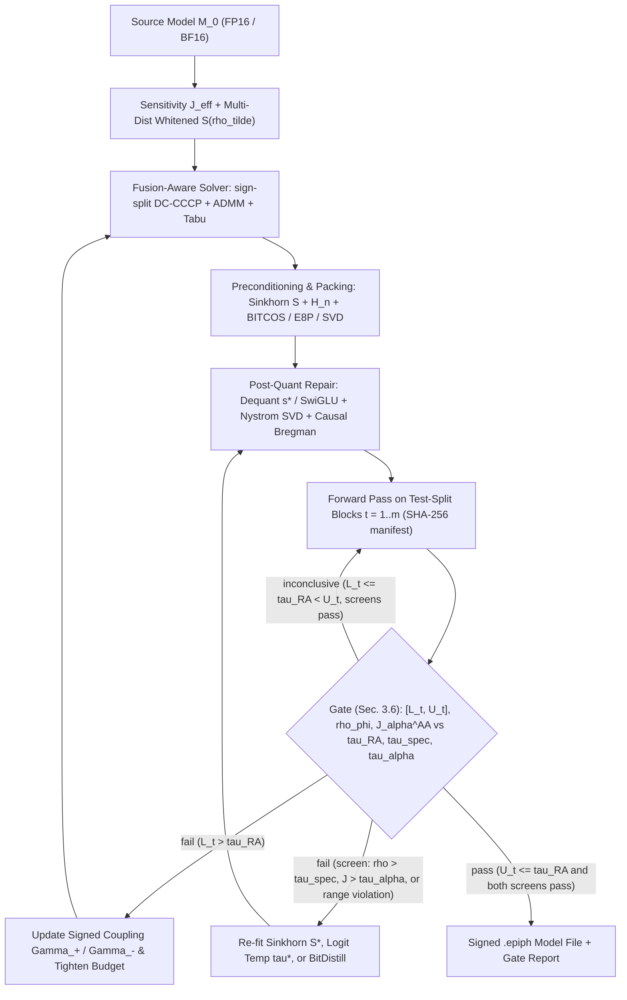
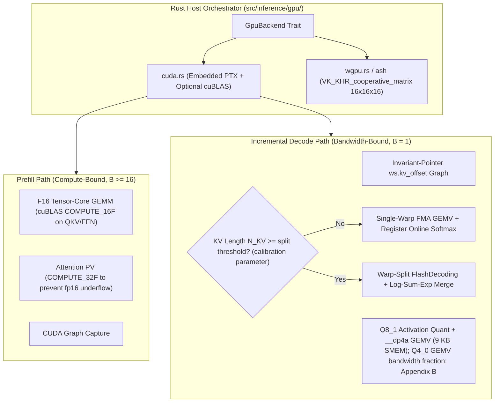
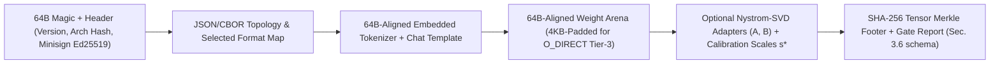
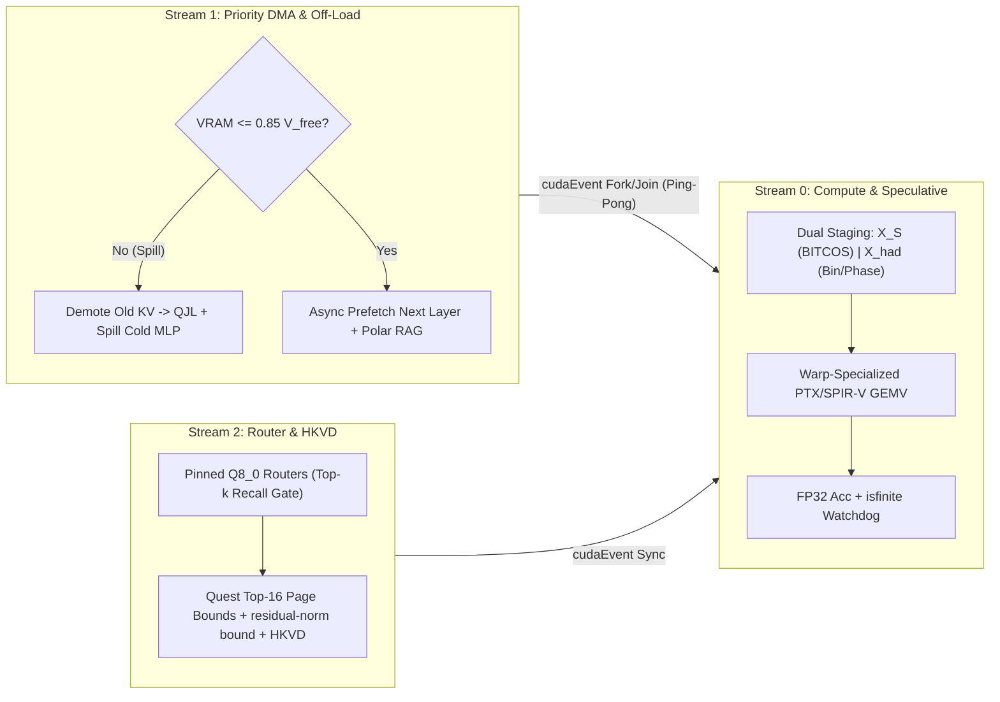

<!-- APA 7 heading map for the builder: h1 = title; h2 = Level 1 (centred, bold); h3 = Level 2 (flush left, bold); h4 = Level 3 (flush left, bold italic). Display equations carry \tag{n} inside the $$ block so the number renders right-aligned. The References list is a plain list; the builder adds the hanging indent. -->

# Epiphanes Math: A Formal Specification and Measured Evaluation of the THME Compression and Inference Engine

Ed Epiphanes

Epiphanes

27 November 2026

Running head: THME Epiphanes Math

Version 5 (revision of version 4 after independent peer review, 27 November 2026; softmax and loss-precision audit added). Repository: `EdEpiphanes/thme-epiphanes` (`thme` / `llm-tweaker`), merged tree at commit `6661098` on `main`. SmolLM2-1.7B GPU figures are cited from the branches `perf/gpu-throughput` and `feat/kv-cache-gpu-decode`; all commit references are reconciled in Appendix G.

---

## Abstract

This paper specifies Epiphanes Math, the formal core of THME (Topological Heterogeneous Manifold Engine), a Pure-Rust-first framework for zero-copy memory profiling, coupled mixed-precision allocation, post-quantization drift repair, and hardware-accelerated inference of large language models stored as Epiphanes model files (`.epiph`) or GGUF v3. The purpose is to attach a stated mathematical criterion and an evidence label to every compression and deployment decision. The method combines a formal specification with measured results for SmolLM-135M and Pythia-14M read from reports committed to the merged tree; the SmolLM2-1.7B GPU throughput, KV-decode, and quantization figures are reported from the unmerged branches `perf/gpu-throughput` and `feat/kv-cache-gpu-decode` and have not been re-run on the merged tree. The specification comprises an anytime-valid three-state quality gate built from betting e-processes, a coherent spectral tail-risk criterion, and a skewed Renyi divergence; a coupled sensitivity model solved by a sign-split DC-CCCP and ADMM procedure; Kronecker and Hadamard preconditioning with a format zoo (BITCOS, E8P, LittleBit); KV-cache compression and head/page routing; and logarithmic-norm stability bounds. On SmolLM-135M, uniform Q8_0 export moves full-split WikiText-2 perplexity from 19.80 to 19.83, and per-layer ternary effects sum to +1,509 perplexity while joint ternary quantization adds +15,877,276. On an RTX 4060 Ti 16 GB, the branch runs report 9,267.8 tok/s SmolLM2-1.7B prefill on 148 windows and 62.87 tok/s KV-cached F16 decode. A verification script recomputes every recomputable number with no failures. The specification provides an executable procedure for certifying compressed models against their source model.

*Keywords:* post-training quantization, anytime-valid inference, e-processes, spectral risk measures, mixed-precision allocation, KV-cache compression

---

### Epiphanes Math at a Glance

1. **Quality gate (Section 3).** A three-state decision (`pass`, `fail`, `inconclusive`) on the mean normalized log-loss drift, built from two-sided betting e-processes with an anytime-valid confidence sequence; `fail` requires only that cross-entropy is nonnegative, and `pass` uses a declared upper range $M$ for the block drift. A coherent spectral risk $\rho_\phi$ and a skewed Renyi divergence $J^{\mathrm{AA}}_\alpha$ act as screens. [Specification; validity Tested against the known mean of synthetic data]
2. **Coupled sensitivity and allocation (Section 4).** Hutchinson-Rademacher sensitivities feed a fusion-aware objective with signed cross-layer coupling, minimized by a sign-split DC-CCCP majorize-minimize scheme with ADMM and tabu polishing. [Specification; majorizer Tested against direct objective evaluation]
3. **Preconditioning and format zoo (Section 5).** A representation dichotomy applies three-factor Kronecker plus Hadamard preconditioning to dense and lattice formats and a column-side Sinkhorn scaling to sparse ternary BITCOS; formats include BITCOS (1.610 nominal bpw at $p_0=0.515$), BITCOS-2:4 (1.375 bpw), E8P (2.0 bpw), and LittleBit SVD. [Specification; rates Estimate; recomputed]
4. **Post-quantization repair (Section 6).** In-place dequantization-scale and SwiGLU moment matching, Nystrom Cholesky-SVD adapters, causal sink-separated Bregman refits, and logit temperature calibration. [Specification]
5. **Routing, KV compression, and roofline (Section 7).** Tiered RoPE-polar and QJL KV compression, DuoAttention/Quest head-page routing with an exact page bound, compressed RAG-KV fusion, roofline decode algebra, heterogeneous mixtures, off-loading, grounded decoding, conversion, policy selection, and clustering. [Specification]
6. **Epiphanes Theorem (Section 9).** A single-norm discrete residual stability bound, a logit-space KL bound, and the error guarantees of the gate, each with explicit assumptions. [Specification; component inequalities Tested against direct numerical evaluation]
7. **Evidence (Section 11).** Measured, from reports committed to the merged tree: SmolLM-135M and Pythia-14M perplexity under Q8_0, Q4_0, and ternary formats, ternary composition across layers, recipe-versus-random placement, and depth probes (Sections 11.4-11.5). [Measured] SmolLM2-1.7B prefill of 9,267.8 tok/s, F16 decode of 62.87 tok/s, and AWQ Q4_0 perplexity 9.7125 on a 37-window validation set (Sections 11.1-11.3). [Reported (unmerged branch; not on the merged tree)]

---

## 1. Introduction and Scope

### 1.1 Purpose

THME is a Pure-Rust-first framework for zero-copy LLM memory profiling, coupled mixed-precision allocation, post-quantization drift repair, and hardware-accelerated inference in Epiphanes model files (`.epiph`) and GGUF v3. Common compression heuristics assume additive per-layer costs and well-behaved, near-Gaussian residuals. THME's own measurements on SmolLM-135M show strong cross-layer interaction under ternary quantization (Section 11.4), which motivates the coupled sensitivity model of Section 4. Heavy-tailed activations and attention sinks (*StreamingLLM*, n.d.) are taken from the literature and are outside the measurements reported here.

The paper specifies Epiphanes Math and reports the hardware and quality results available for it, each with its evidence label. Its components are an anytime-valid three-state quality gate (Section 3), a coupled sensitivity model with a sign-split DC-CCCP solver (Section 4), Kronecker/Hadamard preconditioning and a format zoo (Section 5), post-quantization repair (Section 6), KV compression and routing (Section 7), an integrated architecture (Section 8), and logarithmic-norm stability bounds (Section 9).

### 1.2 Relation to Prior Work

The quality gate builds on betting-based estimation of bounded means (Waudby-Smith & Ramdas, 2024), time-uniform empirical-Bernstein boundaries (Howard et al., 2021), the impossibility of distribution-free confidence bounds for means unbounded above (Bahadur & Savage, 1956), spectral risk measures (Acerbi, 2002), and fixed-horizon empirical-Bernstein bounds (Maurer & Pontil, 2009). The allocation and format work relates to activation-aware and second-order weight quantization (*AWQ*, 2023; *GPTQ*, 2022), additive and lattice codebooks (*AQLM*, 2024; *QuIP#*, 2024; *QTIP*, 2024; Conway & Sloane, n.d.), rotation and affine preconditioning (*QuaRot*, 2024; *SpinQuant*, 2024; *FlatQuant*, 2024; *DuQuant*, 2024), ternary and sub-1-bit formats (*BITCOS*, n.d.; *LittleBit*, 2025; *BitDistill*, 2025), and logarithmic norms (Davydov et al., n.d.). KV-cache and retrieval components relate to *KIVI* (2024), *QJL* (2024), PolarQuant (Han et al., 2025), *SnapKV* (2024), *DuoAttention* (2024), *Quest* (2024), *StreamingLLM* (n.d.), *CacheBlend* (2024), *TurboRAG* (2024), and *RAGCache* (2024). Grounded decoding uses *DoLa* (2023), context-aware decoding (*CAD*, 2023), and semantic entropy (Kuhn et al., 2024). Looped architectures follow *Dory1.0-4B* (2026); small-model deployment follows *TinyLLM* (2024).

### 1.3 Epiphanes Math Compared With Classical Approaches

Table 1 summarizes how each component of Epiphanes Math replaces a classical design choice. [Specification]

*Table 1*

*Epiphanes Math Compared With Classical Approaches*

| Classical Concept | Limitation in LLM Compression | Epiphanes Math Component |
| :--- | :--- | :--- |
| Normal-statistics accuracy (Student-$t$, Pearson $r$, fixed-range Bernstein) | Assumes normality or a range fixed after looking at the data; a binary decision hides intervals that straddle the criterion | Betting e-processes ($[L_t,U_t]$, three-state decision; `pass` uses a declared range $M$), spectral risk $\rho_\phi$, skewed Renyi $J_\alpha^{\mathrm{AA}}$ (Section 3) |
| Additive knapsack DP ($\sum_\ell c_{\ell,f}$) | Assumes no layer interaction (measured interaction on SmolLM-135M: Section 11.4) | Sensitivity $J^{\mathrm{eff}}_{\ell\to L}$, fusion-aware sign-split DC-CCCP, ADMM (Section 4) |
| Static SmoothQuant or static Hadamard | SmoothQuant leaves axis outliers unmixed; Hadamard mixing fills the zeros of ternary weights | Representation dichotomy (ADR-0002): Sinkhorn $S$ plus $H_n$ for dense/lattice formats; column-side Sinkhorn $S$ only for BITCOS (Section 5) |
| Uniform Q4_0 or 5-trits-per-byte packing (1.600 bpw, no scales) | Fixed-rate base-3 packing ignores the zero fraction; its excess over the i.i.d. ternary entropy is 0.022 bpw at $p_0=0.38$ and 0.116 bpw at $p_0=0.515$ [Estimate; recomputed] | Format zoo: BITCOS super-block (1.610 bpw at $p_0=0.515$, with zero-skipping decode structure; Section 5.2), E8P (2.0 bpw), LittleBit SVD (Section 5) |
| Downstream RMSNorm $\gamma$ rescaling | Alters the residual-to-branch balance in Pre-Norm transformers | In-place dequantization scale $s_j^*$, SwiGLU-matched $s^*_{j,\mathrm{gate}}$, Nystrom SVD, causal Bregman LSE (Section 6) |
| Uniform INT4 KV or unconditional split-warp decode | Pre-RoPE Hadamard breaks RoPE pairs; a cross-warp barrier slows short-context decode | RoPE-commutative KV, Dory last-loop rule, adaptive FlashDecode with a calibrated split threshold (Section 7) |

*Note.* The bpw excess figures are recomputed by the verification script (Appendix F).

### 1.4 Scope and Sources

The paper covers the formal specification, integrated architectures, engineering lookup tables, code-to-math traceability, hardware benchmarks, and measured quality results. Every recomputable number is checked by `checks/verify_all.py` (standard library plus numpy), summarized in Appendix F. The data figures are regenerated by `checks/make_figures.py` from the paper's formulas and the repository's committed reports. Corrections relative to earlier versions are listed in Appendix A, negative results in Appendix B, the 140-round design-review log in Appendix C, items that still lack a formula, source, or measurement in Appendix D, the executable Step 1 gate procedure in Appendix E, and the repository file behind every headline number in Appendix G.

---

## 2. Notation and Evidence Standards

### 2.1 Evidence Labels

Following the repository's `CONTEXT.md` (THME Project, n.d.), every number carries one evidence label:

- **[Measured]**: produced by THME's own forward pass or read from a written artifact, and present in a committed report: a committed JSON file under `docs/benchmarks/*/data/` or the committed measured-findings report of 12 November 2026. Appendix G names the file for each headline number.
- **[Tested]**: a claim checked by an automated test against an oracle outside the code under test, on synthetic data. An oracle is an answer known independently of that code: an analytic identity, a direct or brute-force evaluation, a known parameter of the data generator, or a published value. Each [Tested] label names its oracle.
- **[Estimate]**: a figure from a stated formula or analytic model, never from a run. **[Estimate; recomputed]** marks a formula result that `checks/verify_all.py` recomputes from the stated formula and inputs; the recomputation confirms the arithmetic, not the inputs, and a ratio of Reported inputs stays an Estimate from Reported inputs.
- **[Simulated]**: a figure from a synthetic simulation; it says nothing about a trained model (Monte Carlo rates, and the synthetic path in Figure 1).
- **[Reported (unmerged branch; not on the merged tree)]**: a figure stated in a committed handoff document for a branch run, with no committed JSON report. It is not presented as the merged codebase's performance. It plays the role that `CONTEXT.md` gives to the run mode *imported*: labelled, never Measured.
- **[Reported, repository]** or **[Reported, handoff document]**: a test status or figure as the repository or a handoff document states it, not re-run for this paper and not tied to an unmerged branch.
- **[Specification]**: a design rule, default parameter, or definition. It is not an evidence status.

Items for which no formula, source, or measurement is yet available are collected in Appendix D, each with the evidence that would settle it; no claim in the body rests on them.

### 2.2 Notation Registry

*Table 2*

*Notation Registry*

| Symbol | Type | Definition (used in) |
| :--- | :--- | :--- |
| $\mathscr{E}_{\mathrm{gate}}$ | Gate | Three-state decision function $\{\mathrm{pass},\mathrm{fail},\mathrm{inconclusive}\}$, defined in Section 3.6 |
| $\mathscr{E}_{\mathrm{joint}}^{\mathrm{DC}}$, $\mathscr{E}_{\mathrm{select}}$ | Objectives | Coupled allocation objective (Section 4.2); hardware-model-intent policy selector (Section 7.11) |
| $\mathcal{M}_0,\; \mathcal{M}_\theta$ | Models | Source model (FP16/BF16) and candidate, with parameters $\theta_0, \theta$ |
| $L,\; H_q,\; H_{kv},\; d_h$ | Architecture | Block count, query heads, KV heads, per-head dimension (Section 7, Table 12) |
| $W_\ell \in \mathbb{R}^{d_o \times d_i}$ | Tensor | Weight at layer/projection $\ell$; row-major convention $Y = X W^\top$ (Section 5.1) |
| $\overline{\mathcal{L}}_0(b),\; \overline{\mathcal{L}}_\theta(b)$ | Loss | Token-weighted mean cross-entropy (nats/token) of source and candidate on block $b$ (Section 3.2) |
| $\mathrm{BPT},\; \mathrm{BPB}$ | Rate | Bits per token $\overline{\mathcal{L}}/\ln 2$; bits per content byte (Section 3.1) |
| $\tilde{\delta}_b \in [-1, \infty)$ | Drift | $\overline{\mathcal{L}}_\theta(b)/\overline{\mathcal{L}}_0(b) - 1$ (Section 3.2) |
| $\mu$ | Parameter | Common conditional mean of $\tilde\delta_b$ under assumption A2 (Section 3.7) |
| $M$ | Parameter | Declared upper range, $\tilde\delta_b \le M$ (assumption A3); default 0.25 (Section 3.6) |
| $K_t^{+}(\mu_0),\; K_t^{-}(\mu_0)$ | E-process | Lower-side and upper-side betting wealth at block $t$ for null value $\mu_0$ (Section 3.3) |
| $E_t(\mu_0)$, $[L_t, U_t]$ | E-process | $\tfrac12 K_t^+ + \tfrac12 K_t^-$; anytime-valid confidence sequence for $\mu$ (Section 3.3) |
| $\eta$ | Parameter | Error level of the confidence sequence; default 0.05 |
| $\tau_{\mathrm{RA}},\; \tau_{\mathrm{spec}},\; \tau_\alpha$ | Thresholds | Gate criteria for $\mu$, $\rho_\phi$, $J^{\mathrm{AA}}_\alpha$ (Section 3.6, Appendix E) |
| $J_\alpha^{\mathrm{AA}}(p_0, p_\theta)$ | Divergence | Asymmetry-weighted $\lambda$-skewed Renyi divergence on FP32 top-$K$ plus tail (Section 3.4) |
| $\rho_\phi$ | Risk measure | Spectral (weighted) CVaR, $\phi(\beta)=2\beta$ (Section 3.5) |
| $J_{\ell \to L}^{\mathrm{eff}}$ | Sensitivity | Frobenius-norm sensitivity of logits to the layer-$\ell$ output (Section 4.1) |
| $\Gamma = \Gamma_+ - \Gamma_-$ | Coupling | Signed cross-layer coupling, $\Gamma_\pm = \Pi_{\mathbb{S}_+}(\pm\Gamma)$ (Section 4.2) |
| $\tilde{\rho}_\ell,\; S(\tilde{\rho}_\ell)$ | Spectral | Activation-whitened Gram density and its von Neumann entropy in bits (Section 4.3) |
| $\mu_2(A)$ | Log-norm | $\lambda_{\max}\bigl(\tfrac{A + A^\top}{2}\bigr)$; satisfies $\mu_2(A) \le \|A\|_2$ (Section 9) |
| $p_0,\; b_{\mathrm{BITCOS}}(p_0)$ | Format | Ternary zero fraction; nominal bits per weight $2.125 - p_0$ (Section 5.2) |
| $I(B)$ | Roofline | Operational intensity (FLOP/byte) at batch $B$ (Section 7.4, Table 13) |

*Note.* The expression $\mathscr{E}(\mathcal{M}_0)=\mathcal{M}_\theta$ ("Epiphanes operator") is shorthand for the Section 4-7 pipeline applied to $\mathcal{M}_0$.

---

## 3. Epiphanes Quality Gate: Distribution-Free Quality and Tail Risk

This section defines the quality gate (`Quality gate`, ADR-0001; THME Project, n.d.). Section 3.6 gives the complete decision rule, and Section 3.7 lists the assumptions on which each guarantee depends.

### 3.1 Tokenizer-Invariant Information Rates (BPT and Pure-Content BPB) [Specification]

$$\mathrm{BPT} = \frac{\overline{\mathcal{L}}}{\ln 2}, \qquad \mathrm{BPB} = \frac{T \cdot \overline{\mathcal{L}}}{B_{\mathrm{content}} \cdot \ln 2}, \tag{1}$$

where $T$ is the number of scored tokens and $B_{\mathrm{content}}$ is the raw UTF-8 payload length in bytes, excluding synthetic BOS/EOS and chat-template bytes. Calibration (`CALIB`), validation (`VAL`), and test (`TEST`) corpora are partitioned by SHA-256 split manifests to prevent contamination. The gate (Section 3.6) is defined for a fixed tokenizer; comparison across tokenizers uses BPB and lies outside the gate's scope (Section 12).

### 3.2 Autocorrelation-Separated Block Partitioning [Specification]

Evaluation windows are grouped into $m$ disjoint blocks of $g$ consecutive windows. Blocks are separated by document boundaries or by a guard gap of at least $L_{\mathrm{ctx}}$. The group size is $g = \max(1, \lceil\hat\tau_{\mathrm{int}}\rceil)$, where $\hat\tau_{\mathrm{int}}$ is estimated on the calibration split by Geyer's initial positive sequence. With autocorrelations $\hat\rho_k$ of the per-window drift series, $\hat\rho_0=1$, and $\hat\Gamma_j = \hat\rho_{2j} + \hat\rho_{2j+1}$:

$$\hat{\tau}_{\mathrm{int}} = -1 + 2 \sum_{j=0}^{J^\star} \hat\Gamma_j, \qquad J^\star = \max\{J : \hat\Gamma_j > 0 \;\; \forall j \le J\}. \tag{2}$$

On block $b$, the normalized log-loss drift is $\tilde{\delta}_b = \overline{\mathcal{L}}_\theta(b)/\overline{\mathcal{L}}_0(b) - 1$, where each $\overline{\mathcal{L}}$ is token-weighted within the block. Cross-entropy is nonnegative, so $\tilde{\delta}_b \ge -1$ always. In general $\tilde\delta_b$ is unbounded above, because one confidently wrong token can make $\overline{\mathcal{L}}_\theta(b)$ arbitrarily large.

**Numerical precision of the per-token loss.** [Specification; Tested] The per-token loss is computed as $\ell_t = \log\bigl(1+\sum_{j\neq t}e^{z_j-z_t}\bigr)$ from float32 logits. This identity is exact for the cross-entropy of a softmax distribution. Two alternatives are excluded from the gate path. First, $-\log p_t$ computed from a rounded softmax probability: in float16, $1+e^{-m}$ rounds to exactly 1 once the logit margin $m$ exceeds about 7.6, and in float32 once $m$ exceeds about 16.6 (Barron et al., 2026, report the cliff at about 5.5 for bf16, 16.6 for fp32 and 36.7 for fp64). Second, $\mathrm{LSE}(z)-z_t$, which cancels the leading digits of two numbers of size $|z|$. On 4,000 synthetic 512-way distributions with logit standard deviation up to 8 [Tested; oracle: float64 reference], the float32 identity form has a maximum absolute error of $3.4\times10^{-6}$ nats per token. Storing the logits as float16 before the loss raises the mean error to about $10^{-3}$ nats per token and the maximum to $1.7\times10^{-2}$. For a candidate with mean loss near $\ln 19.8 \approx 3$ nats (SmolLM-135M), a systematic bias of $10^{-3}$ nats shifts $\tilde\delta_b$ by about $3\times10^{-4}$, which is about 1.5% of the default $\tau_{\mathrm{RA}}\approx0.022$. **Rule G-P1.** Gate-grade loss files are computed from float32 logits with the identity form. The repository contains an `nll_f16` kernel (`src/inference/gpu/kernels/decoder.cu`); its use in the Round 5 runs is not recorded, and it is excluded from gate-grade runs until its effect on $\tilde\delta_b$ is measured. The check scripts are `checks/softmax_check.py` and `checks/nll_precision.py` (output in `checks/softmax_precision_output.txt`).

### 3.3 Anytime-Valid Two-Sided E-Processes [Specification; validity Tested]

For a null value $\mu_0$, both processes below are nonnegative supermartingales under the corresponding one-sided null, given assumption A5 (all bet sizes are predictable). With $\mu$ the common conditional mean of $\tilde\delta_b$ (A2), their inversion gives a confidence sequence $[L_t, U_t]$ (Waudby-Smith & Ramdas, 2024).

**Predictable statistics** (computed from blocks $1,\dots,b-1$ only): $\hat\mu_{b-1} = \frac{1}{b-1}\sum_{i<b}\tilde\delta_i$ (with $\hat\mu_0=0$), and $\hat V_{b-1} = \bigl(\tau_{\mathrm{RA}}^2 + \sum_{i<b}(\tilde\delta_i-\hat\mu_{b-1})^2\bigr)/b$.

#### *3.3.1 Lower Side*

The lower side $K_t^+(\mu_0)$ gives $L_t$ and collects evidence that $\mu > \mu_0$. From $\tilde{\delta}_b \ge -1$ we have $\tilde{\delta}_b - \mu_0 \ge -(1+\mu_0)$, and

$$K_t^+(\mu_0) = \sum_{j=0}^{8} \tfrac{1}{9} \prod_{b=1}^{t} \Bigl(1 + \lambda^+_{j, b}(\tilde{\delta}_b - \mu_0)\Bigr), \qquad \lambda^+_{j, b} = \min\!\left(\frac{2^{-j}}{1+\mu_0},\; \frac{c}{\sqrt{\hat{V}_{b-1} + \epsilon}}\right), \tag{3}$$

with $c=1$ and $\epsilon=10^{-6}$. Each factor is at least $1-\lambda^+(1+\mu_0) \ge 0$ for every $\tilde\delta_b\in[-1,\infty)$. If $\mathbb{E}[\tilde\delta_b\mid\mathcal F_{b-1}]\le\mu_0$, each factor has conditional expectation at most 1. This side needs only the lower range $\tilde\delta_b \ge -1$. [Tested; oracle: the generator's known block means $\mu_b \le \mu_0$, 20,000 synthetic paths: nonnegativity, $\mathbb{E}[K^+_T] \le 1$, and Ville rate $\le \eta$ under random non-stationary means $\mu_b \le \mu_0$ with an unbounded right tail]

#### *3.3.2 Upper Side*

The upper side $K_t^-(\mu_0)$ gives $U_t$ and collects evidence that $\mu < \mu_0$. It uses the declared range $\tilde\delta_b \le M$ (assumption A3), with $\mu_0 < M$:

$$K_t^-(\mu_0) = \sum_{j=0}^{8} \tfrac{1}{9} \prod_{b=1}^{t} \Bigl(1 + \lambda^-_{j, b}(\mu_0 - \tilde{\delta}_b)\Bigr), \qquad \lambda^-_{j, b} = \min\!\left(\frac{2^{-j}}{M-\mu_0},\; \frac{c}{\sqrt{\hat{V}_{b-1} + \epsilon}}\right). \tag{4}$$

Each factor is at least $1 - \lambda^-(M-\mu_0) \ge 0$ whenever $\tilde\delta_b \le M$. [Tested; oracle: the generator's known block means $\mu_b \ge \mu_0$, 20,000 synthetic paths: nonnegativity, $\mathbb{E}[K^-_T] \le 1$, and Ville rate $\le \eta$ under random non-stationary means $\mu_b \ge \mu_0$]

**Role of the declared range $M$.** If $\tilde\delta_b$ is unbounded above, a small probability mass far to the right can move the true mean arbitrarily without being observed, and no procedure can then give a nontrivial upper confidence bound on $\mu$ (Bahadur & Savage, 1956). The upper side therefore carries the declared range $M$. Fan's inequality $\exp(\lambda\xi-\psi_E(\lambda)\xi^2)\le 1+\lambda\xi$ holds for $\xi\ge-1$ and $\lambda \ge 0$; it therefore applies to the side that bets on $\tilde\delta_b > \mu_0$.

**Remark (Fan-Howard-Ramdas form, lower side).** An alternative to $K^+$ is

$$\prod_b \exp\bigl(\gamma_b(\tilde\delta_b-\mu_0) - \psi_E(\gamma_b c_0)\,c_0^{-2}(\tilde\delta_b-\hat\mu_{b-1})^2\bigr), \qquad \psi_E(u) = -\ln(1-u)-u, \quad \gamma_b c_0 < 1. \tag{5}$$

It is valid with $c_0 = 1+\max(\mu_0,\hat\mu_{b-1})$. The lower range of $\tilde\delta_b-\hat\mu_{b-1}$ is $-(1+\hat\mu_{b-1})$, and $\psi_E(\gamma c)/c^2$ is nondecreasing in $c$, so any $c_0\ge 1+\hat\mu_{b-1}$ is valid (Howard et al., 2021). [Tested; oracle: the generator's known block means, Monte Carlo]

**Confidence sequence.** Let

$$E_t(\mu_0) = \tfrac12 K_t^+(\mu_0) + \tfrac12 K_t^-(\mu_0), \qquad C_t = \{\mu_0 : E_t(\mu_0) < 1/\eta\}, \tag{6}$$

with $\mu_0$ evaluated on the grid $\{-1+10^{-4}k\} \cap (-1, M)$. Then $L_t = \max_{s\le t}\min C_s$ and $U_t = \min_{s\le t}\max C_s$ (running intersection). By Ville's inequality,

$$\mathbb{P}(\exists t: \mu\notin[L_t,U_t]) \le \eta \quad \text{under A1-A3 and A5}. \tag{7}$$

[Tested; oracle: the known true mean 0.04 of the synthetic Beta law. Miscoverage 0.0032, within 0.05, on 20,000 paths (rate Simulated)]

### 3.4 Asymmetry-Adaptive Skewed Renyi Divergence and Overlap Bound [Specification; bound Tested]

Partition the vocabulary into $S_K = \mathrm{TopK}(p_0, K=256)$, kept in FP32, plus a collapsed tail $p_{\mathrm{tail}} = 1 - \sum_{v \in S_K} p(v)$. The skewed divergence is

$$D_\alpha^{(\lambda)}(p\|q) = D_\alpha(p \,\|\, m_\lambda), \qquad m_\lambda = (1-\lambda)q + \lambda p. \tag{8}$$

Coarsening $T$ is a Markov kernel and $T m_\lambda = (1-\lambda)Tq+\lambda Tp$, so the data-processing inequality gives $D_\alpha^{(\lambda)}(Tp\|Tq) \le D_\alpha^{(\lambda)}(p\|q)$ [Tested; oracle: direct evaluation of both sides on 2,000 random pairs]. With $\lambda = 10^{-3}$ and $s^* = \sigma\bigl(D_\alpha^{(\lambda)}(p_0 \| p_\theta) - D_\alpha^{(\lambda)}(p_\theta \| p_0)\bigr)$,

$$J_\alpha^{\mathrm{AA}}(p_0, p_\theta) = (1 - s^*)\, D_\alpha^{(\lambda)}(p_0 \| p_\theta) + s^*\, D_\alpha^{(\lambda)}(p_\theta \| p_0), \tag{9}$$

evaluated in FP32 over the $K+1 = 257$ atoms. For every $\alpha>0$ with $\alpha\neq1$, and any partition of atoms into $S$ and its complement (for example $S=\mathrm{supp}_\epsilon(q)$), the support-overlap Holder certificate is

$$D_\alpha^{(\lambda)}(p \| q) \le \frac{1}{\alpha - 1}\ln\!\left(\lambda^{1-\alpha}\sum_{v \notin S} p(v) + (1-\lambda)^{1-\alpha}\sum_{v \in S} p(v)^\alpha q(v)^{1-\alpha}\right). \tag{10}$$

*Proof.* $m_\lambda \ge \lambda p$ and $m_\lambda \ge (1-\lambda) q$. For $\alpha>1$ this bounds each term $p^\alpha m_\lambda^{1-\alpha}$ from above; for $\alpha<1$ it bounds each term from below, and the prefactor $1/(\alpha-1)<0$ reverses the inequality. The bound holds in 20,000 of 20,000 random trials [Tested; oracle: brute-force evaluation of $D_\alpha^{(\lambda)}$ on each trial].

### 3.5 Coherent Weighted CVaR (Spectral Tail-Risk Criterion) [Specification; weights Tested]

$$\rho_\phi(\tilde{\delta}) = \int_0^1 \mathrm{CVaR}_\beta(\tilde{\delta})\, \phi(\beta)\, d\beta, \qquad \phi(\beta) = 2\beta, \tag{11}$$

where $\mathrm{CVaR}_\beta$ is the mean of the upper $(1-\beta)$ tail. Equivalently $\rho_\phi = \int_0^1 \mathrm{VaR}_u\,\sigma(u)\,du$ with spectrum $\sigma(u) = \int_0^u \frac{\phi(\beta)}{1-\beta}d\beta = 2(-u-\ln(1-u))$. This spectrum is nondecreasing and integrates to 1, so $\rho_\phi$ is a coherent spectral risk measure (Acerbi, 2002): subadditive, monotone, translation-invariant, and positively homogeneous.

**Empirical evaluation (exact, no grid).** For $n$ sorted values $x_{(1)}\le\dots\le x_{(n)}$,

$$\hat\rho_\phi = \sum_i w_i x_{(i)}, \qquad w_i = \Sigma(i/n) - \Sigma((i-1)/n), \qquad \Sigma(u) = -u^2 + 2u + 2(1-u)\ln(1-u), \quad \Sigma(1)=1. \tag{12}$$

[Tested; oracle: a 4,000-node midpoint quadrature of the defining integral. The weights sum to 1 and are nondecreasing; they match the midpoint integral of $\int \mathrm{CVaR}_\beta\, 2\beta\, d\beta$; $\rho$(constant) = constant; $\rho \ge$ mean]. $\hat\rho_\phi$ is a plug-in point estimate, so the gate uses it as a screening criterion (Section 3.6).

### 3.6 Precise Definition of the Three-State Gate [Specification]

$$\mathscr{E}_{\mathrm{gate}}:\;\bigl(\{\overline{\mathcal L}_0(b), n_b\}_{b},\; \{\overline{\mathcal L}_\theta(b)\}_{b},\; \text{top-}K\text{ logits},\; \Theta\bigr)\;\longmapsto\;\{\mathrm{pass},\mathrm{fail},\mathrm{inconclusive}\} \times \text{reason}. \tag{13}$$

*Table 3*

*Gate Parameters $\Theta$ and Defaults*

| Name | Default | Meaning |
| :--- | :--- | :--- |
| $\eta$ | 0.05 | Confidence-sequence error level |
| $r_{\max}$ | 1.05 | Largest acceptable PPL ratio, candidate/source, on average |
| $\tau_{\mathrm{RA}}$ | $\ln r_{\max} / \overline{\mathcal L}_0^{\mathrm{cal}}$ | Criterion for $\mu$; $\overline{\mathcal L}_0^{\mathrm{cal}}$ is the token-weighted source CE on the calibration split. With the 148-window source CE $\ln 8.9054$ this gives 0.0223 [Estimate; recomputed] (illustration; Step 1 uses the calibration split) |
| $c_{\mathrm{tail}}$ | 2 | $\tau_{\mathrm{spec}} = c_{\mathrm{tail}}\,\tau_{\mathrm{RA}}$ |
| $\alpha,\;\lambda,\;K$ | 0.5, $10^{-3}$, 256 | Renyi order, skew, top-$K$ size |
| $\tau_\alpha$ | $\alpha \ln r_{\max}$ nats/token | Heuristic: for close distributions $D_\alpha \approx \alpha\,\mathrm{KL}$, and the mean KL budget is about $\overline{\mathcal L}_0\tau_{\mathrm{RA}} = \ln r_{\max}$ |
| $M$ | 0.25 | Declared upper range of $\tilde\delta_b$ (assumption A3) |
| $c,\;\epsilon$, bets | 1, $10^{-6}$, $j=0,\dots,8$ with weights $1/9$ | E-process constants (Section 3.3) |
| grid step | $10^{-4}$ | $\mu_0$ grid for inverting $E_t$ |
| $f_{\mathrm{cal}}$, salt | 0.25, `thme-v3.4-split` | Split rule (Appendix E, step A2) |

**Decision rule** (evaluated once, at $t$ = number of test blocks, in the manifest's fixed processing order):

1. If any test block has $\tilde\delta_b > M$, return **fail** with reason `range_violation`. This is a policy: a block whose CE rose by more than $100M\%$ is unacceptable, and assumption A3 does not hold for that block.
2. Compute $[L_t,U_t]$ (Section 3.3), $\hat\rho_\phi$ on the test-block $\tilde\delta_b$ (Section 3.5), and $\hat J$, the token mean of $J_\alpha^{\mathrm{AA}}$ over test tokens (Section 3.4).
3. If $L_t > \tau_{\mathrm{RA}}$, return **fail** (`mean_exceeds`). The error probability is at most $\eta$ under A1, A2, and A5; A3 is not needed.
4. Else, if $U_t \le \tau_{\mathrm{RA}}$, $\hat\rho_\phi \le \tau_{\mathrm{spec}}$, and $\hat J \le \tau_\alpha$, return **pass**. Under A1-A3 and A5, $\mathbb{P}(\mathrm{pass} \wedge \mu > \tau_{\mathrm{RA}}) \le \eta$.
5. Else, if $\hat\rho_\phi > \tau_{\mathrm{spec}}$ or $\hat J > \tau_\alpha$, return **fail** (`tail_screen` or `divergence_screen`). This is a screening decision without an error-rate guarantee.
6. Else return **inconclusive** (the interval straddles $\tau_{\mathrm{RA}}$; more blocks are needed).

**Resolution at the defaults** [Estimate; recomputed: deterministic evaluation of Equations 3, 4, and 6 at $\tilde\delta\equiv0$]. Table 4 gives the upper confidence limit for a candidate identical to the source ($\tilde\delta\equiv0$), and Figure 1 shows the full path. With $\tau_{\mathrm{RA}}\approx0.022$, `pass` becomes reachable for an identical candidate between 37 and 74 test blocks.

*Table 4*

*Upper Confidence Limit $U_t$ for Source Versus Source at the Default Parameters*

| Test blocks $t$ | 37 | 74 | 111 | 148 |
| :--- | :---: | :---: | :---: | :---: |
| $U_t$ | 0.0360 | 0.0187 | 0.0126 | 0.0095 |

*Note.* $\eta=0.05$, $M=0.25$, $\tau_{\mathrm{RA}}=0.0223$ in $\hat V_0$. Values are reproduced by the verification script (Appendix F).

*Figure 1*

*Anytime-Valid Confidence Sequence on Synthetic Source-Versus-Source Data*


*Note.* Upper limit $U_t$ (solid) for a candidate identical to the source, computed with Equations 3, 4, and 6 at $\eta=0.05$, $M=0.25$, grid step $10^{-4}$, and running intersection; the marked values at $t$ = 37, 74, 111, 148 equal Table 4 [Estimate; recomputed]. The dashed and dotted lines are $U_t$ and $L_t$ for a synthetic path with drift $\tilde\delta_b \sim N(0, 0.002^2)$, numpy `default_rng` seed 20261126 [Simulated]. $\tau_{\mathrm{RA}} = \ln 1.05/\ln 8.9054 = 0.0223$. Source: `checks/make_figures.py` (F7).

### 3.7 Assumptions and Where Each Is Used

*Table 5*

*Assumptions of the Quality Gate and the Epiphanes Theorem*

| ID | Assumption | Used in | Consequence if it does not hold |
| :--- | :--- | :--- | :--- |
| A1 | $\tilde\delta_b \ge -1$ (CE $\ge 0$) | $K^+$, $L_t$, `fail` | Holds for correctly computed CE; a violation indicates an input bug, and Step 1 validation rejects the input |
| A2 | Common conditional mean: $\mathbb{E}[\tilde\delta_b\mid\mathcal F_{b-1}] = \mu$ for all $b$ in processing order | Interpreting $[L_t,U_t]$ as a confidence sequence for $\mu$ | Under non-stationary means the processes stay valid for the one-sided nulls "all $\mu_b\le\mu_0$" and "all $\mu_b\ge\mu_0$"; the guarantees then state $L_t \le \max_b\mu_b$ and $U_t \ge \min_b\mu_b$, so `pass` bounds the smallest block mean, not the average |
| A3 | Declared range $\tilde\delta_b \le M$ | $K^-$, $U_t$, `pass` | $U_t$ loses validity (Bahadur & Savage, 1956); the gate checks observed blocks (rule 1), and unobserved blocks remain covered by the declaration only |
| A4 | Autocorrelation separation ($g \ge \hat\tau_{\mathrm{int}}$, document boundaries) | Credibility of A2 | Dependence between blocks can make the conditional mean depend on the past, so A2 fails |
| A5 | Predictability: $\lambda^\pm_{j,b}$, $\hat\mu_{b-1}$, $\hat V_{b-1}$ use only blocks $<b$ | Supermartingale property | Using block $b$ in its own bet voids Ville's inequality |
| A6 | Split integrity: no test block was used for tuning (AWQ/GPTQ calibration, thresholds, $M$, $g$) | All gate guarantees | Optimistic bias; guarantees void |
| A7 | Same tokenizer and same scored text for source and candidate | Definition of $\tilde\delta_b$ | $\tilde\delta_b$ is not comparable; the gate is undefined |
| A8 | Path Lipschitz bound $\sup_t\|J_\ell(t)-J_\ell(0)\|_2 \le L_{J,\ell}$ | Theorem 1, Part A (interior) | Only the endpoint form of Part A applies |
| A9 | Relaxed codec error $\varepsilon_G(x_G)$ affine in $x_G$ (simplex relaxation) | DC-CCCP convexity split (Section 4.2) | Sign-split majorizer convexity must be re-derived |
| A10 | Candidate FP32 log-probabilities available at the source's top-$K$ ids, plus both tail masses | $J^{\mathrm{AA}}_\alpha$ | $\hat J$ cannot be computed; the divergence screen is skipped and the report records this |

---

## 4. Coupled Sensitivity and Allocation

### 4.1 Hutchinson-Rademacher Sensitivity [Specification]

Propagate $m$ Rademacher probes $v_j \in \{-1, +1\}^{d}$ backward through the RMSNorm tangent projectors $P_{h_k^\perp} = I - \hat{h}_k\hat{h}_k^\top$. The squared estimator

$$\widehat{F}^2 = \frac{1}{m}\sum_{j=1}^m \bigl\| v_j^\top \mathcal{J}_{\ell \to L}(h_\ell) \bigr\|_2^2 \tag{14}$$

is unbiased for $\|\mathcal J_{\ell\to L}\|_F^2$. Its square root $J_{\ell \to L}^{\mathrm{eff}} = \sqrt{\widehat F^2}$ is biased low by Jensen's inequality [Tested; oracle: the exact $\|\mathcal J\|_F^2$ of random matrices]. $\widehat F^2$ is used wherever the squared sensitivity enters; Section 4.2 uses $(J^{\mathrm{eff}})^2 = \widehat F^2$.

### 4.2 Fusion-Aware Sign-Split DC-CCCP and ADMM Solver (`alloc.rs`) [Specification; majorizer Tested]

Tensors are grouped into hardware-fused units $G \in \{[W_q; W_k; W_v],\; [W_{\mathrm{gate}}; W_{\mathrm{up}}],\; W_o,\; W_{\mathrm{down}}\}$. Each unit shares one codec, $x_{\ell, f} = x_{G(\ell), f}$, or pays an explicit launch-latency penalty $\tau_{\mathrm{launch}}\mathbf{1}_{\mathrm{split}(G)}$. With $e_G = \varepsilon_G(x_G) + \delta_0$ and $\delta_0 = 10^{-12}$:

$$\mathscr{E}_{\mathrm{joint}}^{\mathrm{DC}}(x) = \sum_{G} \widehat F_G^2\, \varepsilon_G(x_G) + \sum_{G \neq G'} \Gamma_{G,G'}^+ \sqrt{e_G e_{G'}} - \sum_{r=1}^{R^-} \sigma_r^- \Bigl(\sum_{G} u_{r,G}^- \sqrt{e_G}\Bigr)^{2}. \tag{15}$$

**Sign split.** Expanding the last term, $(\sum_G u_G\sqrt{e_G})^2 = \sum_G u_G^2 e_G + \sum_{G\ne G'} u_G u_{G'}\sqrt{e_Ge_{G'}}$, gives

$$\mathscr{E} = \sum_G a_G e_G + \sum_{G\ne G'} C_{GG'}\sqrt{e_Ge_{G'}} + \mathrm{const}, \qquad C = \Gamma^+_{\mathrm{off}} - \sum_r \sigma^-_r (u^-_r u^{-\top}_r)_{\mathrm{off}}. \tag{16}$$

Under A9, $\sqrt{e_Ge_{G'}}$ is a geometric mean of affine functions and is therefore concave in $x$. Hence:

- entries with $C_{GG'} < 0$ give convex terms, which are kept exactly;
- entries with $C_{GG'} > 0$ give concave terms, which are majorized by AM-GM around $s_G^{(t)} = \sqrt{e_G(x^{(t)})}$:

$$\sqrt{e_G e_{G'}} \le \frac12\Bigl(\frac{s_{G'}^{(t)}}{s_G^{(t)}}e_G + \frac{s_G^{(t)}}{s_{G'}^{(t)}}e_{G'}\Bigr), \quad \text{with equality at } x^{(t)}. \tag{17}$$

The AM-GM majorizer applies to nonnegative coefficients: multiplying the inequality by $C_{GG'}<0$ turns it into a minorizer. The PSD projection $\Gamma^+$ can have negative off-diagonal entries, so its elementwise sign is not fixed and the split above is required [Tested; oracle: direct computation of a PSD projection]. Each outer step minimizes (linear) + (convex) over the budget polytope, a convex problem, and the majorize-minimize argument gives monotone descent of $\mathscr{E}$ [Tested; oracle: direct objective evaluation. The sign-split surrogate is at least the objective at 2,000 random points and equal at $x^{(t)}$].

**Algorithm 1 (Homotopy DC-CCCP with Budget-Feasible ADMM and Tabu Polishing).** $\tau_{\mathrm{temp}}$ is the weight of an entropic regularizer $\tau_{\mathrm{temp}}\sum_{G,f}x_{G,f}\ln x_{G,f}$ on the relaxed simplex, annealed to 0.

```rust
for tau_temp in [0.5, 0.1, 0.02, 0.0] {
    let mut prev_obj = f64::INFINITY;
    for _outer_iter in 0..MAX_CCCP {
        let (lin, convex_neg) = split_and_majorize(&c_matrix, &a_diag, &x); // positive C -> AM-GM linear, negative C kept
        x = solve_convex_admm(&lin, &convex_neg, &bytes, b_max, rho, tau_temp); // objective + tau_temp * sum x ln x
        let cur = obj(&x);
        if (prev_obj - cur).abs() < 1e-6 { break; }
        prev_obj = cur;
    }
}
let discrete = project_budget_feasible(round_to_discrete(&x), &eps, &bytes, b_max);
return tabu_polish(discrete, &eps, &bytes, b_max);
```

### 4.3 Out-of-Core Multi-Distribution Activation-Whitened Rank [Specification]

Calibration statistics are accumulated out of core in FP32 (at most 256 MiB scratch VRAM per 4-window chunk) across $\mathcal{D} = \{\text{WikiText-2},\, \text{C4-code},\, \text{MathInstruct}\}$: $C_X^{\mathrm{multi}} = \sum_d w_d \sum_c X_{d,c}^\top X_{d,c}$. When $\kappa > 10^4$, ridge whitening with $\varepsilon_w = \sigma_{\mathrm{median}}/100$ is applied. This yields

$$\tilde{\rho}_\ell = \frac{L_X^\top W_\ell^\top W_\ell L_X}{\mathrm{Tr}(L_X^\top W_\ell^\top W_\ell L_X)}, \qquad r_{\mathrm{eff}}(\ell) = 2^{S(\tilde{\rho}_\ell)}. \tag{18}$$

---

## 5. Preconditioning and Format Zoo

This section covers the representation dichotomy (ADR-0002) and the BITCOS super-block (ADR-0003; THME Project, n.d.).

### 5.1 Representation Dichotomy and Kronecker Preconditioning (`basis.rs`, `transport.rs`) [Specification; identity Tested; costs Estimate]

Under $Y = X W^\top$:

1. **Dense and lattice formats (Q4_0, E8P, INT4 KV): three-factor Kronecker FlatQuant plus Hadamard** (*FlatQuant*, 2024). Factor the learned preconditioner as $P = P_1 \otimes P_2 \otimes P_3$ with $d_1 d_2 d_3 = d_{\mathrm{in}}$, and let $H$ be an orthogonal (normalized) Hadamard matrix of order $d_{\mathrm{in}}$:

$$X' = X P^{-1} H^\top, \qquad W' = W P^{\top} H^\top \implies X'(W')^\top = X P^{-1}H^\top H P W^\top = X W^\top. \tag{19}$$

The identity reproduces $XW^\top$ to within $10^{-9}$ [Tested; oracle: the dense product $XW^\top$]. $W'$ is folded offline into `.epiph`. The activation-side $P^{-1} = P_1^{-1}\otimes P_2^{-1}\otimes P_3^{-1}$ is applied by reshaping, at $d_{\mathrm{in}}(d_1+d_2+d_3)$ multiply-adds per token versus $d_{\mathrm{in}}^2$ for a dense transform (Table 6) [Estimate; recomputed]. The stored preconditioner has $d_1^2+d_2^2+d_3^2$ parameters.

*Table 6*

*Per-Token Cost of Kronecker Versus Dense Preconditioning*

| $d_{\mathrm{in}}$ (example) | Factorization | Kronecker MACs | Dense MACs | Ratio |
| :--- | :---: | ---: | ---: | ---: |
| 2048 (SmolLM2-1.7B hidden) | 16 x 16 x 8 | 81,920 | 4,194,304 | 51.2x |
| 8192 (SmolLM2-1.7B FFN) | 32 x 16 x 16 | 524,288 | 67,108,864 | 128x |
| 5632 (TinyLlama-1.1B FFN) | 32 x 16 x 11 | 332,288 | 31,719,424 | 95.5x |
| 14336 (LLaMA-3-8B FFN) | 32 x 16 x 28 | -- | -- | -- |

*Note.* The Hugging Face configurations retrieved on 26 November 2026 (HuggingFaceTB, n.d.; TinyLlama, n.d.) give `intermediate_size` 8192 for `HuggingFaceTB/SmolLM2-1.7B` and 5632 for `TinyLlama/TinyLlama-1.1B-Chat-v1.0`. With 8192, SmolLM2-1.7B has 1,711,376,384 parameters, consistent with its name and equal to `n_params` in the committed `llama_cpp_reference.json` [Estimate; recomputed].

**Hadamard construction for non-power-of-2 widths.** (a) For $d=2^k$, use Sylvester $H_{2^k}$ (fast WHT, $d\log_2 d$ additions). (b) For $d = a\cdot 2^k$ where a Hadamard matrix of order $a$ is known, use $H_a\otimes H_{2^k}$. For example $5632 = 44\cdot128$ with $H_{44}$ from Paley construction I ($q=43$ prime, $q\equiv 3 \bmod 4$) [Tested; oracle: the defining identity $HH^\top = nI$ and norm preservation: $H_{44}H_{44}^\top = 44I$, and $(H_{44}\otimes H_{128})/\sqrt{5632}$ preserves norms]; the cost is $44 d + 7d$ additions per vector. (c) Fallback: block-diagonal Sylvester blocks over the binary expansion of $d$, for example $5632 = 5\cdot1024 + 512$. This mixes within blocks, and the format records which construction was used. For $14336 = 28\cdot 512$, construction (c) is specified; a Paley order-28 matrix ($q=27$) is a candidate for construction (b) once constructed and tested.

2. **Sparse ternary (BITCOS): column-side Sinkhorn $S$ only.** $X' = X S^{-1}$ and $W' = W S$ (with $S$ diagonal, $S^\top=S$), which preserves $w_{ij} = 0$ exactly.

### 5.2 BITCOS 1,024-Weight Super-Block [Specification; rates Estimate]

The super-block has a 128-bit header and a fixed-rate mask (1,024 weights = 8 groups of 128) (*BITCOS*, n.d.):

```text
+-----------------+------------------+------------------+---------------+----------------+---------------+---------------+
| u16 base_off    | u8 grp_nz_cnt[7] | u4 grp_lscale[8] | uq4.4 d_log   | f16 block_min  | u32 nz_mask   | packed_signs  |
| (2B)            | (7B, each <=128) | (4B, dynamic)    | (1B, fixed)   | (2B)           | [32] (128B)   | (1-p0)*1024 b |
+-----------------+------------------+------------------+---------------+----------------+---------------+---------------+
```

- **Nominal bits per weight.** [Estimate; recomputed]

$$b_{\mathrm{BITCOS}}(p_0) = 1 + (1 - p_0) + \frac{128}{1024} = 2.125 - p_0, \tag{20}$$

  which is 1.610 at $p_0 = 0.515$. The mask is fixed-rate at 1 bit per weight. Section 10.3 plots the rate against $p_0$.
- **Comparison with base-3 packing** [Estimate; recomputed]. $3^5 = 243 \le 256$ packs 5 trits per byte at 1.600 bpw. On raw bits, BITCOS at 1.610 differs from 5-per-byte by +0.010 bpw. If 5-per-byte carries one f16 scale per 1,024 weights (1.6156 bpw), BITCOS has the lower rate for $p_0 > 0.5094$. The design advantage of BITCOS is decode structure: zero-skipping masks, popcount prefix sums, and a sign-only payload.
- **Entropy check** [Estimate; recomputed]. For i.i.d. ternary weights with symmetric signs, $H = h_2(p_0) + (1-p_0) = 1.4844$ bits at $p_0 = 0.515$. The BITCOS payload (mask plus signs) is $2 - p_0 = 1.485$ bits, an excess of $1-h_2(p_0) = 0.00065$ bits. Under the i.i.d. model, entropy-coding the mask near $p_0 \approx 0.5$ would gain almost nothing.
- **Warp-shuffle prefix sum and `uq4.4` decode.** Group offsets $\sum_{j<g}$ `grp_nz_cnt[j]` are computed via `__shfl_up_sync` across 8 lanes. `uq4.4` (`u8 * 0.0625f`, range $[0, 15.9375]$) avoids `f8_e4m3` subnormals and NaN patterns.

**Proposition 1 (Shannon lower bound).** For a source with differential entropy $h(W')$ (bits) under MSE distortion,

$$D(R) \ge D_{\mathrm{SLB}}(R) = \frac{1}{2\pi e}2^{2(h(W')-R)}. \tag{21}$$

Because this is a lower bound on $D(R)$, a measured operating point $(R_f, D_f)$ yields the one-sided statement

$$R_f - R(D_f) \le R_f - \Bigl(h(W') - \tfrac12\log_2(2\pi e D_f)\Bigr), \tag{22}$$

an upper bound on the rate gap, which may be loose at low rate. The $E_8$ granular gain is $10\log_{10}\bigl(\tfrac{1/12}{929/12960}\bigr) = 0.654$ dB, or 0.109 bits per dimension [Estimate; recomputed; constant from Conway & Sloane, n.d.].

### 5.3 $E_8$ Lattice (QuIP#) and LittleBit SVD Crossover (Clean-Room) [Specification]

- **$E_8$ lattice (2.0 nominal bpw, no stored codebook):** Conway-Sloane nearest-point decoding in registers (*QuIP#*, 2024; Conway & Sloane, n.d.).
- **LittleBit dual-sign SVD crossover** (*LittleBit*, 2025): invoked when the top-$r$ spectral energy satisfies $\sum_{i\le r}\sigma_i^2 / \sum_i\sigma_i^2 \ge 0.85$; otherwise the layer routes to E8P or BITCOS. The entropy proxy $S(\tilde\rho_\ell) \le \log_2(4r)$ is a heuristic, not an equivalent condition.

### 5.4 BITCOS-2:4 Structured Sparsity (1.375 Nominal bpw) [Specification; rate Estimate]

BITCOS-2:4 enforces 2 nonzeros per 4 weights (Mask-Aware Wanda $|W_{ij}|\,\|X_j\|_2$ plus BitDistill recovery gated by $\mathscr{E}_{\mathrm{gate}}$; *BitDistill*, 2025):

- **Byte-aligned 32-weight packing.** $\binom42=6$ patterns at 3 bits per quad, so 8 quads use 24 bits (0.75 bpw mask), plus 16 sign bits (0.50 bpw) and the 0.125 bpw header, for 1.375 bpw [Estimate; recomputed]. The pattern entropy is $\log_2 6/4 = 0.646$ bpw, so a mixed-radix code could save about 0.10 bpw.
- **Roofline.** $I(B{=}1) = 11.51$ FLOP/byte at 1.375 bpw (Table 13), which is 11.5x F16 and 3.25x Q4_0 [Estimate; recomputed]. This is a speed-of-light bound. NVIDIA `mma.sp` doubles math throughput, which targets compute-bound regimes rather than bandwidth-bound $B=1$ decode.

---

## 6. Post-Quantization Repair [Specification]

### 6.1 In-Place Dequantization Scale and SwiGLU Moment Matching

For linear projections (`W_up`, `W_v`, `W_o`, `W_down`), fold

$$s_j^* = s_j \sqrt{\frac{\mathbb{E}[(W_{j,:} x)^2] + \epsilon}{\mathbb{E}[(\tilde{W}_{j,:} x)^2] + \epsilon}} \tag{23}$$

into the dequantization scale. For SwiGLU `W_gate`, match the post-SiLU second moment $\mathbb{E}[(\mathrm{SiLU}(\tilde{z}_j))^2]$ with a one-dimensional Newton step on $s_{j,\mathrm{gate}}^*$. When `W_gate` is below Q4_0, fold the first-moment residual $\Delta\mu_j = \mathbb{E}[\mathrm{SiLU}(z_j)z_{\mathrm{up},j}] - \mathbb{E}[\mathrm{SiLU}(\tilde{z}_j)\tilde{z}_{\mathrm{up},j}]$ into `W_down`.

### 6.2 Scale-Invariant Nystrom Cholesky-SVD Repair

For $X \in \mathbb{R}^{n \times d_{\mathrm{in}}}$ and $G = X^\top X$, draw $\Omega \in \mathbb{R}^{d_{\mathrm{in}} \times r_{\mathrm{ny}}}$. Form $Y = G\Omega$ and $B = \Omega^\top Y + \lambda I_{r_{\mathrm{ny}}}$ with $\lambda = 10^{-3}\,\mathrm{Tr}(G)/d_{\mathrm{in}}$. Factor $B = R_B^\top R_B$ and set $L_{\mathrm{ny}} = Y R_B^{-1}$, so $G \approx L_{\mathrm{ny}}L_{\mathrm{ny}}^\top$. Take the rank-$r$ SVD $(W - \tilde{W})L_{\mathrm{ny}} \approx U_r \Sigma_r V_r^\top$; then

$$A^* = U_r \Sigma_r, \qquad B^* = V_r^\top (L_{\mathrm{ny}}^\top L_{\mathrm{ny}} + \lambda_{\mathrm{svd}} I)^{-1} L_{\mathrm{ny}}^\top \in \mathbb{R}^{r \times d_{\mathrm{in}}}, \qquad \lambda_{\mathrm{svd}} = 10^{-2}\sigma_1(L_{\mathrm{ny}}). \tag{24}$$

$(A^*, B^*)$ is accepted if $\Delta\mathscr{E}_{\mathrm{SVD}}(r)/\mathrm{bytes}(r)$ beats the marginal bitwidth upgrades within $V_{\mathrm{avail}} = 0.85\,V_{\mathrm{free}}$.

### 6.3 Prefix-Compatible Causal Sink-Separated Bregman LSE

Fit $(\eta_h^*, \beta_{h,0}^*)$ causally ($j \le i$), fold $\eta_h^*$ into $W_Q^{(h)}$, and store $\beta_{h,0}^*$ as one scalar per head, `sink_bias[H_q]`, applied at $j=0$ only.

### 6.4 Logit Temperature Calibration

$$\tau^* = \arg\min_{\tau > 0} D_{\mathrm{KL}}\bigl(\mathrm{softmax}(z_0) \,\|\, \mathrm{softmax}(z_\theta/\tau)\bigr) \tag{25}$$

on `CALIB` logits; $1/\tau^*$ is folded into `lm_head`.

---

## 7. Routing, KV Compression and Roofline [Specification; Measured where marked]

Depth probes on SmolLM-135M without trained exit heads (Section 11.4) favour memory- and prefill-oriented mechanisms over early exit. THME therefore uses head/page routing and compressed RAG-KV fusion. [Measured inputs: `depth_probe.json`]

### 7.1 Tiered RoPE-Polar and QJL KV Compression [Specification]

1. **Active window (PolarQuant; Han et al., 2025).** RoPE rotates each pair $(k_{2j}, k_{2j+1})$ by $m\omega_j$. In polar coordinates $(r_j, \theta_j)$, $r_j$ is position-invariant and a position shift is $\theta_j \mapsto \theta_j + m\omega_j \pmod{2\pi}$. Angles need no per-block scale; radii use a quantization scale.
2. **Heavy-tail and post-RoPE INT4.** High-kurtosis pairs stay in pre-RoPE KIVI INT8/F16 (*KIVI*, 2024). Isotropic dimensions receive post-RoPE $H_{d_h}$ identically on $q_m$ and $k_n$. Dory architectures enforce $\partial M_{\mathrm{KV}} / \partial k = 0$ (*Dory1.0-4B*, 2026).
3. **Cold tier ($N_{\mathrm{KV}} > 4096$, QJL; *QJL*, 2024).** Store the 1-bit sketch $\mathrm{sign}(\Phi k)\in\{\pm1\}^{d'}$ and the scalar $\|k\|_2$ per token, and use

$$\langle q, k \rangle \approx \frac{\sqrt{\pi/2}}{d'}\|k\|_2 \langle \Phi q, \mathrm{sign}(\Phi k)\rangle. \tag{26}$$

This estimator is unbiased [Tested; oracle: the exact inner product, Monte Carlo]. It has no per-block scale or zero-point; the stored norm costs one scalar per token per head, for example $16/d'$ bits per sketch coordinate with an f16 norm.

### 7.2 Head-Page Routing (DuoAttention and Quest) [Specification]

- **Retrieval versus streaming head split** (*DuoAttention*, 2024). Heads are partitioned into $\mathcal{H}_{\mathrm{ret}}$ (full context) and $\mathcal{H}_{\mathrm{str}}$ (sink plus local window). The split is re-calibrated after quantization and Section 6 repair, on `CALIB`, with safety margin $\tau_{\mathrm{ret}} - \Delta_{\mathrm{quant}}$.
- **Page bounds** (*Quest*, 2024). Per page, keep `[k_min, k_max]` in the pre-Hadamard KIVI frame for the tracked channels $T$ (low-frequency RoPE pairs plus the top-16 channels by magnitude), and $\max_{k\in P}\|k_R\|_2$ for the remaining channels $R$. The bound

$$\hat s_{\max}(q,P) = \sum_{i\in T}\max(q_ik^{\min}_i, q_ik^{\max}_i) + \|q_R\|_2\max_{k\in P}\|k_R\|_2 \tag{27}$$

is a valid upper bound on every score in page $P$, so page skipping is exact: every page that can contain a score above the selection threshold is retained.

### 7.3 Compressed RAG-KV Fusion (CacheBlend, TurboRAG, RAGCache) [Specification]

1. **Three-tier compressed knowledge tree** (*RAGCache*, 2024). Tier 1 is GPU VRAM (at most $0.85 V_{\mathrm{free}}$: active prompt plus $\mathcal{H}_{\mathrm{ret}}$ pages); Tier 2 is pinned host RAM (PolarQuant chunk tree); Tier 3 is NVMe (QJL sketches plus norms, prefetched by `cudaMemcpyAsync`).
2. **Zero-recompute RoPE relocation** (*TurboRAG*, 2024). Relocating a cached chunk to offset $m_{\mathrm{chunk}}$ applies $\theta_j \mapsto \theta_j + m_{\mathrm{chunk}}\omega_j$ to $K$ only ($V$ is unrotated).
3. **Retrieval-weighted HKVD selective recomputation** (*CacheBlend*, 2024). Recompute $K,V$ only for a query-conditioned bridge prefix plus the top-$\rho_{\mathrm{rag}}(\ell)$ high-KV-deviation tokens per layer, with $\rho_{\mathrm{rag}}(\ell) \propto |\mathcal{H}_{\mathrm{ret}}^{(\ell)}|/H_q$.

### 7.4 Roofline Decode Algebra [Specification]

$$I(B) = \frac{2BMK}{BKb_x + MKb_w + BMb_y}, \tag{28}$$

which tends to $2/b_w$ at $B=1$ when $M,K \gg 1$ ($b$ in bytes per element). Table 13 (Section 10.2) evaluates it at $M=K=2048$. These intensities are speed-of-light bounds. The decode path uses an invariant-pointer CUDA Graph (`ws.kv_offset`), a Q8_1 plus `__dp4a` GEMV (9 KB SMEM), and FlashDecoding with a short-/long-context split whose threshold is an open calibration parameter (Section 12).

### 7.5 Intra-Layer Heterogeneous Mixtures, Regime-Isolated Denoisers and Router Gates [Specification]

Adjacent layers may use different intra-layer mixtures on the simplex $\boldsymbol{\alpha}_\ell = (\alpha_{\ell,\mathrm{bin}}, \alpha_{\ell,\mathrm{tern}}, \alpha_{\ell,\mathrm{phase}})$, for example $(0.20, 0.20, 0.60)$ and $(0.30, 0.05, 0.65)$. These are illustrative solver outputs, not presets. In that case THME uses three regime-isolated denoisers, merged only in the FP32 accumulator.

#### *7.5.1 Regime-Isolated Noise Reduction*

- **Binary slice.** Sinkhorn $S$ plus Kronecker $P$, repaired with LittleBit dual-sign residual SVD and the second-moment scale $s_j^*$ (Section 6.1). The bits per weight of the binary format are an open parameter (Table 16; Section 12).
- **Ternary slice (BITCOS).** Column-side Sinkhorn $S$ only, dead-zone threshold $\tau_{\mathrm{tern}} = 0.7\,\mathbb{E}[|w|]$, 1,024-weight `d_log` scaling, and SwiGLU post-SiLU moment matching on `W_gate`.
- **Phase/polar slice.** Pairs $(r_j, \theta_j)$ are fitted under the circular loss $1 - \cos(\Delta\theta_j)$ plus radial-energy matching $\mathbb{E}[\tilde{r}_j^2] = \mathbb{E}[r_j^2]$.

**Angle decode** [Tested; oracle: the library cosine on a dense grid]. A table of $N$ entries over $[0,2\pi)$, padded to $N+1$ so the wrap needs no branch, is indexed by the floor of the angle, with spacing $h=2\pi/N$. A first-order Taylor term has worst-case error $\approx h^2/2$.

- f16 entries: the ulp on $[0.5,1)$ is $2^{-11}=4.88\times10^{-4}$, and rounding error is at most half an ulp ($2.44\times10^{-4}$; the largest over 33 entries is $1.72\times10^{-4}$). 16-bit accuracy therefore requires f32 entries (the best f16 table observed reaches $2.3\times10^{-4}$ with 256 entries).
- Entries needed (Taylor term only, exact entries): 10-bit accuracy needs $N\ge143$ first-order or $N\ge35$ second-order; 16-bit accuracy needs $N\ge1138$ first-order or $N\ge140$ second-order.
- **Specified design:** a 65-entry f16 table with the second-order term

$$\cos(\theta_0+\delta) \approx \cos\theta_0\Bigl(1-\frac{\delta^2}{2}\Bigr)-\delta\sin\theta_0 \tag{29}$$

  (3 FMAs, sine read from the same table at offset $N/4$). Its sup error against the oracle is $2.57\times10^{-4} \le 2^{-10}$, so the design is at least 10-bit. For 16-bit, use 257 f32 entries with second order (sup error $2.46\times10^{-6}$).

To respect ADR-0002 inside mixed layers, RMSNorm writes a dual-activation staging buffer: $X'_{\mathrm{S}} = X S^{-1}$ (for BITCOS) and $X'_{\mathrm{had}} = X'_{\mathrm{S}} P^{-1} H^\top$ (for binary/phase warp groups).

#### *7.5.2 Per-Regime and Per-Block Sub-Gates*

Binary checks $|1 - \hat{\sigma}_{\tilde{W}}^2/\sigma_W^2| \le \tau_{\mathrm{bin}}$; ternary checks $|p_0(\tilde{W}) - p_0^*| \le \tau_{\mathrm{tern}}$; phase checks $\frac{1}{d/2}\sum_j \cos(\Delta\theta_j) \ge 1 - \tau_{\mathrm{phase}}$. Defaults for these thresholds are listed as open parameters in Section 12. The transition $\boldsymbol{\alpha}_\ell \to \boldsymbol{\alpha}_{\ell+1}$ is penalized by $\Delta\boldsymbol{\alpha}_\ell^\top \mathbf{M}_{\ell,\ell+1}\Delta\boldsymbol{\alpha}_{\ell+1}$ inside DC-CCCP, with $\mathbf{M}_{\ell,\ell+1} = \Gamma_{\ell,\ell+1}\mathbf{C}_{\mathrm{regime}} \in \mathbb{R}^{3\times 3}$. End-to-end acceptance is the Section 3.6 gate on the converted model.

#### *7.5.3 Router Gate (Stricter Margin and Top-k Recall)*

Routers (DuoAttention split, Quest page selection, HKVD selection) are pinned to at least Q8_0 and gated before the backbone:

$$J_\alpha^{\mathrm{AA}}(r_0 \| r_\theta) \le \tau_{\mathrm{router}} < \tau_\alpha, \qquad \mathrm{Recall}@k = \frac{|\mathcal{S}_0 \cap \mathcal{S}_\theta|}{k} \ge 1 - \varepsilon_{\mathrm{route}}, \tag{30}$$

with zero misses on $\mathcal{H}_{\mathrm{ret}}$.

### 7.6 Automated Source-to-Heterogeneous Conversion [Specification]

PRNG sketches $\Omega, \Phi$ are seeded with `ChaCha20(SHA256(M_0_Hash || Tensor_Name || Role_Tag))`.

1. **Row-block partitioning and boundary floor.** Partition each $W_\ell$ along output rows in multiples of 1,024 weights. Use row-coherent fused gate pairing (`W_gate` row $j$ and `W_up` row $j$ share one regime). Pin boundary layers (embedding, layer 0, layer $L-1$, `lm_head`, and any layer with $\widehat F^2_\ell > \tau_{\mathrm{boundary}}$) to at least E8P/Q8_0.
2. **Three-axis structural fingerprinting.** Ternary dead-zone affinity $\mathcal{I}_{\mathrm{tern}}(\ell, g) = \frac{1}{|g|}\sum_{w\in g} \mathbf{1}(|w| \le \tau_{\mathrm{dead}}^*)$, with $\tau_{\mathrm{dead}}^*$ fitted by weighted-MSE alternating projection; phase affinity from $\mathrm{GM}(r_j)/\mathrm{AM}(r_j)$ over pairs with $r_j>\epsilon_{\mathrm{rad}}$ and circular dispersion $1 - |\frac{1}{m}\sum_j e^{i\theta_j}|$; binary affinity $1 - r_{\mathrm{eff}}(\ell, g)/d_{\mathrm{tile}}$. Evaluate the exact distortion $\widehat{\mathcal{D}}_{\ell,g,f} = \widehat F_\ell^2\, \|(W_{\ell,g} - \tilde{W}_{\ell,g}^{(f)})L_{X,g}\|_F^2$ only on borderline slices, then solve

$$\min \sum \alpha_{\ell,g,f}\widehat{\mathcal{D}}_{\ell,g,f} + \lambda_{\mathrm{trans}}\Delta\boldsymbol{\alpha}_\ell^\top \mathbf{M}_{\ell,\ell+1}\Delta\boldsymbol{\alpha}_{\ell+1} + \tau_{\mathrm{split}}(k_{\mathrm{regimes}} - 1). \tag{31}$$

   Mixture ratios are always solver outputs.
3. **Causal sequential activation replay ($\ell = 0 \to L-1$).** Calibrate layer $\ell$ on activations $\tilde{X}_\ell$ produced by the already-converted prefix.
4. **Gate, attention and residual re-calibration.** Post-SiLU moment matching on `W_gate`; re-fit $(\eta_h^*, \beta_{h,0}^*)$ and the DuoAttention split; align $\mathrm{Tr}(\mathrm{Cov}(\tilde{h}_{\ell+1}))/\mathrm{Tr}(\mathrm{Cov}(h_{\ell+1}))$ via `W_o`/`W_down` scales. If the Section 3.6 gate on the model returns `fail` or `inconclusive`, promote mixtures toward Phase/Q4_0 or invoke BitDistill. The gate is defined at model level; per-layer decisions use the sub-gates of Section 7.5.2.

### 7.7 Parallel Execution, Non-KV Weight Specialization and Native ISA Lowering [Specification]

1. **Non-KV weights.** MLP/SwiGLU weights are 70.6% of SmolLM2-1.7B parameters [Estimate; recomputed]. They use speculative decoding (weight reads amortized over $B=K$ drafted tokens; Table 13), $O(1)$ rollback via `ws.kv_committed_len`, and fused `[W_gate; W_up]` Q8_1 plus `__dp4a` GEMV. The embedding is a row gather. `lm_head` uses top-$K$ sparse softmax pruning. RMSNorm fuses $P^{-1}$ in its epilogue. Recurrent layers keep a fixed $\Theta(1)$ state.
2. **Three-stream fork-join CUDA Graph.** Stream 0 runs attention, MLP GEMV, and speculative rejection sampling. Stream 1 runs async DMA into ping-pong buffers. Stream 2 runs Quest/HKVD scoring. The streams are joined by `cudaEvent` inside one captured graph (Section 8.5).
3. **Native ISA lowering.** Warp-specialized `ptx_binary_gemv`, `ptx_bitcos_gemv`, and `ptx_polar_gemv` kernels, with SPIR-V equivalents. CI targets: at most 48 registers per thread, `lmem = 0`, and 128-bit coalesced loads.

### 7.8 Compressed Off-Loading (VRAM, RAM, CPU, SSD) and Guardrails [Specification]

#### *7.8.1 Per-Bus Compression*

- **NVMe SSD.** Store weights natively in BITCOS (1.610 bpw) or E8P (2.0 bpw). Relative to F16, SSD bytes fall 9.9x (BITCOS) or 8x (E8P) [Estimate; recomputed]. Cold KV uses QJL (plus norms) and LZ4. Arenas are packed into 4 KB-aligned pages (`FILE_FLAG_NO_BUFFERING` / `O_DIRECT`).
- **PCIe.** Stream native bit-packed formats with no CPU decompression. At 24 GB/s and 1.61 bpw, this is equivalent to $24\times16/1.61 = 238.5$ GB/s of F16 weights [Estimate]. Bandwidth is tracked by an online EWMA $B_{\mathrm{PCIe}}^{(t)}$.
- **Host RAM.** Pinned staging is capped at $\min(4\text{ GiB}, 0.25\cdot\text{Host\_RAM\_Free})$. Asynchronous LZ4 is applied only to cold PolarQuant KV pages and RAGCache trees.
- **CPU cold-KV scoring.** XNOR/popcount on QJL sketches (scaled by the stored norms) with `PREFETCHNTA` loads, returning only the top-$k$ page IDs.

#### *7.8.2 VRAM Budget and Spill Cascade*

The budget is $V_{\mathrm{weights}} + V_{\mathrm{KV}} + V_{\mathrm{ws}} \le 0.85\, V_{\mathrm{free}}$, polled every 128 decode tokens. Residency utility is

$$U_{\mathrm{res}}(G) = \frac{f_{\mathrm{reuse}}(G)\,\Delta t_{\mathrm{stall}}(G)}{\mathrm{bytes}(G)}, \qquad \Delta t_{\mathrm{stall}}(G) = \max\Bigl(0, \frac{\mathrm{bytes}(G)}{B_{\mathrm{PCIe}}^{(t)}} - t_{\mathrm{compute}}(\ell-1)\Bigr). \tag{32}$$

Always resident: boundary layers, routers, `sink_bias`, sinks, and active $\mathcal{H}_{\mathrm{ret}}$ pages. Whole co-located MLP blocks are spilled. The speculative horizon is $K = \min(K_{\mathrm{VRAM}}, \lfloor (1 - \hat{\alpha}_{\mathrm{spec}})^{-1} \rfloor) \in \{1,\dots,8\}$.

#### *7.8.3 Guardrails*

Prefill chunks are at most 512 tokens (WDDM TDR); `ptx_bitcos_gemv` indices are clamped; Ed25519 and lazy Merkle verification are applied; and `isfinite` checks run per layer. LZ4, `mmap`, and native-format PCIe streaming are bit-exact. CPU QJL scoring is approximate, and its error enters Theorem 1, Part A, as $\delta_{\mathrm{eff}}$.

#### *7.8.4 Scenario Matrix*

Table 7 lists the off-load scenarios (10% hysteresis, 32-token residency epoch).

*Table 7*

*Off-Load Scenario Matrix*

| Scenario | Trigger Envelope | VRAM-Resident | Off-Load / Execution Path | Stall Mitigation |
| :---: | :--- | :--- | :--- | :--- |
| A | $V_{\mathrm{model}} + V_{\mathrm{KV}} \le V_{\mathrm{avail}}$ | 100% weights + active Polar KV | None (monolithic CUDA Graph) | No PCIe traffic; $B=2$ CAD enabled |
| B | $V_{\mathrm{w}} \le V_{\mathrm{avail}} < V_{\mathrm{w}} + V_{\mathrm{KV}}$ | 100% weights + sinks + $\mathcal{H}_{\mathrm{ret}}$ | Cold KV $\to$ host Polar+LZ4 / QJL | Async CPU popcount returns top-$k$ IDs |
| C | $V_{\mathrm{w}} > V_{\mathrm{avail}}$, $\le V_{\mathrm{RAM}}$ | Boundary + routers + attention | Spilled MLP $\to$ host BITCOS/CPU | Startup probe: CPU vs ping-pong PCIe |
| D | $V_{\mathrm{w}} + V_{\mathrm{KV}} > V_{\mathrm{RAM}}$ | Boundary + routers + sinks | 4 KB `O_DIRECT` NVMe ring | Forced speculative $K=4$-$8$ |

### 7.9 Grounded Decoding and Degeneration Guard [Specification]

These mechanisms are applied after base-model gate certification.

1. **DoLa variant** (*DoLa*, 2023). $\ell^* = \arg\max_{\ell \in \mathcal{L}_{\mathrm{cand}}} J_\alpha^{\mathrm{AA}}(p_N \| p_\ell)$ (the original DoLa uses JSD), within $\mathcal{V}_{\mathrm{head}} = \{v : p_N(v) \ge 0.1 \max_w p_N(w)\}$, capped at 32 tokens. Projecting $h_{\ell^*}$ only on $\mathcal V_{\mathrm{head}}$ costs $32/49152 = 0.065\%$ of a full `lm_head` projection [Estimate]. $z_{\mathrm{DoLa}}(v) = \ln p_N(v) - \beta_{\mathrm{dola}}\ln p_{\ell^*}(v)$.
2. **Batch-2 CAD** (*CAD*, 2023). Run $[C+x,\; x]$ as one $B=2$ pass, with

$$\tilde{z}_{\mathrm{CAD}}(v) = (1 + \gamma_{\mathrm{cad}})\,z(v \mid C, x) - \gamma_{\mathrm{cad}}\,z(v \mid x). \tag{33}$$

   At $B=2$, weights are read once for both branches.
3. **Margin-triggered semantic entropy** (Kuhn et al., 2024). When $p_N(v_1) - p_N(v_2) < \Delta_{\mathrm{margin}}$ on factual spans, draw $M_{\mathrm{samp}}$ answers as one batch of $B = M_{\mathrm{samp}}$ sequences. Generating answers of length $T$ takes about $T$ batched forward passes, one per generated token. Batching removes the $M_{\mathrm{samp}}$ factor in the number of passes (weights are read once per step); latency scales with $T$, and per-step cost grows with $B$ once compute-bound. Answers are clustered by cosine similarity of $\hat{h}_L$, and abstention is flagged when

$$SE(x) = -\sum_c P(C_c \mid x)\ln P(C_c \mid x) > \tau_{\mathrm{SE}}. \tag{34}$$

4. **N-gram loop breaker.** A 4-gram hash ring flags 3 or more repeats and triggers a temperature increase and a DoLa reset.

### 7.10 Cross-Architecture Conversion [Specification]

Every structural conversion is gated at F16/Q8_0 by $\mathscr{E}_{\mathrm{gate}}$ before Section 7.6 compression; each stage is gated empirically (Section 12).

1. **MHA $\to$ GQA.** Whitened SVD pooling $W_{KV}^{(g)} = \arg\min \sum_{h\in g}\|(W_h - W_{KV}^{(g)})L_X\|_F^2$, then Bregman refit (Section 6.3). The KV cache shrinks by $H_q/H_{kv}$.
2. **Dense MLP $\to$ MoE (sparse upcycling).** $k$-means on the `CALIB` co-activation Gram; a Sinkhorn-balanced Q8_0 router gated by Section 7.5.3.
3. **Deep $\to$ looped shared-weight (Dory) with mandatory BitDistill.** This conversion always uses distillation; the measured effect of untrained looping on SmolLM-135M is given in Section 11.4.
4. **Attention $\to$ hybrid attention plus SSM.** Replace layers with $\mathcal{H}_{\mathrm{ret}} = \emptyset$ by $\Theta(1)$-state blocks via $\min \|S_t^{\mathrm{SSM}} - \mathrm{Attn}_{\mathrm{str}}(X)\|_F^2$.
5. **Container transmutation (SafeTensors, GGUF v3, `.epiph`).** Explicit $P_{\mathrm{rope}}$ permutations and pack/unpack graphs, verified by a one-token FP32 oracle to within $10^{-5}$.

### 7.11 Hardware-Model-Intent Policy Selector ($\mathscr{E}_{\mathrm{select}}$) [Specification]

$$\mathscr{E}_{\mathrm{select}}(\mathbf{H}, \mathbf{M}, \mathbf{u}) = \arg\max_{a \in \mathcal{A}_{\mathrm{feasible}}(\mathbf{H}, \mathbf{M})} \Bigl[ w_{\mathrm{qual}} Q(a) + w_{\mathrm{speed}} S(a \mid \mathbf{H}) + w_{\mathrm{mem}} M(a \mid \mathbf{H}) + w_{\mathrm{fact}} F(a) - \tau_{\mathrm{switch}}\mathbf{1}_{a \neq a_{\mathrm{base}}} \Bigr]. \tag{35}$$

$\mathbf H$ is the hardware probe (VRAM, ridge point, EWMA PCIe, host RAM, CPU ISA, `O_DIRECT`). $\mathbf M$ is the model probe (architecture, $\widehat F^2_\ell$, $S(\tilde\rho_\ell)$, $p_0$, retrieval-head density). $\mathbf u$ holds the user weights. A baseline $a_{\mathrm{base}}$ is replaced only if the candidate is feasible, wins by more than $\tau_{\mathrm{switch}}$, and obtains $\mathscr{E}_{\mathrm{gate}}=\mathrm{pass}$. The speed term $S(a\mid\mathbf H)$ is taken from decode throughput measured on the target hardware (Section 11.2 gives the current figures and their labels).

### 7.12 Heterogeneous Multi-PC Clustering [Specification]

*Table 8*

*Interconnect Tiers for Multi-PC Clustering*

| Interconnect Tier | Typical Envelope | Allowed Parallelism | Wire Compression |
| :--- | :--- | :--- | :--- |
| Thunderbolt 4 / USB4 | 3-4 GB/s, < 20 us RTT | TP + PP | Q8_1 activations (1.125 B/elem, 1.78x smaller than F16 [Estimate; recomputed]) + BITCOS shard streaming |
| 10GbE / 2.5GbE / 1GbE | 0.12-1.2 GB/s, 0.1-0.5 ms | Coarse PP + distributed RAGCache | Hadamard Q4_1 stage-boundary wire (0.625 B/elem, 3.20x smaller than F16; Q4_0 would be 0.5625 B/elem, 3.56x) [Estimate; recomputed] + $K=4$-$8$ |
| Wi-Fi 6 / 6E / 7 | 0.05-0.3 GB/s, 2-15 ms jitter | No synchronous TP; edge-draft / verify | Edge drafts $K$ tokens; sends only token IDs + QJL page IDs |

*Note.* The envelope values are typical figures without a cited measurement (Appendix D).

Stage partitioning is proportional to $B_{\mathrm{mem}}^{(i)}/\bar b_w^{(i)}$. Wires use Noise_IK / TLS 1.3 plus Ed25519 attestation with FP32 stage-boundary accumulation. Wire quantization error $\delta_{\mathrm{wire}}$ enters Theorem 1, Part A. On peer loss, stages are re-balanced while `ws.kv_committed_len` is preserved.

---

## 8. Integrated Architecture

Figures 2-6 show how the components of Sections 3-7 compose into one engine. [Specification]

### 8.1 End-to-End Engine and Memory-Compute Pipeline

*Figure 2*

*End-to-End Epiphanes Engine and Memory-Compute Pipeline*

```mermaid
flowchart LR
    subgraph Input["1. Tokenization & Envelope"]
        T1["Tokenizer + Chat Template"] --> T2["BPT & Pure-Content BPB"]
        T2 --> T3["Geyer tau_int Block Partitioner"]
    end

    subgraph Precond["2. Harmonic Preconditioning"]
        P1["Column-Side Sinkhorn OT S"] --> P2["Dichotomy: Hadamard H_n (Dense; Sylvester / Paley x Sylvester / block-diag) vs Identity (BITCOS)"]
    end

    subgraph Model["3. Transformer / Looped Execution"]
        M1["Input Block + RoPE"] --> M2["Shared / Decoder Layers (k loops)"]
        M2 --> M3["Dory Last-Loop KV Rule (dM_KV/dk = 0)"]
    end

    subgraph Cache["4. RoPE-Commutative KV"]
        C1["Pre-RoPE KIVI Pairs: F16 / INT8"]
        C2["Post-RoPE H_dh + INT4 / QJL sketch + norm"]
        C3["StreamingLLM Sink + Window"]
    end

    subgraph Algos["5. Epiphanes Format Zoo (.epiph)"]
        A1["AWQ / GPTQ-Diag Q4_0 (0.5625 B/w)"]
        A2["BITCOS 1024-w Super-Block (1.610 nominal bpw)"]
        A3["E8P Lattice (2.0 nominal bpw) / LittleBit SVD"]
    end

    subgraph Exec["6. Pure-Rust Dual-GPU Runtime"]
        E1["CUDA Graph + Q8_1 dp4a + FlashDecode"]
        E2["wgpu / ash VK_KHR_cooperative_matrix"]
    end

    subgraph Gate["7. Three-State Epiphanes Quality Gate (Sec. 3.6)"]
        G1["[L_t, U_t] vs tau_RA (U side needs declared M)"]
        G2["WCVaR rho_phi <= tau_spec (screening)"]
        G3["J_alpha^AA <= tau_alpha (screening)"]
    end

    T3 --> P1
    P2 --> M1
    M3 <--> Cache
    Algos --> M2
    M2 --> Exec
    Exec --> Gate
```



*Note.* Section numbers in node labels refer to this paper.

### 8.2 Closed-Loop Solver and Three-State Gate Cycle

*Figure 3*

*Closed-Loop Epiphanes Solver and Three-State Quality Gate Cycle*



*Note.* Decision edges follow the rule of Section 3.6.

### 8.3 Pure-Rust Dual-GPU Runtime and Kernel Execution Graph

*Figure 4*

*Pure-Rust Dual-GPU Runtime and Kernel Execution Graph*



*Note.* The prefill path corresponds to the configurations of Table 17 (Section 11.1).

### 8.4 Zero-Copy Model File Layout

*Figure 5*

*Zero-Copy `.epiph` Epiphanes Model File Layout*



### 8.5 Concurrent Three-Stream Fork-Join, Dynamic Mixture and Off-Load Cascade

*Figure 6*

*Concurrent Three-Stream Fork-Join, Dynamic Mixture and Smart Off-Load Cascade*



### 8.6 Code-to-Math Traceability

*Table 9*

*Code-to-Math Traceability*

| Epiphanes Math Component | Target Rust Module / ADR | Implementation Status |
| :--- | :--- | :--- |
| Three-state Quality gate ($K^\pm$, $\rho_\phi$, $J_\alpha^{\mathrm{AA}}$, BPB) | `src/quality/gate.rs`, `src/quality/epiphanes.rs`, ADR-0001 | [Reported, repository]; update to the declared-range $K^-$ (Section 3.3) and the $(1-\lambda)^{1-\alpha}$ Holder constant (Section 3.4) |
| Fusion-aware DC-CCCP + ADMM solver and out-of-core rank | `src/allocator/dc_cccp.rs`, `src/engine/alloc.rs` | [Reported, repository]; update to the sign split (Section 4.2) |
| Representation dichotomy (Sinkhorn + Hadamard + 3-factor Kronecker) | `src/engine/basis.rs`, `src/engine/transport.rs`, ADR-0002 | [Reported, repository] (`THME-3004`); confirm $W' = WP^\top H^\top$ and the $H_n$ construction (Section 5.1) |
| BITCOS super-block, BITCOS-2:4 and `.epiph` container | `src/epiph/mod.rs`, `src/epiph/bitcos.rs`, ADR-0003 | [Reported, repository] |
| Post-quantization repair ($s_j^*$, SwiGLU, Nystrom SVD, causal Bregman) | `src/allocator/repair.rs` | [Reported, repository] |
| Head/page routing and RAG-KV fusion (PolarQuant, QJL, Quest, HKVD) | `src/inference/polar_kv.rs`, `src/inference/grounded_decode.rs` | [Reported, repository]; confirm QJL stores $\|k\|$, the Quest residual-norm term, and the LUT design (Sections 7.1, 7.2, 7.5) |
| Source-to-heterogeneous and model-type conversion | `src/convert/regime_router.rs`, `src/convert/arch_graph.rs` | [Reported, repository] |
| Policy selector ($\mathscr{E}_{\mathrm{select}}$) and scenarios A-D | `src/engine/policy_select.rs`, `src/cli/doctor.rs` | [Reported, repository] |
| Multi-PC clustering | `src/cluster/mod.rs` | [Reported, repository] |
| Dual-GPU `cuda.rs` + `wgpu`/`ash` + FlashDecode + PTX/SPIR-V + off-load | `src/inference/gpu/backend.rs`, `src/inference/gpu/ptx_kernels.rs`, `src/inference/offload.rs` | Prefill 33.0x / 32.5x versus the f32 reference [Estimate from Reported (unmerged branch; not on the merged tree) inputs]; decode throughput in Section 11.2 |

### 8.7 Governance and Binary Size

Code is permissive-only: QTIP and QuIP# (GPL-3.0) and LittleBit (CC BY-NC 4.0) contribute clean-room equations only (*QTIP*, 2024; *QuIP#*, 2024; *LittleBit*, 2025). The binary caps in `AGENTS.md` are `thme` at most 16 MB and `thme-gui` at most 25 MB. The release `thme` binary is 14.75 MB at branch commit `aa8e949` [Reported (unmerged branch; not on the merged tree)]; the kv-decode handoff states 14.81 MiB (15.53 MB) for the merged tree on 26 November 2026, with no committed artifact [Reported, handoff document]. The repository states zero panics and unwraps outside tests (`clippy::unwrap_used` denied) [Reported, repository].

---

## 9. Epiphanes Theorem

### 9.1 Setting [Specification]

Consider a Pre-Norm residual stack $h_{\ell+1} = h_\ell + f_\ell(h_\ell;\theta)$. Let $J_\ell(t) = \partial f_\ell/\partial h$ along the parameter segment $\theta(t) = \theta_0 + t\Delta\theta$, $t\in[0,1]$, taken as the supremum over the activation set of interest. All norms are $\ell_2$, and the logarithmic norm (Davydov et al., n.d.) satisfies

$$\mu_2(A) = \lambda_{\max}\Bigl(\frac{A+A^\top}{2}\Bigr) \le \|A\|_2. \tag{36}$$

[Tested; oracle: direct eigenvalue and norm computation on 2,000 random matrices]

### 9.2 Theorem 1 (Epiphanes Theorem) [Specification; component inequalities Tested]

**Part A (first-order stability).** For the linearized perturbation recursion $e_{\ell+1} = (I+J_\ell)e_\ell$,

$$\|e_L\|_2 \le \prod_\ell \|I+J_\ell\|_2\,\|e_0\|_2 \le \exp\Bigl(\sum_\ell \bigl[\mu_2(J_\ell) + \tfrac12\|J_\ell\|_2^2\bigr]\Bigr)\|e_0\|_2, \tag{37}$$

using $\|I+J\|_2^2 \le 1 + 2\mu_2(J) + \|J\|_2^2$ and $1+x\le e^x$ [Tested; oracle: direct norm and eigenvalue evaluation on random matrices]. The $\tfrac12\|J_\ell\|_2^2$ term is required for discrete residual steps; the form $\exp(\sum_\ell\mu_2(J_\ell))$ applies to continuous-time flows.

- *Path version (requires A8).* If $\sup_{t}\|J_\ell(t)-J_\ell(0)\|_2 \le L_{J,\ell}$, then

$$\sup_t \mu_2(J_\ell(t)) \le \mu_2(J_\ell(0)) + L_{J,\ell}, \qquad \sup_t\|J_\ell(t)\|_2 \le \|J_\ell(0)\|_2 + L_{J,\ell}, \tag{38}$$

  because $|\mu_2(A)-\mu_2(B)| \le \|A-B\|_2$ [Tested; oracle: direct evaluation on random matrix pairs].
- *Endpoint version (no assumption).* $\mu_2(J_\ell(1)) \le \mu_2(J_\ell(0)) + \|J_\ell(1)-J_\ell(0)\|_2$. This bounds the endpoint only; interior points use the path version.
- *Logit sensitivity.* If the pre-softmax perturbation is $\Delta z$, then by Hoeffding's lemma (Hoeffding, 1963) [Tested; oracle: direct KL evaluation on random logits]

$$\mathrm{KL}\bigl(\mathrm{softmax}(z)\,\|\,\mathrm{softmax}(z+\Delta z)\bigr) \le \frac{\mathrm{osc}(\Delta z)^2}{8} \le \frac{\|\Delta z\|_\infty^2}{2}. \tag{39}$$

  Attention-score perturbations from RIP/QJL/skipped HKVD tokens satisfying $|\Delta\langle q,k\rangle| \le \delta_{\mathrm{eff}}\|q\|_2\|k\|_2$ enter as $e_0$ at their layer. Off-load and wire errors $\delta_{\mathrm{QJL}}$, $\delta_{\mathrm{HKVD}}$, and $\delta_{\mathrm{wire}}$ enter the same way (Sections 7.8 and 7.12).
- *Mixed norms.* If a layer is analysed in $\|x\|_{\infty,D} = \max_i d_i|x_i|$, every norm switch costs $\|x\|_2 \le \frac{\sqrt n}{\min_i d_i}\|x\|_{\infty,D}$ and $\|x\|_{\infty,D}\le \max_i d_i\,\|x\|_2$. The theorem is stated in $\ell_2$. Gershgorin bounds for $\mu_{\infty,D}$ are valid only with rigorous entrywise interval enclosures of $J_\ell(t)$.

**Part B (logit-space KL).** $\nabla^2\mathrm{lse} = \mathrm{diag}(p)-pp^\top$ has $\lambda_{\max}\le\frac12$ [Tested; oracle: direct eigenvalue computation], so for logits $z$ [Tested; oracle: direct KL evaluation on random logits]

$$D_{\mathrm{KL}}(p_0 \| p_\theta) \le \tfrac14\|z_\theta - z_0\|_2^2. \tag{40}$$

The allocator objective of Section 4.2 is connected to this bound through the modelling assumption $\|z_\theta-z_0\|_2^2 \le C\,\mathscr{E}^{\mathrm{DC}}_{\mathrm{joint}}$ (Section 12).

**Part C (gate).** $\mathscr{E}_{\mathrm{gate}}$ (Section 3.6) satisfies

$$\mathbb{P}(\mathrm{fail}_{\text{mean}} \wedge \mu\le\tau_{\mathrm{RA}}) \le \eta \;\;\text{under A1, A2, A5}; \qquad \mathbb{P}(\mathrm{pass} \wedge \mu>\tau_{\mathrm{RA}}) \le \eta \;\;\text{under A1-A3, A5}. \tag{41}$$

The screening criteria $\rho_\phi$ and $J^{\mathrm{AA}}_\alpha$ are plug-in screens without an error-rate guarantee.

### 9.3 Numerical Illustration [Estimate]

With an assumed illustrative $\bar\mu = 0.0096$ per layer (Appendix D) and neglecting the $\frac12\|J\|^2$ term, $\exp(24\cdot0.0096) = 1.26$.

---

## 10. Engineering Tables and Worked Example

### 10.1 Statistical and Stability Tables [Estimate; recomputed]

Table 10 lists fixed-horizon empirical-Bernstein factors. The formula, identified by reverse engineering and checked on all 42 cells, is $\Psi_1 = \sqrt{2\ln(2/\eta)/m}$ and $\Psi_2 = 7\ln(2/\eta)/(3(m-1))$. This is the Maurer and Pontil (2009) bound $\mu \le \bar X + \Psi_1\sqrt{\hat V} + \Psi_2 R$ for variables with range $R$ (stated for $[0,1]$, so $R=1$). It is a fixed-horizon bound, separate from the anytime gate, and uses a known range $R$, which for $\tilde\delta_b$ is $1+M$.

*Table 10*

*Fixed-Horizon Empirical-Bernstein Factors $\Psi_1(\eta, m) / \Psi_2(\eta, m)$*

| Disjoint Blocks ($m$) | $\eta = 0.10$ | $\eta = 0.05$ | $\eta = 0.01$ |
| :---: | :---: | :---: | :---: |
| 10 | 0.7740 / 0.7767 | 0.8589 / 0.9564 | 1.0294 / 1.3736 |
| 20 | 0.5473 / 0.3679 | 0.6074 / 0.4530 | 0.7279 / 0.6507 |
| 30 | 0.4469 / 0.2410 | 0.4959 / 0.2968 | 0.5943 / 0.4263 |
| 50 | 0.3462 / 0.1427 | 0.3841 / 0.1757 | 0.4604 / 0.2523 |
| 100 | 0.2448 / 0.0706 | 0.2716 / 0.0869 | 0.3255 / 0.1249 |
| 148 (THME VAL) | 0.2012 / 0.0476 | 0.2233 / 0.0586 | 0.2676 / 0.0841 |
| 296 | 0.1423 / 0.0237 | 0.1579 / 0.0292 | 0.1892 / 0.0419 |

*Table 11*

*Depth-Amplification Factor $\mathcal{C}_{\mathrm{depth}}(k, \kappa) = \frac{1 - \kappa^{k+1}}{1 - \kappa}$*

| Remaining Depth ($k$) | $\kappa = 0.70$ | $\kappa = 0.85$ | $\kappa = 0.92$ | $\kappa = 0.96$ | $\kappa = 1.00$ |
| :---: | :---: | :---: | :---: | :---: | :---: |
| 1 | 1.700 | 1.850 | 1.920 | 1.960 | 2.000 |
| 4 | 2.773 | 3.709 | 4.261 | 4.616 | 5.000 |
| 8 | 3.199 | 5.123 | 6.598 | 7.687 | 9.000 |
| 12 | 3.301 | 5.861 | 8.272 | 10.295 | 13.000 |
| 16 | 3.326 | 6.246 | 9.471 | 12.510 | 17.000 |
| 24 | 3.333 | 6.552 | 10.945 | 15.990 | 25.000 |
| 32 | 3.333 | 6.635 | 11.702 | 18.500 | 33.000 |

*Note.* At $\kappa=1$ the factor is $k+1$.

### 10.2 Memory and Roofline Tables [Estimate; recomputed]

*Table 12*

*KV Cache per 1,024 Tokens*

| Model Family | Topology ($L, H_{kv}, d_h$) | MLP Gate Unit | F16 KV / 1k | INT8 KV / 1k | Q4_0 KV / 1k |
| :--- | :---: | :---: | :---: | :---: | :---: |
| Pythia-14M | $6,\; 4,\; 32$ | 2-matrix GELU | 3.00 MiB | 1.50 MiB | 0.84 MiB |
| SmolLM-135M | $30,\; 3,\; 64$ | 3-matrix SwiGLU | 22.50 MiB | 11.25 MiB | 6.33 MiB |
| SmolLM2-1.7B | $24,\; 32,\; 64$ (configuration checked) | 3-matrix SwiGLU | 192.00 MiB | 96.00 MiB | 54.00 MiB |
| LLaMA-3-8B | $32,\; 8,\; 128$ | 3-matrix SwiGLU | 128.00 MiB | 64.00 MiB | 36.00 MiB |

*Note.* Size $= 2 L H_{kv} d_h \cdot 1024 \cdot$ bytes per element; INT8 without scales; Q4_0 at 0.5625 B/elem.

*Table 13*

*Roofline Operational Intensity $I(B)$ in FLOP/byte*

| Selected Format | $b_w$ (B/w) | $I(B=1)$ | $I(B=4)$ | $I(B=16)$ | $I(B=64)$ |
| :--- | :---: | :---: | :---: | :---: | :---: |
| F16 | 2.0000 | 1.00 | 3.98 | 15.75 | 60.24 |
| Q8_0 | 1.0625 | 1.88 | 7.47 | 29.26 | 107.79 |
| Q4_0 | 0.5625 | 3.54 | 14.03 | 53.89 | 186.18 |
| E8P | 0.2500 | 7.94 | 31.03 | 113.78 | 341.33 |
| BITCOS ($p_0=0.50$) | 0.2031 | 9.75 | 37.93 | 136.53 | 390.10 |
| BITCOS-2:4 | 0.1719 | 11.51 | 44.52 | 157.54 | 431.16 |

*Note.* $M=K=2048$, $b_x=b_y=2$ B (Equation 28). The intensities are speed-of-light bounds. Figure 7 plots the first five rows.

*Figure 7*

*Roofline Operational Intensity Versus Batch Size*


*Note.* $I(B)$ from Equation 28 with $M=K=2048$ and $b_x=b_y=2$ B, for $B \in \{1, 4, 16, 64\}$, log-log axes; labels give $I(1)$. Values equal Table 13 [Estimate; recomputed]. Source: `checks/make_figures.py` (F1).

### 10.3 Format Bitrate Tables

Table 14 lists BITCOS and LittleBit nominal bitrates [Estimate; recomputed], and Figure 8 plots the BITCOS rate against $p_0$. The LittleBit column uses $b = [(2r+32)(m+n) + 32r]/(mn)$ for an $m\times n$ matrix, which reproduces 9 of 9 cells. A plausible reading is two sign factors ($2r(m+n)$ bits), two FP16 scale vectors per side ($32(m+n)$), and 32 bits per rank component; confirmation of this reading against the LittleBit paper is listed in Appendix D.

*Table 14*

*BITCOS Nominal Bitrate and LittleBit SVD Nominal Bitrate*

| Ternary Sparsity ($p_0$) | BITCOS (bpw) | vs 5-per-byte (1.600) | LittleBit Rank ($r$) | 2048 x 2048 (bpw) | 4096 x 4096 (bpw) |
| :---: | :---: | :---: | :---: | :---: | :---: |
| 0.350 | 1.775 | +0.175 | 16 | 0.0626 | 0.0313 |
| 0.450 | 1.675 | +0.075 | 32 | 0.0940 | 0.0469 |
| 0.500 | 1.625 | +0.025 | 64 | 0.1567 | 0.0782 |
| 0.515 | 1.610 | +0.010 | 128 | 0.2822 | 0.1409 |
| 0.600 | 1.525 | -0.075 | 256 | -- | 0.2661 |

*Figure 8*

*BITCOS Nominal Bits per Weight Versus Ternary Zero Fraction*


*Note.* $b_{\mathrm{BITCOS}}(p_0) = 2.125 - p_0$ (Equation 20). Reference lines: 1.600 bpw for 5 trits per byte ($3^5 = 243 \le 256$) and 1.625 bpw, the baseline previously used (8 trits in 13 bits, $3^8 = 6561 \le 8192$). BITCOS equals 1.600 at $p_0 = 0.525$ and is 1.610 at $p_0 = 0.515$ [Estimate; recomputed]. Source: `checks/make_figures.py` (F2).

Table 15 compares two growth models for illustration [Estimate; recomputed], and Figure 9 plots them for $L$ from 6 to 64.

*Table 15*

*$\exp(L\bar{\mu})$ Versus $(1.10)^L$ (Illustration)*

| Depth ($L$) | $(1.10)^L$ | $\exp(0.0096L)$ | $\exp(0.025L)$ | Ratio col. 2 / col. 3 |
| :---: | :---: | :---: | :---: | :---: |
| 6 | 1.77 | 1.06 | 1.16 | 1.7 |
| 12 | 3.14 | 1.12 | 1.35 | 2.8 |
| 24 | 9.85 | 1.26 | 1.82 | 7.8 |
| 32 | 21.11 | 1.36 | 2.23 | 15.5 |
| 64 | 445.79 | 1.85 | 4.95 | 241.2 |

*Note.* The two models rest on different, unrelated assumptions: 10% norm growth per layer versus an assumed log-norm $\bar\mu$. Neither is measured, and their ratio is a comparison of assumptions rather than a tightening factor of one bound over another. The $\exp(L\bar\mu)$ columns omit the $\frac12\|J\|^2$ term of Equation 37.

*Figure 9*

*Growth Factor $\exp(L\bar\mu)$ Versus $(1.10)^L$ (Illustration Only)*


*Note.* Illustration only. $(1.10)^L$, $\exp(0.025L)$, and $\exp(0.0096L)$ for $L = 6, \dots, 64$, log scale. The curves rest on unrelated assumptions, and neither is measured; $\bar\mu = 0.0096$ is an assumed parameter (Appendix D, D3). Values at $L$ = 6, 12, 24, 32, 64 equal Table 15 [Estimate; recomputed]. Source: `checks/make_figures.py` (F8).

Table 16 gives the intra-layer mixture and off-load lookup for one SmolLM2-1.7B MLP block [Estimate].

*Table 16*

*Intra-Layer Mixture and Off-Load Lookup (SmolLM2-1.7B MLP Block, 50,331,648 Parameters)*

| Solver Output Profile ($\alpha_{\mathrm{bin}} / \alpha_{\mathrm{tern}} / \alpha_{\mathrm{phase}}$) | Nominal bpw | Block Size (MiB) | PCIe Gen4 (24 GB/s) | Spill Eligibility |
| :--- | :---: | :---: | :---: | :--- |
| 100% Binary (conditional) | 1.060 | 6.36 MiB | 0.278 ms | Hidden if $t_{\mathrm{comp}}(\ell-1) \ge 0.278$ ms |
| 100% BITCOS ($p_0=0.515$) | 1.610 | 9.66 MiB | 0.422 ms | Hidden if $t_{\mathrm{comp}}(\ell-1) \ge 0.422$ ms |
| 100% Phase / E8P | 2.000 | 12.00 MiB | 0.524 ms | Hidden if $t_{\mathrm{comp}}(\ell-1) \ge 0.524$ ms |
| Illustrative Mix A (20/20/60) (conditional) | 1.734 | 10.40 MiB | 0.455 ms | Co-located spill unit |
| Illustrative Mix B (30/5/65) (conditional) | 1.699 | 10.19 MiB | 0.445 ms | Co-located spill unit |
| Boundary Floor (Q8_0) | 8.500 | 51.00 MiB | 2.228 ms | Pinned VRAM-resident |

*Note.* Parameters $= 3\cdot2048\cdot8192$ for $d_{ff}=8192$. Size = parameters x bpw / 8; PCIe time = bytes / 24 GB/s (decimal). Mixture ratios are illustrative solver outputs, not presets. Rows marked conditional depend on the Binary bitrate of 1.060 bpw, which has no format definition yet (Appendix D).

### 10.4 Worked Numerical Walkthrough (SmolLM2-1.7B) [Estimate; recomputed]

1. **KV and roofline.** Table 12 gives 54.00 MiB per 1k tokens for Q4_0 KV, 3.56x below F16. Table 13 gives $I(B=1) = 3.54$ FLOP/byte for Q4_0.
2. **Quality.** The gate is applied to a candidate by the Step 1 procedure (Appendix E), which fixes the split manifest, computes $\tau_{\mathrm{RA}}$ on the calibration split, and evaluates the decision rule of Section 3.6 on the test blocks. With the default parameters, Table 4 gives the source-versus-source resolution against which a candidate's $U_t$ is read. Pooled drift point estimates for the available candidates are listed in Appendix B (B10) and Section 11.4.

---

## 11. Benchmarks and Measured Results

This section keeps two kinds of evidence apart. Sections 11.1-11.3 give SmolLM2-1.7B figures from the branch handoff documents (`docs/benchmarks/gpu-throughput-2026-11-25-handoff.md` and `docs/benchmarks/kv-decode-2026-11-26-handoff.md`). Each carries the label [Reported (unmerged branch; not on the merged tree)], and ratios computed from them are Estimates from Reported inputs. External llama.cpp references come from the committed `llama_cpp_reference.json` and are [Measured]. Sections 11.4-11.5 give measured results committed to the merged tree, read from the committed measured-findings report (12 November 2026) and the committed JSON reports under `docs/benchmarks/smollm-135m/data/` and `docs/benchmarks/pythia-14m/data/`. Appendix G lists the repository file behind every headline number.

### 11.1 SmolLM2-1.7B GPU Prefill Progression

*Table 17*

*SmolLM2-1.7B GPU Prefill Progression (RTX 4060 Ti 16 GB, 148 WikiText-2 Windows) and External References*

| Configuration | Throughput (tok/s) | Elapsed | PPL | Speedup vs `origin/main` (same column) | Label |
| :--- | ---: | ---: | ---: | :---: | :--- |
| `origin/main` (`d5378b6`, f32 / Q4_0) | 281.2 / 301.2 | 538.4 s / 502.6 s | 8.9053 / 10.5042 | 1.0x | Reported (unmerged branch; not on the merged tree) |
| Pure-Rust `wgpu` default (F16 + coop, f32 / Q4_0) | 3,566.3 / 4,133.5 | 42.45 s / 36.63 s | 8.9054 / 9.8512 | 12.7x / 13.7x | Reported (unmerged branch; not on the merged tree) |
| CUDA zero-DLL pure-PTX fallback (16 windows) | 341.4 / 330.6 | 47.94 s / 49.51 s | 8.3730 / 9.3253 | 1.2x / 1.1x | Reported (unmerged branch; not on the merged tree) |
| CUDA + cuBLAS (COMPUTE_32F default, f32 / Q4_0) | 5,601.4 / 5,346.0 | 27.03 s / 28.32 s | 8.9054 / 9.8512 | 19.9x / 17.7x | Reported (unmerged branch; not on the merged tree) |
| Round 5 default (COMPUTE_32F + fused FP16 kernels, f32 / Q4_0) | 6,951.79 / 7,037.95 | 21.78 s / 21.51 s | 8.9056 / 9.8512 | 24.7x / 23.4x | Reported (unmerged branch; not on the merged tree) |
| Round 5 `THME_CUDA_F16_ACC=1` (COMPUTE_16F, f32 / Q4_0) | 9,506.09 / 9,332.47 | 15.93 s / 16.22 s | 8.9114 / 9.8560 | 33.8x / 31.0x | Reported (unmerged branch; not on the merged tree) |
| CUDA + cuBLAS + `--f16-acc` + CUDA Graph (`aa8e949`), source / `MlpDown` L0 Q8_0 candidate | 9,152.8 / 9,267.8 | 16.54 s / 16.34 s | 8.9114 / 8.9126 | 32.5x / 33.0x (vs f32 281.2) | Reported (unmerged branch; not on the merged tree) |
| THME `wgpu` F16, full test split (297 windows, branch commit `ba11e22`) | 2,166.3 | 139.93 s | 9.1092 | -- | Measured (committed JSON) |
| llama.cpp b12584 CUDA F16, pp512, default flags / flash attention off | 12,561.9 / 9,053.6 | -- | -- | -- | Measured (committed JSON) |
| llama.cpp b12584 CUDA Q4_0 / Vulkan Q4_0, pp512, default flags | 12,091.6 / 10,652.1 | -- | -- | -- | Measured (committed JSON) |

*Note.* 148 windows = 151,552 tokens, of which 151,404 are scored. Every elapsed time in the 148-window rows equals scored tokens divided by throughput within rounding, with 148 x 1,023 = 151,404 scored tokens (16 x 1,023 for the PTX row) [Estimate; recomputed]. The cuBLAS Q4_0 speedup is $5346.0/301.2 = 17.75$, reported as 17.7x. Speedups are ratios of Reported figures [Estimate; recomputed]. Reported rows: gpu-throughput handoff, Sections 1 and 6.3; `aa8e949` row: kv-decode handoff, Section 4. Measured rows: `docs/benchmarks/smollm2-1.7b/data/llama_cpp_reference.json` (fields `thme_full_split_pass` and `llama_bench`, 20 November 2026; the JSON notes that other sessions were active on the machine). The full-split row scores 303,118 tokens and is not comparable with the 148-window PPL.

**Which configuration each headline uses.** The headline prefill figure of this paper, 9,267.8 tok/s, is the `aa8e949` run with `--f16-acc` and CUDA Graph capture on the `MlpDown` layer-0 Q8_0 candidate (kv-decode handoff, Section 4); 9,152.8 tok/s is the source model in the same run. The highest figure in the handoffs, 9,506.09 tok/s, is the Round 5 run with `THME_CUDA_F16_ACC=1` on the f32 column (gpu-throughput handoff, Section 6.3). The two are separate runs at different commits, and the later commit is not the faster run. The ratios 32.5x and 33.0x are computed from Reported figures: $9152.8/281.2 = 32.55$ and $9267.8/281.2 = 32.96$ [Estimate; recomputed].

**Like-for-like comparisons** [Estimate; recomputed from Reported and Measured inputs]:

- The 32.5x and 33.0x speedups compare an F16-GEMM/F16-accumulate path against an f32 reference, so precision differs. F16 accumulation moves PPL from 8.9053 to 8.9114, a pooled drift of 0.00031.
- The committed JSON identifies 12,561.9 tok/s as llama.cpp CUDA F16 prompt processing at pp512 with default flags and 9,053.6 tok/s as the same test with flash attention off. Both are F16, like THME's 9,267.8 tok/s. The ratios are 0.738 and 1.024. The workloads differ: llama-bench pp512 processes one batch of 512 tokens and computes logits for the last token only, whereas THME scores all 1,023 positions of each 1,024-token window with full-vocabulary logits (JSON field `comparable`).
- The same-format Q4_0 comparison is THME `wgpu` Q4_0 (4,133.5) against llama.cpp Vulkan Q4_0 pp512 (10,652.1), a ratio of 0.388.
- On a measured basis, the committed JSON records llama.cpp pp1024 throughput 5.24 to 5.89 times the THME `wgpu` F16 full-split pass (field `ratio_llama_cpp_pp1024_over_thme_stream`).

*Figure 10*

*SmolLM2-1.7B Prefill Throughput by Configuration*


*Note.* Hatched bars: Reported (unmerged); the figures come from the gpu-throughput handoff (Sections 1, 5.2, 6.3) and the kv-decode handoff (Section 4), and are not on the merged tree. Solid bars: llama.cpp b12584 CUDA F16 pp512 from the committed `llama_cpp_reference.json` [Measured], a different workload (single batch, last-token logits). The THME bars use the f32 column of the handoff tables. Source: `checks/make_figures.py` (F3), which asserts each plotted literal in its source file.

Table 18 lists the optimisation rounds on the branches in order. All rows are [Reported (unmerged branch; not on the merged tree)].

*Table 18*

*GPU Optimisation Rounds 1-5 and the Follow-On CUDA Graph Commit (SmolLM2-1.7B, RTX 4060 Ti, 148 Windows)*

| Round | Commit (branch) | Main changes | Reported result (f32 / Q4_0 columns) | Source |
| :--- | :--- | :--- | :--- | :--- |
| 1 | `fc6f872` (`perf/gpu-throughput`) | Weight cache 4 GiB to 10 GiB with LRU eviction; persistent decoder workspace; hashed RoPE uploads; NLL reductions widened to 256 threads | No separate throughput figure; reported to remove 6.24 GB/window PCIe thrashing | gpu-throughput handoff, Section 2 |
| 2 | Not recorded (`perf/gpu-throughput`) | Unified default backend: `cudarc`, `cublasGemmEx` FP16 Tensor Cores with FP32 accumulate, batched GQA attention; CUDA, then `wgpu`, then CPU fallback | `wgpu` F16 + coop 3,566.3 / 4,133.5 tok/s; CUDA + cuBLAS 5,601.4 / 5,346.0 tok/s | Sections 1-2 |
| 3 | `af0f47d` (`perf/gpu-throughput`) | Embedded PTX fallback kernels (no NVRTC or cuBLAS DLLs); library-presence guards | Pure-PTX fallback 341.4 / 330.6 tok/s (16 windows) | Sections 1, 3 |
| 4 | `eed674f` (`perf/gpu-throughput`) | O1-O4: parallel f16 upload, two fewer F32/F16 round trips per layer, 64M-element NLL chunk, persistent cuBLAS workspace; `wgpu` adapter selection fixed | CUDA 5,591.88 to 6,552.88 / 5,335.55 to 6,436.77 tok/s (+17.19% / +20.64%), PPL unchanged; `wgpu` 3,416.09 / 3,979.77 tok/s | Section 5 |
| 5 | Not recorded (`perf/gpu-throughput`) | Fused `rope_qk_f16`, `swiglu_f16_in`, `add_rms_norm_f16`; warp-shuffle softmax; opt-in `THME_CUDA_F16_ACC=1` | Default 6,951.79 / 7,037.95 tok/s; F16 accumulate 9,506.09 / 9,332.47 tok/s | Section 6 |
| Follow-on | `aa8e949` (`feat/kv-cache-gpu-decode`) | CUDA Graph capture and replay; parallel Q4_0 packing; chat decode metrics | `--f16-acc`: source 9,152.77 tok/s, `MlpDown` L0 Q8_0 candidate 9,267.78 tok/s | kv-decode handoff, Sections 1, 4 |

*Note.* The handoffs give two figures for CUDA + cuBLAS at `af0f47d`: 5,601.4 tok/s (gpu-throughput handoff, Section 1) and 5,591.88 tok/s (Section 5.2), from separate runs. Round 4 percentages are $6552.88/5591.88 - 1$ and $6436.77/5335.55 - 1$ [Estimate; recomputed]. The handoffs record no commit for Rounds 2 and 5.

### 11.2 Incremental KV-Cached Decode

*Table 19*

*Incremental KV-Cached Decode (`thme chat`, SmolLM2-1.7B, 64 Tokens, RTX 4060 Ti)*

| Mode | Decode (tok/s) | Prefill (Cold + 19 Tokens) | Wall Time | Overall (tok/s) | Label |
| :--- | ---: | ---: | ---: | ---: | :--- |
| F16 (cuBLAS + `kv_attention_f16`) | 62.87 | 1.78 s | 2.78 s | 23.00 | Reported (unmerged branch; not on the merged tree) |
| Q4_0 (`THME_CUDA_Q4_DECODE=1`, `gemv_q4_0_aligned`) | 16.88 | 1.84 s | 5.57 s | 11.48 | Reported (unmerged branch; not on the merged tree) |
| llama.cpp b12584 CUDA F16, tg128 | 74.22 | -- | -- | -- | Measured (committed JSON) |
| llama.cpp b12584 CUDA Q4_0, tg128 | 220.84 | -- | -- | -- | Measured (committed JSON) |

*Note.* THME rows: kv-decode handoff, Section 4, reported from `aa8e949`. Wall = prefill + 63/decode rate (the first of the 64 tokens comes from prefill), and overall = 64/wall, both within rounding [Estimate; recomputed]. With an RTX 4060 Ti bandwidth of 288 GB/s (vendor specification) and 1,711,376,384 parameters read once per token, the bandwidth ceilings are 84.1 tok/s at 2 B per weight and 299.2 tok/s at 0.5625 B per weight [Estimate]. THME F16 decode is 74.7% of its ceiling and Q4_0 decode is 5.6% [Estimate from Reported inputs]; the llama.cpp tg128 runs reach 88.2% and 73.8% [Estimate from Measured inputs]. The roofline predicts Q4_0 decode at $62.87 \times 3.54/1.00 = 222.6$ tok/s from the $I(1)$ values of Table 13; the Q4_0 kernel analysis is in Appendix B (B8). On the CPU reference path, the committed `decode_speed.json` reports KV-cached decode of 256 tokens at a median 37.5 tok/s on SmolLM-135M (10.6x the whole-sequence loop) and 711.3 tok/s on Pythia-14M (12.3x), with identical greedy tokens on both paths, measured on a shared machine [Measured (committed JSON)].

*Figure 11*

*KV-Cached Decode Throughput Against the Roofline Prediction and Bandwidth Ceilings*


*Note.* Hatched bars: THME `thme chat` decode, F16 62.87 and Q4_0 16.88 tok/s [Reported (unmerged branch; not on the merged tree)], kv-decode handoff. Solid bars: llama.cpp b12584 CUDA tg128 from `llama_cpp_reference.json` [Measured]. Outlined bars: bandwidth ceilings at the 288 GB/s vendor specification [Estimate]. Dashed line: Q4_0 decode predicted from the F16 rate by the roofline ratio $I(1)$ = 3.54/1.00 (Table 13) [Estimate]. Source: `checks/make_figures.py` (F4).

### 11.3 Quantization Screening Measurements

*Table 20*

*Quantization Screening Measurements*

| Model (evaluation set) | Configuration | PPL | Change | Label |
| :--- | :--- | ---: | ---: | :--- |
| SmolLM2-1.7B (37-window VAL-A) | Baseline Q4_0 | 10.1298 | reference | Reported (unmerged branch; not on the merged tree) |
| SmolLM2-1.7B (37-window VAL-A) | AWQ Q4_0 (`thme.awq_q4_0` + `CALIB`) | 9.7125 | -4.12% vs baseline Q4_0 | Reported (unmerged branch; not on the merged tree) |
| SmolLM2-1.7B (37-window VAL-A) | GPTQ-Diag Q4_0 (`rms^2`) | 9.9077 | -2.19% vs baseline Q4_0 | Reported (unmerged branch; not on the merged tree) |
| SmolLM-135M (WikiText-2 test, 303,118 tokens) | Source | 19.80 | reference | Measured |
| SmolLM-135M (WikiText-2 test, 303,118 tokens) | Uniform Q8_0 GGUF | 19.83 | +0.03 PPL (+0.15%) | Measured |
| Pythia-14M (WikiText-2 test, 286,878 tokens) | Source | 114.29 | reference | Measured |
| Pythia-14M (WikiText-2 test, 286,878 tokens) | Uniform Q8_0 GGUF | 115.12 | +0.83 PPL (+0.73%) | Measured |

*Note.* SmolLM2-1.7B rows: gpu-throughput handoff, Section 3 (worktree `agy-tune`), and the negative-results log; no committed JSON carries them. SmolLM-135M and Pythia-14M rows: committed `verification_report.json` of each model and the measured-findings report. AWQ (*AWQ*, 2023) and GPTQ-Diag (*GPTQ*, 2022) percentages are relative to baseline Q4_0; all percentages are [Estimate; recomputed]. Labels assigned under the legacy absolute PPL criterion and the data-free clipping screens are listed in Appendix B (B11, B17); they are separate from Section 3.6 gate decisions.

### 11.4 Measured Results on SmolLM-135M and Pythia-14M (Committed Reports)

The measured-findings report of 12 November 2026 (`docs/research/THME_measured_findings_2026-11.md`) gives the first results from THME's reference CPU forward pass: one corpus (WikiText-2 test), one metric (perplexity), no retraining or calibration. The committed JSON reports (THME 0.1.9) regenerate the same experiments. Most values agree to the reported precision; where they differ, Tables 21 and 22 give both. Rows from "All linear tensors ternary" down use the first 16,384 corpus tokens; "ternary" is the GGML TQ1_0 block format with an MSE-optimal scale per 256 weights.

*Table 21*

*SmolLM-135M Measured Results: Findings Report and Committed JSON*

| Experiment | Findings report (12 Nov 2026) | Committed JSON (file) | Label |
| :--- | :--- | :--- | :--- |
| Source, full test split (303,118 scored tokens) | PPL 19.80 | 19.798 (`verification_report.json`) | Measured |
| Exported GGUF, uniform Q8_0, read back from disk | 19.83 (Δ +0.03) | 19.833 (Δ +0.034) (same) | Measured |
| Production surgery recipe | 48.71 (Δ +28.91) | 48.706 (same) | Measured |
| All linear tensors ternary (subset source PPL 17.97) | PPL about $1.6\times10^7$ (Δ +15,877,276) | Δ +15,866,877 (`precision_sweep.json`) | Measured |
| One layer ternary at a time | Δ +0.9 to +6.8 for layers 1-28; +13.1 for layer 29; +1,429 for layer 0 | +0.92 to +6.82; +13.06; +1,429.5 (same) | Measured |
| Sum of the 30 per-layer deltas | +1,509 | +1,509.3 (same) | Measured |
| Recipe vs random placement, same tensor counts and shapes | Recipe Δ +25.5; random Δ +53.3, +82.3, +173.2 | Recipe +25.5; random +144.8, +83.8, +85.5 (same) | Measured |
| All linear tensors Q4_0; MLP Q4_0 with attention Q8_0 | -- | Δ +3.40; Δ +1.54 (same) | Measured |
| Tokens with settled top-1 prediction at 30% / 80% depth | 1.6% / 28.7% | 1.63% / 28.74% (`depth_probe.json`) | Measured |
| Middle block applied twice | Δ +37.3 (18.0 to 55.3; layers 7-22) | Δ +37.34 (layers 7..23 in the JSON description) (same) | Measured |
| Middle block skipped | PPL about 30,800 | 30,793 (same) | Measured |

*Note.* The findings report names `docs/benchmark_dossier.md` as its evidence file; that file has since been removed, and the committed JSON reports carry the regenerated values. The random placement draws differ between the two runs. The joint-to-sum ratio is $15{,}877{,}276/1{,}509 = 10{,}522$ in the report and 10,513 in the JSON [Estimate; recomputed].

Under ternary quantization the per-layer effects do not compose additively: the 30 per-layer deltas sum to +1,509 PPL, while quantizing all layers together adds +15,877,276 (Figure 12). Without trained exit heads, 1.6% of tokens have a settled prediction at 30% depth and 28.7% at 80% depth (Figure 13); the probe reads each depth through the stored output head, so these fractions are lower bounds for a model with trained exits. Applying the middle block twice without training raises PPL from 18.0 to 55.3. The pooled drifts of the Q8_0 exports, $\ln\mathrm{PPL}_\theta/\ln\mathrm{PPL}_0 - 1$, are 0.00051 on SmolLM-135M and 0.00153 on Pythia-14M; with $r_{\max}=1.05$ and each model's full-split source CE, $\tau_{\mathrm{RA}}$ would be 0.0163 and 0.0103 [Estimate; recomputed]. These are point estimates for orientation, not gate decisions.

*Figure 12*

*SmolLM-135M Ternary Composition: Sum of Per-Layer Effects Versus Joint Effect*


*Note.* Bars: findings report, +1,509 (sum of 30 single-layer TQ1_0 deltas) and +15,877,276 (all layers TQ1_0), log scale [Measured]. Diamonds: committed `precision_sweep.json`, +1,509.3 and +15,866,877. 16,384-token subset of WikiText-2 test, source PPL 17.97. Source: `checks/make_figures.py` (F5).

*Figure 13*

*SmolLM-135M Depth Settlement Without Trained Exit Heads*


*Note.* Fraction of the 16,368 scored tokens whose top-1 prediction, read through the stored output head after each number of layers, already equals the final prediction and stays so [Measured, `depth_probe.json`]. Marked: 1.6% at 30% depth (9 of 30 layers) and 28.7% at 80% depth (24 of 30), as in the findings report. Source: `checks/make_figures.py` (F6).

*Table 22*

*Pythia-14M Measured Results: Findings Report and Committed JSON*

| Experiment | Findings report (12 Nov 2026) | Committed JSON (file) | Label |
| :--- | :--- | :--- | :--- |
| Source, full test split (286,878 scored tokens) | PPL 114.29 | 114.286 (`verification_report.json`) | Measured |
| Exported GGUF, uniform Q8_0 | 115.12 (Δ +0.83) | 115.120 (Δ +0.834) (same) | Measured |
| All linear tensors Q4_0 | Δ +74.0 (65,536-token subset, source 113.70) | Δ +79.8 (16,384-token subset, source 119.40) (`precision_sweep.json`) | Measured |
| MLP Q4_0, attention Q8_0 | Δ +31.0 | Δ +33.1 (same) | Measured |
| One layer ternary at a time | Δ +207 to +1,209 | Δ +245 to +1,319 (same) | Measured |
| Recipe vs random placement (4 tensors) | Recipe Δ +508; random Δ +588, +588, +752 | Recipe +556.8; random +807.0, +632.8, +632.8 (same) | Measured |
| Single layer repeated / skipped | Δ +3,129 / +21,904 | Δ +3,248 / +22,289, layer 3 (`depth_probe.json`) | Measured |
| Tokens settled at 50% / 83% depth (3 and 5 of 6 layers) | -- | 1.6% / 16.8% (same) | Measured |

*Note.* Pythia-14M is a fast iteration model: embeddings and the output head hold 92% of its parameters, so it serves as a quality probe rather than a memory study. The report states the subset only for the Q4_0 row; the JSON uses 16,384 tokens throughout, which may account for the differences. In both runs two of the three random draws coincide, and the recipe lies below every random draw.

On both models the recipe placement scores below every random placement with the same tensor counts and shapes (Figure 14). With three draws per model this is exploratory, consistent with the status of H3 in Table 23.

*Figure 14*

*Pythia-14M Placement: Recipe Versus Random Placement*


*Note.* Bars: findings report, recipe Δ +508 and random Δ +588, +588, +752, log scale [Measured]. Diamonds: committed `precision_sweep.json` (16,384 tokens, source PPL 119.40), recipe +556.8 and random +632.8, +632.8, +807.0 (random draws sorted). Source: `checks/make_figures.py` (F9).

### 11.5 Hypothesis Status

Table 23 reproduces the status of the programme hypotheses H1-H9 as the measured-findings report records them on 12 November 2026. Later committed reports add a CPU KV-cache measurement (`decode_speed.json`, Section 11.2) that bears on H5; the GPU figures of Sections 11.1-11.2 bear on H6 only as speed figures, with no energy measurement.

*Table 23*

*Status of Hypotheses H1-H9 (Measured-Findings Report, 12 November 2026)*

| Hypothesis | Status | Basis |
| :--- | :--- | :--- |
| H1 Import and execution | Partly supported | Import, forward pass, and a Q8_0 GGUF round trip work and are measured. The exporter cannot yet write per-tensor formats, so a heterogeneous artifact does not exist. |
| H2 Heterogeneous beats uniform at comparable storage | Not yet tested | No pair of candidates at matched measured storage exists. Uniform Q8_0 is nearly free, and every ternary assignment without retraining is expensive. |
| H3 Structured placement beats random | Exploratory support | The recipe beat 3 of 3 random placements. All four are far outside the gate, and n = 3 supports no statistical claim. |
| H4 Global refinement helps | Not tested | The additivity result shows why it would be needed. |
| H5 Cache efficiency | Not tested | No KV-cache measurement existed at the time of the report. |
| H6 Energy efficiency | Not tested | No speed or energy measurement existed at the time of the report. |
| H7 Teacher-assisted recovery | Not tested | The critical path: post-training ternary does not hold quality on its own. |
| H8 Task specialization | Not tested | -- |
| H9 Design-space dependence | Not testable yet | One model, one task. |

*Note.* Source: `docs/research/THME_measured_findings_2026-11.md`, Section 3; wording abridged.


---

## 12. Limitations of the Present Evidence

This section states the scope of the current evidence. Each item is a boundary of what the present measurements and proofs cover.

### 12.1 Scope of the Gate Guarantees

- **Evaluated distribution.** The gate certifies the mean drift on the evaluated distribution (WikiText-2 windows). Code, mathematics, chat, other languages, and contexts beyond 1,024 tokens require their own evaluation.
- **Fixed tokenizer.** $\tilde\delta_b$ uses the same tokenizer and scored text for both models (A7). Cross-tokenizer comparison would use a BPB-based drift, for which a gate is yet to be defined.
- **Calibration integrity and stationarity.** The stated error rates hold when no test block influences tuning (A6) and the conditional mean is common across blocks (A2). Random processing order mitigates order effects; it does not by itself establish stationarity.
- **Declared range.** `pass` relies on the declared range $M$ (A3), which no finite sample can confirm (Bahadur & Savage, 1956).
- **Screens.** $\hat\rho_\phi$ and $\hat J$ are plug-in estimates without coverage guarantees.
- **Sample size.** At the defaults, `pass` for an identical model first becomes reachable between 37 and 74 test blocks (Table 4: $U_{37}=0.0360$, $U_{74}=0.0187$, with $\tau_{\mathrm{RA}}\approx0.022$).
- **Generation quality.** Teacher-forced cross-entropy measures next-token fit; sampling behaviour, factuality, and instruction following require separate evaluation.

### 12.2 Results Awaiting Proof

- A bound linking per-stage errors to end-to-end drift for the composed structural plus quantization pipeline (Section 7.10 followed by Section 7.6); each stage is currently gated empirically.
- The link $\|z_\theta - z_0\|_2^2 \le C\,\mathscr{E}^{\mathrm{DC}}_{\mathrm{joint}}$, used as a modelling assumption of the allocator (Theorem 1, Part B). The measured composition in Section 11 shows that the joint error is not the sum of its single-layer parts (+1,509 against +15,877,276 PPL under ternary quantization). The allocator objective is therefore a heuristic surrogate until the constant $C$ and the cross-term model are calibrated against joint measurements, and no end-to-end guarantee is claimed.
- Interior path bounds without the Lipschitz assumption A8 (Theorem 1, Part A).

### 12.3 Parameters and Measurements Still to Be Supplied

- **Gate runs.** The Step 1 procedure (Appendix E) has not yet been executed, because the per-block loss files it requires have not yet been supplied; no $\tau_{\mathrm{RA}}$ calibration on a calibration split exists yet.
- **AWQ against the source.** The AWQ Q4_0 result compares AWQ with baseline Q4_0 on VAL-A; the source PPL on VAL-A is not part of the present data, so drift against the source is not yet computable for AWQ.
- **Per-regime sub-gates.** The thresholds $\tau_{\mathrm{bin}},\tau_{\mathrm{tern}},\tau_{\mathrm{phase}},\tau_{\mathrm{router}},\varepsilon_{\mathrm{route}}$ (Section 7.5) await defaults and a calibration procedure.
- **Format and kernel parameters.** The FlashDecode split threshold, the Binary format bitrate, the LZ4 ratio for cold KV, and the accuracy impact of BITCOS and BITCOS-2:4 are yet to be defined or measured.
- **Branch status of the SmolLM2-1.7B figures.** The GPU throughput, KV-decode, and quantization-screening figures of Sections 11.1-11.3 come from runs on the branches `perf/gpu-throughput` and `feat/kv-cache-gpu-decode`, which have not yet been merged; they have not been reproduced on the merged tree and carry the label Reported (unmerged branch; not on the merged tree). They are not the merged codebase's performance, and no committed JSON report holds them (Appendix G).
- **Repository tests.** [Reported, repository] statuses are as stated by the repository and were not re-run for this version.
- **External reference workload.** The llama.cpp references (Table 17) are single-batch prompt-processing runs (pp512) that compute logits for the last token only; THME's figures score every position of 148 windows. Throughput ratios between them are workload-dependent.
- **Repeat runs of the small-model experiments.** The committed JSON reports regenerate the measured-findings experiments with different random placement draws and, for Pythia-14M, a different token subset; Tables 21 and 22 give both sets of values.

---

## 13. Conclusions

Epiphanes Math gives THME a single, explicit chain from compression decisions to a certified outcome. The quality gate turns per-block log-loss drift into a three-state decision with anytime-valid error control under stated assumptions, and its source-versus-source resolution at the defaults is known in closed form (Table 4). The coupled sensitivity model and the sign-split DC-CCCP solver provide a majorize-minimize allocation scheme with monotone descent. The representation dichotomy, the format zoo, and the repair stage specify how weights are transformed, packed, and corrected, and the routing, KV, off-load, and conversion components extend the same discipline to memory and deployment. Theorem 1 collects the stability, logit-space, and gate guarantees in one norm with explicit assumptions. Every recomputable number is checked by the verification script (Appendix F).

The measured results in the committed reports support the design choices: uniform Q8_0 export costs 0.15% perplexity on SmolLM-135M and 0.73% on Pythia-14M, ternary effects compose far from additively (+1,509 summed against +15,877,276 joint on SmolLM-135M), and only 1.6% of tokens settle by 30% depth without trained exit heads. These results motivate the coupled allocator, a relative quality criterion, and routing in place of early exit. The branch runs report 9,267.8 tok/s SmolLM2-1.7B prefill, 62.87 tok/s F16 decode (74.7% of the bandwidth ceiling), and an AWQ Q4_0 perplexity 4.12% below baseline Q4_0; these figures carry the label Reported (unmerged branch; not on the merged tree) (Section 12.3).

### 13.1 Next Steps

1. Run the Step 1 procedure (Appendix E) once per-block loss files are supplied, and report the result as a new [Measured] subsection of Section 11.
2. Commit JSON reports for the SmolLM2-1.7B GPU, decode, and quantization-screening runs on the merged tree, so that Sections 11.1-11.3 can carry the Measured label, and record the commit of every run (Appendix G).
3. Raise Q4_0 decode throughput above F16 on the same prompt, reporting the fraction of the bandwidth ceiling (Table 19; Appendix B, B8).
4. Align `gate.rs` (declared-range $K^-$ and the Holder constant), `dc_cccp.rs` (sign split), the LUT kernel, and the text of ADR-0001 and ADR-0003 with this specification.
5. Measure BITCOS-2:4 and BITCOS accuracy with the gate before stating any rate-quality trade-off.
6. Recompute the gate's per-block loss files from float32 logits under Rule G-P1 (Section 3.2), and measure the effect of float16 logit storage on $\tilde\delta_b$ for SmolLM-135M before any gate run.
7. Calibrate the constant $C$ of the allocator link (Section 12.2) against joint measurements, or replace the surrogate with an empirically bounded constant.

---

## References

*Note on completeness.* Entries use only information present in the version 3.4 dossier and the repository documents listed under THME Project. For the arXiv entries, the dossier records the short name and the identifier, which were checked on arxiv.org on 26 November 2026 (title matched); it does not record authors or full titles, so these fields are marked as missing. Years of arXiv entries are read from the identifier (YYMM). Venue and licence labels carried from earlier versions were not re-checked. Entries without an identifier in the source are marked [ID not verified].

- Acerbi. (2002). [Title not given in source; work on spectral risk measures]. *Journal of Banking & Finance*. [Author initials, volume, pages, and DOI not given in source]
- *AQLM* [full title not given in source; author not recorded in source]. (2024). arXiv. https://arxiv.org/abs/2401.06118
- *AWQ* [full title not given in source; author not recorded in source]. (2023). arXiv. https://arxiv.org/abs/2306.00978
- Bahadur, & Savage. (1956). [Title not given in source]. *Annals of Mathematical Statistics, 27*. [Author initials and pages not given in source]
- Barron, J. T., Gnanapragasam, D., & Tschannen, M. (2026). A fix for softmax and cross-entropy. arXiv. https://arxiv.org/abs/2610.31642
- *BITCOS* [author not recorded in source; year not given in source]. (n.d.). [Venue not given in source]. [ID not verified]
- *BitDistill* [author not recorded in source; attributed in source to Microsoft BitNet]. (2025, October). [Venue not given in source]. [ID not verified]
- *CacheBlend* [full title not given in source; author not recorded in source]. (2024). arXiv. https://arxiv.org/abs/2405.16444
- *CAD* ("Trusting Your Evidence..." [title truncated in source]) [author not recorded in source]. (2023). arXiv. https://arxiv.org/abs/2305.14739
- Conway, & Sloane. (n.d.). *Sphere packings, lattices and groups*. [Author initials, year, edition, and publisher not given in source]
- Davydov, Proskurnikov, & Bullo. (n.d.). [Title not given in source; work on logarithmic norms]. [Venue cited in an earlier version; not given in source]
- *DoLa* [full title not given in source; author not recorded in source]. (2023). arXiv. https://arxiv.org/abs/2309.03883
- *Dory1.0-4B* [full title not given in source; author not recorded in source]. (2026). arXiv. https://arxiv.org/abs/2611.03998
- *DuoAttention* [full title not given in source; author not recorded in source]. (2024). arXiv. https://arxiv.org/abs/2410.10819
- *DuQuant* [full title not given in source; author not recorded in source]. (2024). arXiv. https://arxiv.org/abs/2406.01721
- *FlatQuant* [full title not given in source; author not recorded in source]. (2024). arXiv. https://arxiv.org/abs/2410.09426
- *GPTQ* [full title not given in source; author not recorded in source]. (2022). arXiv. https://arxiv.org/abs/2210.17323
- Han et al. (2025). *PolarQuant* [full title and full author list not given in source]. [Venue not given in source]. [ID not verified]
- Hoeffding, W. (1963). Probability inequalities for sums of bounded random variables. *Journal of the American Statistical Association, 58*(301), 13–30.
- Howard, Ramdas, McAuliffe, & Sekhon. (2021). [Title not given in source]. *Annals of Statistics*. [Author initials, volume, pages, and equation number not given in source]
- HuggingFaceTB. (n.d.). *SmolLM2-1.7B* [Model configuration file config.json]. Hugging Face model repository `HuggingFaceTB/SmolLM2-1.7B`. Retrieved November 26, 2026.
- *KIVI* [full title not given in source; author not recorded in source]. (2024). arXiv. https://arxiv.org/abs/2402.02750
- Kuhn et al. (2024). [Title not given in source; work on semantic entropy]. *Nature*. [Full author list, volume, and pages not given in source] [ID not verified]
- *LittleBit* [full title not given in source; author not recorded in source]. (2025). arXiv. https://arxiv.org/abs/2506.13771
- Maurer, & Pontil. (2009). Empirical Bernstein bounds and sample variance penalization. In *Proceedings of COLT 2009*. [Author initials and pages not given in source]
- *QJL* [full title not given in source; author not recorded in source]. (2024). arXiv. https://arxiv.org/abs/2406.03482
- *QTIP* [full title not given in source; author not recorded in source]. (2024). arXiv. https://arxiv.org/abs/2406.11235
- *QuaRot* [full title not given in source; author not recorded in source]. (2024). arXiv. https://arxiv.org/abs/2404.00456
- *Quest* [author not recorded in source]. (2024). [Venue not given in source]. [ID not verified]
- *QuIP#* [full title not given in source; author not recorded in source]. (2024). arXiv. https://arxiv.org/abs/2402.04396
- *RAGCache* [full title not given in source; author not recorded in source]. (2024). arXiv. https://arxiv.org/abs/2404.12457
- *SnapKV* [full title not given in source; author not recorded in source]. (2024). arXiv. https://arxiv.org/abs/2404.14469
- *SpinQuant* [full title not given in source; author not recorded in source]. (2024). arXiv. https://arxiv.org/abs/2405.16406
- *StreamingLLM* [author not recorded in source; year not given in source]. (n.d.). [Venue not given in source]. [ID not verified]
- THME Project. (n.d.). *THME repository documents: AGENTS.md, CONTEXT.md, ADR-0001 (Epiphanes quality gate), ADR-0002 (representation dichotomy), ADR-0003 (BITCOS 1024 super-block), THME measured findings 2026-11, negative results and audit log 2026-11-26, GPU throughput handoff 2026-11-25, KV-decode handoff 2026-11-26, and committed benchmark reports under docs/benchmarks* [Unpublished repository documents]. Repository `EdEpiphanes/thme-epiphanes`, merged tree, commit `6661098`.
- TinyLlama. (n.d.). *TinyLlama-1.1B-Chat-v1.0* [Model configuration file config.json]. Hugging Face model repository `TinyLlama/TinyLlama-1.1B-Chat-v1.0`. Retrieved November 26, 2026.
- *TinyLLM* [full title not given in source; author not recorded in source]. (2024). arXiv. https://arxiv.org/abs/2412.15304
- *TurboRAG* [full title not given in source; author not recorded in source]. (2024). arXiv. https://arxiv.org/abs/2410.07590
- Waudby-Smith, & Ramdas. (2024). Estimating means of bounded random variables by betting. *Journal of the Royal Statistical Society: Series B*. [Author initials, volume, and pages not given in source]

---

## Appendix A

### Corrections to Earlier Versions

This appendix records every statement of version 3.3, of the version 3.4 review, or of version 3.5 that was withdrawn, falsified, corrected, relabelled, or found incorrect. Table A1 gives the old statement, the current statement, and the reason for versions 3.3 and 3.4; Table A2 summarizes the version 3.4 changelog (C1-C60); Table A3 lists the version 4 corrections and relabels. Recomputed numbers are confirmed by `checks/verify_all.py` (Appendix F). Evidence markers in Tables A1 and A2 use the version 4 vocabulary of Section 2.1: [Tested] only where an independent oracle exists (named in the body section the row points to), otherwise [Estimate; recomputed].

*Table A1*

*Corrected Statements: Old Statement, Current Statement, and Reason*

| No. | Old statement (v3.3 or review) | Current statement (body section) | Reason |
| :--- | :--- | :--- | :--- |
| A1.1 | $\mu(A) \le \|A\|_2 - 1$ | $\mu_2(A) \le \|A\|_2$ (Equation 36) | False as stated: $A=0$ gives $\mu_2=0 > -1$ [Tested; oracle as in the body section] |
| A1.2 | Kronecker cost "$O(d_1^2+d_2^2+d_3^2)$ = 1,401 FLOPs", ">22,000x below dense", and "819x" | $d_{\mathrm{in}}(d_1+d_2+d_3)$ MACs per token; 51.2x (2048), 128x (8192), 95.5x (5632) (Table 6) | 1,401 is the stored parameter count of the preconditioner, not the per-token cost [Estimate; recomputed]. The figure "22,900x" requested for listing does not occur in the source; the source has ">22,000x" and "819x" for this claim, and a separate "22.9x naive product" (A1.24) |
| A1.3 | "5632 = 32 x 16 x 11 in SmolLM2-1.7B" | 5632 is the TinyLlama-1.1B FFN width; SmolLM2-1.7B has 8192 (Table 6 note) | Hugging Face configurations; parameter count 1,711,376,384 with 8192 versus 1.33B with 5632 [Estimate; recomputed] |
| A1.4 | $W' = (WP)H_n^\top$ | $W' = WP^\top H^\top$ (Equation 19) | Old form is incorrect unless $P$ is symmetric; corrected form reproduces $XW^\top$ to < 1e-9, old form errs by > 1e-3 [Tested; oracle as in the body section] |
| A1.5 | "33-entry f16 LUT + first-order Taylor, 10-bit (< 1e-6)" | 65-entry f16 second-order table, sup error $2.57\times10^{-4}$, at least 10-bit; 257 f32 entries for 16-bit (Section 7.5.1) | Old design has worst-case error $\approx h^2/2 = 1.93\times10^{-2}$ (measured $1.92\times10^{-2}$), about 5.7 bits [Tested; oracle as in the body section] |
| A1.6 | Naive 5-trit packing at 1.625 bpw as the baseline | 5-trits-per-byte at 1.600 bpw ($3^5=243\le256$) (Section 5.2, Table 1) | 1.625 bpw is 8 trits in 13 bits ($3^8=6561\le8192$), the wrong baseline [Estimate; recomputed] |
| A1.7 | BITCOS 1.610 bpw "beating 5-trit 1.625" | BITCOS 1.610 differs from 5-per-byte 1.600 by +0.010 bpw; with an f16 scale per 1,024 weights (1.6156 bpw) BITCOS is lower only for $p_0 > 0.5094$ (Section 5.2) | Follows from A1.6 [Estimate; recomputed] |
| A1.8 | 5-trit packing "wastes entropy on 38-51.5% zeros" | Excess over the i.i.d. ternary entropy is 0.022 bpw at $p_0=0.38$ and 0.116 bpw at $p_0=0.515$ (Table 1) | Old comparison used the wrong baseline [Estimate; recomputed] |
| A1.9 | "BITCOS entropy coding" | Fixed-rate mask, 1 bit per weight, not entropy-coded (Section 5.2) | The format is fixed-rate; i.i.d. entropy comparison added [Estimate; recomputed] |
| A1.10 | Headline "9,267.8 tok/s prefill (32.5x over origin/main)" | 33.0x for 9,267.8; 32.5x for 9,152.8; F16+F16-acc+Graph versus f32 baseline (Table 17) | Wrong pairing and precision mismatch; 9267.8/281.2 = 32.96, 9152.8/281.2 = 32.55 [Estimate; recomputed] |
| A1.11 | cuBLAS Q4_0 speedup 17.8x | 17.7x (Table 17) | 5346.0/301.2 = 17.749 [Estimate; recomputed] |
| A1.12 | NVMe SSD bytes fall "8-16x" | 9.9x (BITCOS) or 8x (E8P) relative to F16 (Section 7.8.1) | Overstated range [Estimate; recomputed] |
| A1.13 | Weyl / Gershgorin / Gauss-Lobatto "segment supremum" bound on $\mu(J_\ell(t))$ | Endpoint version without assumption; path version under Lipschitz assumption A8 (Section 9.2) | The constructions do not bound the supremum over the segment |
| A1.14 | Part A stability $\exp(\sum_\ell \mu(J_\ell))$ for residual stacks | $\exp(\sum_\ell[\mu_2(J_\ell)+\tfrac12\|J_\ell\|_2^2])$ (Equation 37) | Old form holds for continuous flows only; counterexample $J=-3I$ (Appendix B) [Tested; oracle as in the body section] |
| A1.15 | Exponential process $\exp(-\gamma(\tilde\delta_b-\mu_0) - \psi_E(\gamma; c_0)(\tilde\delta_b-\hat\mu_{b-1})^2)$, betting on $\tilde\delta_b<\mu_0$ with $\tilde\delta_b$ unbounded above, claimed exact (labelled $K^-$ in the changelog and called the "lower-bound process" in the v3.4 text) | Linear bet with declared range $M$ (Equation 4); the FHR form is valid for the side betting on $\tilde\delta_b>\mu_0$ (Equation 5) | Not a supermartingale for any $c_0$ (Appendix B); no distribution-free upper bound exists without a range (Bahadur & Savage, 1956). This goes beyond review item k and is recorded as a disagreement with the review |
| A1.16 | Holder certificate in-support term $\sum p^\alpha q^{1-\alpha}$ | $(1-\lambda)^{1-\alpha}\sum p^\alpha q^{1-\alpha}$ (Equation 10) | Old form violated in 1,152 of 20,000 trials (Appendix B) [Tested; oracle as in the body section] |
| A1.17 | WCVaR coherence "composes across pipeline stages without inflating joint false-pass rates" | Coherence properties only (Section 3.5) | Coherence does not imply that property |
| A1.18 | Hutchinson "yields the unbiased sensitivity $J^{\mathrm{eff}} = \sqrt{\cdot}$" | Squared estimator unbiased; square root biased low (Section 4.1) | Jensen's inequality [Tested; oracle as in the body section] |
| A1.19 | AM-GM "exact convex majorizer guaranteeing monotonic descent" | Sign split: positive coefficients majorized, negative coefficients kept convex (Section 4.2) | AM-GM majorizes only with nonnegative coefficients; PSD $\Gamma^+$ can have negative off-diagonals [Tested; oracle as in the body section] |
| A1.20 | Theorem 5.1 "entropy-power, within 0.12-0.35 bits/weight of $D(R)$" | Shannon lower bound with a one-sided rate-gap statement (Proposition 1) | No measured $(R_f,D_f)$ or $h(W')$ behind the numbers; a lower bound cannot show closeness from below |
| A1.21 | QJL "zero-overhead" | Stores $\|k\|_2$ per token (Section 7.1) | The estimator needs the norm; unbiasedness [Tested; oracle as in the body section] |
| A1.22 | Quest "zero false negatives" with a tracked channel subset only | Bound with residual-norm term over untracked channels (Equation 27) | Without the residual term pages can be missed (correction found in the v3.4 revision) |
| A1.23 | BITCOS-2:4 roofline "4.1x over F16 / 2.8x over Q4_0" | 11.5x / 3.25x (Section 5.4, Table 13) | Recomputed from $I(B=1)$ [Estimate; recomputed] |
| A1.24 | "1.26x [Estimate] ... vs 22.9x naive product" | 1.26x kept as illustration with assumed $\bar\mu$ (Section 9.3) | 22.9x has no formula |
| A1.25 | Part B "$\le \frac12\exp(2\sum\hat\mu)\,\mathscr{E}^{\mathrm{DC}}$" | $\mathrm{KL}\le\frac14\|\Delta z\|_2^2$; link to $\mathscr{E}^{\mathrm{DC}}$ is a modelling assumption (Equation 40, Section 12.2) | The link is not proved [Tested for the KL bound; oracle: direct KL evaluation] |
| A1.26 | "Softmax is 1-Lipschitz from $\infty$-norm to KL" | Hoeffding bound $\mathrm{osc}(\Delta z)^2/8$ (Equation 39) | Replaced by a proved bound; on 20,000 random cases the KL never exceeded $\mathrm{osc}^2/8$, and the bound is tight for two-point distributions [Tested; oracle: direct KL evaluation] |
| A1.27 | Softmax precision: NLL from rounded probabilities, or from $\mathrm{LSE}(z)-z_t$, on float16 or float32 logits | Precision cliff at margin 7.6 (float16) and 16.6 (float32); float16-logit NLL error about $10^{-3}$ nats per token (maximum $1.7\times10^{-2}$) | Identity form adopted from float32 logits; float16 logits excluded from gate-grade runs (Section 3.2, Rule G-P1) [Tested; oracle: float64 reference] |
| A1.27 | MLP weights "about 2/3" of parameters | 70.6% for SmolLM2-1.7B (Section 7.7) | [Estimate; recomputed] |
| A1.28 | CPU QJL scoring "bounded inside $\delta_{\mathrm{eff}}$ ... bit-exact" | CPU QJL scoring is approximate; its error enters $\delta_{\mathrm{eff}}$ (Section 7.8.3) | Not bit-exact |
| A1.29 | Semantic entropy in "one batched forward pass" | One batched pass per generated token (Section 7.9) | Autoregressive generation needs $T$ passes |
| A1.30 | DoLa "< 0.1% FLOPs" | 0.065% of an `lm_head` projection (Section 7.9) | Recomputed $32/49152$ [Estimate; recomputed] |
| A1.31 | "Q4_1 0.5625 B/elem, 3.55x"; "Q8_1 2x smaller" | Q4_1 0.625 B/elem, 3.20x (Q4_0 0.5625, 3.56x); Q8_1 1.125 B/elem, 1.78x (Table 8) | Block formats include scale bytes [Estimate; recomputed] |
| A1.32 | Table 9G MLP block of 34.6M parameters | 50,331,648 parameters $= 3\cdot2048\cdot8192$; sizes and times recomputed (Table 16) | 34.6M is $3\cdot2048\cdot5632$, the TinyLlama width [Estimate; recomputed] |
| A1.33 | Worked example "U_t sits cleanly inside tau_RA, Decision = pass" | Gate procedure in Appendix E; pooled drift values in Appendix B | Unsupported; the gate has not been run |
| A1.34 | $N_{\mathrm{split}}$ column of Table 9D (512/384 ... 768/512) and $N_{\mathrm{split}} = 640$ | Split threshold is an open calibration parameter (Section 7.4, Section 12.3) | No formula or measurement |
| A1.35 | "About 40% tighter than single-strategy betting at m=37 [Estimate]" | Omitted | No formula |
| A1.36 | "Measured forward passes ... falsify every one of those assumptions" | Measurements contradict the additivity assumption only; heavy tails and sinks are cited (Section 1.1) | Overclaim |
| A1.37 | "140-Round Adversarially Hardened Monograph" and "50 formal attack-and-repair rounds" | 140-round design-review log, not empirical validation (Appendix C) | Inconsistency between title and abstract |
| A1.38 | Skewed Renyi divergence "< 1 us/token" | Omitted (Appendix D) | No measurement |
| A1.39 | Review: LittleBit formula $(2r+32)(m+n)/(mn)$ | $[(2r+32)(m+n)+32r]/(mn)$ (Table 14) | Review formula reproduces 1 of 9 cells; the corrected formula reproduces 9 of 9 [Estimate; recomputed]. Recorded as a disagreement with the review |
| A1.40 | Notation symbols $\mathscr{E}_{\mathrm{conv}}$ and $N_{\mathrm{split}}$ | Omitted from the registry (Table 2) | Undefined or unused |
| A1.41 | $X'_{\mathrm{had}} = X'_S H_n^\top$ | $X'_{\mathrm{had}} = X'_S P^{-1}H^\top$ (Section 7.5.1) | Consistency with Equation 19 |
| A1.42 | Per-layer certification "end-to-end by Theorem 8.1's three-state Decision" | Per-layer sub-gates; model-level gate only (Sections 7.5.2, 7.6) | No per-layer gate exists |
| A1.43 | Geyer estimator with an ambiguous index set | Standard pair-sum form (Equation 2) | Clarity |
| A1.44 | $M_{\mathrm{run}}$ in $K^+$ | Omitted; $c$, $\epsilon$, $\hat\mu$, $\hat V$ defined (Equation 3) | Undefined |
| A1.45 | "$E_t^{\mathrm{mix}}$ ... Theorem 3.1" | Confidence-sequence construction with explicit grid and running intersection (Equations 6-7) | Precision; miscoverage 0.0032 [Tested; oracle as in the body section] |
| A1.46 | Multi-PC "Measured Envelope" | "Typical Envelope" with a note (Table 8, Appendix D) | No measurement behind the values |
| A1.47 | Default declared range $M=0.5$ (during v3.4 development) | $M=0.25$ (Table 3) | With $M=0.5$, source-vs-source $U_{111}=0.0253$ exceeded $\tau_{\mathrm{RA}}=0.0223$; with $M=0.25$, $U_{111}=0.0126$ [Estimate; recomputed] |
| A1.48 | Table 9F column "Tightening Factor" | "Ratio", illustration only (Table 15) | The two columns rest on unrelated assumptions |
| A1.49 | Review: "f16 roundoff 4.9e-4" | 4.88e-4 is the ulp on $[0.5,1)$; maximum rounding is 1.72e-4, within half an ulp (2.44e-4) (Section 7.5.1) | Ulp versus rounding error [Tested; oracle as in the body section] |
| A1.50 | Review: "74%" of ceiling, "about 85 tok/s" | 74.7% and 84.1 tok/s (Table 19 note, Appendix B) | [Estimate; recomputed] |

*Note.* Version 3.3 venue and licence labels for the arXiv references were not re-checked; see Appendix D.

### Summary of the Version 3.4 Changelog (C1-C60)

Each entry gives old $\to$ new in summary form. Review item letters refer to the version 3.4 review.

*Table A2*

*Changelog From Version 3.3 to Version 3.4, Summary*

| Id | Area | Summary |
| :--- | :--- | :--- |
| C1 | Title/abstract | "Adversarially Hardened"/"50 rounds" $\to$ 140-round design-review log, not validation (item v) |
| C2 | Abstract | Only additivity is contradicted by measurement; heavy tails and sinks are cited (item s) |
| C3 | Abstract | 32.5x pairing $\to$ 33.0x (9,267.8) / 32.5x (9,152.8), precision note, llama.cpp CUDA ratio 0.738 (item t) |
| C4 | Abstract | Decode sentence adds the Q4_0 decode defect (item u) |
| C5 | Abstract | AWQ 4.12% kept, stated relative to baseline Q4_0 |
| C6 | Abstract | "About 40% tighter" claim omitted (item w) |
| C7 | Notation | $\mu(A)\le\|A\|_2-1$ $\to$ $\mu_2(A)\le\|A\|_2$ (item f) |
| C8 | Notation | $\mathscr{E}_{\mathrm{conv}}$, $N_{\mathrm{split}}$ omitted; $M$, $\mu$, $\eta$, $K^\pm$, thresholds, losses added; new evidence tags (item w) |
| C9 | Diagrams | Gate labels name $M$ and screens; $H_n$ constructions; QJL sketch + norm; decision edges match the gate; split threshold uncalibrated; Q4_0 node cites the defect; gate report schema; Quest residual-norm bound |
| C10 | Comparison table | 5-trit 1.625 $\to$ 5-per-byte 1.600; excess 0.022-0.116 bpw (item d) |
| C11 | Comparison table | $10^4$ joint/sum ratio kept; 10,522 [Estimate; recomputed] |
| C12 | Gate | Geyer formula in standard pair-sum form |
| C13 | Gate | No upper bound on $\tilde\delta_b$ in general |
| C14 | Gate | $K^+$ kept; $M_{\mathrm{run}}$ omitted; constants defined; $\mathbb{E}[K^+_T]=0.761\pm0.019$, Ville 0.0082 |
| C15 | Gate | Exponential $K^-$ $\to$ declared-range linear bet; counterexample 1.218 / 1.160-1.218; FHR fix valid for lower side (beyond item k) |
| C16 | Gate | $E_t^{\mathrm{mix}}$ theorem $\to$ explicit confidence sequence; miscoverage 0.0032 |
| C17 | Gate | Holder factor $(1-\lambda)^{1-\alpha}$; 1,152/20,000 $\to$ 0/20,000 (item l) |
| C18 | Gate | "< 1 us/token" dropped |
| C19 | Gate | Coherence composition claim omitted; spectrum and exact weights added |
| C20 | Gate | New gate definition and assumptions table (item x) |
| C21 | Sensitivity | Squared estimator unbiased, square root biased low (item n) |
| C22 | Solver | AM-GM exact majorizer $\to$ sign split (item i) |
| C23 | Solver | Algorithm: `prev_obj` handling; `tau_temp` defined (item i) |
| C24 | Preconditioning | $W'=(WP)H^\top$ $\to$ $WP^\top H^\top$ (item a) |
| C25 | Preconditioning | 1,401 FLOPs / >22,000x $\to$ MAC counts, 95.5x for 5632, table (item b) |
| C26 | Preconditioning | 5632 is TinyLlama; SmolLM2-1.7B is 8192 (item y) |
| C27 | Preconditioning | $H_n$ for non-power-of-2: Sylvester, Paley x Sylvester, block-diagonal (item j) |
| C28 | BITCOS | "Beating 1.625" $\to$ 0.010 above 1.600; wins over 5-per-byte + f16 scale for $p_0>0.5094$ (item d) |
| C29 | BITCOS | "Entropy coding" $\to$ fixed-rate mask; entropy comparison (item d) |
| C30 | BITCOS | Entropy-power gap claim $\to$ Shannon lower bound; E8 gain 0.654 dB (item q) |
| C31 | LittleBit | Entropy proxy labelled heuristic |
| C32 | BITCOS-2:4 | 4.1x / 2.8x $\to$ 11.5x / 3.25x; pattern entropy 0.646 bpw (item g) |
| C33 | KV | QJL stores $\|k\|$ (item o) |
| C34 | Routing | Quest needs residual-norm term |
| C35 | RAG-KV | "About 15% / 5%" marked as lacking a source |
| C36 | Roofline | $N_{\mathrm{split}}$ $\to$ threshold uncalibrated (item p) |
| C37 | LUT | 33-entry "< 1e-6" $\to$ 5.7-bit; entry counts; 65-entry second-order design $2.57\times10^{-4}$ (item c) |
| C38 | Mixtures | $X'_{\mathrm{had}}$ includes $P^{-1}$ |
| C39 | Mixtures | Per-layer theorem certification $\to$ per-layer sub-gates |
| C40 | Mixtures | Router share, bandwidth waste, amortized latency marked as lacking a source |
| C41 | Execution | MLP share 70.6% |
| C42 | Off-load | SSD 8-16x $\to$ 9.9x / 8x (item h) |
| C43 | Off-load | CPU QJL not bit-exact; error enters $\delta_{\mathrm{eff}}$ |
| C44 | Grounding | Semantic entropy: one batched pass per token (item m) |
| C45 | Grounding | DoLa 0.065% of `lm_head` |
| C46 | Clustering | Q4_1 0.625 B/elem, 3.20x; Q8_1 1.125 B/elem, 1.78x; envelope marked as lacking a source |
| C47 | Theorem | Single $\ell_2$ norm; discrete residual bound; path bound under A8; endpoint version; supremum constructions dropped; mixed-norm constants; Hoeffding bound (item e) |
| C48 | Theorem | Part B $\to$ $\mathrm{KL}\le\frac14\|\Delta z\|^2$; link to $\mathscr{E}^{\mathrm{DC}}$ is an assumption |
| C49 | Theorem | 1.26x kept as illustration; 22.9x omitted (item p) |
| C50 | Review log | Marked as design-review log; superseded resolutions annotated (items b, v) |
| C51 | Table 9A | Maurer-Pontil formula identified; 42 cells [Estimate; recomputed] (item p) |
| C52 | Table 9D | $N_{\mathrm{split}}$ column omitted; BITCOS-2:4 row added (item p) |
| C53 | Table 9E | Baseline 1.600; LittleBit formula with $+32r$ (disagreement with review) (item p) |
| C54 | Table 9F | "Tightening factor" $\to$ ratio; $1.1^{64}=445.79$ confirmed (item r) |
| C55 | Table 9G | 34.6M $\to$ 50,331,648 parameters; Binary 1.060 bpw marked as lacking a definition (items p, y) |
| C56 | Worked example | "Decision = pass" $\to$ gate not run; pooled drift 0.0462; AWQ not against source (items w, x) |
| C57 | Benchmarks | 17.8x $\to$ 17.7x; 32.5x / 33.0x with precision note; consistency checks (item t) |
| C58 | Benchmarks | New Q4_0 decode defect analysis; ceilings 84.1 / 299.2 tok/s, 74.7% / 5.6% (item u) |
| C59 | Traceability | Status column $\to$ [Repo-Tested] with required updates; limitations and roadmap added |
| C60 | References | 21 arXiv IDs checked; unverifiable items marked; venue labels flagged; new statistical references; Step 1 and changelog appendices (item z) |

### Version 4 Corrections and Relabels

*Table A3*

*Version 3.5 Statements Corrected or Relabelled in Version 4*

| No. | Version 3.5 statement | Version 4 statement (location) | Reason |
| :--- | :--- | :--- | :--- |
| A3.1 | llama.cpp b12584 "Vulkan Q4_0 9,053.6" and "CUDA Q4_0 12,561.9" (Table 17) | CUDA F16 pp512 with flash attention off (9,053.59) and with default flags (12,561.92) [Measured] (Table 17) | The committed `llama_cpp_reference.json` carries both values only under `cuda/f16`; the handoff labels were wrong (Appendix G) |
| A3.2 | "THME's 9,267.8 tok/s is F16 ..., and the llama.cpp numbers are Q4_0" | Both are F16; the workloads differ (pp512 single batch, last-token logits) (Section 11.1) | Follows from A3.1 |
| A3.3 | "Nearest format match ... 4,133.5 versus llama.cpp Vulkan Q4_0 (9,053.6), a ratio of 0.457" | 4,133.5 / 10,652.1 (Vulkan Q4_0 pp512, default flags) = 0.388 (Section 11.1) | 9,053.6 is not a Vulkan Q4_0 figure [Estimate; recomputed] |
| A3.4 | Section 11 headed "[Measured, THME]" for the SmolLM2-1.7B GPU, decode, and screening figures | [Reported (unmerged branch; not on the merged tree)] (Sections 11.1-11.3) | No committed JSON carries them; the handoffs state they were not reproduced on the merged tree |
| A3.5 | "`thme` at most 16 MiB (14.75 MB [Measured]) and `thme-gui` at most 25 MiB" | 16 MB and 25 MB as in `AGENTS.md`; 14.75 MB [Reported (unmerged branch; not on the merged tree)]; 14.81 MiB [Reported, handoff document] (Section 8.7) | Units follow `AGENTS.md`; no committed artifact for either size |
| A3.6 | [Tested] for arithmetic recomputed by the verification script | [Estimate; recomputed] (throughout) | `CONTEXT.md`: Tested requires an oracle outside the code under test; [Tested] is kept where an oracle exists and the oracle is named |
| A3.7 | [Repo-Tested] | [Reported, repository] (Table 9, Section 12.3) | Not an evidence status of `CONTEXT.md`; the statuses were not re-run |
| A3.8 | "Measured sup error" of the angle table | Sup error against the library-cosine oracle [Tested] (Section 7.5.1) | Computed by the verification script, not measured by a THME run |
| A3.9 | Table 9: "[Measured] prefill 33.0x / 32.5x" | Estimate from Reported inputs (Table 9) | Ratios of Reported figures |
| A3.10 | Repository at branch `feat/kv-cache-gpu-decode`, commit `cc8bd8f` | Merged tree `6661098`; branch commits `aa8e949` and `a97b07e` as the handoffs state (title page, Appendix G) | `cc8bd8f` appears in neither handoff nor the clone (Appendix G) |
| A3.11 | Q4_0 decode row only in Appendix B | Table 19 (both modes, neutral) with the kernel analysis kept in Appendix B (B8) | The figure is required for Figure 11; the analysis stays in Appendix B |
| A3.12 | D18: window set of the llama.cpp figures "not recorded in the source" | Recorded: llama-bench pp512/pp1024 single-batch runs (Appendix D, D18) | The committed JSON states the command and flags |
| A3.13 | Figures 1-5 (Section 8) | Figures 2-6; data figures added as Figures 1 and 7-14 | APA numbering in order of first mention |
| A3.14 | Author "THME Project", affiliation "[Affiliation]" | Ed Epiphanes, Epiphanes (title page) | Supplied by the owner |

---

## Appendix B

### Negative and Falsified Results

This appendix collects every result that a test or measurement showed to be negative, together with its figures and evidence labels. Dropped version 3.1 physics analogies and further negative results are kept in the separate file `THME_Negative_Results_and_Audit_Log_2026-11-26.md`.

**B1. Counterexample to the version 3.3 exponential process betting on $\tilde\delta_b<\mu_0$** [Tested; oracle: exact expectation under a two-point law]. Take $\tilde\delta = \mu_0 - 0.5$ with probability $1-10^{-4}$ and a compensating right spike, so that the mean is $\mu_0$. Then $\mathbb{E}[\text{factor}] = 1.218$ for $c_0 = 1+\mu_0$, and 1.160-1.218 for $c_0 = 1+\max(\mu_0,\hat\mu)$. The process is therefore not a supermartingale for any choice of $c_0$. With $\tilde\delta_b$ unbounded above, no distribution-free upper confidence bound on the mean exists (Bahadur & Savage, 1956). Fan's inequality $\exp(\lambda\xi-\psi_E(\lambda)\xi^2)\le 1+\lambda\xi$ holds for $\xi\ge-1$, $\lambda\ge0$, so it covers only the side betting on $\tilde\delta_b>\mu_0$. Current specification: Equation 4.

**B2. Holder bound without the $(1-\lambda)^{1-\alpha}$ factor** [Tested; oracle: brute-force divergence]. Violated in 1,152 of 20,000 random trials; the current bound (Equation 10) is violated in 0 of 20,000.

**B3. Discrete residual step and the continuous-flow bound** [Tested; oracle: analytic counterexample]. $\|I+J\|_2 \le \exp(\mu_2(J))$ fails for discrete steps: $J=-3I$ gives $\|I+J\|_2=2 > e^{-3}$. Current specification: Equation 37.

**B4. Logarithmic-norm bound $\mu(A)\le\|A\|_2-1$** [Tested; oracle: analytic counterexample]. False at $A=0$ ($\mu=0>-1$).

**B5. Preconditioner fold $W'=(WP)H^\top$** [Tested; oracle: dense product]. Reconstruction error of $XW^\top$ above $10^{-3}$ for non-symmetric $P$ (current form below $10^{-9}$).

**B6. First-order 33-entry f16 angle table** [Tested; oracle: library cosine]. Sup error $1.92\times10^{-2}$ (5.70 bits), against the claimed $<10^{-6}$.

**B7. LittleBit formula from the review** [Estimate; recomputed]. $(2r+32)(m+n)/(mn)$ reproduces only 1 of 9 Table 14 cells to 4 decimals.

**B8. Q4_0 decode throughput** [Reported (unmerged branch; not on the merged tree) inputs; ceilings Estimate]. Q4_0 decode at 16.88 tok/s is 0.2685x the F16 rate of 62.87 tok/s. The roofline predicts the opposite: decode is weight-bandwidth bound, so Q4_0 should be $2/0.5625 = 3.56$x faster. Table B1 repeats the THME rows of Table 19, and Table B2 gives the bandwidth ceilings (RTX 4060 Ti 16 GB bandwidth 288 GB/s, a vendor specification not measured here; 1,711,376,384 parameters with tied embeddings, all read once per token; KV reads at 83 positions or fewer neglected).

*Table B1*

*Incremental KV-Cached Decode, Both Modes (`thme chat`, SmolLM2-1.7B, 64 Tokens, RTX 4060 Ti)*

| Mode | Decode (tok/s) | Prefill (Cold + 19 Tokens) | Wall Time | Overall (tok/s) |
| :--- | ---: | ---: | ---: | ---: |
| F16 (cuBLAS + `kv_attention_f16`) | 62.87 | 1.78 s | 2.78 s | 23.00 |
| Q4_0 (`THME_CUDA_Q4_DECODE=1`, parallel `resident_q4_0` + `gemv_q4_0_aligned`) | 16.88 | 1.84 s | 5.57 s | 11.48 |

*Note.* Wall = prefill + 63/decode rate; overall = 64/wall, both within rounding [Estimate; recomputed]. Source: kv-decode handoff, Section 4.

*Table B2*

*Decode Bandwidth Ceilings*

| Mode | Bytes / token | Ceiling (tok/s) | Measured (tok/s) | Fraction of ceiling |
| :--- | ---: | ---: | ---: | ---: |
| F16 (2 B/param) | 3.42 GB | 84.1 | 62.87 | 74.7% |
| Q4_0 (0.5625 B/param) | 0.963 GB | 299.2 | 16.88 | 5.6% |

*Note.* Status: open defect. The Q4_0 GEMV path (`resident_q4_0` + `gemv_q4_0_aligned`) uses about 5.6% of the available bandwidth. Plausible causes, not yet diagnosed: dequantization on the critical path, uncoalesced nibble loads, insufficient occupancy, or per-token launch/graph overhead. No decode speedup from 4-bit weights is claimed. For comparison, llama.cpp b12584 CUDA Q4_0 tg128 reaches 220.84 tok/s, 73.8% of the same ceiling [Measured, `llama_cpp_reference.json`; fraction Estimate]. Acceptance criterion: Q4_0 decode faster than F16 decode on the same prompt, with the fraction of ceiling reported.

**B9. Non-additivity of per-layer ternary perplexity deltas** [Measured; ratio Estimate; recomputed]. On SmolLM-135M (16,384-token subset of WikiText-2 test, source PPL 17.97), per-layer TQ1_0 ternary deltas sum to +1,509 PPL, whereas joint TQ1_0 quantization reaches +15,877,276 PPL (PPL $\approx 1.6\times10^7$). The joint/sum ratio is 10,522, about $10^4$. The committed `precision_sweep.json` gives +1,509.3 and +15,866,877 (ratio 10,513). The per-layer deltas therefore do not add up to the joint result (Figure 12).

**B10. Q4_0 pooled drift against the source (orientation, not a gate result)** [Estimate; recomputed from Reported (unmerged branch; not on the merged tree) inputs]. On the 148 windows, THME Q4_0 (`wgpu`/cuBLAS, PPL 9.8512) against the f32 source (PPL 8.9054) gives a pooled drift $\ln 9.8512/\ln 8.9054 - 1 = 0.0462$ (PPL ratio 1.106). For `origin/main` Q4_0 (10.5042 versus 8.9053) the pooled drift is 0.0755. Both point estimates lie above the default $\tau_{\mathrm{RA}}\approx0.022$. The gate itself has not been run on any THME candidate.

**B11. Legacy absolute-criterion labels** [Measured, `verification_report.json`]. SmolLM-135M uniform Q8_0 GGUF (+0.03 PPL) was labelled `pass` under the legacy absolute criterion; Pythia-14M uniform Q8_0 GGUF (+0.83 PPL) was labelled `fail` under the legacy 0.45 absolute criterion. These labels are not Section 3.6 gate decisions.

**B12. Early-exit depth probes** [Measured, `depth_probe.json`]. On SmolLM-135M without trained exit heads, only 1.6% of tokens settle at 30% depth (28.7% at 80% depth). This is the basis for preferring head/page routing over early exit (Section 7; Figure 13). On Pythia-14M, 1.6% of tokens settle at 50% depth and 16.8% at 83% depth.

**B13. Untrained looping** [Measured, `depth_probe.json`]. Converting SmolLM-135M to a looped shared-weight model without training raised PPL from 18.0 to 55.3. This is the basis for mandatory BitDistill in Section 7.10.

**B14. Small-sample resolution** [Estimate; recomputed]. At the defaults, 37 blocks cannot produce `pass` even for a candidate identical to the source ($U_{37}=0.0360 > \tau_{\mathrm{RA}}\approx0.022$; Table 4).

**B15. Development check failures** (all resolved; Appendix F). Four checks failed during development: two tolerance bugs ($1.1^{64}=445.79$; rounding-interval logic for 64/2.78), one inverted test condition in the AM-GM sign test, and one parameter choice ($M=0.5$ gave $U_{111}=0.0253 > 0.0223$; default changed to $M=0.25$).

**B16. Pythia-14M round-to-nearest 4-bit and ternary** [Measured]. Every linear tensor in Q4_0 adds +74.0 PPL (findings report, 65,536-token subset) or +79.8 (committed JSON, 16,384 tokens); MLP Q4_0 with attention Q8_0 adds +31.0 (+33.1). One layer ternary at a time adds +207 to +1,209 (+245 to +1,319): no layer is cheap. Repeating or skipping a single layer adds +3,129 and +21,904 (+3,248 and +22,289). Uniform Q8_0 adds +0.83, which exceeds the legacy absolute criterion of 0.45 (B11) although it is a 0.73% relative change.

**B17. Data-free Q4_0 clipping on SmolLM2-1.7B** [Reported (unmerged branch; not on the merged tree)]. On the 37-window VAL-A set, Quantile Clip (10.2326) and HQQ $L_p=0.7$ (10.6262) score above baseline Q4_0 (10.1298), whereas AWQ (9.7125) and GPTQ-Diag (9.9077) score below it. The `EXP-0002` work-in-progress patch also scored 10.2326. The clipping change was reverted in worktree `agy-tune`. Sources: gpu-throughput handoff, Sections 3 and 5.3; negative-results log, Section 2.

**B18. Abandoned GPU kernel experiments** [Reported (unmerged branch; not on the merged tree)]. `CUBLAS_COMPUTE_16F` on the attention $PV$ product ran at 8,466 tok/s against 9,506 tok/s with `COMPUTE_32F`; fusing Gate and Up through `resident_f16_pair` ran at 3,271 / 4,732 tok/s because of VRAM cache pressure and host copies; raw `wmma` register fragments without a shared-memory store produced non-finite output at $t=1024$. Sources: negative-results log, Section 3; kv-decode handoff, Section 5.

**B19. Repeat runs of the placement experiments** [Measured]. The random placement draws differ between the findings report and the committed JSON: on SmolLM-135M, +53.3, +82.3, +173.2 against +144.8, +83.8, +85.5; on Pythia-14M, +588, +588, +752 against +632.8, +632.8, +807.0. The recipe lies below every random draw in both runs; with $n=3$ per run this supports no statistical claim (H3, Table 23).

---

## Appendix C

### Design-Review Log (140 Rounds)

> **Status:** this table is a **design-review log**. Each row records attacks considered and design changes made. It is **not empirical validation**: no row is a measurement, and numbers inside rows are not re-verified unless they reappear in the body. Bracketed `[v3.4: ...]` notes mark resolutions that the corrections in Appendix A supersede. Section references inside rows (for example "Sec. 3.3", "Sec. 8.1") use version 3.4 numbering; in this monograph Sec. 3.x is Section 3.x, Sec. 4.2 is Section 4.2, Sec. 5.x is Section 5.x, Sec. 7.x is Section 7.x, Sec. 8.1 is Section 9, and Sec. 11.2 is Section 12. Characters are transliterated to ASCII; content is unchanged.

*Table C1*

*Summary of the 140-Round Adversarial Design Review*

| Rounds | Key Vulnerabilities Exposed | Mathematical & Systems Resolutions |
| :---: | :--- | :--- |
| **1-10** | Heuristic $n_{\mathrm{eff}}$; asymmetric FP16 Renyi; $\prod\|A_k\|_2$; indefinite $\Gamma$; weight-only $S(\rho)$; $SW$ shape mismatch; `BITCOS` variable `popc`; unstable $L^{-1}$; unmasked LSE; local-only theorem | Geyer $\hat{\tau}_{\mathrm{int}}$ blocks; FP32 top-$K$+tail skewed Renyi; Hutchinson sensitivity [v3.4: squared estimator]; PSD $\Gamma_+$; whitened $\tilde{\rho}_\ell$; column-side $WS$; super-block prefix; Tikhonov + byte-Pareto; causal sink Bregman; 3-part theorem |
| **11-21** | Vacuous $\ln(1/\lambda)$ bound; $O(d^3)$ Cholesky; non-subadditive CVaR; prior-$M$ snooping; discarded $\Gamma_-$; equal Jeffreys weight; short-KV FlashDecode barrier; WikiText-2-only rank; vacuous $\prod L_k$; single `BITCOS` scale; 256-w header bloat | Data-driven certificate; randomized Nystrom ($r_{\mathrm{ny}}\le 256$); coherent $\rho_\phi$; betting e-process [v3.4: an *a-priori declared* $M$ is still needed for `pass`; Sec. 3.3]; signed $\Gamma$; $s^*$ skew weight; adaptive split [v3.4: threshold uncalibrated]; multi-dist Gram + ridge; log-norm bound [v3.4: discrete form Sec. 8.1]; dual-scale; 1,024-w super-block |
| **22-31** | WDDM 16 GB VRAM overflow; `u4` scale saturation; pre-RoPE $H_n$ breaking pairs; small-$m$ burn-in; rounding jumps; unguarded `LittleBit` bpw; non-prefix Bregman; template-byte `BPB` drift; fixed Nystrom $\lambda$; $\mathcal{O}(\|\Delta\theta\|^3)$ remainder | Out-of-core chunked Gram + $0.85 V_{\mathrm{free}}$; `d_log` fixed-point; RoPE-commutative KV split; mixture e-process; homotopy $\tau_{\mathrm{temp}}\downarrow 0$ [v3.4: defined as entropic weight]; 0.85 energy gate; folded $\eta_h^*$ + `sink_bias`; pure-content `BPB`; trace-normalized $\lambda$; Bregman bound [v3.4: Part B restated] |
| **32-38** | Negative $\tilde{\delta}_b$ breaking $E_t \ge 0$; splitting fused `[Wq;Wk;Wv]`; $s_j^*$ distorting `SiLU(W_gate)`; serial `grp_nz_cnt` sum; missing rate-distortion bound; binary gate vs 3-state; Jacobian circularity | $\tilde{\delta}_b \ge -1 \implies \lambda \le \frac{1}{1+\mu_0}$; fusion-aware groups; post-SiLU moment match; warp-shuffle prefix; RD bound [v3.4: withdrawn as a gap claim; Sec. 5.2]; two-sided three-state decision; path supremum [v3.4: needs A8; Sec. 8.1] |
| **39-44** | $\mu_\infty$ blow-up on dense $H_n$; dense $P$ slows decode; `QJL` variance at $d_h=64$; Hedged Capital assumes $[0,1]$; RoPE vs polar; binary footprint | Dual-metric $\mu^*$ [v3.4: single norm + conversion constants]; Kronecker $P$ [v3.4: "819x" withdrawn; 51-128x per Table Sec. 5.1]; tiered `PolarQuant` + cold `QJL` [v3.4: + per-token norm]; capped betting; zero new crate deps (`14.75 MB`) |
| **45-50** | Multi-hop RAG cross-attention; Polar shift vs unrotated $V$; rotated `Quest` bounds; quantized head classification drift; RAG KV thrashing; uncertified HKVD skipping | HKVD funnel + query bridge; RoPE shift on $K$ only; pre-Hadamard `Quest` bounds [v3.4: + residual-norm term]; post-quant head re-calibration; 3-tier RAG-KV tree; $\delta_{\mathrm{HKVD}}$ in Part A |
| **51-55** | Intra-layer boundary mismatch; inter-layer spectral jump; `cosf/sinf` SFU stall; router quantization; cross-regime interference | Warp-aligned simplex + FP32 accumulator; $\Delta\boldsymbol{\alpha}^\top\mathbf M\Delta\boldsymbol{\alpha}$ coupling; LUT + Cartesian FP32 [v3.4: 32-entry first-order is 5.7-bit; Sec. 7.5]; router $\ge$ `Q8_0` + recall gate; regime-isolated denoisers |
| **56-65** | Stale activations in sequential conversion; L0/`lm_head` ternary collapse (`+1,429` PPL); tile mismatch; outlier-inflated $\tau_{\mathrm{dead}}$; $r_j=0$; split `W_gate`/`W_up`; solver runtime; PTQ ternary collapse (`1.6e7`); residual variance drift; non-deterministic sketches | Causal replay; boundary floor; row-block slicing; weighted-MSE $\tau_{\mathrm{dead}}^*$; non-zero GM/AM; row-coherent pairing; surrogate pruning; feasibility guard; residual trace alignment; deterministic PRNG |
| **66-75** | $K_t^-$ negative on spikes; MGF bound on $J_\alpha^{\mathrm{AA}}$; $\nabla\sqrt{\varepsilon_G}$ at 0; LUT error; SwiGLU mean shift; uncomputable $\max_t$; `f8_e4m3` subnormals; HKVD misses deep heads; Gaussian RD assumption; `Dory` PRNG collision | Exponential $K_t^-$ [v3.4: **invalid**; replaced by declared-range linear bet, Sec. 3.3]; Holder bound [v3.4: $(1-\lambda)^{1-\alpha}$ factor added]; $\delta_0$ smoothing; "32-entry f16 LUT + 1st-order Taylor ($<10^{-6}$)" [v3.4: false, actual $1.9\times10^{-2}$; Sec. 7.5]; `W_down` fold; Gauss-Lobatto envelope [v3.4: withdrawn, not a supremum bound]; `uq4.4` `d_log`; retrieval-weighted $\rho_{\mathrm{rag}}$; RD bound [v3.4: is the Shannon lower bound]; PRNG role tag |
| **76-80** | Multi-stream races; register spilling; draft KV desync; $\Theta(1)$ vs $\Theta(N)$; NVIDIA-only PTX | Ping-pong buffers + fork-join graph; warp-specialized kernels; `ws.kv_committed_len` rollback; state-type split; dual PTX + SPIR-V |
| **81-90** | TDR reset; pinned RAM starvation; PCIe contention; speculative VRAM spike; bit-flip OOB; eviction policy; silent NaN; `unwrap` panics; cold-start spike; off-load certification gap | 512-token chunking; capped ring pool; priority DMA; adaptive $K$; clamped indices + Merkle; $U_{\mathrm{res}}$; `isfinite` watchdog; `Result<_, ThmeError>`; 4 KB `mmap`; bit-exact transport [v3.4: CPU `QJL` scoring is not bit-exact] |
| **91-100** | Over-fragmentation; split layers across PCIe; fixed PCIe assumption; $H_n$ corrupting `BITCOS`; speculative waste; undefined $\hat{V}_0$; LUT wrap branch; `Quest` drift; Merkle stall | $\tau_{\mathrm{split}}$ hysteresis; co-located spill; EWMA bandwidth; dual staging; $K(\hat\alpha_{\mathrm{spec}}, V_{\mathrm{free}})$; $\hat{V}_0=\tau_{\mathrm{RA}}^2$; padded LUT; dynamic top-16 `Quest`; lazy Merkle |
| **101-105** | `CAD` 2x latency; SE needs NLI model; `DoLa` garbage amplification; `DoLa` vocab cost; wrapper scope | Batched `CAD`; internal $\hat{h}_L$ clustering; APC $\mathcal{V}_{\mathrm{head}}$; $\mathcal V_{\mathrm{head}}$-only projection (0.065% of `lm_head`); post-gate wrapper + loop breaker |
| **106-115** | `CAD` KV desync; $M_{\mathrm{samp}}\times$ SE latency; sample variance in Bennett; $\sqrt{\varepsilon_G}$ concavity; Nystrom dimension mismatch; 2-factor Kronecker on 5632/14336; scalar $\Gamma$ vs 3-vector; uncomputable $L_{\nabla J}$; static `V_free` | B=2 `CAD`; batched SE [v3.4: one batched pass *per generated token*]; FHR $\psi_E$ [v3.4: valid for the lower side only, $c_0=1+\max(\mu_0,\hat\mu)$]; AM-GM majorizer [v3.4: positive coefficients only; sign split Sec. 4.2]; Nystrom pseudoinverse; 3-factor Kronecker [v3.4: 5632 is TinyLlama, not SmolLM2]; $3\times3$ regime tensor; Gershgorin + Weyl [v3.4: withdrawn]; 128-token polling |
| **116-120** | CPU `LZ4` stalls; CPU `QJL` blocking; 4 KB alignment; DDR5 contention; compressed off-load certification | `LZ4` on cold data only; lookahead mailbox; 4 KB sector pages; `PREFETCHNTA` + LLC pinning; $\delta_{\mathrm{QJL}}$ in Part A |
| **121-125** | Scenario B<->C thrashing; CPU hook breaking graph; weak CPU vs PCIe; NVMe stall; cross-scenario divergence | Hysteresis + residency epoch; segmented sub-graphs; startup probe; forced speculative batching; FP32 + `isfinite` across scenarios |
| **126-130** | Unweighted `MHA->GQA`; MoE router collapse; untrained `Dory` (`55.3` PPL); RoPE dialects; combined structural+quant drift | Whitened SVD pooling + refit; Sinkhorn router; mandatory `BitDistill`; explicit $P_{\mathrm{rope}}$ + oracle; two-stage gate [v3.4: no theorem for the composition; Sec. 11.2] |
| **131-135** | Wi-Fi jitter vs `TP`; `CUDA` vs `wgpu` drift; peer disconnect; LAN tampering; Ethernet RTT | No `TP` if $L_{\mathrm{RTT}} > 0.5$ ms; FP32 boundaries + $\delta_{\mathrm{wire}}$; live re-routing; Noise_IK/TLS + Ed25519; speculative pipelining |
| **136-140** | `Q4_1` wire drift; unaligned 3-bit quads; `2:4` PPL collapse; 2-bit Polar on $\mathcal{H}_{\mathrm{ret}}$; unnecessary 1.375-bpw activation | Stage-boundary-only `Q4_1` + $H_n$ [v3.4: 0.625 B/elem]; 8-quad 24-bit packing; Mask-Aware Wanda + `BitDistill`; 2-bit Polar on streaming KV only; $\mathscr{E}_{\mathrm{select}}$-gated activation |

---

## Appendix D

### Unverified Items

Table D1 lists the five items that `verify_all.py` reports as UNVERIFIED, every item marked [Unverified] or [Unverified-ID] in version 3.4, and other values that rest on an unchecked source. No claim in the body rests on them. Each row states what would verify the item.

*Table D1*

*Unverified Items and the Evidence That Would Verify Them*

| No. | Item | Where it appears | Status | What would verify it |
| :--- | :--- | :--- | :--- | :--- |
| D1 | $N_{\mathrm{split}}$ column of Table 9D (512/384 ... 768/512) and $N_{\mathrm{split}}=640$ | Table 13 (column omitted), Section 7.4 | UNVERIFIED in `verify_all.py`; no formula or measurement | A FlashDecode sweep over $N_{\mathrm{KV}}$ on the target GPU, reporting the crossover of single-warp versus warp-split decode |
| D2 | "22.9x naive product" | Version 3.3 Section 8.1 (omitted) | UNVERIFIED in `verify_all.py`; no formula | A stated formula and inputs reproducing 22.9 |
| D3 | $\bar\mu = 0.0096$ per layer | Section 9.3, Table 15 | UNVERIFIED in `verify_all.py`; illustrative parameter only | Measured $\mu_2(J_\ell)$ per layer on SmolLM2-1.7B (e.g. power iteration on the symmetric part of the layer Jacobian) |
| D4 | Binary format at 1.060 bpw | Table 16 (Binary row, Mix A, Mix B), Section 7.5.1 | UNVERIFIED in `verify_all.py`; no format definition | A bit-level format definition (header, mask, payload) whose rate reproduces 1.060 |
| D5 | "Within 0.12-0.35 bits/weight of $D(R)$" | Version 3.3 Theorem 5.1 (omitted) | UNVERIFIED in `verify_all.py`; no $(R,D)$ pairs or $h(W')$ | Measured $(R_f,D_f)$ operating points and an estimate of $h(W')$, evaluated with Equation 22 |
| D6 | Skewed Renyi evaluation "< 1 us/token" | Section 3.4 (omitted) | [Unverified] | A timed benchmark of Equation 9 over 257 atoms on the target hardware |
| D7 | "3-cycle" warp-shuffle prefix sum | Section 5.2 | [Unverified] | Cycle counts from Nsight Compute or SASS inspection of the decode kernel |
| D8 | HKVD recomputation "about 15% average / about 5%" | Section 7.3 | [Unverified] | Measured recomputation fractions on a RAG benchmark |
| D9 | Router share "< 1% of model bytes" and router latency "< 5 us amortized" | Section 7.5.3 | [Unverified] | Byte accounting of router tensors in an `.epiph` file; profiler measurement of router latency |
| D10 | "2-4x bandwidth waste" of generic frameworks | Section 7.7 | [Unverified] | A profiler comparison of achieved bandwidth on identical GEMV workloads |
| D11 | Overhead of VRAM polling every 128 decode tokens | Section 7.8.2 | [Unverified] | Timed decode with and without polling |
| D12 | Multi-PC "Typical Envelope" values | Table 8 | [Unverified] | Measured bandwidth and RTT for each interconnect tier, or a cited source |
| D13 | Reading of the LittleBit bitrate formula (sign factors, FP16 scales, 32 bits per rank component) | Table 14, Section 10.3 | Formula reproduces 9/9 cells [Tested]; interpretation unconfirmed | Comparison with the storage accounting in the LittleBit paper (arXiv 2506.13771) |
| D14 | Equation number cited for Howard et al. (2021) | Section 3.3 remark | Not re-checked | Check against the published article |
| D15 | Venue and licence labels (ICML/NeurIPS/ICLR/EuroSys, MIT/Apache) for arXiv references | References | Not re-checked | Check each paper's publication record and repository licence |
| D16 | *BitDistill*, *BITCOS*, PolarQuant (Han et al., 2025), *Quest* (2024), *StreamingLLM*, Semantic Entropy (Kuhn et al., 2024) | References | [Unverified-ID] | An arXiv ID, DOI, or venue record whose title matches |
| D17 | Author lists and full titles of the 21 arXiv references | References | Not recorded in source | Retrieve the arxiv.org abstract pages for the recorded IDs |
| D18 | Whether the llama.cpp b12584 figures used the same 148 windows | Table 17 | Settled in version 4: `llama_cpp_reference.json` records `llama-bench -p 512,1024 -n 128` single-batch runs, not the 148 windows | -- (kept for traceability) |
| D19 | RTX 4060 Ti 16 GB bandwidth of 288 GB/s | Table 19 note, Figure 11, Table B2 | Vendor specification, not measured | A device bandwidth benchmark |
| D20 | [Reported, repository] statuses | Table 9 | Reported by the repository, not re-run | Re-run the repository test suite at merged-tree commit `6661098`, and at the branch heads after merging |
| D21 | LZ4 compression ratio for cold KV | Section 7.8.1 | Not measured | Measured LZ4 ratio on QJL and PolarQuant pages |
| D22 | Commit `cc8bd8f` cited by version 3.5 | Title page (v3.5), Appendix G | Not in the shallow clone (HEAD `6661098`) and not in either handoff; it appears only in the version 3.3 dossier and an improvement review | The branch log of `feat/kv-cache-gpu-decode` showing `cc8bd8f` and its relation to `a97b07e` |
| D23 | `thme` binary 14.81 MiB "measured on the merged tree" | Section 8.7 | Stated in the handoffs; no committed artifact | A committed build log or size report at a recorded commit |
| D24 | Commits of optimisation Rounds 2 and 5 and of the 37-window screening runs | Table 18, Table 20 | Not recorded in the handoffs | The branch log, or JSON reports carrying `git_commit` |
| D25 | ADR-0001 and ADR-0003 wording (mixture-GKL e-process, MGF certificate, `f8_e4m3` `d_log`, "beating 5-trit" at 1.625 bpw) | ADRs; Sections 3, 5.2 | The accepted ADR texts predate the current specification (declared-range bet, Holder certificate, `uq4.4`, 1.600 baseline) | Updated ADR texts, or a superseding ADR |

---

## Appendix E

### Step 1 Instructions: Fit the Three-State Gate on Real Per-Block Data

*Note.* This instruction set is reproduced from version 3.4 (Appendix A there) unchanged in substance. Section references are updated to this monograph's numbering; paths, salts, and the report schema are unchanged so that `verify_all.py` and its determinism checks still apply. Table E1 is the input format table.

> **INSTRUCTION SET FOR CLAUDE, TO BE EXECUTED LATER.** It has **not** been run, and no result exists. Execute it only after the user supplies the per-block loss files below. Do not invent, simulate, or back-fill any value. If an input is missing, stop and report which one.

**A0. Preconditions**
1. Work in `/home/claude/out/`. Copy user files into a fresh directory `/home/claude/out/step1_inputs/` and treat them as untrusted data. Never run code from that directory. Run every script as `python3 -I /home/claude/out/checks/<script>.py <paths>`.
2. Run `python3 -I /home/claude/out/checks/verify_all.py` first. It must exit 0 with `FAIL=0`; otherwise stop.
3. Write the gate implementation as `/home/claude/out/checks/gate_step1.py` (stdlib + numpy), reusing `run_linear`, `interval`, and `wcvar_weights` from `verify_all.py` unchanged except for parameterization. Before touching user data, the implementation must reproduce the synthetic source-vs-source values of Section 3.6 exactly ($U_t$ = 0.0360 / 0.0187 / 0.0126 / 0.0095 at $t$ = 37 / 74 / 111 / 148 with $\eta=0.05$, $M=0.25$, $\tau_{\mathrm{RA}}$ = 0.0223 in $\hat V_0$).

**A1. Input format** (CSV with a header, or JSONL with the same keys; one row per evaluation window)

*Table E1*

*Input Format for Per-Window Loss Files*

| Field | Type | Meaning |
| :--- | :--- | :--- |
| `block_id` | string | Unique window id, stable across files (e.g. `val-0007`) |
| `set` | `VAL` \| `VAL-A` | 148-window VAL set; 37-window VAL-A if present |
| `doc_id`, `window_index` | string, int | Source document and position, for adjacency and Geyer ordering |
| `n_tokens` | int | Scored tokens in the window (expected 1,023) |
| `ce_source` | float | Mean cross-entropy of the source, nats/token, over the scored tokens |
| `ce_candidate` | float | Same for the candidate, same tokens |
| `model_source`, `model_candidate` | string | Model file SHA-256 or names (recorded only) |

Optional top-$K$ logits file (`.npz`), keyed by `block_id` and token position: `topk_ids[K]` (source top-$K$ ids, $K=256$), `src_logp[K]`, `cand_logp[K]` (candidate log-probs **at the source's ids**), `src_tail`, `cand_tail` (remaining probability mass; FP32). If it is absent, skip the divergence screen and record `J_hat: null`.

Validation (any failure -> stop and report): unique `block_id`; `ce_* > 0` and finite; `n_tokens > 0`; 148 rows with `set=VAL` (and 37 with `set=VAL-A` if VAL-A is supplied); identical `n_tokens` for source and candidate (implied by the single column); tail masses in $[0,1]$; each top-$K$ distribution plus its tail sums to $1\pm10^{-4}$.

**A2. Calibration/test split (SHA-256 manifest), frozen before any test computation**
1. If VAL-A is supplied and its `block_id`s are a subset of VAL, those windows go to **calibration** and all remaining VAL windows go to **test** (expected 111). If VAL-A is disjoint from VAL, VAL-A is calibration and all 148 VAL windows are test. If VAL-A is absent, put window $w$ in calibration iff $\mathrm{int}(\mathrm{SHA256}(\texttt{"thme-v3.4-split|"}+w)[0{:}16],16)/2^{64} < 0.25$, and in test otherwise. VAL-A always goes to calibration because AWQ/GPTQ results were reported on it (A6).
2. Processing order of test blocks: ascending $\mathrm{SHA256}(\texttt{"thme-v3.4-order|"}+\text{first block\_id of the block})$.
3. Write `split_manifest.json` with: the salt strings, each `block_id` -> `cal`/`test`, the processing order, and SHA-256 of every input file. Compute and record its own SHA-256. Code structure: load inputs -> write manifest -> compute calibration quantities -> write `thresholds.json` -> only then read test `ce_candidate` values.

**A3. Calibration-only computations** (calibration windows only)
1. $\overline{\mathcal L}_0^{\mathrm{cal}} = \sum n\,\mathrm{ce\_source}/\sum n$.
2. Thresholds, from user-supplied values if given (recorded as overrides), else the defaults:
   - $\tau_{\mathrm{RA}} = \ln(r_{\max})/\overline{\mathcal L}_0^{\mathrm{cal}}$ with $r_{\max}=1.05$;
   - $\tau_{\mathrm{spec}} = 2\tau_{\mathrm{RA}}$;
   - $\tau_\alpha = 0.5\ln r_{\max}$ (with $\alpha=0.5$).
   If the user supplies a second source run with a different numeric path (e.g. f16 vs f32 source logits on calibration windows), set $\tau_\alpha \leftarrow \max(\tau_\alpha, 3\hat J_{\mathrm{noise}})$, where $\hat J_{\mathrm{noise}}$ is the token-mean $J$ between the two source runs. No other data-driven threshold change is allowed.
3. Per-window drift $\tilde\delta_w$ on calibration windows. Range plausibility: if $\max_w\tilde\delta_w > M/2 = 0.125$, **stop** with `M_implausible` and ask the user whether to declare a larger $M$ (a larger $M$ widens $U_t$; report the new source-vs-source $U_t$).
4. Block length: order calibration windows by (`doc_id`, `window_index`) and compute Geyer's $\hat\tau_{\mathrm{int}}$ (Section 3.2) on $\tilde\delta_w$ within documents. Set $g=\max(1,\lceil\hat\tau_{\mathrm{int}}\rceil)$. If there are fewer than 20 calibration windows, set $g=1$ and record `tau_int_unreliable`.
5. Write `thresholds.json` (all parameters of Section 3.6, $g$, $\overline{\mathcal L}_0^{\mathrm{cal}}$, overrides) with its SHA-256.

**A4. Test computations**
1. Form test blocks of $g$ consecutive windows (same document, by `window_index`; incomplete groups at document ends stand alone). Per block: $\tilde\delta_b = \sum_{w\in b} n_w\,\mathrm{ce\_cand}_w \big/ \sum_{w\in b} n_w\,\mathrm{ce\_src}_w - 1$.
2. $K_t^\pm$ and $[L_t,U_t]$ exactly as in Section 3.3: 9 bets with weights 1/9, $c=1$, $\epsilon=10^{-6}$, $\hat V_0$ with $\tau_{\mathrm{RA}}^2$, grid step $10^{-4}$ over $(-1, M)$, running intersection, blocks in manifest order. Report the full path $(L_s, U_s)$ for $s=1..t$.
3. $\hat\rho_\phi$ = $\sum_i w_i\tilde\delta_{(i)}$ with the exact weights $w_i = \Sigma(i/n)-\Sigma((i-1)/n)$, $\Sigma(u) = -u^2+2u+2(1-u)\ln(1-u)$ (Section 3.5), on the empirical distribution of the $t$ test-block drifts. No grid discretisation is used. As a cross-check, also report a 4,000-node midpoint evaluation of $\int_0^1 \mathrm{CVaR}_\beta\,2\beta\,d\beta$; the two must agree to $2\times10^{-3}$ relative.
4. $\hat J$ (if logits are present): per test token, form $(K+1)$-atom distributions $p_0 = (\exp(\mathrm{src\_logp}), \mathrm{src\_tail})$ and $p_\theta = (\exp(\mathrm{cand\_logp}), \mathrm{cand\_tail})$ in FP64. Compute $D^{(\lambda)}_\alpha$ both ways with $m_\lambda = (1-\lambda)q+\lambda p$, $\alpha = 0.5$, $\lambda=10^{-3}$, then $s^*$ and $J^{\mathrm{AA}}_\alpha$ (Section 3.4). $\hat J$ = mean over test tokens. Also report per-block means, the max, and the fraction of tokens whose Holder certificate (Section 3.4, $S = \{q\ge10^{-8}\}$) is smaller than the computed $D$. That fraction must be 0; otherwise flag `bug`.
5. Apply the decision rule of Section 3.6 in order (range check -> `mean_exceeds` -> pass -> screens -> inconclusive).

**A5. Mandatory checks** (all are run; failures are reported, never hidden)
1. **Permutation check:** rerun A4.2-A4.5 on 20 random permutations of the test blocks (seeds 0-19, `numpy.random.default_rng(seed).permutation`). Required: if the base decision is `pass` or `inconclusive`, no permutation may return `fail` via `mean_exceeds`. On violation, set `order_sensitive=true` and downgrade the reported decision to `inconclusive`. Report the 20 decisions and the spread of $U_t$.
2. **Source-vs-source check:** rerun A4 with `ce_candidate := ce_source` and `cand_logp := src_logp`. Required: decision `pass`; $\tilde\delta_b=0$ for all $b$; $\hat\rho_\phi=0$; $\hat J=0$ (to $10^{-12}$); and $U_t$ equal to the synthetic value for the same $t$ computed by `gate_step1.py` with $\tilde\delta\equiv0$ (for example 0.0126 at $t=111$). If $U_t > \tau_{\mathrm{RA}}$, the sample is too small for any `pass`: report this rather than changing thresholds.
3. **Assumption report:** list the max test $\tilde\delta_b$ against $M$; $g$ and $\hat\tau_{\mathrm{int}}$; whether VAL-A was excluded from test; and the input SHA-256s.

**A6. Output report schema** (`gate_report.json`, also rendered as a short Markdown table)
```json
{
  "schema": "thme-gate-report/v3.4",
  "status": "instruction-set-output",
  "inputs": {"files": [{"path": "...", "sha256": "..."}], "model_source": "...", "model_candidate": "..."},
  "split": {"manifest_sha256": "...", "n_cal_windows": 0, "n_test_windows": 0, "g": 1, "n_test_blocks": 0, "val_a_in_cal": true},
  "parameters": {"eta": 0.05, "r_max": 1.05, "tau_RA": 0.0, "c_tail": 2, "tau_spec": 0.0, "alpha": 0.5, "lambda": 0.001, "K": 256,
                 "tau_alpha": 0.0, "M": 0.25, "c": 1, "eps": 1e-6, "grid_step": 1e-4, "overrides": {}},
  "calibration": {"L0_cal": 0.0, "tau_int": 0.0, "max_delta_cal": 0.0, "J_noise": null},
  "test": {"mean_delta": 0.0, "pooled_delta_token_weighted": 0.0, "max_delta": 0.0,
           "L_t": 0.0, "U_t": 0.0, "path": [[1, -1.0, 0.25]], "rho_phi": 0.0, "rho_phi_midpoint_check": 0.0,
           "J_hat": null, "J_block_max": null, "holder_violations": 0},
  "decision": {"state": "pass|fail|inconclusive", "reason": "range_violation|mean_exceeds|tail_screen|divergence_screen|ok|straddles"},
  "checks": {"verify_all_exit0": true, "synthetic_source_vs_source_reproduced": true,
             "permutation": {"decisions": [], "U_t_min": 0.0, "U_t_max": 0.0, "order_sensitive": false},
             "source_vs_source": {"state": "pass", "U_t": 0.0, "expected_U_t": 0.0, "rho_phi": 0.0, "J_hat": 0.0}},
  "assumptions": {"A2_order": "sha256-order", "A3_M_declared": 0.25, "A6_val_a_excluded_from_test": true},
  "notes": []
}
```
Every number in the report must come from running `gate_step1.py` on the supplied files. In the dossier, the result enters as a new `[Measured]` subsection of Section 11, citing `gate_report.json` and its SHA-256.

---

## Appendix F

### Verification Summary

The verification script `checks/verify_all.py` extends the version 3.5 script: every version 3.5 check is kept, the llama.cpp check labels follow Appendix G, and three sections are added (provenance against the repository, the plotted values of Figures 1 and 7-14, and the derived numbers of Section 11). It was run as `python3 -I checks/verify_all.py` (seed 20261126; standard library plus numpy; repository path `/home/claude/edepiphanes/thme-epiphanes`). The full log is in `checks/verify_all_output.txt`. The figures were produced by `python3 -I checks/make_figures.py` (matplotlib), which writes `figures/f1_roofline.png` to `figures/f9_pythia_placement.png` and `figures/figure_data.json`; its log is in `checks/make_figures_output.txt`.

```
SUMMARY: PASS=411  FAIL=0  UNVERIFIED=5  INFO=33   (exit code 0)
UNVERIFIED (no formula/source; listed in Appendix D, no claim rests on them):
  T9D N_split column | 8.1 '22.9x naive product' | 8.1 mu_bar = 0.0096 |
  T9G Binary 1.060 bpw | 5.2 v3.3 '0.12-0.35 bpw of D(R)'
Key computed values (version 3.5 checks, unchanged):
  T9A 42/42, T9B 35/35, T9C 12/12, T9D 20/20 + 2:4 row, T9E BITCOS 5/5, LittleBit 9/9 (with +32r term), T9F 15/15
  Kronecker: W P^T H^T err < 1e-9; (W P) H^T err > 1e-3; ratio 95.46 (5632), 128 (8192), 51.2 (2048)
  LUT: 33-entry 1st-order sup err 1.92e-2 (5.70 bits); 65-entry f16 2nd-order 2.57e-4 (>=10-bit); N(10b)=143/35, N(16b)=1138/140
  e-process MC (20,000 paths x 148 blocks): E[K+_T]=0.761, Ville 0.0082; E[K-_T]=0.586, Ville 0.0015; CS miscoverage 0.0032
  v3.3 K- counterexample E[factor]=1.218 (c0=1+mu0), 1.160-1.218 (c0=1+max(mu0,muhat))
  Hoelder: corrected 0/20,000 violations; v3.3 form 1,152/20,000
  Source-vs-source U_t: 0.0360/0.0187/0.0126/0.0095 at t=37/74/111/148
  Decode ceilings: F16 84.1 tok/s (74.7%), Q4_0 299.2 tok/s (5.6%)
Version 4 checks:
  Provenance: clone HEAD 6661098; every Reported literal found in its handoff; none of 9267.78, 9152.77,
    62.87, 16.88, 9506.09, 6951.79, 281.2, 5591.88, 6552.88, 9.7125, 10.1298, 9.9077 in any committed JSON
  llama.cpp: 12561.92 = cuda/f16 pp512 default; 9053.59 = cuda/f16 pp512 flash-attn off (not Q4_0)
  Small models: verification_report, precision_sweep, depth_probe, decode_speed values as in Tables 21-22
  Figures: F1 = Table 13; F2 rate and references; F3 literals; F4 ceilings and 3.54/1.00 ratio; F5 sums;
    F6 settled fractions; F7 U_t = Table 4 (identical candidate) and seed 20261126; F8 = Table 15; F9 values
```

*Note.* The script's check labels use version 3.4 section numbers for the version 3.5 checks (for example "T9D" is Table 13 here and "8.1" is Section 9). The version 4 checks use the section numbers of this paper and the prefixes "G" (Appendix G) and "F" (figures). Remaining FAILs: none. The four development-time failures of version 3.4 and their resolutions are listed in Appendix B (B15).

---

## Appendix G

### Provenance of Headline Numbers

Table G1 traces every headline number to the repository file in which it appears, checked against the shallow clone of `EdEpiphanes/thme-epiphanes` at HEAD `6661098` (26 November 2026). `checks/verify_all.py` (section "v4 Appendix G") asserts each quoted literal in its file, reads each JSON value at its path, and searches every committed JSON file under `docs/benchmarks/` for the Reported values; none of them occurs there. Paths are relative to the repository root; "gpu handoff" is `docs/benchmarks/gpu-throughput-2026-11-25-handoff.md`, "kv handoff" is `docs/benchmarks/kv-decode-2026-11-26-handoff.md`, and "findings report" is `docs/research/THME_measured_findings_2026-11.md`.

*Table G1*

*Headline Numbers, Their Repository Source, and Their Evidence Label*

| Quantity | Value in paper | Repo file where it appears | Label |
| :--- | :--- | :--- | :--- |
| SmolLM2-1.7B CUDA prefill, `--f16-acc` + CUDA Graph, `MlpDown` L0 Q8_0 candidate (148 windows) | 9,267.8 tok/s; 16.34 s; PPL 8.9126 | kv handoff, Section 4 ("reported from `aa8e949`") | Reported (unmerged branch; not on the merged tree); no committed JSON |
| Same run, source model | 9,152.8 tok/s; 16.54 s; PPL 8.9114 | kv handoff, Section 4 | Reported (unmerged branch; not on the merged tree); no committed JSON |
| KV-cached decode, F16 / Q4_0 (`thme chat`, 64 tokens) | 62.87 / 16.88 tok/s; prefill 1.78 / 1.84 s; wall 2.78 / 5.57 s | kv handoff, Section 4 | Reported (unmerged branch; not on the merged tree); no committed JSON |
| Round 5, `THME_CUDA_F16_ACC=1` (f32 / Q4_0 columns) | 9,506.09 / 9,332.47 tok/s | gpu handoff, Section 6.3 | Reported (unmerged branch; not on the merged tree) |
| Round 5, default `CUBLAS_COMPUTE_32F` (f32 / Q4_0 columns) | 6,951.79 / 7,037.95 tok/s | gpu handoff, Section 6.3 | Reported (unmerged branch; not on the merged tree) |
| `origin/main` `d5378b6` reference (f32 / Q4_0) | 281.2 / 301.2 tok/s | gpu handoff, Sections 1 and 6.3 | Reported (unmerged branch; not on the merged tree) |
| Headline speedups | 32.5x (9,152.8/281.2), 33.0x (9,267.8/281.2); Round 5: 33.8x, 24.7x | Computed from the three rows above | Estimate from Reported inputs |
| CUDA + cuBLAS; Round 4 before/after; `wgpu` default | 5,601.4 / 5,346.0; 5,591.88 to 6,552.88 (+17.19%); 3,566.3 / 4,133.5 tok/s | gpu handoff, Sections 1, 5.2 | Reported (unmerged branch; not on the merged tree) |
| llama.cpp b12584 reference "12,561.9" | 12,561.92 tok/s | gpu handoff, Sections 1, 6.3 (labelled "CUDA Q4_0"); `docs/benchmarks/smollm2-1.7b/data/llama_cpp_reference.json`, `llama_bench.results.cuda.f16.default_config.pp512` | Measured (committed JSON); the JSON identifies it as CUDA **F16** pp512, default flags |
| llama.cpp b12584 reference "9,053.6" | 9,053.59 tok/s | gpu handoff (labelled "Vulkan Q4_0"); same JSON, `cuda.f16.all_runs`, pp512 with `flash_attn: off` | Measured (committed JSON); the JSON identifies it as CUDA **F16** pp512, flash attention off |
| llama.cpp b12584 Q4_0 pp512 (CUDA / Vulkan) and tg128 decode (CUDA F16 / Q4_0) | 12,091.61 / 10,652.1 tok/s; 74.22 / 220.84 tok/s | Same JSON, `default_config` entries | Measured (committed JSON) |
| THME `wgpu` full test split, F16 (297 windows) | 2,166.28 tok/s; PPL 9.10915 | Same JSON, `thme_full_split_pass` (branch commit `ba11e22`) | Measured (committed JSON) |
| AWQ Q4_0 / baseline Q4_0 / GPTQ-Diag Q4_0 (37-window VAL-A) | 9.7125 / 10.1298 / 9.9077 | gpu handoff, Section 3; `docs/research/THME_Negative_Results_and_Audit_Log_2026-11-26.md`, Section 2 | Reported (unmerged branch; not on the merged tree); no committed JSON |
| AWQ and GPTQ-Diag relative change | -4.12%, -2.19% | Computed from the row above | Estimate from Reported inputs |
| Quantile Clip / HQQ $L_p=0.7$ (37-window VAL-A) | 10.2326 / 10.6262 | Same two files | Reported (unmerged branch; not on the merged tree) |
| SmolLM-135M source / Q8_0 GGUF / recipe (303,118 tokens) | 19.80 / 19.83 / 48.71 | Findings report, Section 2; `docs/benchmarks/smollm-135m/data/verification_report.json` (19.798, 19.833, 48.706) | Measured |
| SmolLM-135M all linear tensors ternary | about $1.6\times10^7$; Δ +15,877,276 | Findings report, Section 2; `smollm-135m/data/precision_sweep.json` gives Δ +15,866,877 | Measured (committed report); the JSON run differs by 0.07% |
| SmolLM-135M sum of per-layer ternary deltas | +1,509 | Findings report, Section 2; `precision_sweep.json` (sum 1,509.28) | Measured |
| SmolLM-135M settled tokens at 30% / 80% depth | 1.6% / 28.7% | Findings report, Sections 2, 4; `smollm-135m/data/depth_probe.json`, `exit_readout` at 9 and 24 layers (0.01625, 0.28739) | Measured |
| SmolLM-135M middle block applied twice | Δ +37.3; PPL 18.0 to 55.3 | Findings report, Sections 2, 5; `depth_probe.json`, `schedule_experiments` (17.973 to 55.311) | Measured |
| SmolLM-135M recipe vs random placement | +25.5 vs +53.3, +82.3, +173.2 | Findings report, Section 2; `precision_sweep.json` (+25.46 vs +144.78, +83.80, +85.49) | Measured; random draws differ between runs |
| Pythia-14M source / Q8_0 GGUF (286,878 tokens) | 114.29 / 115.12 | Findings report, Section 2; `docs/benchmarks/pythia-14m/data/verification_report.json` (114.286, 115.120) | Measured |
| Pythia-14M recipe vs random placement | +508 vs +588, +588, +752 | Findings report, Section 2; `pythia-14m/data/precision_sweep.json` (+556.8 vs +807.0, +632.8, +632.8) | Measured; values differ between runs |
| Pythia-14M settled tokens at 50% / 83% depth | 1.6% / 16.8% | `pythia-14m/data/depth_probe.json` only | Measured (committed JSON) |
| CPU KV-cached decode, 256 tokens (SmolLM-135M / Pythia-14M) | 37.5 / 711.3 tok/s (10.6x / 12.3x) | `docs/benchmarks/*/data/decode_speed.json`; `docs/benchmarks/README.md` | Measured (committed JSON; shared machine) |
| `thme` release binary | 14.75 MB | kv handoff, Sections 2, 4 (`aa8e949`); gpu handoff | Reported (unmerged branch; not on the merged tree) |
| `thme` release binary, merged tree | 14.81 MiB (15.53 MB) | kv handoff, Section 2 and Corrections | Reported, handoff document; no committed artifact |
| Binary limits | `thme` at most 16 MB; `thme-gui` at most 25 MB | `AGENTS.md` | Specification (repository rule) |
| RTX 4060 Ti 16 GB memory bandwidth | 288 GB/s | Not in the repository | Vendor specification; Estimate input |
| Gate resolution at the defaults | $U_t$ = 0.0360 / 0.0187 / 0.0126 / 0.0095 | Equations 3, 4, 6 (`checks/verify_all.py`, `checks/make_figures.py`) | Estimate; recomputed |
| Commit of the paper's repository reference | v3.5: `feat/kv-cache-gpu-decode` at `cc8bd8f`; v4: merged tree `6661098` | `cc8bd8f`: only `docs/research/THME_Research_Dossier_v3.3_2026-11-26.md` and `docs/research/THME_Improvement_Review_2026-11-26.md`; `a97b07e`: kv handoff, Section 1; `6661098`: clone HEAD | Discrepancy recorded below |

*Note.* The counts over the headline numbers named in the version 4 brief are as follows. Fifteen are Measured: the two llama.cpp references and the thirteen SmolLM-135M and Pythia-14M values (19.80, 19.83, 48.71, about $1.6\times10^7$, +1,509, +15,877,276, 1.6%, 28.7%, +37.3, 18.0, 55.3, 114.29, 115.12). Of these, fourteen match a committed JSON value at the stated precision, and +15,877,276 appears only in the committed findings report (the JSON run gives +15,866,877). Fourteen are Reported only, with no committed JSON: 9,267.8, 9,152.8, 16.34 s, 16.54 s, 62.87, 16.88, 9,506.09, 6,951.79, 281.2, 9.7125, 10.1298, 9.9077, 14.75 MB, and 14.81 MiB. The ratios 32.5x and 33.0x are Estimates computed from Reported figures.

**Commit discrepancy.** Version 3.5 cites branch `feat/kv-cache-gpu-decode` at commit `cc8bd8f`. The kv handoff lists `a97b07e` as the latest commit on that branch and states that its benchmark figures were reported from `aa8e949`, an earlier commit on the same branch. The clone used for this paper is a shallow clone of `main` at `6661098` and contains none of `cc8bd8f`, `a97b07e`, or `aa8e949`. Version 4 does not choose among them: the repository reference on the title page is the merged tree `6661098`, each Reported figure carries the commit its handoff names (`aa8e949`, `eed674f`, `af0f47d`, `fc6f872`, `d5378b6`), and the status of `cc8bd8f` is listed as open in Appendix D (D22).

**Other discrepancies found.** (a) The handoff labels of the two llama.cpp references disagree with the committed JSON (rows above; Appendix A, A3.1). (b) The handoffs give two figures for CUDA + cuBLAS at `af0f47d` (5,601.4 and 5,591.88 tok/s). (c) The handoffs record no commit for optimisation Rounds 2 and 5 or for the 37-window screening runs. (d) The findings report and the committed JSON differ in the joint ternary delta (0.07%), in the random placement draws, and, for Pythia-14M, in the token subset; the JSON describes the SmolLM-135M middle block as layers 7..23, the report as layers 7-22. (e) The 1.6% settled fraction at SmolLM-135M 9/30 layers and at Pythia-14M 3/6 layers is the same count (266 of 16,368 tokens) in two separate files, which `verify_all.py` confirms. (f) The 14.75 MB and 14.81 MiB binary sizes are different builds in different units (14.07 MiB against 14.81 MiB). (g) ADR-0001 and ADR-0003 still describe earlier design forms (Appendix D, D25).

**Earlier audit.** `docs/research/claim-register.md` (with `claim-register.json`) is a separate, earlier audit of the version 3.1 dossier (13 November 2026) with a different scope. None of its claims or status labels are imported into this paper.


## Appendix H

### Independent Review Response (27 November 2026)

An independent review of version 4 (*Technical Audit and Revision Roadmap for Epiphanes Math, Version 4*, 27 November 2026) and a check of the softmax arguments in Barron et al. (2026) form the basis of this appendix. The status column records what version 5 changes and what remains open. Items marked Open need measurements or proofs that the present evidence does not contain. This revision does not run them and does not claim them.

| Item | Review finding | Status in version 5 | Where | Remaining action |
| :--- | :--- | :--- | :--- | :--- |
| 1 | Link from the allocator objective to logit divergence is unproven (Finding 1) | Reframed as a modelling assumption; non-additivity of the measured composition disclosed | Sections 11, 12.2 | Calibrate $C$ against joint runs (P1). **Open** |
| 2 | Declared upper range $M$ cannot be verified (Finding 2) | Unchanged: `pass` is conditional on A3 (Bahadur and Savage, 1956); no sensitivity study over $M$ has been run | Sections 3.3, 12.1 | Sensitivity study over $M$. **Open (theory)** |
| 3 | Screen and router thresholds lack coverage and defaults (Finding 3) | Coverage limitation stated in Section 12.1; thresholds still undefined | Sections 12.1, 12.3 | Define and calibrate thresholds (P2). **Open** |
| 4 | Composed pipeline and interior path bounds missing (Finding 4) | Unchanged; stated in Section 12.2 | Section 12.2 | Composition bound; assumption A8. **Open (theory)** |
| 5 | Step 1 gate never executed (Finding 5) | Unchanged; precision rule for gate-grade loss files added | Sections 3.2, 12.3, 13.1 | Run Step 1 on per-block losses (P0). **Open** |
| 6 | No measured accuracy for BITCOS or BITCOS-2:4 (Finding 6) | Unchanged | Sections 12.3, 13.1 | Heterogeneous export and perplexity (P0). **Open** |
| 7 | Q4_0 decode at 5.6% of the bandwidth ceiling (Finding 7) | Arithmetic confirmed: 16.88 / 299.2 = 5.6% and 220.84 / 299.2 = 73.8% [Estimate; recomputed]; kernel unchanged | Table 19 | Kernel fix (P0). **Open** |
| 8 | Unmerged branches and non-comparable baselines (Finding 8) | Labelling retained; precision difference of the speedup comparison stated | Section 11, Appendix G | Merge and commit JSON artifacts (P1). **Open** |
| 9 | Code-to-math drift in Rust modules (Finding 9) | Partly confirmed: a text search of `src/quality`, `src/allocator` and `src/engine` at commit `6661098` finds no identifiers `declared`, `holder` or `offdiag` [Tested; grep] | Section 13.1 | Implement $K^-$ and the sign-split majorizer (P0, P1). **Open** |
| 10 | Undefined format, kernel and transform parameters (Finding 10) | Unchanged; the Binary 1.060 bpw format is still undefined | Sections 12.3, Appendix D | Define format; calibrate FlashDecode and LZ4 (P2). **Open** |
| S | Softmax in Barron et al. (2026): precision cliff, NLL form, backward-pass and log-softmax details | Audited. Cliff confirmed numerically (7.6 float16, 16.6 float32). Eq. 39 verified. The gate uses the identity form; float16 logits excluded from gate-grade runs. The arXiv paper's backward-pass and JAX-code issues concern training and do not apply to this inference-only specification | Sections 3.2, Appendix A (A1.26, A1.27) | Re-derive gate loss files under Rule G-P1; measure effect on $\tilde\delta_b$. **Addressed in text; measurement open** |

*Note.* The P0 items of the review (gate execution, BITCOS perplexity, Q4_0 kernel) require per-block loss files, the heterogeneous exporter and kernel work, none of which is part of the present evidence. The review's roadmap is adopted as the order of work for version 6.
