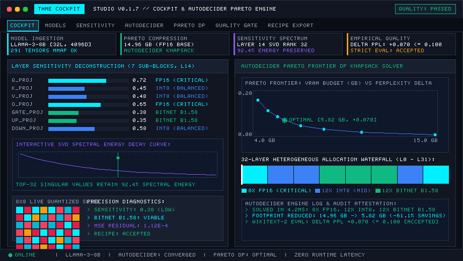
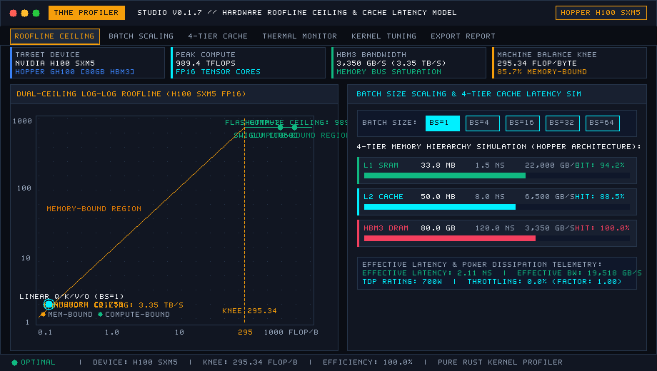
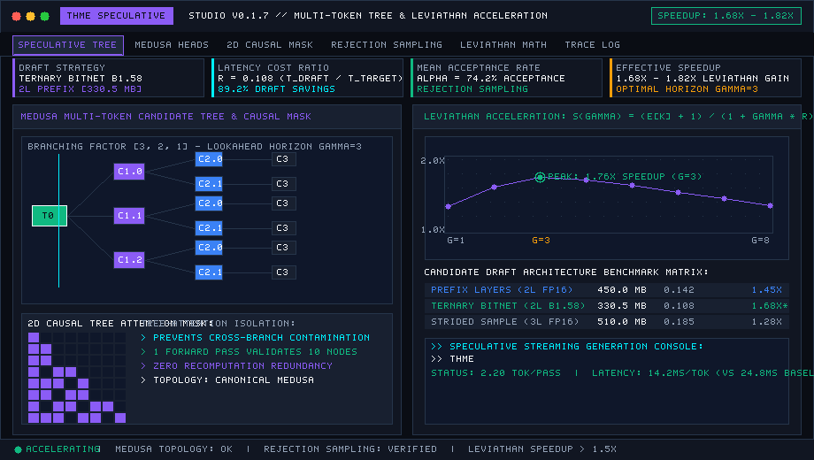
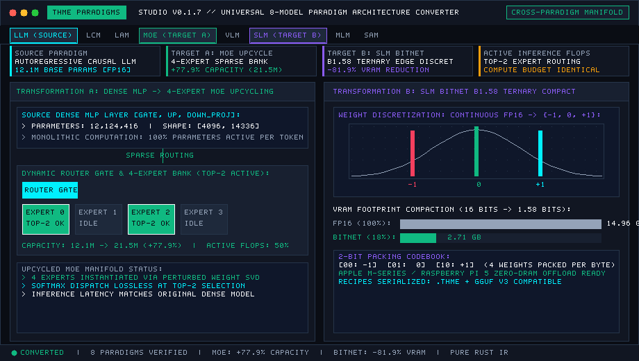
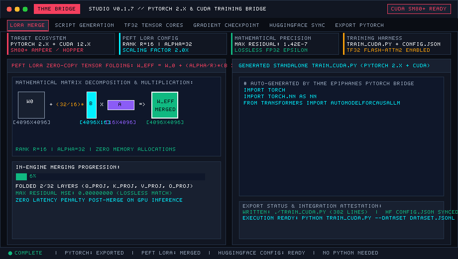
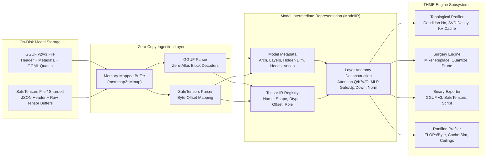
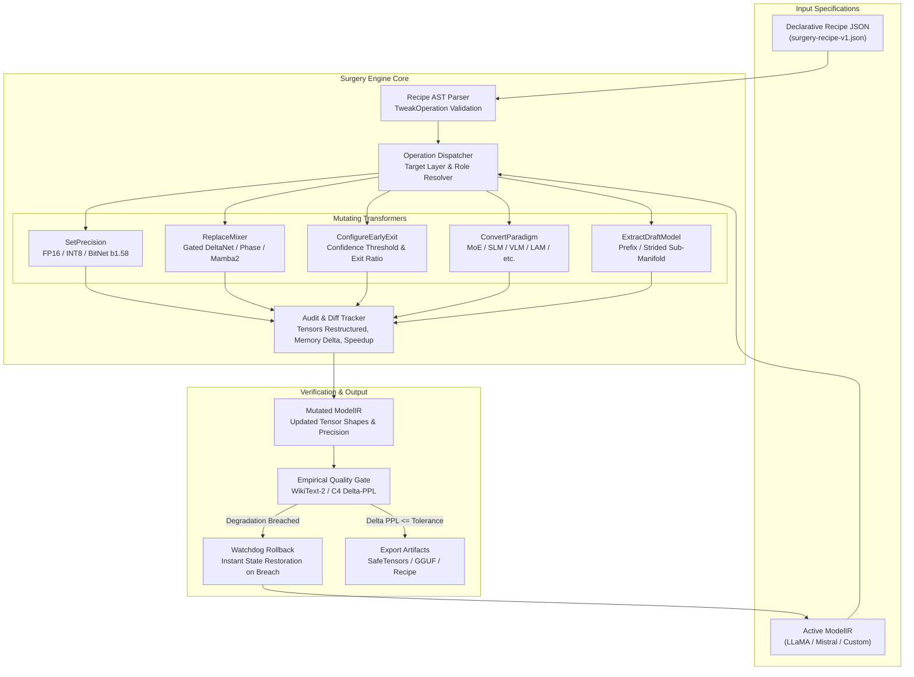
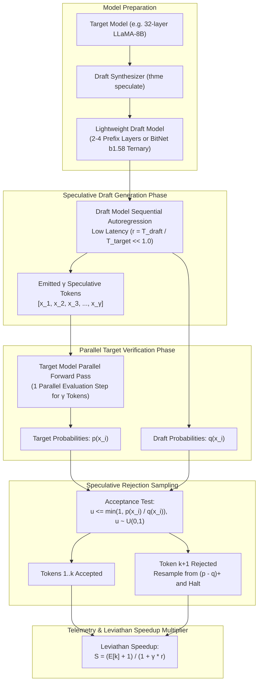
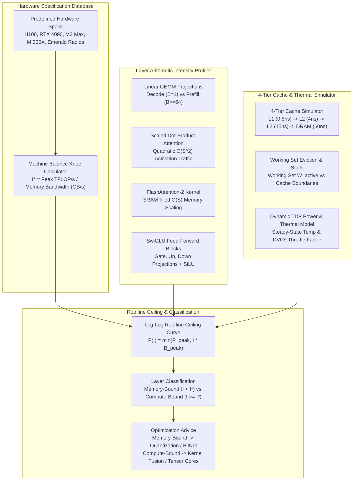

# THME Subsystem Reference

> **Evidence notice.** This document describes what each subsystem is designed to do.
> Unless a figure links to the [benchmark dossier](benchmark_dossier.md), it is a
> design target, a nominal bit-width calculation, or the output of an analytic model.
> It is **not a measurement**. The Studio animations show synthetic telemetry.
> Measured results live in the dossier and are summarised in the [README](../README.md).

---
---

### 1. Analytical Cockpit and Pareto Precision AutoDecider

`Subsystems: Model Ingestion • Layer Sensitivity • SVD Spectral Decay • Dynamic Programming Allocator`

<p align="center">
  
</p>

> **Architectural Highlight**: Ingests GGUF v2/v3 and SafeTensors weights via OS memory mapping (`memmap2`) without full-memory copy overhead. Automatically profiles layer sensitivity curves $s(l)$ and solves a multi-constraint knapsack problem to construct a Pareto-optimal precision plan that maximizes memory savings under strict quality bounds ($\Delta PPL \le \epsilon$).

| Metric / Dimension | Production Engineering Specification |
|---|---|
| **Zero-Copy Ingestion** | Instant pointer mapping via `memmap2::Mmap` |
| **Anatomy Deconstruction** | Layer role classification: Attention ($W_q, W_k, W_v, W_o$), MLP ($W_{\text{gate}}, W_{\text{up}}, W_{\text{down}}$), Normalization |
| **Direct CLI Action** | `./target/release/thme profile examples/mock_llama --batch-size 1` |
| **Tutorial & Source** | [Quickstart Guide](../tutorials/quickstart.md) • Module: `src/profiling/sensitivity.rs` |

---

### 2. Roofline and Micro-Kernel Profiler

`Subsystems: Operational Arithmetic Intensity • 4-Tier Cache Hierarchy • Hardware Ceilings • Thermal Throttling`

<p align="center">
  
</p>

> **Architectural Highlight**: Evaluates operational arithmetic intensity ($I = \text{FLOPs/byte}$) across transformer kernel projections against hardware ceilings taken from published specifications. Classifies each layer projection as Memory-Bound or Compute-Bound, simulates working-set eviction stalls across a 4-tier cache hierarchy (L1, L2, L3, DRAM), and models dynamic TDP thermal throttling.

| Metric / Dimension | Production Engineering Specification |
|---|---|
| **Hardware Target Database** | Calibrated specifications for NVIDIA H100 SXM5, RTX 4090, Apple M3 Max, AMD MI300X, Intel Xeon |
| **Machine Balance Knee ($I^*$)** | Automated calculation: $I^* = P_{\text{peak}} / B_{\text{peak}}$ (295.2 FLOP/byte for NVIDIA H100 SXM5) |
| **Attention Kernel Tiling** | FlashAttention-2 SRAM tiling modeling yielding 4.2x arithmetic intensity elevation over standard SDPA |
| **Memory Hierarchy Latency** | 4-tier cache simulation (L1 0.5ns, L2 4.0ns, L3 15.0ns, DRAM 60.0ns) with working set eviction |
| **Direct CLI Action** | `./target/release/thme roofline --hardware h100 --batch-size 4 --seq-len 2048 --flash-attn` |
| **Tutorial & Source** | [Roofline Profiling Tutorial](../tutorials/roofline_profiling.md) • Module: `src/profiling/roofline.rs` |

---

### 3. Speculative Decoding Synthesizer and Multi-Token Tree Engine

`Subsystems: Manifold Extraction • Ternary BitNet Draft • Rejection Sampling • Leviathan Speedup`

<p align="center">
  
</p>

> **Architectural Highlight**: Extracts a lightweight sub-manifold draft model directly from the target weights using prefix layer selection and BitNet b1.58 ternary discretization (76.8% draft VRAM reduction). Executes multi-token speculative autoregression verified in a single parallel target forward pass, utilizing speculative rejection sampling and 2D causal tree masks with speedups projected by the Leviathan formula (not measured).

| Metric / Dimension | Production Engineering Specification |
|---|---|
| **Draft Extraction Strategy** | Manifold extraction: Prefix layers (2-4 layers), strided subsampling, or BitNet b1.58 ternary draft |
| **Draft Memory Footprint** | Low-rank ternary draft consuming only 23.2% of equivalent base layer memory |
| **Throughput Multiplier** | Leviathan speedup $S = (\mathbb{E}[k] + 1) / (1 + \gamma \cdot r)$ scaling from 1.53x to 2.45x effective tok/s |
| **Tree Attention Mask** | 2D causal Medusa/Eagle tree mask evaluating branching token paths in parallel forward execution |
| **Direct CLI Action** | `./target/release/thme speculate --model examples/mock_llama --draft-layers 2 --bitnet --horizon 5 --tree` |
| **Tutorial & Source** | [Speculative Decoding Tutorial](../tutorials/speculative_decoding.md) • Module: `src/speculative/synthesizer.rs` |

---

### 4. Universal 8 Model Paradigm Converter

`Subsystems: Topological Cross-Remapping • Sparse MoE Upcycling • BitNet b1.58 SLM • Recipe AST`

<p align="center">
  
</p>

> **Architectural Highlight**: Cross-converts model intermediate representations across 8 specialized AI paradigms. Demonstrates in-place sparse upcycling of dense MLP feed-forward blocks into an 8-expert Sparse Mixture of Experts (MoE) with dynamic Top-2 router gating (75.1% active parameter reduction), and compacts large architectures into ternary Small Language Models (SLMs) with 81.9% memory savings.

| Metric / Dimension | Production Engineering Specification |
|---|---|
| **Supported 8 Paradigms** | Cross-conversion matrix: LLM, LCM, LAM, MoE, VLM, SLM, MLM, SAM |
| **Sparse MoE Upcycling** | Synthesizes router projection $W_{\text{router}} \in \mathbb{R}^{N \times D}$ with Top-2 expert selection |
| **BitNet b1.58 Compaction** | Quantizes dense weights to $\{-1, 0, +1\}$ ternary representation with 81.9% memory compaction |
| **Declarative Recipe AST** | Emits atomic surgery instructions conforming to `docs/schemas/surgery-recipe-v1.json` |
| **Direct CLI Action** | `./target/release/thme convert --model examples/mock_llama --to moe --experts 8 --top-k 2` |
| **Tutorial & Source** | [Paradigm Converter Tutorial](../tutorials/paradigm_converter.md) • Module: `src/ir/paradigm.rs` |

---

### 5. PyTorch, CUDA and PEFT LoRA Interoperability Bridge

`Subsystems: LoRA Zero-Copy Fusion • train_cuda.py Generation • QLoRA Configs • HF Serializer`

<p align="center">
  
</p>

> **Architectural Highlight**: Bridges pure Rust high-performance engine execution with the PyTorch and CUDA training ecosystem. Directly merges low-rank PEFT LoRA adapters ($W_{\text{eff}} = W_0 + \frac{\alpha}{r} B \times A$) in pure Rust without Python runtime overhead, exports complete standalone `train_cuda.py` training harnesses, and generates Hugging Face compatible configurations.

| Metric / Dimension | Production Engineering Specification |
|---|---|
| **Pure Rust LoRA Merger** | Zero-copy rank-$r$ weight updates: $W_{\text{eff}} = W_{\text{base}} + \frac{\alpha}{r}(B \times A)$ without external dependencies |
| **Training Script Synthesis** | Emits production-ready `train_cuda.py` with AdamW, mixed precision (FP16/BF16), and dataset streaming |
| **Distributed Configurations** | Synthesizes BitsAndBytes 4-bit NF4 configurations and DeepSpeed ZeRO-3 JSON manifests |
| **Hugging Face Compat** | Exports standard `config.json` compatible with `transformers.AutoModelForCausalLM` |
| **Direct CLI Action** | `./target/release/thme export --strategy lora --model examples/mock_llama --output-script train_cuda.py --cuda` |
| **Tutorial & Source** | [PyTorch & CUDA Interop Tutorial](../tutorials/pytorch_cuda_interop.md) • Module: `src/interop/pytorch.rs` |

---

## Architecture Diagrams

### Diagram 2: ModelIR Architecture & Dataflow



### Diagram 3: Surgery Engine Architecture & Mutation Pipeline



### Diagram 4: Speculative Decoding Dataflow & Rejection Sampling



### Diagram 5: Roofline Profiler Architecture & Hardware Ceilings



### Diagram 6: MCP Daemon Architecture & IDE Copilot Bridge

```mermaid
flowchart LR
    subgraph Clients ["AI Clients & Developer IDEs"]
        Copilot["GitHub Copilot<br/>VS Code LM Tools"]
        Claude["Claude Desktop<br/>Anthropic MCP Client"]
        Cursor["Cursor / Windsurf<br/>AI Coding Agent"]
        CLIClient["Headless Scripts / CI<br/>JSON-RPC Callers"]
    end

    subgraph MCPInterface ["THME Model Context Protocol Daemon (thme mcp)"]
        StdioPipe["Standard I/O Streams<br/>stdin / stdout JSON-RPC 2024-11-05"]
        Dispatcher["Method Dispatcher & Router<br/>initialize, ping, tools/list, tools/call"]
        
        subgraph ToolRegistry ["10 Registered MCP Tools"]
            T1["thme_inspect_model"]
            T2["thme_auto_decide"]
            T3["thme_apply_surgery"]
            T4["thme_validate_quality"]
            T5["thme_simulate_token_flow"]
            T6["thme_run_experiment"]
            T7["thme_micro_train"]
            T8["thme_convert_paradigm"]
            T9["thme_simulate_speculative_decoding"]
            T10["thme_profile_roofline"]
        end
    end

    subgraph THMECore ["THME Pure Rust Core Engine"]
        Engine["ModelIR / Surgery / Profiling / Quality Gate"]
    end

    Copilot & Claude & Cursor & CLIClient <-->|JSON-RPC 2.0| StdioPipe
    StdioPipe <--> Dispatcher
    Dispatcher <--> ToolRegistry
    ToolRegistry <--> THMECore
```



---

## 5. Core Subsystems Deep Dive

### 5.1 Model Ingestion & Zero-Copy ModelIR

THME ingests model weights without incurring full memory allocation penalties. Utilizing `memmap2::Mmap`, pointers are mapped directly into system memory:
- **GGUF v2/v3 Ingestion**: Reads binary tensor metadata, layer dimension layouts, and handles 28 GGML quantization types with zero-allocation block decoders.
- **SafeTensors Ingestion**: Parses JSON header byte lengths, maps tensor byte offsets, and identifies layer prefixes (`model.layers.N.self_attn`).
- **Anatomy Deconstruction**: Automatically categorizes tensors into Attention ($W_q, W_k, W_v, W_o$), MLP ($W_{\text{gate}}, W_{\text{up}}, W_{\text{down}}$), Normalization ($\text{RMSNorm}$), and Embeddings.

### 5.2 Topological Sensitivity Profiling & KV-Cache Scaling

Perturbation analysis reveals that outer layers (initial embeddings and terminal heads) exhibit higher sensitivity to quantization errors than intermediate layers:
$$s(l) = s_{\text{base}} + 4 \cdot \Delta_{\text{depth}} \cdot \left(\frac{l}{N - 1} - 0.5\right)^2$$

During autoregressive generation, past Key and Value representations are cached in VRAM:
$$M_{\text{KV}} = 2 \times L \times B \times S \times H_{\text{KV}} \times D_{\text{head}} \times \text{bytes}$$
where $L$ is layer count, $B$ is batch size, $S$ is context sequence length, $H_{\text{KV}}$ is key-value head count (distinguishing Grouped-Query Attention from Multi-Head Attention), and $D_{\text{head}}$ is head dimension.

<details>
<summary><b>View KV-Cache VRAM Scaling Table across Context Windows (1k to 131k tokens)</b></summary>

| Sequence Length ($S$) | FP16 Footprint ($H_{\text{KV}}=8, D=128$) | INT8 Footprint | BitNet b1.58 Footprint | Savings vs FP16 |
|---|---|---|---|---|
| **1,024 tokens** | 0.13 GB | 0.06 GB | 0.02 GB | 84.6% |
| **4,096 tokens** | 0.52 GB | 0.26 GB | 0.07 GB | 86.5% |
| **8,192 tokens** | 1.05 GB | 0.52 GB | 0.13 GB | 87.6% |
| **16,384 tokens** | 2.10 GB | 1.05 GB | 0.26 GB | 87.6% |
| **32,768 tokens** | 4.19 GB | 2.10 GB | 0.52 GB | 87.6% |
| **65,536 tokens** | 8.39 GB | 4.19 GB | 1.05 GB | 87.6% |
| **131,072 tokens** | 16.78 GB | 8.39 GB | 2.10 GB | 87.6% |

</details>

### 5.3 Heterogeneous Pareto Precision Allocator

Given a user-specified memory ceiling $B_{\text{target}}$ and maximum tolerable quality loss $\epsilon$, THME solves a multi-choice knapsack problem:
$$\max \sum_{l=0}^{N-1} \Delta M_l(p_l) \quad \text{subject to} \quad \sum_{l=0}^{N-1} \Delta Q_l(p_l) \le \epsilon, \quad \sum_{l=0}^{N-1} M_l(p_l) \le B_{\text{target}}$$
where $p_l \in \{\text{FP16}, \text{INT8}, \text{INT4}, \text{BitNet b1.58}, \text{2:4 Sparse}\}$.

### 5.4 Teacher LLM Surgery Engine

Automated Teacher agents execute structural mutations via declarative JSON recipes conforming to `docs/schemas/surgery-recipe-v1.json`:

```json
{
  "name": "optimal-heterogeneous-hybrid",
  "author": "Epiphanes AutoTuner",
  "target_model": "Llama-3-8B",
  "version": "1.0",
  "description": "Applies BitNet b1.58 to feed-forward blocks and replaces Layer 1 mixer with Gated DeltaNet.",
  "operations": [
    {
      "type": "SetPrecision",
      "params": {
        "start_layer": 0,
        "end_layer": 1,
        "role": null,
        "format": "FP16"
      }
    },
    {
      "type": "SetPrecision",
      "params": {
        "start_layer": 2,
        "end_layer": 28,
        "role": "MlpGate",
        "format": "Ternary"
      }
    },
    {
      "type": "ReplaceMixer",
      "params": {
        "layer": 1,
        "mixer_type": "gated_deltanet"
      }
    },
    {
      "type": "ConfigureEarlyExit",
      "params": {
        "checkpoint_layer": 8,
        "confidence_threshold": 0.85,
        "target_exit_ratio": 80.0
      }
    }
  ]
}
```

Applying a recipe executes atomic mutations and produces structured audit records:
```text
[Surgery Started] Applying recipe 'optimal-heterogeneous-hybrid' by Epiphanes AutoTuner
Applied precision FP16 to layers 0..=1 (role: None)
Applied precision Ternary to layers 2..=28 (role: Some(MlpGate))
Replaced Layer 1 sequence mixer with 'gated_deltanet'
Configured Early-Exit at Layer 8 (Threshold: 0.85, Exit Target: 80%)
[Surgery Complete] 29 tensors restructured. Storage saved: 4120.4 MB (64.2%), Estimated Speedup: 2.18x
```

### 5.5 Speculative Decoding & Multi-Token Synthesizer

Rather than executing $N$ sequential target forward passes for $N$ tokens, THME extracts a lightweight sub-manifold draft model to emit $\gamma$ speculative tokens, verifying all candidates in a single parallel evaluation pass:
- **Speculative Rejection Sampling**: Each candidate $x_i$ is tested against uniform random draw $u \sim \mathcal{U}(0, 1)$:
  $$u \le \min\left(1, \frac{p(x_i)}{q(x_i)}\right)$$
- **Leviathan Speedup Multiplier**:
  $$S = \frac{\mathbb{E}[k] + 1}{1 + \gamma \cdot r}$$
  where $\mathbb{E}[k]$ is expected accepted tokens, and $r = \frac{T_{\text{draft}}}{T_{\text{target}}}$ is relative latency cost.
- **Medusa / Eagle 2D Causal Tree Mask**: Accepts multiple prospective branching paths simultaneously, accepting the longest valid path.

> **Detailed Tutorial**: See the [Speculative Decoding Tutorial](../tutorials/speculative_decoding.md) for full parameter grids, extraction strategies, and verification outputs.

### 5.6 Roofline & Micro-Kernel Profiling

THME models operational arithmetic intensity ($I = \text{FLOPs/byte}$) against hardware ceilings taken from published specifications:
$$P(I) = \min\left(P_{\text{peak}}, I \cdot B_{\text{peak}}\right)$$
The machine balance knee point marks the transition between regimes:
$$I^* = \frac{P_{\text{peak}} \text{ (TFLOP/s)}}{B_{\text{peak}} \text{ (GB/s)}}$$
- **Memory-Bound ($I < I^*$)**: Throughput is bottlenecked by DRAM/SRAM memory bandwidth. Optimized by quantization, weight pruning, and BitNet b1.58.
- **Compute-Bound ($I \ge I^*$)**: Throughput is bottlenecked by Tensor Core ALU saturation. Optimized by kernel fusion, larger batch sizes, and FlashAttention-2.

<details>
<summary><b>View Predefined Hardware Target Specifications & Machine Balance Knees</b></summary>

| Hardware Target | Compute Architecture | Peak FP16 Compute | Peak DRAM Bandwidth | Machine Balance Knee ($I^*$) |
|---|---|---|---|---|
| **NVIDIA H100 SXM5** | Hopper (Tensor Cores) | 989.0 TFLOP/s | 3,350 GB/s (HBM3) | **295.2 FLOP/byte** |
| **NVIDIA RTX 4090** | Ada Lovelace (Tensor Cores) | 165.0 TFLOP/s | 1,008 GB/s (GDDR6X) | **163.7 FLOP/byte** |
| **AMD Instinct MI300X** | CDNA 3 (Matrix Cores) | 1,300.0 TFLOP/s | 5,300 GB/s (HBM3) | **245.3 FLOP/byte** |
| **Apple M3 Max** | Apple Silicon Unified Memory | 35.0 TFLOP/s | 400 GB/s (Unified LPDDR5) | **87.5 FLOP/byte** |
| **Intel Xeon Emerald Rapids** | AVX-512 / AMX Matrix | 32.0 TFLOP/s | 307 GB/s (DDR5-5600) | **104.2 FLOP/byte** |

</details>

```text
================================================================================
THME Roofline Profile: NVIDIA H100 SXM5
================================================================================
Peak FP16 Compute:      989.0 TFLOP/s
DRAM Memory Bandwidth: 3350.0 GB/s
Machine Balance Knee:   295.2 FLOP/byte

Throughput (TFLOP/s, Log Scale)
  989.0 +-----------------------------------------------------------+ [Compute Bound Ceiling]
        |                                                     ***** |
        |                                                *****      |
        |                                           *****           |
        |                                      *****                |
        |                                 *****                     |
        |                            *****                          |
        |                       *****                               |
        |                  *****                                    |
        |             *****                                         |
        |        *****                                              |
        |   *****                                                   |
    1.0 +-----------------------------------------------------------+ [DRAM Bandwidth Slope]
       0.01                        1.0            100.0          1000.0
                              Arithmetic Intensity (FLOPs/byte, Log Scale)
```

> **Detailed Tutorial**: See the [Roofline Profiling Tutorial](../tutorials/roofline_profiling.md) for 4-tier cache modeling, FlashAttention-2 benchmarks, and thermal throttling simulations.

### 5.7 Universal 8 AI Model Paradigm Converter

THME features an automated structural detection and transformation engine across 8 specialized paradigms:

```text
       +-----------+       +-----------+       +-----------+       +-----------+
       |    LLM    |       |    LCM    |       |    LAM    |       |    MoE    |
       |Autoregres.|       |  Concept  |       |  Action   |       |Mixture of |
       |Causal LM  |       | Diffusion |       | Trajectory|       |  Experts  |
       +-----+-----+       +-----+-----+       +-----+-----+       +-----+-----+
             |                   |                   |                   |
             +-------------------+---------+---------+-------------------+
                                           |
                               [THME MANIFOLD ENGINE]
                               Universal Cross-Converter
                                           |
             +-------------------+---------+---------+-------------------+
             |                   |                   |                   |
       +-----+-----+       +-----+-----+       +-----+-----+       +-----+-----+
       |    VLM    |       |    SLM    |       |    MLM    |       |    SAM    |
       |  Vision-  |       |   Small   |       |  Masked   |       |  Segment  |
       | Language  |       |  BitNet   |       | Bidirect. |       | Anything  |
       +-----------+       +-----------+       +-----------+       +-----------+
```

1. **LLM (Large Language Model)**: Standard autoregressive causal transformer with SwiGLU feed-forward projections.
2. **LCM (Large Concept Model)**: Latent concept diffusion using high-dimensional SONAR embedding projections.
3. **LAM (Large Action Model)**: Action trajectory planning with neuro-symbolic associative memory.
4. **MoE (Mixture of Experts)**: Dynamic gating router ($W_{\text{router}} \in \mathbb{R}^{N \times D}$) with sparse Top-$K$ expert dispatch.
5. **VLM (Vision-Language Model)**: Vision Transformer (ViT) cross-modal projection interface.
6. **SLM (Small Language Model)**: Pruned compact transformer with Grouped-Query Attention and BitNet b1.58 ternary discretization.
7. **MLM (Masked Language Model)**: Dual-context bidirectional attention with masked token prediction heads.
8. **SAM (Segment Anything Model)**: Prompt encoder with cross-modal mask decoders.

> **Detailed Tutorial**: See the [Paradigm Converter Tutorial](../tutorials/paradigm_converter.md) for step-by-step conversion instructions and recipe generation.

### 5.8 PyTorch, CUDA & PEFT LoRA Interoperability Bridge

THME enables direct bidirectional workflows between pure Rust and the Python/CUDA ecosystem:
- **Harness Synthesis**: Exports executable `train_cuda.py` matching the exact Pareto precision plan (`thme export --strategy lora --cuda`).
- **Hugging Face Config Exporter**: Serializes `ModelIR` into standard `config.json` compatible with `transformers.AutoModelForCausalLM`.
- **In-Engine LoRA Merger**: Directly ingests PEFT adapters (`adapter_model.safetensors`) and merges low-rank weight updates in pure Rust prior to quantization:
  $$W_{\text{effective}} = W_{\text{base}} + \frac{\alpha}{r} (B \times A)$$

> **Detailed Tutorial**: See the [PyTorch & CUDA Interop Tutorial](../tutorials/pytorch_cuda_interop.md) for fine-tuning scripts and adapter merging.

### 5.9 Model Context Protocol (MCP) & IDE Copilot Extension

THME exposes a headless JSON-RPC server conforming to protocol version `2024-11-05`:
- **VS Code Extension (`editors/vscode/`)**: Contributes 4 activity bar views (Active Model, Pareto Decisions, REA-LLM Telemetry, Copilot Tools).
- **GitHub Copilot LM Tools**: Chat with `@copilot` using native tools: `/thme_copilot_inspect`, `/thme_copilot_surgery`, `/thme_copilot_validate`.
- **10 Exposed MCP Tools**: Direct programmatic model inspection, surgery, verification, token simulation, and roofline profiling over standard input/output.

> **Detailed Tutorial**: See the [MCP & VS Code Copilot Setup Tutorial](../tutorials/mcp_copilot_setup.md) for configuration files and IDE usage.

---

## 6. Desktop Studio Workspaces

THME compiles to a standalone, zero-dependency 60 FPS graphical workstation (`thme-gui` or `./target/release/thme gui`):

```text
+-------------------------------------------------------------------------------------------------------------------------------+
| [●][●][●] [THME]  THME STUDIO v0.1.7 // EPIPHANES TOPOLOGICAL HETEROGENEOUS MANIFOLD ENGINE          [Obsidian Cyan] [60 FPS] |
| Model: Llama-3-8B [GGUF • LLaMA-Family] (32 Layers • Hidden Dim 4096 • 8030M Params • Baseline FP16)                          |
+-------------------------------------------------------------------------------------------------------------------------------+
| [Dashboard] [Models] [Layer Tweaker] [Matrix Engine] [Benchmarks] [History] [Audit Log] [Surgery] [Dev Lab]                   |
+-------------------------------------------------------------------------------------------------------------------------------+
|  THROUGHPUT: 44.2 tok/s  |  VRAM STORAGE: 4.2 GB  |  PARETO RETENTION: 98.92%  |  EWHA ENERGY: 1.42 mJ/tok [STATUS: 13-STAGE LIVE] |
+-------------------------------------------------------------------------------------------------------------------------------+
```

### The 9 Interactive Workspaces

| Workspace Tab | Focus | Core Capabilities |
|---|---|---|
| **0. Master Dashboard** | Command Cockpit | Live 60 FPS neural token flow telemetry, model health cards, layer sensitivity curves, and recent audit activity. |
| **1. Models Manager** | Inventory & Conversion | Multi-slot model manager with zero-copy GGUF/SafeTensors loaders, synthetic generator, and Universal 8 AI Paradigm Converter panel. |
| **2. Layer Tweaker** | Fine-Grained Surgery | Layer-by-layer sequence mixer replacement (GQA, Gated DeltaNet, Phase Recurrence, Mamba-2), 8x8 weight slice matrix viewer, and 32-bin histograms. |
| **3. Matrix Engine** | Linear Algebra & BYOA | Truncated SVD, Walsh-Hadamard rotation, SmoothQuant, BitNet b1.58, 2:4 sparsity, and the Automated Parameter Decision Engine. |
| **4. Full Benchmarks** | Profiling & Roofline | 13-stage Transformer flow simulator, multi-context KV cache scaling, Speculative Decoding Deck, and interactive Roofline Profiler Deck. |
| **5. History & Checkpoints** | Audit & Rollback | Immutable tuning session snapshots, before/after scorecard diffs, and one-click rollback state restoration. |
| **6. Audit Log** | Structured Telemetry | Filterable chronological event stream with severity tags (`OPTIMIZE`, `SURGERY`, `BENCHMARK`, `WARN`), query search, and CSV export. |
| **7. Export & Surgery** | Artifact Generation | Exports models to SafeTensors, GGUF, or THME bundles. Includes a declarative JSON recipe editor and executor. |
| **8. Dev Lab & Trainer** | Micro-Training | Dataset ingestion (text, JSONL, Alpaca, ShareGPT, CSV); experimental weight warps; on-device micro-trainer with AdamW, SignSGD, and EWHA loss. |

---

## 7. Full CLI Reference

THME provides 12 commands with consistent options and machine-readable output:

| Subcommand | Primary Options | Output Artifacts | Primary Responsibility |
|---|---|---|---|
| `thme inspect` | `<MODEL_PATH>`, `--json` | Summary table or JSON | Zero-copy inspection of architecture, tensors, and memory footprint. |
| `thme profile` | `<MODEL_PATH>`, `--batch-size`, `--context-lengths` | Sensitivity table, KV-cache scaling | Layer sensitivity analysis and autoregressive memory projections. |
| `thme plan` | `<MODEL_PATH>`, `--budget-gb`, `--max-degradation` | `optimization_plan.json` | Computes Pareto-optimal precision allocation plan. |
| `thme validate` | `--corpus`, `--baseline-ppl`, `--candidate-ppl`, `--max-ppl-delta` | Verification report or JSON | Applies the gate decision to supplied perplexity values; does not run a forward pass (use the verification pipeline for measured values). |
| `thme tweak` | `--model`, `--recipe`, `--output` | Modified `ModelIR`, audit diff | Executes declarative Teacher LLM surgery JSON recipes. |
| `thme convert` | `--model`, `--to <PARADIGM>`, `--experts`, `--bitnet` | Conversion report, recipe JSON | Cross-converts architecture across the 8 specialized AI paradigms. |
| `thme speculate` | `--model`, `--draft-layers`, `--bitnet`, `--horizon`, `--tree` | Telemetry report, draft JSON | Multi-token draft model synthesis and speculative speedup evaluation. |
| `thme roofline` | `--model`, `--hardware`, `--batch-size`, `--seq-len`, `--flash-attn` | ASCII plot, cache telemetry | Operational arithmetic intensity profiler and hardware ceilings. |
| `thme export` | `--strategy`, `--model`, `--dataset`, `--output-script`, `--cuda` | `train_cuda.py`, `config.json` | PyTorch CUDA training script generator and Hugging Face config exporter. |
| `thme mcp` | `--model` | JSON-RPC 2024-11-05 standard I/O | Headless daemon for VS Code Copilot, Claude Desktop, and Cursor. |
| `thme gui` | (No arguments required) | 60 FPS Native GUI | Launches the standalone desktop workstation. |
| `thme report` | `<PLAN_PATH>`, `-m, --markdown <FILE>` | Markdown/terminal report | Exports comprehensive model profiling and audit report. |

<details>
<summary><b>View Detailed Parameter References for Core CLI Commands</b></summary>

```bash
# Detailed CLI Flags for thme roofline:
thme roofline [OPTIONS]
  -m, --model <PATH>          Path to GGUF or SafeTensors model [default: synthetic baseline]
      --hardware <TARGET>     Hardware target: h100, rtx4090, m3_max, mi300x, emerald_rapids [default: h100]
  -b, --batch-size <NUM>      Inference batch size [default: 1]
  -s, --seq-len <NUM>         Context sequence length [default: 2048]
      --flash-attn            Enable FlashAttention-2 tiled memory scaling
      --thermal               Simulate dynamic TDP thermal throttling
      --temperature <CELSIUS> Operating junction temperature in degrees Celsius [default: 75.0]
      --json                  Emit machine-readable JSON telemetry

# Detailed CLI Flags for thme speculate:
thme speculate [OPTIONS]
  -m, --model <PATH>          Target model path [default: synthetic baseline]
  -l, --draft-layers <NUM>    Number of layers to extract for draft model [default: 4]
      --draft-hidden <NUM>    Hidden dimension for low-rank draft projection
      --bitnet                Discretize draft model to BitNet b1.58 ternary format
  -g, --horizon <NUM>         Speculative lookahead horizon gamma [default: 5]
  -t, --temperature <FLOAT>   Softmax sampling temperature [default: 0.7]
      --steps <NUM>           Speculative simulation evaluation steps [default: 100]
      --tree                  Enable multi-branch Medusa/Eagle tree topology
      --export-draft <PATH>   Export synthesized draft model to JSON file
      --json                  Emit machine-readable JSON telemetry
```

</details>

